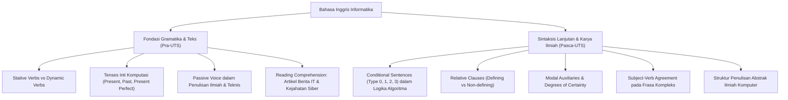

# Rangkuman Materi: Bahasa Inggris (PAIK6106 / MIK1624106)

> **Bobot:** 2 SKS | **Semester:** 1 | **Fokus Utama:** English for Academic Purposes (EAP), Technical English for Computer Science, Grammar, and Scientific Reading Comprehension

---

## 1. Catatan Integritas & Status Berkas Materi Drive
> [!IMPORTANT]
> **Transparansi Ketersediaan Berkas Materi:**
> Berdasarkan inventarisasi repositori Google Drive DMW HMIF Undip, folder `materi` untuk mata kuliah **Bahasa Inggris** hanya memuat **1 berkas suplemen**, yaitu `stative-verbs-list.pdf` (daftar kata kerja statif). Dosen pengampu tidak mengunggah bundel slide PPT pertemuan 1–14 secara lengkap ke Drive mahasiswa.
>
> Namun demikian, folder `bank_soal` memiliki **26 berkas soal asli UTS & UAS** (2018–2025) yang sangat kaya. Rangkuman ini dikonstruksi secara obyektif berdasarkan:
> 1. Dokumen silabus kurikulum resmi Informatika Undip.
> 2. Analisis pola materi gramatika dan pemahaman teks teknis yang diujikan dalam 26 paket soal UTS/UAS tersebut.

---

## 2. Gambaran Besar Mata Kuliah (*Grand View*)
Mata kuliah **Bahasa Inggris** di Informatika Undip berfokus pada penguasaan bahasa Inggris teknis dan akademik (*English for Specific Purposes - ESP / Computer Science*). Mahasiswa dipersiapkan untuk mampu membaca dokumentasi teknis (*API documentation, RFC, whitepaper*), menulis makalah ilmiah (*paper/skripsi abstract*), serta memahami terminologi komputasi mutakhir.

---

## 3. Peta Silabus & Konsep Inti Perkuliahan

### A. Bagian Pra-UTS (Gramatika Teknis Dasar & Pemahaman Bacaan)

#### 1. Stative Verbs vs Dynamic Verbs (Sesuai Materi Resmi Drive)
* **Dynamic Verbs (Action Verbs):** Menyatakan aksi fisik atau proses yang dapat berlangsung dalam bentuk kontinu (*continuous / progressive* `-ing`).
  * Contoh: *run, calculate, execute, compile, download*.
  * *"The compiler is processing the source code."* (Benar).
* **Stative Verbs (State Verbs):** Menyatakan keadaan, perasaan, persepsi, kepemilikan, atau proses mental statis yang **tidak boleh** digunakan dalam bentuk *continuous* (*-ing*).
  * Kategori Stative Verbs:
    * *Mental State:* `know`, `believe`, `understand`, `recognize`, `remember`, `doubt`.
    * *Emotion/Attitude:* `like`, `love`, `hate`, `prefer`, `need`, `want`.
    * *Possession:* `have`, `own`, `possess`, `belong`, `contain`, `consist of`.
    * *Sense/Perception:* `seem`, `appear`, `hear`, `smell`, `taste`.
  * *Contoh Kesalahan Kompre:*
    * Salah: *"The database is containing user records."*
    * Benar: *"The database contains user records."*
  * *Verba Ganda (Dual Meaning):* Beberapa kata kerja dapat bersifat dinamis atau statif tergantung konteks:
    * *Think:* *"I think this algorithm is optimal"* (Opini $\rightarrow$ Statif) vs *"The engineer is thinking about the bug"* (Proses berpikir mental aktif $\rightarrow$ Dinamis).

#### 2. Tenses Utama dalam Konteks Ilmu Komputer
* **Simple Present Tense:** Menjelaskan fakta umum arsitektur sistem, definisi algoritma, dan operasi standar.
  * Formula: $S + V_1(s/es) + O$.
  * *"A CPU fetches instructions from memory."*
* **Simple Past Tense:** Menjelaskan eksperimen yang telah dilakukan di masa lalu, metode pengujian, atau sejarah perkembangan komputasi.
  * Formula: $S + V_2 + O$.
  * *"Turing designed the concept of universal machines in 1936."*
* **Present Perfect Tense:** Menjelaskan kemajuan teknologi atau penelitian dari masa lalu yang dampaknya masih berlangsung hingga saat ini.
  * Formula: $S + \text{have/has} + V_3 + O$.
  * *"Deep learning has revolutionized computer vision in recent years."*

#### 3. Passive Voice (Kalimat Pasif) dalam Laporan Teknis
Dalam penulisan ilmiah dan spesifikasi sistem, sudut pandang objektif diutamakan dengan menonjolkan objek atau proses yang dikenai tindakan, bukan subjek pelakunya:
* Formula: $\text{Object} + \text{to be} + V_3 + (\text{by Subject})$.
* *"We encrypted the user payload"* $\rightarrow$ Lebih tepat dalam paper ilmiah: *"The user payload was encrypted using AES-256."*

---

### B. Bagian Pasca-UTS (Klausa Kompleks & Bahasa Ilmiah Akademik)

#### 1. Conditional Sentences (Kalimat Pengandaian)
Sangat erat kaitannya dengan logika percabangan `if-then-else` pada pemrograman:
* **Zero Conditional (Hukum Alam / Fakta Pasti):**
  * *If + Simple Present, Simple Present.*
  * *"If the server loses power, the volatile memory clears."*
* **First Conditional (Kemungkinan Realistis di Masa Depan):**
  * *If + Simple Present, will + $V_1$.*
  * *"If we optimize the SQL query, the latency will decrease."*
* **Second Conditional (Hipotesis / Bertolak Belakang dengan Fakta Sekarang):**
  * *If + Simple Past, would + $V_1$.*
  * *"If the algorithm had $O(1)$ complexity, it would run instantaneously."* (Faktanya tidak berorde $O(1)$).
* **Third Conditional (Penyesalan / Bertolak Belakang dengan Masa Lalu):**
  * *If + Past Perfect (had $V_3$), would have + $V_3$.*
  * *"If the administrator had applied the security patch, the system would not have been compromised."*

#### 2. Relative Clauses (Defining vs Non-Defining)
* **Defining Relative Clause:** Memberikan informasi esensial untuk mengidentifikasi objek (tanpa tanda koma).
  * *"The server that crashed yesterday has been replaced."*
* **Non-Defining Relative Clause:** Memberikan informasi tambahan pelengkap (wajib menggunakan tanda koma, tidak boleh memakai `that`).
  * *"Python, which was created by Guido van Rossum, is widely used for artificial intelligence."*

#### 3. Subject-Verb Agreement pada Frasa Teknis
Kesalahan umum yang sering diuji pada ujian Bahasa Inggris Informatika:
* Subjek yang dipisahkan oleh frasa preposisi:
  * *"The performance of the multi-core processors **is** impressive"* (Subjek inti adalah *performance* [tunggal], bukan *processors*).
* Frasa kuantitas: *A number of* (+ jamak) vs *The number of* (+ tunggal).
  * *"A number of vulnerabilities **have** been discovered."*
  * *"The number of infected machines **is** increasing."*

---

## 4. Pola Ujian & Strategi Kompre Bahasa Inggris

1. **Reading Comprehension Berita/Jurnal IT:** Ujian selalu memuat teks artikel berita tentang topik IT aktual (misal: *Cybersecurity incident, Artificial Intelligence ethics, Quantum computing, Cloud outage*).
2. **Pertanyaan Teks Standar:**
   * Menentukan gagasan pokok (*main idea of paragraph*).
   * Menemukan sinonim kata teknis berdasarkan konteks kalimat (*vocabulary in context*).
   * Menemukan rujukan kata ganti (*pronoun reference*: *what does "it" refer to?*).
3. **Analisis Error (*Error Recognition / Sentence Correction*):** Mengidentifikasi bagian kalimat bergaris bawah yang melanggar kaidah *Subject-Verb Agreement* atau *Parallel Structure*.
