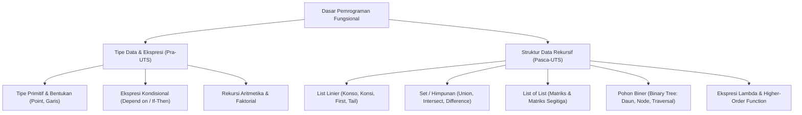

# Rangkuman Materi: Dasar Pemrograman (PAIK6102 / MIK1624102)

> **Bobot:** 3 SKS | **Semester:** 1 | **Fokus Utama:** Paradigma Pemrograman Fungsional (*Functional Programming*) & Dekomposisi Rekursif

---

## 1. Gambaran Besar Mata Kuliah (*Grand View*)
Mata kuliah **Dasar Pemrograman (Daspro)** di Informatika Universitas Diponegoro berfokus pada **Paradigma Pemrograman Fungsional**. Berbeda dengan pemrograman imperatif/prosedural (yang menekankan *state* dan perulangan `for`/`while`), pemrograman fungsional memandang komputasi sebagai evaluasi ekspresi matematis murni:
* **Tanpa Efek Samping (*No Side Effects*):** Nilai variabel tidak bermutasi (*immutable*).
* **Fungsi sebagai Warga Kelas Satu (*First-Class Citizen*):** Fungsi dapat dijadikan parameter, dikembalikan sebagai nilai, atau disimpan dalam struktur data.
* **Rekursi sebagai Pengganti Loop:** Seluruh perulangan diselesaikan melalui fungsi rekursif (memiliki **Basis** dan **Rekurens**).



---

## 2. Peta Silabus & Konsep Inti Perkuliahan

### A. Bagian Pra-UTS (Fondasi & Rekursi Dasar)
1. **Computational Thinking & Paradigma:** Dekomposisi, pengenalan pola, abstraksi, dan algoritma.
2. **Tipe Data Primitif & Operator:** `integer`, `real`, `boolean`, `character`, operator aritmetika, perbandingan, dan logika murni (`and`, `or`, `not`).
3. **Tipe Data Bentukan (*Abstract Data Type - ADT*):**
   * Konstruktor dan Selektor.
   * Contoh ADT `Point`: $P = \langle x, y \rangle$, konstruktor `MakePoint(x,y)`, selektor `Absis(P)`, `Ordinat(P)`.
   * Contoh ADT `Pecahan`: $T = \langle pemb, peny \rangle$.
4. **Ekspresi Kondisional:** Notasi kondisional matematis:
   $$f(x) = \begin{cases} a, & \text{jika } kondisi_1 \\ b, & \text{jika } kondisi_2 \\ c, & \text{lainnya} \end{cases}$$
5. **Konsep Rekursi:**
   * **Basis:** Kondisi terminasi/berhenti (agar tidak terjadi rekursi tak hingga).
   * **Rekurens:** Pemanggilan fungsi ke masalah berukuran lebih kecil.

---

### B. Bagian Pasca-UTS (List, Pohon & Struktur Kompleks)
1. **List Linier Fungsional:**
   * List kosong dilambangkan dengan `[]`.
   * **Primitif Konstruktor:**
     * `Konso(e, L)`: Menambahkan elemen `e` di **awal** list `L`.
     * `Konsi(L, e)`: Menambahkan elemen `e` di **akhir** list `L`.
   * **Primitif Selektor:**
     * `FirstElmt(L)`: Mengambil elemen pertama dari list.
     * `Tail(L)`: Mengambil sisa list setelah elemen pertama dibuang.
     * `LastElmt(L)`: Mengambil elemen terakhir.
     * `Head(L)`: Mengambil list tanpa elemen terakhir.
   * **Primitif Predikat:** `IsEmpty(L)`, `IsOneElmt(L)`.
2. **Himpunan (*Set*):** List tanpa elemen duplikat.
   * Operasi: `IsMember(x, S)`, `Union(S1, S2)`, `Intersection(S1, S2)`, `Difference(S1, S2)`.
3. **List of List (LoL):** List yang elemennya berupa list.
   * Digunakan untuk representasi matriks atau data berstruktur pohon tak teratur.
4. **Pohon Biner (*Binary Tree*):**
   * Definisi: Pohon kosong atau terdiri dari akar (*Akar*), subpohon kiri (*Left*), dan subpohon kanan (*Right*).
   * Konstruktor: `MakeTree(Akar, Left, Right)`.
   * Selektor: `Akar(P)`, `Left(P)`, `Right(P)`.
   * Predikat: `IsTreeEmpty(P)`, `IsOneElmt(P)`, `IsUnerLeft(P)`, `IsUnerRight(P)`, `IsBiner(P)`.
5. **Ekspresi Lambda & Higher-Order Functions:** Fungsi tanpa nama `lambda x: ekspresi` serta fungsi `map`, `filter`, dan `reduce/fold`.

---

## 3. Rumus & Pola Rekursif Standar (Wajib Dihafal untuk Kompre)

### Pola 1: Pemrosesan Elemen List (Panjang List - `NbElmt`)
```text
NbElmt(L):
  Basis: Jika IsEmpty(L) -> 0
  Rekurens: 1 + NbElmt(Tail(L))
```

### Pola 2: Akumulasi Penjumlahan List (`SumElmt`)
```text
SumElmt(L):
  Basis: Jika IsEmpty(L) -> 0
  Rekurens: FirstElmt(L) + SumElmt(Tail(L))
```

### Pola 3: Pencarian Nilai Maksimum (`MaxElmt`)
```text
MaxElmt(L):
  Basis: Jika IsOneElmt(L) -> FirstElmt(L)
  Rekurens: max(FirstElmt(L), MaxElmt(Tail(L)))
```

### Pola 4: Menghitung Jumlah Daun pada Pohon Biner (`NbDaun`)
```text
NbDaun(P):
  Basis 1: Jika IsTreeEmpty(P) -> 0
  Basis 2: Jika IsOneElmt(P) -> 1
  Rekurens:
    Jika IsUnerLeft(P)  -> NbDaun(Left(P))
    Jika IsUnerRight(P) -> NbDaun(Right(P))
    Jika IsBiner(P)     -> NbDaun(Left(P)) + NbDaun(Right(P))
```

---

## 4. Tip Ujian Komprehensif
1. Dosen penguji hampir selalu menanyakan: **"Apa perbedaan mendasar paradigma Fungsional dan Prosedural?"**
   * *Jawaban Kunci:* Fungsional bersifat *declarative* berbasis evaluasi fungsi murni tanpa mutasi *state* (variabel konstan), sedangkan Prosedural bersifat *imperative* berbasis langkah sekuensial dan manipulasi memori variabel.
2. Saat menulis fungsi rekursif, **selalu tulis BASIS terlebih dahulu**, baru kemudian tulis langkah REKURENS.
