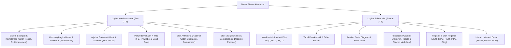

# Rangkuman Materi: Dasar Sistem (PAIK6103 / MIK1624103)

> **Bobot:** 3 SKS | **Semester:** 1 | **Fokus Utama:** Sistem Digital, Aljabar Boolean, Rangkaian Kombinasional, dan Rangkaian Sekuensial

---

## 1. Gambaran Besar Mata Kuliah (*Grand View*)
Mata kuliah **Dasar Sistem (Dasis)** meletakkan dasar pemahaman perangkat keras (*hardware*) komputer modern dari level abstraksi paling dasar: logika biner dan saklar semikonduktor. Komputer tidak memproses konsep abstrak tingkat tinggi secara langsung, melainkan mengolah sinyal tegangan diskrit ($0\text{ V} \rightarrow 0$ dan $5\text{ V} \rightarrow 1$). 

Mata kuliah ini dibagi menjadi dua paruh besar:
1. **Rangkaian Logika Kombinasional (Pra-UTS):** Output *hanya* bergantung pada kombinasi input saat itu juga (tanpa memori/tanpa umpan balik).
2. **Rangkaian Logika Sekuensial (Pasca-UTS):** Output bergantung pada kombinasi input saat ini *dan* riwayat/keadaan sebelumnya (*state*) menggunakan elemen penyimpan memori (*Flip-Flop*).

---

## 2. Peta Silabus & Konsep Inti Perkuliahan

### A. Bagian Pra-UTS (Sistem Bilangan, Aljabar Boolean & Rangkaian Kombinasional)

#### 1. Sistem Bilangan & Representasi Data
* **Basis Bilangan:**
  * Desimal (Basis 10): $0-9$
  * Biner (Basis 2): $0, 1$
  * Oktal (Basis 8): $0-7$
  * Heksadesimal (Basis 16): $0-9, \text{A}(10), \text{B}(11), \text{C}(12), \text{D}(13), \text{E}(14), \text{F}(15)$
* **Konversi Antar-Basis:**
  * Biner $\leftrightarrow$ Heksadesimal: Dikelompokkan per 4 bit biner. Contoh: $1101\,1010_2 = \text{DA}_{16}$.
  * Biner $\leftrightarrow$ Oktal: Dikelompokkan per 3 bit biner. Contoh: $101\,011_2 = 53_8$.
* **Aritmetika Bilangan Bertanda (*Signed Numbers*):**
  * **Sign-and-Magnitude:** MSB (*Most Significant Bit*) sebagai tanda ($0 = +$, $1 = -$). Kelemahan: memiliki dua representasi nol ($+0$ dan $-0$).
  * **1's Complement:** Membalik seluruh bit ($0 \rightarrow 1, 1 \rightarrow 0$). Masih memiliki $+0$ dan $-0$.
  * **2's Complement (Standar Komputer Modern):** Dihitung dengan $\text{Komplemen 1} + 1$.
    * Hanya memiliki tepat satu nilai 0.
    * Rentang untuk $n$-bit bertanda: $-2^{n-1} \text{ hingga } 2^{n-1}-1$.
    * Pengurangan $A - B$ dilakukan via penjumlahan: $A + (-B) = A + (\text{2's comp of } B)$.

#### 2. Gerbang Logika Dasar & Universal
* **Gerbang Dasar:**
  * **AND:** $Y = A \cdot B$ (Bernilai 1 jika semua input 1).
  * **OR:** $Y = A + B$ (Bernilai 1 jika minimal satu input 1).
  * **NOT (Inverter):** $Y = \overline{A}$ (Membalik logika).
* **Gerbang Universal (*Universal Gates*):**
  * **NAND:** $Y = \overline{A \cdot B}$
  * **NOR:** $Y = \overline{A + B}$
  * *Mengapa disebut Universal?* Karena kombinasi gerbang NAND saja atau NOR saja dapat mengimplementasikan seluruh operasi logika dasar (AND, OR, NOT).
* **Gerbang Khusus:**
  * **XOR (Exclusive-OR):** $Y = A \oplus B = \overline{A}B + A\overline{B}$ (Bernilai 1 jika input berbeda).
  * **XNOR (Equivalence):** $Y = \overline{A \oplus B} = AB + \overline{A}\,\overline{B}$ (Bernilai 1 jika input sama).

#### 3. Aljabar Boolean & Bentuk Standar
* **Hukum De Morgan:**
  1. $\overline{A \cdot B} = \overline{A} + \overline{B}$
  2. $\overline{A + B} = \overline{A} \cdot \overline{B}$
* **Bentuk Standar Fungsi Logika:**
  * **SOP (Sum of Products / Minterm):** Penjumlahan dari perkalian literatur, dilambangkan dengan $\Sigma m$. Contoh: $f(A,B,C) = \Sigma m(1, 3, 5)$.
  * **POS (Product of Sums / Maxterm):** Perkalian dari penjumlahan literatur, dilambangkan dengan $\Pi M$. Contoh: $f(A,B,C) = \Pi M(0, 2, 4, 6, 7)$.
  * Hubungan: $\Sigma m = \Pi (\text{komplemen indeks})$.

#### 4. Penyederhanaan dengan Karnaugh Map (K-Map)
* Mengatur minterm dalam kisi kode Gray (hanya 1 bit berubah antar sel bertetangga).
* Aturan Pengelompokan (*Grouping*):
  1. Ukuran kelompok harus kelipatan $2^k$ (1, 2, 4, 8, 16 sel).
  2. Kelompok dapat menggulung (*wrap-around*) di tepi ujung matriks.
  3. Utamakan mencari *Essential Prime Implicants* (kelompok yang mencakup '1' yang tidak dicakup kelompok lain).
* **Kondisi Don't Care ($d$ atau $X$):**
  * Nilai output yang tidak mungkin terjadi atau tidak dipedulikan. Dapat dianggap sebagai '1' jika membantu memperbesar kelompok, atau diabaikan sebagai '0' jika tidak membantu.

#### 5. Rangkaian Kombinasional Standar (MSI)
* **Half Adder (HA):** Menjumlahkan 2 bit input ($A, B$).
  $$\text{Sum} = A \oplus B, \quad \text{Carry} = A \cdot B$$
* **Full Adder (FA):** Menjumlahkan 3 bit input ($A, B, C_{in}$).
  $$\text{Sum} = A \oplus B \oplus C_{in}, \quad C_{out} = AB + C_{in}(A \oplus B)$$
* **Magnitude Comparator:** Membandingkan dua bilangan biner $A$ dan $B$, menghasilkan tiga output: $A > B$, $A = B$, dan $A < B$.
* **Decoder:** Mengubah kode biner $n$-bit input menjadi maksimal $2^n$ jalur output unik (biasanya aktif *low*). Contoh Decoder 3-ke-8 ($74138$).
* **Encoder & Priority Encoder:** Mengubah $2^n$ input menjadi kode biner $n$-bit. Pada *Priority Encoder*, jika ada $>1$ input aktif, input dengan prioritas tertinggi yang dikodekan.
* **Multiplexer (MUX):** Pemilih data (*data selector*). Memiliki $2^n$ input data, $n$ pin pemilih (*select lines*), dan 1 output.
  * MUX dapat mengimplementasikan sembarang tabel kebenaran fungsi Boolean tanpa gerbang logika tambahan.

---

### B. Bagian Pasca-UTS (Rangkaian Sekuensial, Counter, Register & Memori)

#### 1. Elemen Memori & Flip-Flop
* **SR Latch:** Dibangun dari pasangan gerbang NAND bersilang (*active low*) atau NOR (*active high*).
  * Masalah: Kondisi $S=1, R=1$ pada NOR (atau $0,0$ pada NAND) adalah kondisi terlarang (*forbidden state / race condition*).
* **D Flip-Flop (Data):** Menghilangkan kondisi terlarang SR. $Q_{next} = D$. Mentransfer nilai input $D$ ke output $Q$ saat pemicuan pulsa clock.
* **JK Flip-Flop:** Flip-flop universal.
  * $J=0, K=0 \rightarrow$ *No Change* (Hold)
  * $J=0, K=1 \rightarrow$ *Reset* ($Q=0$)
  * $J=1, K=0 \rightarrow$ *Set* ($Q=1$)
  * $J=1, K=1 \rightarrow$ *Toggle* ($Q_{next} = \overline{Q}$)
* **T Flip-Flop (Toggle):** Dibuat dari JK FF dengan menggabungkan input $J$ dan $K$ ($J=K=T$).
  * $T=0 \rightarrow$ *Hold*, $T=1 \rightarrow$ *Toggle*. Sangat penting untuk perancangan counter.
* **Mekanisme Pemicuan Clock:**
  * *Level-triggered* (Latch) vs *Edge-triggered* (Flip-Flop: pemicuan tepi naik $\uparrow$ atau tepi turun $\downarrow$).
  * *Master-Slave Flip-Flop* digunakan untuk mencegah osilasi saat transisi clock.

#### 2. Tabel Eksitasi Flip-Flop (Kunci Desain Kompre!)
Tabel eksitasi menunjukkan input apa yang harus diberikan jika kita menginginkan transisi state dari $Q_t \rightarrow Q_{t+1}$:

| Transisi ($Q_t \rightarrow Q_{t+1}$) | S | R | D | J | K | T |
|:---:|:---:|:---:|:---:|:---:|:---:|:---:|
| $0 \rightarrow 0$ | 0 | X | 0 | 0 | X | 0 |
| $0 \rightarrow 1$ | 1 | 0 | 1 | 1 | X | 1 |
| $1 \rightarrow 0$ | 0 | 1 | 0 | X | 1 | 1 |
| $1 \rightarrow 1$ | X | 0 | 1 | X | 0 | 0 |

*(Keterangan: X = Don't Care)*

#### 3. Prosedur Desain Rangkaian Sekuensial Sinkron
1. Gambar **State Diagram** (lingkaran = state, panah = input/output transisi).
2. Turunkan **State Table** (Present State, Input, Next State, Output).
3. Lakukan **State Reduction** jika terdapat status ekuivalen.
4. Lakukan **State Assignment** (memberikan representasi biner pada state, misal $S_0=00, S_1=01, \dots$).
5. Tentukan jenis Flip-Flop yang digunakan (D, JK, atau T).
6. Petakan transisi state ke **Tabel Eksitasi** Flip-Flop.
7. Sederhanakan fungsi input Flip-Flop menggunakan **K-Map**.
8. Gambar diagram skema rangkaian logika.

#### 4. Pencacah (Counter)
* **Asynchronous Counter (Ripple Counter):** Output clock Flip-Flop berikutnya dipicu oleh output ($Q$ atau $\overline{Q}$) Flip-Flop sebelumnya.
  * Kelebihan: Rangkaian sederhana.
  * Kelemahan: *Propagation delay* terakumulasi antar flip-flop sehingga frekuensi kerja terbatas.
* **Synchronous Counter:** Semua Flip-Flop mendapatkan sinyal pulsa clock secara serentak dari sumber yang sama.
* **Counter Modulo-N (Truncated Counter):** Menghitung hingga $N$ status lalu reset kembali ke awal menggunakan gerbang reset asinkron (misal memanfaatkan pin `CLR` aktif-rendah melalui gerbang NAND). Contoh: BCD Counter (Modulo-10, menghitung $0000_2$ s.d. $1001_2$).

#### 5. Register & Shift Register
* **Register:** Kumpulan Flip-Flop yang digunakan untuk menyimpan kata data multi-bit secara paralel.
* **Shift Register:** Register yang mampu menggeser data satu posisi bit ke kiri atau ke kanan setiap siklus clock.
  * **SISO:** *Serial-In Serial-Out* (Hemat jalur kabel, lambat).
  * **SIPO:** *Serial-In Parallel-Out* (Konversi serial ke paralel).
  * **PISO:** *Parallel-In Serial-Out* (Konversi paralel ke serial).
  * **PIPO:** *Parallel-In Parallel-Out* (Transfer kecepatan tinggi).
* **Special Counters dari Shift Register:**
  * **Ring Counter:** Shift register dengan output FF terakhir dihubungkan kembali ke input FF pertama. Memiliki $N$ state untuk $N$ flip-flop.
  * **Johnson Counter (Twisted Ring Counter):** Output $\overline{Q}$ FF terakhir dihubungkan kembali ke input FF pertama. Memiliki $2N$ state untuk $N$ flip-flop.

#### 6. Dasar Memori & Penyimpanan Digital
* **SRAM (Static RAM):** Menggunakan flip-flop 6-transistor (6T). Cepat, tidak memerlukan rangkaian refresh, mahal, konsumsi daya lebih tinggi. Digunakan untuk Cache CPU.
* **DRAM (Dynamic RAM):** Menggunakan 1 transistor dan 1 kapasitor (1T-1C). Membutuhkan *refresh cycle* berkala karena muatan kapasitor bocor. Kepadatan tinggi, murah. Digunakan untuk Memori Utama (RAM PC).
* **ROM (Read-Only Memory):** Non-volatile. PROM (diprogram sekali), EPROM (dihapus sinar UV), EEPROM & Flash Memory (dihapus secara elektrik per blok).

---

## 3. Rumus & Konsep Kunci Wajib Hafal untuk Kompre

1. **Jumlah Sel K-Map:** Untuk $n$ variabel input, jumlah sel $= 2^n$.
2. **Karakteristik Persamaan State Flip-Flop:**
   * D Flip-Flop: $Q_{next} = D$
   * JK Flip-Flop: $Q_{next} = J\overline{Q} + \overline{K}Q$
   * T Flip-Flop: $Q_{next} = T \oplus Q = T\overline{Q} + \overline{T}Q$
3. **Jumlah Flip-Flop untuk Counter Modulo-$N$:**
   $$2^{k-1} < N \le 2^k$$
   *(di mana $k$ adalah jumlah minimum Flip-Flop yang dibutuhkan).*
4. **Kapasitas Memori:**
   $$\text{Kapasitas} = 2^{\text{Address Lines}} \times \text{Data Bits per Word}$$
   Contoh: Memori dengan 16 jalur alamat dan 8 jalur data $= 2^{16} \times 8\text{ bit} = 64\text{ KB}$.
