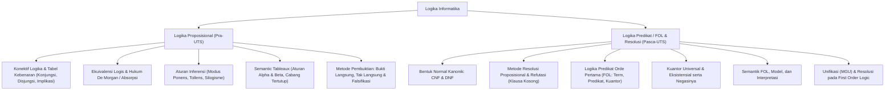

# Rangkuman Materi: Logika Informatika (PAIK6105 / MIK1624105)

> **Bobot:** 3 SKS | **Semester:** 1 | **Fokus Utama:** Logika Proposisional, Aturan Inferensi, Semantic Tableaux, Bentuk Normal (CNF/DNF), Resolusi, dan Logika Predikat Orde Pertama (*First-Order Logic*)

---

## 1. Gambaran Besar Mata Kuliah (*Grand View*)
Mata kuliah **Logika Informatika (Logif)** adalah studi tentang penalaran valid (*valid reasoning*), inferensi formal, dan pembuktian matematis yang menjadi dasar pemodelan sistem komputasi cerdas. Dalam ilmu komputer, logika bukan sekadar filsafat, melainkan bahasa komputasi matematis:
* **Kecerdasan Buatan & Sistem Pakar:** Representasi pengetahuan (*Knowledge Representation*) dan *Inference Engine* (Backward & Forward Chaining).
* **Verifikasi Perangkat Lunak:** Pembuktian kebenaran program (*Formal Methods*, Hoare Logic).
* **Pemrograman Logika:** Bahasa pemrograman deklaratif seperti **Prolog** yang langsung mengeksekusi *Horn Clauses* dan Algoritma Resolusi.
* **Basis Data Relasional:** Aljabar relasional dan kalkulus relasional diturunkan langsung dari kalkulus predikat orde pertama.

---

## 2. Peta Silabus & Konsep Inti Perkuliahan

### A. Bagian Pra-UTS (Logika Proposisional, Aturan Inferensi & Semantic Tableaux)

#### 1. Proposisi & Operator Logika
* **Definisi Proposisi:** Pernyataan deklaratif yang bernilai Benar (*True* / $T$) atau Salah (*False* / $F$), tetapi tidak keduanya sekaligus.
* **Konektif Logika Standar:**
  * Negasi ($\neg p$ atau $\sim p$): Membalik nilai kebenaran.
  * Konjungsi ($p \land q$): Benar jika dan hanya jika keduanya benar.
  * Disjungsi ($p \lor q$): Salah jika dan hanya jika keduanya salah.
  * Implikasi ($p \to q$): Bernilai Salah **hanya ketika** Anteseden ($p$) Benar dan Konsekuen ($q$) Salah ($T \to F \equiv F$).
  * Biimplikasi ($p \leftrightarrow q$): Benar jika nilai kebenaran $p$ dan $q$ sama.
* **Varian Implikasi dari $p \to q$:**
  * Konvers (*Converse*): $q \to p$
  * Invers (*Inverse*): $\neg p \to \neg q$
  * Kontraposisi (*Contrapositive*): $\neg q \to \neg p$ (*Ekuivalen secara logis dengan implikasi awal!*)
* **Klasifikasi Formula Kalimat:**
  * **Tautologi:** Selalu bernilai $T$ untuk semua kemungkinan interpretasi nilai kebenaran.
  * **Kontradiksi:** Selalu bernilai $F$ untuk semua kemungkinan interpretasi.
  * **Kontingensi:** Memiliki kombinasi $T$ dan $F$.

#### 2. Aturan Ekuivalensi Logis Penting
* Hukum Implikasi: $p \to q \equiv \neg p \lor q$
* Hukum De Morgan: $\neg(p \land q) \equiv \neg p \lor \neg q$, $\quad \neg(p \lor q) \equiv \neg p \land \neg q$
* Hukum Kontraposisi: $p \to q \equiv \neg q \to \neg p$
* Hukum Absorpsi: $p \lor (p \land q) \equiv p$, $\quad p \land (p \lor q) \equiv p$
* Hukum Biimplikasi: $p \leftrightarrow q \equiv (p \to q) \land (q \to p) \equiv (\neg p \lor q) \land (\neg q \lor p)$

#### 3. Aturan Inferensi Deduktif (Rules of Inference)
Argumen dengan premis $P_1, P_2, \dots, P_k$ dan konklusi $Q$ valid jika $(P_1 \land P_2 \land \dots \land P_k) \to Q$ merupakan Tautologi ($P_1, \dots, P_k \models Q$).
* **Modus Ponens (MP):** $p \to q, \; p \implies q$
* **Modus Tollens (MT):** $p \to q, \; \neg q \implies \neg p$
* **Silogisme Hipotetis (HS):** $p \to q, \; q \to r \implies p \to r$
* **Silogisme Disjungtif (DS):** $p \lor q, \; \neg p \implies q$
* **Resolusi Proposisional:** $p \lor q, \; \neg p \lor r \implies q \lor r$
* **Simplifikasi:** $p \land q \implies p$
* **Adisi:** $p \implies p \lor q$

#### 4. Semantic Tableaux (Pohon Semantik)
Metode pembuktian sistematis menggunakan pohon semantik (*tree decomposition*):
* **Aturan $\alpha$ (Non-percabangan / Konjungtif):**
  * $\neg \neg A \implies A$
  * $A \land B \implies A$ dan $B$ ditulis vertikal ke bawah pada cabang yang sama.
  * $\neg(A \lor B) \implies \neg A$ dan $\neg B$ vertikal.
  * $\neg(A \to B) \implies A$ dan $\neg B$ vertikal.
* **Aturan $\beta$ (Percabangan / Disjungtif):**
  * $A \lor B \implies$ bercabang ke kiri ($A$) dan ke kanan ($B$).
  * $A \to B \implies$ bercabang ke kiri ($\neg A$) dan ke kanan ($B$).
  * $\neg(A \land B) \implies$ bercabang ke kiri ($\neg A$) dan ke kanan ($\neg B$).
* **Penutupan Cabang (*Closed Branch*):** Suatu cabang ditutup (diberi tanda $\times$) jika terdapat literal dan negasinya sekaligus ($P$ dan $\neg P$) pada jalur tersebut.
* **Validitas Argumen via Tableaux:** Masukkan seluruh Premis dan **Negasi dari Konklusi** ke akar pohon. Jika **seluruh cabang tertutup ($\times$)**, maka argumen **VALID** (*bukti kontradiksi*).

---

### B. Bagian Pasca-UTS (Bentuk Normal, Resolusi & First-Order Logic)

#### 1. Bentuk Normal (CNF & DNF)
* **Literal:** Variabel atomik ($p$) atau negasinya ($\neg p$).
* **CNF (*Conjunctive Normal Form*):** Konjungsi dari disjungsi-disjungsi (*Product of Sums*). Contoh: $(A \lor \neg B) \land (C \lor D)$.
  * Format wajib untuk algoritma *Resolution Refutation* dan SAT-Solver (DPLL).
* **DNF (*Disjunctive Normal Form*):** Disjungsi dari konjungsi-konjungsi (*Sum of Products*). Contoh: $(A \land \neg B) \lor (C \land D)$.
* **Prosedur Konversi ke CNF:**
  1. Hilangkan $\leftrightarrow$ menjadi implikasi ganda.
  2. Hilangkan $\to$ menggunakan ekuivalensi $A \to B \equiv \neg A \lor B$.
  3. Dorong negasi $\neg$ ke dalam hingga berada tepat di depan variabel literal (Hukum De Morgan dan Eliminasi Negasi Ganda).
  4. Terapkan hukum distributif $\lor$ terhadap $\land$ secara berulang: $A \lor (B \land C) \equiv (A \lor B) \land (A \lor C)$.

#### 2. Metode Resolusi & Refutasi (*Resolution Refutation*)
* Representasi Klausa: Setiap klausul dalam CNF ditulis sebagai himpunan literal. Misal $(A \lor \neg B \lor C)$ ditulis $\{A, \neg B, C\}$.
* **Aturan Resolusi:** Dari dua klausa yang memiliki pasangan komplementer:
  $$C_1 = \{L\} \cup R_1, \quad C_2 = \{\neg L\} \cup R_2 \implies \text{Resolvent } R = R_1 \cup R_2$$
* **Algoritma Refutasi:**
  1. Masukkan semua klausa premis.
  2. Masukkan negasi konklusi yang telah diubah ke bentuk klausa.
  3. Lakukan resolusi berulang antar-klausa hingga menghasilkan **Klausa Kosong ($\square$ atau $\emptyset$)**.
  4. Dihasilkannya klausa kosong membuktikan kontradiksi, sehingga argumen awal **VALID**.

#### 3. Logika Predikat Orde Pertama (*First-Order Logic - FOL*)
Logika Proposisional memiliki kelemahan: tidak dapat menyatakan hubungan antar-objek atau kuantifikasi umum (seperti *"semua manusia fana"*). FOL memperluas proposisi dengan:
* **Konstanta:** Menunjuk objek spesifik (misal `budi`, `indonesia`, `2`).
* **Variabel:** Menggantikan sembarang objek dalam domain (misal $x, y, z$).
* **Fungsi:** Memetakan objek ke objek lain (misal `ayah(budi)`).
* **Predikat:** Menyatakan properti atau relasi antar-objek yang bernilai $T/F$ (misal `Mahasiswa(x)`, `Berteman(x, y)`).
* **Kuantor:**
  * **Kuantor Universal ($\forall x$):** *"Untuk setiap $x$"* atau *"semua $x$"*.
    * Pola umum: $\forall x (P(x) \to Q(x))$ (*Semua $P$ adalah $Q$*).
  * **Kuantor Eksistensial ($\exists x$):** *"Terdapat sekurang-kurangnya satu $x$"* atau *"ada $x$"*.
    * Pola umum: $\exists x (P(x) \land Q(x))$ (*Ada sebagian $P$ yang merupakan $Q$*).

#### 4. Aturan Semantik & Ekuivalensi FOL
* **Hukum Negasi Kuantor (De Morgan untuk Kuantor):**
  $$\neg (\forall x P(x)) \equiv \exists x \neg P(x)$$
  $$\neg (\exists x P(x)) \equiv \forall x \neg P(x)$$
* **Distribusi Kuantor:**
  * $\forall x (P(x) \land Q(x)) \equiv (\forall x P(x)) \land (\forall x Q(x))$
  * $\exists x (P(x) \lor Q(x)) \equiv (\exists x P(x)) \lor (\exists x Q(x))$
  * *(Hati-hati: $\forall x (P(x) \lor Q(x)) \not\equiv (\forall x P(x)) \lor (\forall x Q(x))$!)*

#### 5. Unifikasi & Resolusi FOL
* **Skolemisasi (*Skolemization*):** Menghilangkan kuantor eksistensial ($\exists$) dengan menggantinya dengan konstanta Skolem (jika tidak berada di dalam lingkup $\forall$) atau fungsi Skolem (jika berada di dalam lingkup $\forall x$).
  * Contoh: $\forall x \exists y \text{Ibu}(y, x) \implies \forall x \text{Ibu}(f(x), x)$.
* **Unifikasi:** Proses mencari substitusi variabel $\theta$ yang membuat dua ekspresi predikat identik ($P \theta = Q \theta$).
* **MGU (*Most General Unifier*):** Substitusi unifikasi paling umum dan minimal.

---

## 3. Rumus & Jebakan Kunci Ujian Komprehensif

1. **Jebakan Implikasi:** Pernyataan $p \to q$ selalu bernilai **Benar** setiap kali $p$ bernilai Salah, terlepas dari nilai $q$.
2. **Jebakan Kuantor & Implikasi:**
   * *"Semua mahasiswa rajin"* $\rightarrow$ Wajib ditulis $\forall x (\text{Mhs}(x) \to \text{Rajin}(x))$.
   * Jika ditulis $\forall x (\text{Mhs}(x) \land \text{Rajin}(x))$, maknanya menjadi keliru: *"Semua entitas di alam semesta adalah mahasiswa dan mereka rajin"*.
3. **Jebakan Resolusi Refutasi:** Jangan lupa **menegasikan konklusi** sebelum mengubahnya menjadi klausa CNF.
