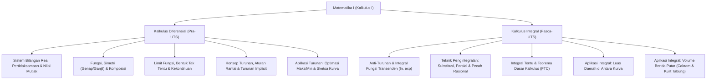

# Rangkuman Materi: Matematika I (Kalkulus I) (PAIK6101 / MIK1624101)

> **Bobot:** 3 SKS | **Semester:** 1 | **Fokus Utama:** Sistem Bilangan Real, Fungsi, Limit, Turunan (Diferensial), dan Aplikasi Integral Tentu

---

## 1. Gambaran Besar Mata Kuliah (*Grand View*)
Mata kuliah **Matematika I (Kalkulus Diferensial dan Integral I)** di Informatika Universitas Diponegoro memberikan fondasi analisis matematis kontinu. Dalam komputasi modern, kalkulus memegang peranan krusial pada:
* **Machine Learning & Deep Learning:** Optimasi fungsi kerugian (*loss function*) via *Gradient Descent* dan *Backpropagation* (didasarkan pada turunan rantai / *chain rule*).
* **Grafika Komputer & Animasi:** Perhitungan laju perubahan posisi/kecepatan, kurva Bézier, dan interpolasi gerak fisik.
* **Analisis Kompleksitas & Metode Numerik:** Perilaku asimtotik limit fungsi, integral hampiran (aturan Trapezoida/Simpson), dan aproksimasi deret Taylor.

---

## 2. Peta Silabus & Konsep Inti Perkuliahan

### A. Bagian Pra-UTS (Pertidaksamaan, Limit, Turunan & Aplikasinya)

#### 1. Bilangan Real, Pertidaksamaan & Nilai Mutlak
* **Sifat Nilai Mutlak:**
  $$|x| < a \iff -a < x < a \quad (a > 0)$$
  $$|x| > a \iff x < -a \quad \text{atau} \quad x > a$$
* **Pertidaksamaan Pecahan / Rasional:**
  * Pindahkan semua suku ke ruas kiri sehingga ruas kanan menjadi 0: $\frac{P(x)}{Q(x)} \le 0$.
  * Tentukan titik pembuat nol pembilang dan penyebut (penyebut $Q(x) \ne 0$).
  * Uji tanda pada garis bilangan untuk menentukan himpunan penyelesaian.

#### 2. Fungsi & Karakteristiknya
* **Daerah Asal (*Domain*) & Daerah Hasil (*Range*):**
  * Bentuk akar $\sqrt{g(x)} \implies g(x) \ge 0$.
  * Bentuk pecahan $\frac{f(x)}{g(x)} \implies g(x) \ne 0$.
* **Simetri Fungsi:**
  * **Fungsi Genap:** $f(-x) = f(x)$ (Simetris terhadap sumbu-$Y$). Contoh: $x^2, \cos x, |x|$.
  * **Fungsi Ganjil:** $f(-x) = -f(x)$ (Simetris terhadap titik asal $(0,0)$). Contoh: $x^3, \sin x$.

#### 3. Limit Fungsi & Kekontinuan
* **Limit Sepihak:** $\lim_{x \to c} f(x) = L \iff \lim_{x \to c^-} f(x) = \lim_{x \to c^+} f(x) = L$.
* **Limit Trigonometri Khusus:**
  $$\lim_{x \to 0} \frac{\sin x}{x} = 1, \quad \lim_{x \to 0} \frac{\tan x}{x} = 1, \quad \lim_{x \to 0} \frac{1 - \cos x}{x} = 0$$
* **Syarat Kekontinuan Fungsi di Titik $x = c$ (3 Syarat Mutlak):**
  1. $f(c)$ terdefinisi (ada nilainya).
  2. $\lim_{x \to c} f(x)$ ada.
  3. $\lim_{x \to c} f(x) = f(c)$.
* **Aturan L'Hôpital:** Untuk bentuk tak tentu $\left[\frac{0}{0}\right]$ atau $\left[\frac{\infty}{\infty}\right]$:
  $$\lim_{x \to c} \frac{f(x)}{g(x)} = \lim_{x \to c} \frac{f'(x)}{g'(x)}$$

#### 4. Turunan (Diferensial)
* **Definisi Formal:**
  $$f'(x) = \lim_{h \to 0} \frac{f(x+h) - f(x)}{h}$$
* **Aturan-Aturan Dasar Turunan:**
  * Perkalian: $(uv)' = u'v + uv'$
  * Pembagian: $\left(\frac{u}{v}\right)' = \frac{u'v - uv'}{v^2}$
  * Aturan Rantai (*Chain Rule*): $\frac{dy}{dx} = \frac{dy}{du} \cdot \frac{du}{dx}$
* **Turunan Implisit:** Menurunkan kedua ruas persamaan yang memuat $x$ dan $y$ terhadap $x$, memperlakukan $y$ sebagai fungsi dari $x$ (setiap menurunkan suku $y$, kalikan dengan $\frac{dy}{dx}$).

#### 5. Aplikasi Turunan
* **Kemonotonan:**
  * $f'(x) > 0 \implies$ fungsi naik.
  * $f'(x) < 0 \implies$ fungsi turun.
* **Kecekungan & Titik Belok:**
  * $f''(x) > 0 \implies$ cekung ke atas (*concave up* $\cup$).
  * $f''(x) < 0 \implies$ cekung ke bawah (*concave down* $\cap$).
  * Titik belok terjadi saat $f''(x) = 0$ dan terjadi perubahan tanda kecekungan.
* **Masalah Optimasi Ekstrem:**
  * Cari fungsi objektif 1 variabel.
  * Cari titik kritis dari $f'(x) = 0$ atau titik batas.
  * Uji dengan turunan kedua: $f''(c) < 0 \implies$ Maksimum lokal, $f''(c) > 0 \implies$ Minimum lokal.

---

### B. Bagian Pasca-UTS (Integral, Teknik Pengintegralan & Aplikasinya)

#### 1. Integral Fungsi Transenden & Aljabar Dasar
* $\int x^n \, dx = \frac{1}{n+1} x^{n+1} + C \quad (n \ne -1)$
* $\int \frac{1}{x} \, dx = \ln|x| + C$
* $\int e^x \, dx = e^x + C, \quad \int a^x \, dx = \frac{a^x}{\ln a} + C$
* $\int \sin x \, dx = -\cos x + C, \quad \int \cos x \, dx = \sin x + C$
* $\int \frac{1}{1 + x^2} \, dx = \arctan(x) + C, \quad \int \frac{1}{\sqrt{1 - x^2}} \, dx = \arcsin(x) + C$

#### 2. Teknik Pengintegralan
* **Metode Substitusi:** Digunakan saat integran memuat fungsi dan turunannya:
  $$\int f(g(x)) g'(x) \, dx = \int f(u) \, du \quad (u = g(x))$$
* **Pengintegralan Parsial (*Integration by Parts*):**
  $$\int u \, dv = u \cdot v - \int v \, du$$
  *Prioritas pemilihan $u$ (LIATE):* **L**ogarithmic, **I**nverse Trig, **A**lgebraic, **T**rigonometric, **E**xponential.
* **Pengintegralan Pecahan Rasional (Dekomposisi Parsial):**
  $$\frac{P(x)}{Q(x)} = \frac{A}{ax + b} + \frac{B}{(ax + b)^2} + \frac{Cx + D}{ax^2 + bx + c}$$
* **Substitusi Trigonometri:**
  * Bentuk $\sqrt{a^2 - x^2} \implies \text{gunakan } x = a \sin \theta$
  * Bentuk $\sqrt{a^2 + x^2} \implies \text{gunakan } x = a \tan \theta$
  * Bentuk $\sqrt{x^2 - a^2} \implies \text{gunakan } x = a \sec \theta$

#### 3. Integral Tentu & Teorema Dasar Kalkulus (FTC)
* **FTC Bagian 1:** $\frac{d}{dx} \left[ \int_a^x f(t) \, dt \right] = f(x)$
* **FTC Bagian 2 (Evaluasi):**
  $$\int_a^b f(x) \, dx = F(b) - F(a) \quad (\text{di mana } F'(x) = f(x))$$

#### 4. Aplikasi Integral Tentu
* **Luas Daerah di Antara Dua Kurva:**
  $$L = \int_a^b \big( y_{\text{atas}} - y_{\text{bawah}} \big) \, dx \quad \text{atau} \quad L = \int_c^d \big( x_{\text{kanan}} - x_{\text{kiri}} \big) \, dy$$
* **Volume Benda Putar:**
  * **Metode Cakram / Cincin (Sumbu Putar Sejajar Sumbu Integrasi):**
    $$V = \pi \int_a^b \Big( [R(x)]^2 - [r(x)]^2 \Big) \, dx$$
  * **Metode Kulit Tabung / Cylindrical Shells (Sumbu Putar Tegak Lurus Sumbu Integrasi):**
    $$V = 2\pi \int_a^b (\text{radius}) \cdot (\text{tinggi}) \, dx = 2\pi \int_a^b x \cdot f(x) \, dx$$

---

## 3. Rumus Cepat & Jebakan Ujian (Wajib Diingat untuk Kompre)

1. **Jebakan Turunan Implisit:** Jangan lupa mengalikan $\frac{dy}{dx}$ saat menurunkan suku yang mengandung $y$. Misal $\frac{d}{dx}(y^3) = 3y^2 \frac{dy}{dx}$.
2. **Jebakan Pembuat Nol Penyebut:** Pada pertidaksamaan rasional $\frac{x-1}{x+2} \le 0$, titik $x = -2$ **tidak boleh** masuk himpunan penyelesaian karena membuat penyebut nol (selalu interval terbuka pada penyebut: $(-2, 1]$).
3. **Volume Benda Putar:** Pilihlah metode kulit tabung jika memutar terhadap sumbu-$Y$ tetapi fungsi diberikan dalam bentuk $y = f(x)$ yang sulit diubah menjadi $x = g(y)$.
