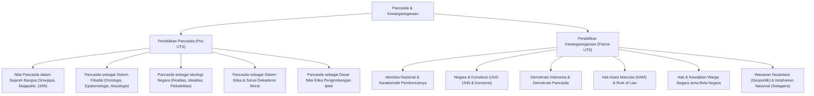

# Rangkuman Materi: Pancasila dan Kewarganegaraan (MPK6001 / UNW00003 & UNW00004)

> **Bobot:** 3 SKS (Gabungan Kurikulum 2020) / Masing-masing 2 SKS | **Semester:** 1 | **Fokus Utama:** Filsafat & Ideologi Pancasila, Etika Pengembangan Iptek, Identitas Nasional, Konstitusi, Demokrasi, HAM, dan Wawasan Nusantara

---

## 1. Gambaran Besar Mata Kuliah (*Grand View*)
Mata kuliah **Pancasila dan Kewarganegaraan (PPKn)** merupakan Mata Kuliah Wajib Kurikulum (MKWK) Nasional di Universitas Diponegoro yang bertujuan membentuk karakter, etika kewarganegaraan (*civic virtue*), integritas moral kebangsaan, dan pemahaman hukum tata negara bagi calon sarjana komputer. 

Dalam konteks mahasiswa **Informatika**, materi ini memiliki korelasi langsung dengan:
* **Etika Rekayasa Perangkat Lunak & AI:** Menjadikan nilai kemanusiaan dan keadilan sosial sebagai filter moral (*ethical guardrails*) dalam pengembangan kecerdasan buatan, privasi data, dan algoritma digital.
* **Keamanan Siber & Ketahanan Nasional (*Cyber Defense*):** Menempatkan kedaulatan ruang digital Indonesia dalam kerangka Geopolitik Wawasan Nusantara dan Geostrategi Ketahanan Nasional (Gatra Pertahanan & Ideologi).
* **Kepatuhan Regulasi Digital:** Kesadaran konstitusi terhadap perlindungan hak asasi warga negara (Pasal 28G UUD 1945 / UU Perlindungan Data Pribadi).

---

## 2. Peta Silabus & Konsep Inti Perkuliahan

### A. Bagian Pra-UTS: Pendidikan Pancasila

#### 1. Nilai-Nilai Pancasila dalam Lintasan Sejarah
* **Masa Pra-Kemerdekaan:**
  * Kerajaan Kutai & Sriwijaya: Praktik toleransi beragama dan kemaritiman (sila ke-1, ke-2, ke-3).
  * Kerajaan Majapahit: Istilah *Pancasila Krama* dalam Kitab Negarakertagama karangan Mpu Prapanca, dan semboyan *Bhinneka Tunggal Ika tan Hana Dharma Mangrwa* dalam Kitab Sutasoma karangan Mpu Tantular.
* **Proses Perumusan Formal Menuju Kemerdekaan:**
  * Sidang BPUPKI I (29 Mei – 1 Juni 1945): Pidato Ir. Soekarno pada 1 Juni 1945 mencetuskan nama *Pancasila*.
  * Piagam Jakarta (*Jakarta Charter*, 22 Juni 1945): Draf awal rumusan 5 sila dengan klausul 7 kata sila pertama.
  * Sidang PPKI (18 Agustus 1945): Penetapan UUD 1945 dan rumusan final Pancasila dalam Pembukaan UUD 1945 alinea IV (penghapusan 7 kata demi keutuhan integrasi persatuan bangsa timur).

#### 2. Pancasila sebagai Sistem Filsafat
Pancasila memenuhi kualifikasi sebagai sistem filsafat karena merupakan kesatuan bulat dan utuh yang hierarkis piramidal:
* **Landasan Ontologis (Hakikat Keberadaan):** Menjawab *"apa hakikat manusia dan entitas yang mendasari sila-sila Pancasila?"*. Manusia sebagai makhluk *monopluralis* (terdiri dari jiwa-raga, individu-sosial, makhluk mandiri-makhluk Tuhan).
* **Landasan Epistemologis (Hakikat Pengetahuan):** Menjawab *"bagaimana sumber dan validitas pengetahuan tentang Pancasila?"*. Nilai-nilai digali dari adat istiadat, kebudayaan luhur, dan pengalaman religius bangsa Indonesia sendiri (*causa materialis*).
* **Landasan Aksiologis (Hakikat Nilai):** Menjawab *"untuk apa nilai tersebut digunakan?"*. Sila-sila mengandung hierarki nilai kerohanian: nilai material, vital, kebenaran, keindahan, moral/kebaikan, dan religius/kesucian.

#### 3. Pancasila sebagai Ideologi Terbuka
* Berbeda dengan ideologi tertutup (dogmatis, mutlak, totaliter seperti Marxisme-Leninisme), Pancasila adalah **Ideologi Terbuka** yang dinamis dan mampu menyesuaikan diri dengan perubahan zaman tanpa mengubah nilai dasarnya.
* **3 Dimensi Pancasila sebagai Ideologi Terbuka:**
  1. **Dimensi Realitas:** Nilai-nilai dasar bersumber dan hidup dalam masyarakat Indonesia secara nyata.
  2. **Dimensi Idealitas:** Memuat cita-cita luhur masa depan yang ingin dicapai dalam berbagai aspek kehidupan bangsa.
  3. **Dimensi Fleksibilitas (Pengembangan):** Memiliki kelenturan intelektual untuk merespons inovasi teknologi dan dinamika global.

#### 4. Pancasila sebagai Sistem Etika & Pengembangan Iptek
* **Sistem Etika:** Etika Pancasila mendasarkan penilaian perbuatan pada nilai-nilai ketuhanan, kemanusiaan, persatuan, kerakyatan, dan keadilan sosial (kombinasi deontologis kewajiban moral dan teleologis tujuan kebaikan bersama).
* **Dasar Nilai Pengembangan Iptek:**
  * Sila 1: Iptek tidak boleh merusak hubungan spiritual manusia dengan Pencipta dan alam.
  * Sila 2: Pengembangan teknologi wajib menjunjung harkat kemanusiaan (*human-centric*), bukan memperbudak manusia atau mengeksploitasi data pribadi secara sepihak.
  * Sila 3: Iptek harus memperkuat persatuan dan integrasi bangsa, bukan menjadi alat polarisasi sosial dan hoaks di media sosial.
  * Sila 4: Pengambilan kebijakan adopsi teknologi harus transparan dan melibatkan musyawarah publik.
  * Sila 5: Hasil inovasi teknologi dan ekonomi digital harus didistribusikan secara adil untuk kesejahteraan seluruh rakyat (mereduksi kesenjangan digital / *digital divide*).

---

### B. Bagian Pasca-UTS: Pendidikan Kewarganegaraan

#### 1. Identitas Nasional
* Ciri khas yang membedakan bangsa Indonesia dari bangsa lain di dunia.
* **Faktor Pembentuk:** Faktor objektif (geografis-ekologis, demografis) dan faktor subjektif (historis, sosial, politik, kebudayaan).
* **Unsur-Unsur Identitas Nasional Indonesia:**
  * Bahasa Persatuan: Bahasa Indonesia.
  * Bendera Negara: Sang Saka Merah Putih.
  * Lagu Kebangsaan: Indonesia Raya (karya W.R. Supratman).
  * Lambang Negara: Garuda Pancasila dengan semboyan Bhinneka Tunggal Ika.
  * Konstitusi Negara: UUD NRI Tahun 1945.

#### 2. Negara & Konstitusi
* **Unsur Terbentuknya Negara:**
  * **Unsur Konstitutif (Mutlak):** Rakyat/Penduduk, Wilayah tertentu (Daratan, Lautan, Udara), dan Pemerintah yang Berdaulat ke dalam dan ke luar.
  * **Unsur Deklaratif:** Pengakuan dari negara lain (*de facto* berdasarkan fakta keberadaan, dan *de jure* sah menurut hukum internasional).
* **Konstitusi:** Hukum dasar tertinggi (*Supreme Law of the Land*).
  * Mengatur pembatasan kekuasaan organ-organ negara (*Checks and Balances*) dan menjamin hak asasi warga negara.
  * Konstitusi Indonesia: UUD 1945 (telah diamandemen 4 kali: 1999, 2000, 2001, 2002).

#### 3. Demokrasi & Hak Asasi Manusia (HAM)
* **Demokrasi Pancasila:** Demokrasi kedaulatan rakyat yang dijiwai dan diintegrasikan dengan sila-sila Pancasila, mengutamakan asas kekeluargaan dan musyawarah mufakat.
* **Prinsip Negara Hukum (*Rule of Law*):** Pasal 1 ayat (3) UUD 1945 menegaskan: *"Negara Indonesia adalah negara hukum"*.
* **Penegakan Hak Asasi Manusia:**
  * Diatur secara rinci pasca-amandemen pada **Pasal 28A hingga 28J UUD 1945** serta UU No. 39 Tahun 1999 tentang HAM.
  * Hak mutlak yang tidak dapat dikurangi dalam keadaan apa pun (*Non-derogable Rights*): hak untuk hidup, hak bebas dari penyiksaan, kemerdekaan pikiran dan hati nurani, hak beragama.

#### 4. Wawasan Nusantara (Geopolitik Indonesia)
* Cara pandang bangsa Indonesia mengenai diri dan lingkungannya yang serba beragam dan bernilai strategis dengan mengutamakan persatuan dan kesatuan wilayah.
* **Deklarasi Djuanda (13 Desember 1957):** Tonggak lahirnya konsep wilayah laut Nusantara sebagai kesatuan utuh (laut bukan pemisah pulau, melainkan perangkai kepulauan). Diresmikan di UNCLOS 1982 sebagai *Archipelagic State Principle*.

#### 5. Ketahanan Nasional (Geostrategi Indonesia)
* Kondisi dinamik bangsa Indonesia yang berisi keuletan dan ketangguhan dalam menghadapi segala bentuk Ancaman, Gangguan, Hambatan, dan Tantangan (AGHT) baik dari dalam maupun luar negeri.
* **Konsepsi Astagatra (8 Aspek Kehidupan Nasional):**
  * **Trigatra (Aspek Alamiah / Statis):**
    1. Letak dan bentuk geografis (posisi silang strategis).
    2. Keadaan dan kemampuan penduduk (demografi).
    3. Keadaan dan kekayaan alam (SDA).
  * **Pancagatra (Aspek Sosial / Dinamis):**
    1. Ideologi (Ketahanan Ideologi Pancasila).
    2. Politik (Stabilitas sistem politik demokrasi).
    3. Ekonomi (Kemandirian ekonomi).
    4. Sosial Budaya (Integrasi dan kebudayaan).
    5. Pertahanan dan Keamanan (Sishankamrata).

---

## 3. Konsep Kunci Wajib Hafal untuk Kompre

1. **Kedudukan Pokok Pancasila:** Sebagai Dasar Negara (*Philosophische Grondslag*), Pandangan Hidup Bangsa (*Weltanschauung*), Ideologi Nasional, dan Sumber dari Segala Sumber Hukum Negara.
2. **Kausa Pembentukan Pancasila (Notonagoro):**
   * *Causa Materialis* (Asal bahan: adat kebiasaan & agama nusantara).
   * *Causa Formalis* (Asal bentuk: dirumuskan oleh BPUPKI).
   * *Causa Efficient* (Asal karya: disahkan oleh PPKI).
   * *Causa Finalis* (Asal tujuan: menjadi dasar negara merdeka).
3. **Konstitusi Tertulis vs Tidak Tertulis:** Konstitusi tertulis adalah UUD 1945; konstitusi tidak tertulis adalah **Konvensi Ketatanegaraan** (seperti Pidato Kenegaraan Presiden setiap 16 Agustus).
4. **Asas Kewarganegaraan:** *Ius Sanguinis* (berdasarkan keturunan) dan *Ius Soli* (berdasarkan tempat kelahiran). Indonesia menganut *ius sanguinis* dengan ketentuan perlindungan terbatas terhadap anak berkewarganegaraan ganda hingga usia 18 tahun (UU No. 12 Tahun 2006).
