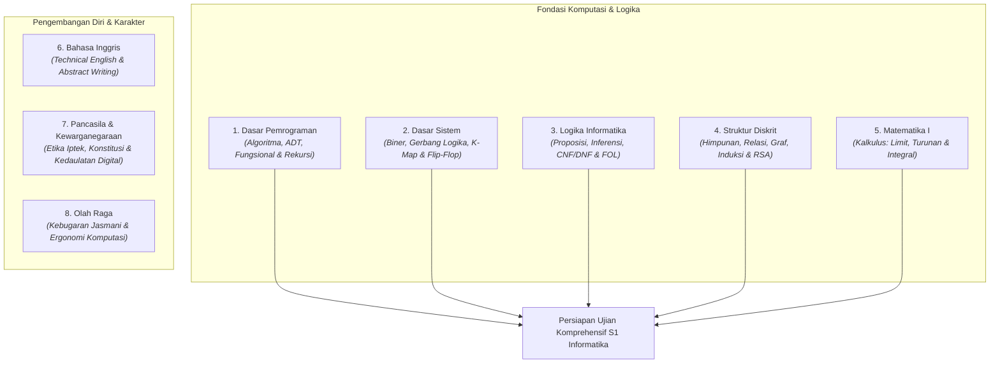

# 🎓 Rangkuman Belajar Ujian Komprehensif Informatika — Semester 1

> **Sintesis Komprehensif Semester 1:** Fondasi Komputasi, Logika Formal, Arsitektur Sistem, dan Matematika Diskrit/Kalkulus  
> **Departemen:** Informatika, Fakultas Sains dan Matematika, Universitas Diponegoro  
> **Basis Rujukan:** Repositori Resmi [BelajarKompre](https://github.com/khairys/BelajarKompre) (Kurikulum 2020)

---

## 🧭 Peta Besar Kurikulum Semester 1

Semester 1 adalah fondasi utama untuk memahami seluruh spektrum ilmu komputer. Di semester ini, mahasiswa mulai mempelajari bagaimana program bekerja dari paradigma fungsional, bagaimana komputer merepresentasikan dan memproses informasi secara digital, bagaimana masalah dibuktikan secara matematis, serta bagaimana bernalar logis secara formal.

---

## 1. Dasar Pemrograman

> Dokumen acuan lengkap: [`RANGKUMAN_MATERI.md`](https://github.com/khairys/BelajarKompre/blob/main/RANGKUMAN_DAN_CONTOH_SOAL/01_Semester_1/Dasar_Pemrograman/RANGKUMAN_MATERI.md)

### Apa yang Dipelajari?
Dasar Pemrograman mengajarkan cara mengubah masalah menjadi langkah-langkah terstruktur yang dapat dijalankan oleh komputer. Fokus utama perkuliahan ini di Informatika Undip adalah **paradigma pemrograman fungsional** dan **rekursi**. 

Paradigma fungsional menekankan pada pemetaan ekspresi matematika dan fungsi murni (*pure function* tanpa efek samping / *no side-effects*), berbeda dengan pemrograman prosedural yang mengandalkan banyak perulangan (`for`/`while`) dan mutasi nilai variabel.

### Urutan Materi Inti:
1. **Pemahaman Masalah & Dekomposisi Algoritma:**
   * Memecah masalah kompleks menjadi sub-masalah kecil (*problem decomposition*), mengenali pola, dan menyusun algoritma solutif.
2. **Tipe Data Dasar & Operator:**
   * `Integer` (bilangan bulat), `Real` (pecahan/floating-point), `Boolean` (`true`/`false`), dan `Character` (karakter tunggal).
   * Operator aritmetika (`+`, `-`, `*`, `/`, `div`, `mod`) dan operator logika (`AND`, `OR`, `NOT`).
3. **Tipe Data Bentukan / Abstract Data Type (ADT):**
   * Menggabungkan tipe data primitif menjadi entitas bermakna. Contohnya ADT `Point` dengan koordinat $(x, y)$, ADT `Date` dengan $(d, m, y)$.
   * Komponen ADT: **Konstruktor** (pembentuk objek) dan **Selektor** (pengambil komponen nilai).
4. **Ekspresi Kondisional:**
   * Pengambilan keputusan fungsional menggunakan konstruksi `if-then-else` atau `depend-on` bersarang untuk menghasilkan nilai kembalian.
5. **Konsep Rekursi:**
   * Fungsi yang memanggil dirinya sendiri dengan argumen yang mengecil menuju kondisi berhenti:
     $$n! = n \times (n-1)! \quad \text{dengan basis } 0! = 1$$
   * Dua pilar mutlak rekursi:
     * **Basis:** Kondisi terminasi saat pemanggilan rekursif harus berhenti.
     * **Rekurens:** Pola pemecahan masalah dengan mendelegasikan ke sub-masalah yang lebih kecil.
6. **List Fungsional & Kumpulan Data:**
   * Struktur list berbasis *head* dan *tail*.
   * Primitif list: `Konso(e, L)` (tambah elemen di awal), `Konsi(L, e)` (tambah di akhir), `FirstElmt(L)`, `Tail(L)`, `IsEmpty(L)`.
   * Operasi list rekursif: Menghitung panjang list (`NbElmt`), menjumlahkan elemen, mencari nilai ekstrem ($min/max$), dan membalik list (*reverse*).
7. **Struktur Lanjutan & Higher-Order Functions:**
   * Himpunan (*Set* tanpa duplikasi), List of List (representasi matriks), dan Pohon Biner (*Binary Tree*).
   * Konsep Lambda dan fungsi tingkat tinggi (`map`, `filter`, `fold/reduce`).

### Target Evaluasi Komprehensif:
* Mampu menjelaskan perbedaan fundamental paradigma fungsional vs prosedural.
* Mampu menuliskan fungsi rekursif lengkap dengan penegasan Basis dan Rekurens.
* Mampu menganalisis alur pemrosesan data list tanpa menggunakan perulangan iteratif.

---

## 2. Dasar Sistem

> Dokumen acuan lengkap: [`RANGKUMAN_MATERI.md`](https://github.com/khairys/BelajarKompre/blob/main/RANGKUMAN_DAN_CONTOH_SOAL/01_Semester_1/Dasar_Sistem/RANGKUMAN_MATERI.md)

### Apa yang Dipelajari?
Dasar Sistem menjelaskan fondasi fisik dan logika perangkat keras digital: bagaimana data dan instruksi direpresentasikan dalam bentuk sinyal biner serta bagaimana gerbang logika digabungkan untuk membentuk sirkuit komputasi modern.

### Urutan Materi Inti:
1. **Sistem Bilangan & Aritmetika Biner:**
   * Representasi biner (basis 2), desimal (basis 10), oktal (basis 8), dan heksadesimal (basis 16).
     $$13_{10} = 1101_2 = \text{D}_{16}$$
   * Representasi bilangan bertanda (*Signed Magnitude, 1's Complement, 2's Complement*).
2. **Gerbang Logika Dasar & Universal:**
   * Gerbang dasar: `AND`, `OR`, `NOT`.
   * Gerbang khusus: `XOR` (detektor perbedaan bit) dan `XNOR`.
   * Gerbang universal: `NAND` dan `NOR` (dapat digunakan untuk merangkai semua fungsi logika lainnya tanpa gerbang lain).
3. **Aljabar Boolean & Hukum De Morgan:**
   * Penyederhanaan ekspresi logika melalui hukum identitas, negasi ganda, distributif, dan hukum De Morgan:
     $$\overline{A \cdot B} = \overline{A} + \overline{B}, \quad \overline{A + B} = \overline{A} \cdot \overline{B}$$
4. **Penyederhanaan Visual Karnaugh Map (K-Map):**
   * Mengelompokkan sel bernilai 1 (*Minterm / Sum of Products*) dalam ukuran pangkat dua ($1, 2, 4, 8, 16$) untuk mendapatkan ekspresi Boolean paling efisien.
5. **Rangkaian Logika Kombinasional:**
   * Sirkuit tanpa memori (*output* hanya bergantung pada kombinasi *input* saat ini):
     * **Half Adder & Full Adder:** Sirkuit penjumlahan bit aritmetika (lengkap dengan *Carry-in* dan *Carry-out*).
     * **Decoder & Encoder:** Penerjemah kode biner ke jalur aktif atau sebaliknya.
     * **Multiplexer (MUX) & Demultiplexer (DEMUX):** Selektor data multi-saluran ke satu saluran transmisi.
6. **Rangkaian Sekuensial & Flip-Flop (Penyimpan State):**
   * Sirkuit yang memiliki memori internal dan bergantung pada sinyal detak (*clock*).
   * Latch SR, Flip-Flop D (*Data/Delay*), Flip-Flop JK, dan Flip-Flop T (*Toggle*). Flip-Flop D adalah elemen dasar penyimpan 1 bit RAM.
7. **Register, Counter & Memori Komputer:**
   * *Shift Register* (geser seri/paralel), *Binary Counter* sinkron/asinkron, arsitektur SRAM (*Static RAM* berbasis flip-flop), DRAM (*Dynamic RAM* berbasis kapasitor), dan ROM.

### Target Evaluasi Komprehensif:
* Mampu menyederhanakan ekspresi logika multi-variabel menggunakan K-Map 4 variabel.
* Mampu menjelaskan perbedaan mendasar sirkuit kombinasional vs sekuensial.
* Mampu menguraikan mekanisme penyimpanan bit pada D Flip-Flop berbasis clock triggering.

---

## 3. Logika Informatika

> Dokumen acuan lengkap: [`RANGKUMAN_MATERI.md`](https://github.com/khairys/BelajarKompre/blob/main/RANGKUMAN_DAN_CONTOH_SOAL/01_Semester_1/Logika_Informatika/RANGKUMAN_MATERI.md)

### Apa yang Dipelajari?
Logika Informatika mempelajari sistem penalaran formal, validitas argumen, pembuktian kebenaran proposisi, serta logika simbolik tingkat lanjut (First-Order Logic) yang mendasari kecerdasan buatan, sistem pakar, dan verifikasi perangkat lunak.

### Urutan Materi Inti:
1. **Logika Proposisi & Tabel Kebenaran:**
   * Proposisi atomik, nilai kebenaran (*truth value*), dan operator logika:
     $$\neg p, \quad p \land q, \quad p \lor q, \quad p \to q, \quad p \leftrightarrow q$$
   * Klasifikasi formula: **Tautologi** (selalu benar), **Kontradiksi** (selalu salah), dan **Kontingensi** (bergantung input).
2. **Ekuivalensi Logis:**
   * Dua ekspresi yang selalu menghasilkan nilai kebenaran identik:
     $$p \to q \equiv \neg p \lor q$$
3. **Aturan Inferensi & Validitas Argumen:**
   * **Modus Ponens:** $[(p \to q) \land p] \implies q$
   * **Modus Tollens:** $[(p \to q) \land \neg q] \implies \neg p$
   * **Silogisme Hipotetis:** $[(p \to q) \land (q \to r)] \implies (p \to r)$
4. **Metode Semantic Tableaux:**
   * Pohon semantik untuk membuktikan konsistensi atau ketidakkonsistenan himpunan formula; cabang tertutup ($\times$) menandakan adanya kontradiksi ($p$ dan $\neg p$).
5. **Bentuk Normal (CNF & DNF):**
   * **Conjunctive Normal Form (CNF):** Konjungsi dari klausa-klausa disjungsi, format standar untuk algoritma pembuktian otomatis (*SAT Solvers*):
     $$(A \lor B) \land (\neg B \lor C)$$
   * **Disjunctive Normal Form (DNF):** Disjungsi dari klausa-klausa konjungsi.
6. **Teknik Resolusi (*Resolution Refutation*):**
   * Pembuktian keabsahan argumen melalui penegasian kesimpulan (*refutation*). Jika resolusi menghasilkan klausa kosong ($\square$), maka argumen terbukti valid secara sah.
7. **Logika Predikat Orde Pertama (First-Order Logic / FOL):**
   * Memperluas proposisi dengan objek, predikat, dan kuantor:
     * Kuantor Universal ($\forall x$): *"Untuk semua $x$"*.
     * Kuantor Eksistensial ($\exists x$): *"Terdapat setidaknya satu $x$"*.
     $$\forall x \, [\text{Mahasiswa}(x) \to \text{Belajar}(x)]$$
   * Negasi kuantor, unifikasi variabel, dan resolusi predikat.

### Target Evaluasi Komprehensif:
* Mampu menguji keabsahan argumen menggunakan tabel kebenaran, inferensi deduktif, dan Semantic Tableaux.
* Mampu mengubah kalimat logika proposisi ke bentuk standar CNF.
* Mampu menerjemahkan kalimat bahasa alami kompleks ke dalam formula FOL berkuantor.

---

## 4. Struktur Diskrit

> Dokumen acuan lengkap: [`RANGKUMAN_MATERI.md`](https://github.com/khairys/BelajarKompre/blob/main/RANGKUMAN_DAN_CONTOH_SOAL/01_Semester_1/Struktur_Diskrit/RANGKUMAN_MATERI.md)

### Apa yang Dipelajari?
Struktur Diskrit adalah matematika intinya ilmu komputer. Topik-topik di mata kuliah ini (himpunan, relasi, induksi, kombinatorika, graf, dan teori bilangan) menjadi fondasi matematis bagi algoritma penelusuran, arsitektur basis data relasional, jaringan komputer, dan algoritma kriptografi modern.

### Urutan Materi Inti:
1. **Teori Himpunan (*Set Theory*):**
   * Operasi gabungan ($A \cup B$), irisan ($A \cap B$), komplemen ($A^c$), selisih ($A - B$), dan beda setangkup ($A \oplus B$). Himpunan kuasa (*Power Set*) dengan kardinalitas $2^{|A|}$.
2. **Relasi & Karakteristiknya:**
   * Relasi pada himpunan: Refleksif, Simetris, Transitif, dan Antisimetris.
   * **Relasi Ekuivalensi:** Memenuhi sifat refleksif, simetris, dan transitif (membentuk partisi himpunan).
   * **Partial Order Set (Poset):** Memenuhi sifat refleksif, antisimetris, dan transitif.
3. **Teori Fungsi:**
   * Pemetaan domain ke kodomain: Fungsi Injektif (*satu-ke-satu*), Surjektif (*pada/onto*), dan Bijektif (korespondensi satu-satu yang memiliki fungsi invers).
4. **Prinsip Sarang Merpati (*Pigeonhole Principle*):**
   * Jika $N$ merpati ditempatkan ke dalam $k$ sarang ($N > k$), maka setidaknya ada satu sarang yang berisi $\lceil N/k \rceil$ merpati. Digunakan untuk membuktikan keberadaan kondisi batas tanpa harus menguji seluruh kombinasi.
5. **Induksi Matematika:**
   * Pembuktian teorema bilangan bulat dengan 3 langkah berurutan: (1) Langkah Basis $P(1)$, (2) Hipotesis Induksi $P(k)$, dan (3) Langkah Induksi membuktikan kebenaran $P(k+1)$.
6. **Kombinatorika & Kaidah Pencacahan:**
   * Kaidah penjumlahan dan perkalian.
   * **Permutasi** (urutan diperhatikan):
     $$P(n, r) = \frac{n!}{(n - r)!}$$
   * **Kombinasi** (urutan tidak diperhatikan):
     $$C(n, r) = \binom{n}{r} = \frac{n!}{r!(n - r)!}$$
7. **Relasi Rekurens & Barisan:**
   * Menyelesaikan persamaan rekurens homogen linier dengan akar persamaan karakteristik (seperti deret Fibonacci $F_n = F_{n-1} + F_{n-2}$).
8. **Teori Bilangan & Aritmetika Modular:**
   * Algoritma Euclidean untuk mencari FPB / $\text{GCD}(a, b)$, kongruensi modulo, bilangan prima, dan Invers Modulo.
     $$17 \bmod 5 = 2$$
9. **Teori Graf & Pohon (*Trees*):**
   * Representasi graf (matriks ketetanggaan dan senarai ketetanggaan).
   * Sirkuit Euler, Sirkuit Hamilton, Graf Planar (Rumus Euler: $V - E + F = 2$), dan Pewarnaan Graf.
   * Properti Pohon (*Tree*): Graf terhubung tanpa sirkuit; pohon dengan $n$ simpul selalu memiliki tepat $(n - 1)$ sisi.
10. **Fondasi Kriptografi Kunci Publik (RSA):**
    * Pemanfaatan bilangan prima besar, fungsi Totient Euler $\phi(n) = (p-1)(q-1)$, dan invers modular $d \cdot e \equiv 1 \pmod{\phi(n)}$ untuk keamanan enkripsi data.

### Target Evaluasi Komprehensif:
* Mampu membuktikan keterbagian dan kesamaan deret dengan induksi matematika.
* Mampu menghitung kompleksitas konfigurasi menggunakan permutasi dan kombinasi.
* Mampu menganalisis properti graf, spanning tree, dan langkah matematis enkripsi/dekripsi algoritma RSA.

---

## 5. Matematika I

> Dokumen acuan lengkap: [`RANGKUMAN_MATERI.md`](https://github.com/khairys/BelajarKompre/blob/main/RANGKUMAN_DAN_CONTOH_SOAL/01_Semester_1/Matematika_I/RANGKUMAN_MATERI.md)

### Apa yang Dipelajari?
Matematika I berfokus pada **Kalkulus Diferensial dan Integral fungsi satu peubah**. Mahasiswa mempelajari konsep perubahan kontinu, laju perubahan sesaat (*turunan*), dan akumulasi luas/volume (*integral*), yang merupakan bahasa matematika esensial untuk grafika komputer, machine learning (gradient descent), dan simulasi komputasi.

### Urutan Materi Inti:
1. **Sistem Bilangan Real, Pertidaksamaan & Nilai Mutlak:**
   * Sifat kelengkapan bilangan real, penyelesaian pertidaksamaan rasional, dan sifat jarak nilai mutlak $|x| < a \iff -a < x < a$.
2. **Fungsi & Karakteristik Grafiknya:**
   * Domain alami, range, grafik fungsi aljabar, trigonometri, dan fungsi komposisi $(f \circ g)(x)$.
3. **Limit & Kekontinuan Fungsi:**
   * Konsep limit intuitif dan formal:
     $$\lim_{x \to 2} (x + 3) = 5$$
   * Limit sepihak (kiri dan kanan), limit tak hingga, dan syarat kekontinuan fungsi di titik $x = c$:
     $$\lim_{x \to c} f(x) = f(c)$$
4. **Turunan Fungsi (Diferensial):**
   * Definisi turunan sebagai limit laju perubahan sesaat:
     $$f'(x) = \lim_{h \to 0} \frac{f(x+h) - f(x)}{h}$$
   * Aturan diferensiasi: Aturan pangkat, hasil kali $(uv)' = u'v + uv'$, hasil bagi $(u/v)' = \frac{u'v - uv'}{v^2}$, Aturan Rantai (*Chain Rule*), dan turunan implisit.
5. **Aplikasi Turunan (Optimasi):**
   * Uji turunan pertama untuk kemonotonan (fungsi naik/turun) dan titik ekstrem lokal ($min/max$).
   * Uji turunan kedua untuk kecekungan (*concavity*) dan titik belok.
   * Masalah optimasi praktis (memaksimalkan efisiensi atau meminimalkan biaya).
6. **Integral Tak Tentu & Teknik Pengintegralan:**
   * Antiturunan fungsi dasar.
   * Teknik integrasi: Metode Substitusi, Integral Parsial ($\int u \, dv = uv - \int v \, du$), dan Dekomposisi Pecahan Parsial.
7. **Integral Tentu & Teorema Dasar Kalkulus (TDK):**
   * Akumulasi luas di bawah kurva:
     $$\int_a^b f(x) \, dx = F(b) - F(a) \quad \text{di mana } F'(x) = f(x)$$
   * Aplikasi geometri integral: Menghitung luas daerah di antara dua kurva dan volume benda putar (metode cakram & cincin).

### Target Evaluasi Komprehensif:
* Mampu menghitung nilai limit fungsi tak tentu menggunakan manipulasi aljabar atau aturan L'Hôpital.
* Mampu menurunkan fungsi kompleks menggunakan aturan rantai bersarang.
* Mampu menyelesaikan masalah optimasi ekstrim dan menghitung integral tentu menggunakan teknik yang tepat.

---

## 6. Bahasa Inggris

> Dokumen acuan lengkap: [`RANGKUMAN_MATERI.md`](https://github.com/khairys/BelajarKompre/blob/main/RANGKUMAN_DAN_CONTOH_SOAL/01_Semester_1/Bahasa_Inggris/RANGKUMAN_MATERI.md)

### Apa yang Dipelajari?
Mata kuliah Bahasa Inggris di Informatika difokuskan pada **English for Academic Purposes (EAP)** dan **Technical English for Computing**. Mahasiswa dilatih untuk memahami literatur teknis internasional (dokumentasi API, whitepaper arsitektur, dan paper penelitian bereputasi IEEE/ACM), menyusun abstrak karya ilmiah, serta menguasai tata bahasa formal dalam penulisan ilmiah.

### Urutan Materi Inti:
1. **Stative Verbs vs Dynamic Verbs:**
   * Membedakan kata kerja aksi (*dynamic*: calculate, compile, execute) dengan kata kerja keadaan/mental (*stative*: contain, consist of, belong, know).
   * *Aturan Kritis:* Stative verbs tidak boleh digunakan dalam bentuk *continuous (-ing)* (Contoh benar: *"The packet contains encrypted headers"*).
2. **Tenses dalam Konteks Ilmu Komputer:**
   * *Simple Present Tense:* Fakta umum dan spesifikasi sistem (*"Python supports multiple paradigms"*).
   * *Simple Past Tense:* Prosedur eksperimen yang telah dilakukan (*"We executed the benchmark on Linux"*).
   * *Present Perfect Tense:* Status perkembangan riset (*"Researchers have developed novel neural architectures"*).
3. **Passive Voice dalam Penulisan Ilmiah:**
   * Menggeser fokus dari pelaku ke objek atau proses rekayasa (*"The dataset was partitioned into 80% training and 20% testing"*).
4. **Conditional Sentences (Type 0, 1, 2, 3):**
   * Pemodelan kondisi logika komputasi dalam bahasa Inggris (identik dengan struktur `if-else` dalam pemrograman).
5. **Klausul Relatif (*Relative Clauses*):**
   * Penggunaan klausa pembatas (*defining*) dan penjelas (*non-defining*) menggunakan `which`, `that`, `who` untuk mendefinisikan terminologi sistem secara presisi.
6. **Struktur Penulisan Abstrak Ilmiah (*Scientific Abstract Writing*):**
   * Sistematika baku 5 elemen abstrak: (1) Background/Problem Statement, (2) Proposed Method/Architecture, (3) Implementation Scope, (4) Empirical Results, dan (5) Conclusion.

### Target Evaluasi Komprehensif:
* Mampu membaca dan merangkum intisari paper teknis komputer berbahasa Inggris.
* Mampu menulis paragraf deskripsi sistem dan abstrak penelitian dengan tata bahasa ilmiah yang baku.

---

## 7. Pancasila dan Kewarganegaraan

> Dokumen acuan lengkap: [`RANGKUMAN_MATERI.md`](https://github.com/khairys/BelajarKompre/blob/main/RANGKUMAN_DAN_CONTOH_SOAL/01_Semester_1/Pancasila_dan_Kewarganegaraan/RANGKUMAN_MATERI.md)

### Apa yang Dipelajari?
Mata kuliah wajib nasional ini membentuk karakter etis, integritas kebangsaan (*civic virtue*), dan kesadaran konstitusi bagi calon Sarjana Komputer. Bagi mahasiswa Informatika, nilai-nilai Pancasila menjadi kompas moral dalam menghadapi disrupsi teknologi: privasi data warga negara, keadilan algoritma AI, kedaulatan siber (*cyber sovereignty*), dan pencegahan kejahatan digital.

### Urutan Materi Inti:
1. **Pancasila sebagai Sistem Filsafat & Ideologi Terbuka:**
   * Landasan ontologis (manusia sebagai makhluk monopluralis), epistemologis (digali dari kearifan lokal bangsa), dan aksiologis (hierarki nilai moral kemanusiaan).
   * Dimensi ideologi terbuka: Realitas, Idealitas, dan Fleksibilitas dalam merespons kemajuan teknologi informasi.
2. **Pancasila sebagai Dasar Nilai Etika Pengembangan Iptek:**
   * Menempatkan kemajuan rekayasa perangkat lunak dan kecerdasan buatan agar tidak mendegradasi martabat manusia, tidak memperlebar kesenjangan sosial, dan menjunjung keadilan.
3. **Konstitusi & Hak Asasi Manusia (HAM):**
   * UUD 1945 sebagai hukum dasar tertinggi.
   * Perlindungan hak privasi dan data pribadi warga negara sebagai hak asasi konstitusional (Pasal 28G ayat 1 UUD 1945 dan implementasi UU Perlindungan Data Pribadi No. 27/2022).
4. **Geopolitik Wawasan Nusantara & Ketahanan Nasional Digital:**
   * Memandang ruang digital Indonesia sebagai kesatuan ruang kedaulatan nasional yang wajib dilindungi dari ancaman spionase siber, disinformasi, dan serangan infrastruktur kritis.

### Target Evaluasi Komprehensif:
* Memahami tanggung jawab etis dan moral seorang insinyur komputer terhadap bangsa dan masyarakat.
* Mampu mengaitkan nilai konstitusi dengan etika perlindungan privasi data dan keamanan informasi.

---

## 8. Olah Raga

> Dokumen acuan lengkap: [`RANGKUMAN_MATERI.md`](https://github.com/khairys/BelajarKompre/blob/main/RANGKUMAN_DAN_CONTOH_SOAL/01_Semester_1/Olah_Raga/RANGKUMAN_MATERI.md)

### Apa yang Dipelajari?
Mata kuliah praktikum lapangan ini berfokus pada pembinaan kebugaran jasmani, stamina fisik, dan kesehatan mental mahasiswa Informatika guna mengimbangi tingginya beban belajar komputasi dan durasi duduk yang lama di depan monitor (*screen time*).

### Urutan Materi Inti:
1. **Komponen Kebugaran Jasmani Utama:**
   * **Daya Tahan Kardiorespirasi (*Cardiovascular Endurance*):** Kapasitas jantung dan paru-paru dalam menyuplai oksigen melalui latihan aerobik (lari/jogging, bleep test).
   * **Kekuatan Otot (*Muscular Strength & Endurance*):** Latihan beban tubuh / kalistenik dasar (*push-up, sit-up, plank*) untuk memperkuat otot inti tubuh (*core muscles*).
   * **Kelenturan (*Flexibility*):** Peregangan dinamis dan statis untuk melenturkan sendi dan otot.
2. **Ergonomi Kerja Komputasi & Pencegahan Cedera:**
   * Edukasi postur tubuh yang benar saat melakukan *coding* di meja kerja.
   * Pencegahan penyakit akibat kerja komputer: *Carpal Tunnel Syndrome* (CTS) pada pergelangan tangan, *Computer Vision Syndrome* (mata lelah), dan *Lower Back Pain* (nyeri punggung bawah).
3. **Sportivitas & Kerja Sama Tim (*Teamwork*):**
   * Pembinaan mental kepemimpinan, kepatuhan pada aturan, dan respek melalui cabang olahraga beregu (futsal, bola voli, basket, bulu tangkis).

> [!NOTE]
> **Catatan Ujian Komprehensif:** Mata kuliah Olah Raga bersifat praktikum lapangan fisik dan **tidak diujikan secara teori** dalam sidang ujian lisan komprehensif. Mahasiswa cukup memastikan kelulusan nilai (minimal C) sebagai syarat yudisium.

---

## 🎯 Kesimpulan Sintesis Semester 1

Semester 1 membangun pondasi kokoh seorang calon Sarjana Komputer melalui sinergi multidimensi:
* **Logika & Pemrograman:** Dilatih secara fungsional melalui *Dasar Pemrograman* dan diperkuat oleh *Logika Informatika*.
* **Matematika Terapan:** Dibentuk oleh *Struktur Diskrit* (untuk algoritma diskrit/graf/kripto) dan *Matematika I* (untuk laju perubahan kontinu dan optimasi).
* **Perangkat Keras:** Dipahami fondasi fisik biner dan gerbang logikanya melalui *Dasar Sistem*.
* **Komunikasi & Karakter:** Dilengkapi oleh *Bahasa Inggris* akademik, etika moral *Pancasila*, dan stamina fisik *Olah Raga*.
