# Rangkuman Materi: Struktur Diskrit (PAIK6104 / MIK1624104)

> **Bobot:** 3 SKS | **Semester:** 1 | **Fokus Utama:** Himpunan, Relasi & Fungsi, Kombinatorika, Teori Bilangan, Teori Graf, Pohon (*Tree*), dan Relasi Rekurens

---

## 1. Gambaran Besar Mata Kuliah (*Grand View*)
Mata kuliah **Struktur Diskrit (Matematika Diskrit)** adalah fondasi matematika paling krusial dalam ilmu komputer. Struktur diskrit membedah objek-objek diskrit yang terpisah (*discrete*) dan dapat dihitung, bukan kontinu seperti kalkulus. 

Mata kuliah ini menjadi prasyarat intelektual langsung bagi mata kuliah lanjutan di semester-semester berikutnya:
* **Himpunan, Relasi, dan Fungsi:** Menjadi dasar Teori Basis Data Relasional (*Codd's Relational Algebra*).
* **Induksi & Relasi Rekurens:** Menjadi dasar Analisis Kompleksitas Algoritma (*Divide and Conquer*, Master Theorem).
* **Teori Bilangan & Modular:** Menjadi fondasi Kriptografi (RSA, Diffie-Hellman) dan Keamanan Informasi.
* **Teori Graf dan Pohon:** Menjadi fondasi Struktur Data (Tree, Trie, Graph), Jaringan Komputer (Routing Dijkstra), dan *Compiler* (Parsing Tree).

```mermaid
graph TD
    A["Struktur Diskrit"] --> B["Fondasi Diskrit & Logika (Pra-UTS)"]
    A --> C["Struktur Lanjutan & Aplikasi (Pasca-UTS)"]
    
    B --> B1["Himpunan & Operasi (Inklusi-Eksklusi, Himpunan Kuasa)"]
    B --> B2["Relasi & Sifat (Refleksif, Simetris, Transitif, Poset, Hasse)"]
    B --> B3["Fungsi (Injektif, Surjektif, Bijektif, Invers, Komposisi)"]
    B --> B4["Prinsip Sarang Merpati (Pigeonhole Principle & Generalisasinya)"]
    B --> B5["Induksi Matematika (Standar & Kuat)"]
    B --> B6["Kombinatorika & Koefisien Binomial"]
    
    C --> C1["Relasi Rekurens Homogen & Non-Homogen"]
    C --> C2["Teori Bilangan (Algoritma Euclid, Modulo, Teorema Bezout)"]
    C --> C3["Teori Graf (Handshaking Lemma, Euler vs Hamilton, Planaritas)"]
    C --> C4["Pewarnaan Graf (Welsh-Powell, Bilangan Kromatik)"]
    C --> C5["Pohon / Tree & Spanning Tree (MST Prim & Kruskal)"]
    C --> C6["Kriptografi Klasik & Dasar Enkripsi Kunci Publik RSA"]
```

---

## 2. Peta Silabus & Konsep Inti Perkuliahan

### A. Bagian Pra-UTS (Himpunan, Relasi, Fungsi, Induksi, & Kombinatorika)

#### 1. Teori Himpunan
* **Operasi Himpunan:** Irisan ($\cap$), Gabungan ($\cup$), Selisih ($A \setminus B$ atau $A - B$), Komplemen ($\overline{A}$ atau $A^c$), Beda Setangkup / *Symmetric Difference* ($A \oplus B = (A \cup B) - (A \cap B)$).
* **Himpunan Kuasa (*Power Set*):** $\mathcal{P}(A)$ adalah himpunan semua subset dari $A$. Jika $|A| = n$, maka $|\mathcal{P}(A)| = 2^n$.
* **Prinsip Inklusi-Eksklusi:**
  * Untuk 2 himpunan: $|A \cup B| = |A| + |B| - |A \cap B|$.
  * Untuk 3 himpunan: $|A \cup B \cup C| = |A| + |B| + |C| - |A \cap B| - |A \cap C| - |B \cap C| + |A \cap B \cap C|$.

#### 2. Relasi & Sifat-Sifatnya
* Suatu relasi $R$ dari himpunan $A$ ke $B$ adalah subset dari *Cartesian Product* $A \times B$.
* **4 Sifat Relasi pada Himpunan $A$:**
  1. **Refleksif:** $\forall x \in A, (x, x) \in R$.
  2. **Simetris:** $\forall x, y \in A, (x, y) \in R \implies (y, x) \in R$.
  3. **Antisimetris:** $\forall x, y \in A, ((x, y) \in R \land (y, x) \in R) \implies x = y$.
  4. **Transitif:** $\forall x, y, z \in A, ((x, y) \in R \land (y, z) \in R) \implies (x, z) \in R$.
* **Relasi Ekuivalensi:** Relasi yang bersifat **Refleksif, Simetris, dan Transitif**. Menghasilkan *partisi* pada himpunan.
* **Partial Ordering (Poset):** Relasi yang bersifat **Refleksif, Antisimetris, dan Transitif**.
  * Dilambangkan dengan $(A, \preceq)$ dan dapat digambarkan dengan **Diagram Hasse**.

#### 3. Fungsi
* Relasi khusus di mana setiap elemen domain dipetakan ke tepat satu elemen kodomain.
* **Jenis-Jenis Fungsi:**
  * **Injektif (*One-to-One*):** $f(a) = f(b) \implies a = b$. Tidak ada dua elemen domain berbeda yang memiliki citra sama.
  * **Surjektif (*Onto*):** $\forall y \in B, \exists x \in A \text{ s.t. } f(x) = y$ (Range $=$ Kodomain).
  * **Bijektif (*One-to-One Correspondence*):** Bersifat Injektif *sekaligus* Surjektif. Fungsi memiliki invers $f^{-1}$ **jika dan hanya jika** ia bijektif.
* **Fungsi Tangga:** $\lfloor x \rfloor$ (*Floor*) dan $\lceil x \rceil$ (*Ceiling*).

#### 4. Pigeonhole Principle (Prinsip Sarang Merpati)
* **Bentuk Dasar:** Jika $k+1$ atau lebih objek ditempatkan ke dalam $k$ kotak, maka minimal terdapat satu kotak yang memuat $\ge 2$ objek.
* **Bentuk Generalisasi:** Jika $N$ objek ditempatkan ke dalam $k$ kotak, maka minimal terdapat satu kotak yang memuat sekurang-kurangnya:
  $$\left\lceil \frac{N}{k} \right\rceil \text{ objek}$$

#### 5. Induksi Matematika
Metode pembuktian proposisi $P(n)$ untuk semua bilangan bulat positif:
1. **Basis Induksi:** Tunjukkan bahwa $P(n_0)$ bernilai benar (biasanya $n_0 = 1$ atau $0$).
2. **Langkah Induksi:** Asumsikan $P(k)$ benar untuk suatu $k \ge n_0$ (**Hipotesis Induksi**), lalu buktikan bahwa $P(k+1)$ juga bernilai benar.

#### 6. Kombinatorika & Peluang Diskrit
* **Aturan Penjumlahan & Aturan Perkalian.**
* **Permutasi ($P$):** Urutan diperhatikan. $P(n, r) = \frac{n!}{(n - r)!}$.
* **Kombinasi ($C$):** Urutan diabaikan. $C(n, r) = \binom{n}{r} = \frac{n!}{r!(n - r)!}$.
* **Permutasi dengan Pengulangan:** $\frac{n!}{n_1! n_2! \dots n_k!}$.
* **Kombinasi dengan Pengulangan ($r$-kombinasi dari $n$ objek dengan perulangan):**
  $$\binom{n + r - 1}{r}$$

---

### B. Bagian Pasca-UTS (Relasi Rekurens, Teori Bilangan, Graf, Pohon & Kriptografi)

#### 1. Relasi Rekurens
* **Relasi Rekuren Homogen Linier Berkoefisien Konstan Derajat $k$:**
  $$a_n = c_1 a_{n-1} + c_2 a_{n-2} + \dots + c_k a_{n-k}$$
* **Metode Penyelesaian Persamaan Karakteristik:**
  $$r^k - c_1 r^{k-1} - c_2 r^{k-2} - \dots - c_k = 0$$
  * Jika akar $r_1, r_2$ riil dan berbeda: $a_n = \alpha_1 r_1^n + \alpha_2 r_2^n$.
  * Jika akar kembar $r_1 = r_2 = r$: $a_n = \alpha_1 r^n + \alpha_2 n r^n$.
  * Koefisien $\alpha_1, \alpha_2$ diselesaikan menggunakan nilai awal (*initial conditions*).

#### 2. Teori Bilangan & Aritmetika Modular
* **Keterbagian:** $a \mid b \iff \exists c \in \mathbb{Z} \text{ s.t. } b = a \cdot c$.
* **Algoritma Pembagian Euclid (GCD / FPB):**
  $$a = b \cdot q + r \implies \gcd(a, b) = \gcd(b, r)$$
* **Identitas Bézout:** Untuk setiap bilangan bulat $a$ dan $b$, terdapat bilangan bulat $x$ dan $y$ sedemikian rupa sehingga:
  $$a \cdot x + b \cdot y = \gcd(a, b)$$
* **Aritmetika Modulo & Kongruensi:**
  $a \equiv b \pmod m \iff m \mid (a - b)$.
* **Invers Modulo:** $a \cdot x \equiv 1 \pmod m$. Nilai invers $x$ ada **jika dan hanya jika** $\gcd(a, m) = 1$ (relatif prima).
* **Teorema Kecil Fermat (*Fermat's Little Theorem*):**
  Jika $p$ prima dan $\gcd(a, p) = 1$, maka:
  $$a^{p-1} \equiv 1 \pmod p \quad \text{dan} \quad a^p \equiv a \pmod p$$

#### 3. Teori Graf
* Graf $G = (V, E)$ terdiri dari himpunan simpul/vertex $V$ dan sisi/edge $E$.
* **Lemma Jabat Tangan (*Handshaking Lemma*):**
  $$\sum_{v \in V} \text{deg}(v) = 2|E|$$
  *Konsekuensi Logis:* Jumlah simpul berderajat ganjil pada sembarang graf selalu genap!
* **Jenis Graf Khusus:**
  * Graf Lengkap $K_n$: Setiap simpul terhubung ke semua simpul lain. Jumlah sisi $|E| = \frac{n(n-1)}{2}$.
  * Graf Bipartit $K_{m, n}$: $V$ dapat dipartisi menjadi $V_1$ dan $V_2$ sedemikian rupa sehingga tidak ada sisi antar-anggota dalam partisi yang sama.
* **Lintasan & Sirkuit:**
  * **Lintasan/Sirkuit Euler:** Melewati setiap **sisi** tepat satu kali.
    * Graf memiliki Sirkuit Euler $\iff$ Semua simpul berderajat genap dan terhubung.
    * Graf memiliki Lintasan Euler $\iff$ Memiliki tepat 2 simpul berderajat ganjil.
  * **Lintasan/Sirkuit Hamilton:** Mengunjungi setiap **simpul** tepat satu kali.
* **Graf Planar & Rumus Euler:**
  Graf yang dapat digambar pada bidang datar tanpa sisi berpotongan.
  $$V - E + F = 2$$
  *(di mana $V$ = jumlah simpul, $E$ = jumlah sisi, $F$ = jumlah wilayah/muka/face).*
  Ketaksamaan planar untuk graf sederhana ($V \ge 3$): $E \le 3V - 6$.

#### 4. Pewarnaan Graf (Graph Coloring)
* Memberi warna pada setiap simpul sedemikian rupa sehingga tidak ada dua simpul bertetangga yang memiliki warna sama.
* **Bilangan Kromatik $\chi(G)$:** Jumlah minimum warna yang dibutuhkan.
  * Graf Bipartit: $\chi(G) = 2$.
  * Siklus ganjil $C_{2k+1}$: $\chi(G) = 3$.
  * Graf Lengkap $K_n$: $\chi(G) = n$.
  * Teorema 4 Warna: Sembarang graf planar dapat diwarnai dengan paling banyak 4 warna ($\chi(G) \le 4$).
* **Algoritma Welsh-Powell:** Urutkan simpul berdasarkan derajat menurun, warnai simpul pertama dengan warna 1, lalu warnai simpul-simpul berikutnya yang tidak bertetangga dengan simpul berwarna 1, ulangi untuk warna berikutnya.

#### 5. Pohon (Tree) & Spanning Tree
* **Definisi:** Graf tak berarah yang **terhubung** dan **tidak memuat sirkuit/siklus** (asiklik).
  * Pada pohon dengan $n$ simpul, jumlah sisi selalu tepat $|E| = n - 1$.
* **Pohon Rentang Minimum (*Minimum Spanning Tree - MST*):**
  * **Algoritma Kruskal:** Berorientasi pada sisi (*edge-based*). Urutkan seluruh sisi dari bobot terkecil ke terbesar, ambil satu per satu sisi terkecil selama tidak membentuk siklus (*cycle detection* via Disjoint Set).
  * **Algoritma Prim:** Berorientasi pada simpul (*vertex-based*). Mulai dari satu simpul sembarang, selalu tambahkan simpul baru yang memiliki sisi berbobot terendah ke himpunan pohon yang sudah terbentuk.

#### 6. Dasar Kriptografi RSA
1. Pilih 2 bilangan prima besar rahasia: $p$ dan $q$.
2. Hitung modulus publik: $n = p \cdot q$.
3. Hitung fungsi Euler totient: $\phi(n) = (p - 1)(q - 1)$.
4. Pilih kunci publik $e$ sedemikian rupa sehingga $\gcd(e, \phi(n)) = 1$ dan $1 < e < \phi(n)$.
5. Hitung kunci privat $d$ sebagai invers modular: $d \cdot e \equiv 1 \pmod{\phi(n)}$.
6. **Enkripsi:** $C = M^e \pmod n$.
7. **Dekripsi:** $M = C^d \pmod n$.

---

## 3. Rumus & Teorema Kunci Wajib Hafal untuk Kompre

1. **Lemma Jabat Tangan:** $\sum_{v \in V} \text{deg}(v) = 2|E|$
2. **Pohon dengan $n$ simpul:** Selalu memiliki tepat $n - 1$ sisi.
3. **Rumus Euler Graf Planar:** $V - E + F = 2$
4. **Batas Sisi Graf Planar Sederhana:** $E \le 3V - 6$ (untuk $V \ge 3$)
5. **Teorema Kecil Fermat:** $a^{p-1} \equiv 1 \pmod p$ (jika $p$ prima, $\gcd(a, p) = 1$)
6. **Prinsip Sarang Merpati Generalisasi:** $\lceil N / k \rceil$
7. **Kombinasi dengan Pengulangan:** $\binom{n + r - 1}{r}$
