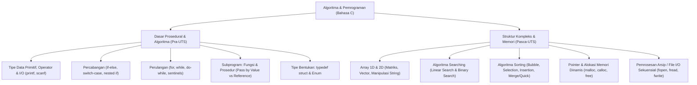

# Rangkuman Materi: Algoritma dan Pemrograman (PAIK6202 / MIK1624202)

> **Bobot:** 4 SKS (Kuliah + Praktikum) | **Semester:** 2 | **Fokus Utama:** Paradigma Pemrograman Prosedural/Imperatif Bahasa C, Tipe Data, Struktur Kontrol, Prosedur & Fungsi, Array, Struct, Pointer, Sorting, Searching, dan File Processing

---

## 1. Gambaran Besar Mata Kuliah (*Grand View*)
Mata kuliah **Algoritma dan Pemrograman (Alpro)** adalah tulang punggung komputasi prosedural di Informatika Universitas Diponegoro. Jika pada semester 1 mahasiswa mempelajari pemrograman fungsional murni (*immutable*, tanpa loop), maka pada Alpro mahasiswa mempelajari **Paradigma Prosedural/Imperatif** menggunakan bahasa **C standard (C99/C11)**:
* **Status Berubah (*Mutable State*):** Variabel dialokasikan di memori dan nilainya dapat diperbarui melalui operasi penugasan (*assignment*).
* **Runtunan Eksekusi Terstruktur:** Komputasi dijalankan secara sekuensial langkah demi langkah dengan kontrol alur percabangan dan perulangan eksplisit.
* **Manajemen Memori Tingkat Rendah:** Penggunaan **Pointer** untuk manipulasi alamat fisik RAM, alokasi memori dinamis (`malloc`, `free`), dan efisiensi *passing by reference*.



---

## 2. Peta Silabus & Konsep Inti Perkuliahan

### A. Bagian Pra-UTS (Sintaks Dasar C, Struktur Kontrol & Subprogram)

#### 1. Sintaks Dasar Bahasa C & Tipe Data
* **Struktur Program C:**
  ```c
  #include <stdio.h>
  #include <stdlib.h>
  
  int main() {
      // Deklarasi dan Algoritma
      return 0;
  }
  ```
* **Tipe Data Primitif:**
  * `int` (biasanya 4 byte, $-2^{31}$ s.d. $2^{31}-1$). Format specifier: `%d`.
  * `float` (4 byte presisi tunggal). Format specifier: `%f`.
  * `double` (8 byte presisi ganda). Format specifier: `%lf`.
  * `char` (1 byte, kode karakter ASCII). Format specifier: `%c`.
  * `boolean` di C standard: menggunakan `<stdbool.h>` (`true` / `false` atau `1` / `0`).
* **Operasi Input/Output Standar:**
  * `printf("format", argumen)`
  * `scanf("%d", &variabel)` $\rightarrow$ Karakter ampersand `&` wajib disertakan untuk mengambil alamat memori variabel!

#### 2. Struktur Kontrol Percabangan (*Selection*)
* **`if - else if - else`:** Evaluasi kondisi boolean berjenjang.
* **`switch - case`:** Evaluasi nilai diskrit (`int` atau `char`).
  * Wajib menyertakan statemen `break;` di setiap blok `case` untuk mencegah efek *fall-through*.
  * Blok `default:` dieksekusi jika tidak ada case yang cocok.

#### 3. Struktur Kontrol Perulangan (*Iteration / Loops*)
* **`for` Loop:** Perulangan dengan jumlah iterasi yang sudah diketahui pasti (*counter-controlled*).
  * `for (inisialisasi; kondisi_terminasi; increment/decrement)`
* **`while` Loop:** Evaluasi kondisi di awal (*entry-controlled*). Jika kondisi awal bernilai false, badan loop tidak pernah dieksekusi ($0$ kali).
* **`do - while` Loop:** Evaluasi kondisi di akhir (*exit-controlled*). Badan loop dijamin dieksekusi sekurang-kurangnya $1$ kali.
* **Kontrol Loop Khusus:** `break` (menghentikan dan keluar dari loop secara paksa) dan `continue` (melompati sisa iterasi saat ini dan langsung menuju evaluasi iterasi berikutnya).

#### 4. Subprogram: Prosedur dan Fungsi
* **Fungsi (*Function*):** Menghasilkan/mengembalikan satu nilai balik (*return value*) ke pemanggil melalui kata kunci `return`.
* **Prosedur (*Procedure* di C):** Ditandai dengan tipe pengembalian `void` (tidak mengembalikan nilai langsung, melainkan menghasilkan *side effect* atau mengubah parameter via pointer).
* **Mekanisme Pengiriman Parameter (*Parameter Passing*):**
  * **Pass by Value (Kirim Nilai):** Nilai variabel disalin (*cloned*) ke parameter lokal fungsi. Perubahan di dalam fungsi **tidak mempengaruhi** nilai variabel asli di fungsi pemanggil.
  * **Pass by Reference (Kirim Alamat Memori via Pointer):** Alamat memori variabel asli dikirimkan menggunakan operator `&`. Fungsi menerima tipe pointer `*`. Modifikasi di dalam fungsi **langsung mengubah** nilai variabel asli pemanggil!

#### 5. Tipe Data Bentukan (*Struct*)
Mengelompokkan beberapa variabel dengan tipe data berbeda ke dalam satu entitas logis:
```c
typedef struct {
    char nim[15];
    char nama[50];
    float ipk;
} Mahasiswa;

Mahasiswa mhs1;
mhs1.ipk = 3.90; // Mengakses field menggunakan dot operator (.)
```

---

### B. Bagian Pasca-UTS (Array, Pointer, Algoritma Sorting/Searching, & File I/O)

#### 1. Array (Larik) & Manipulasi String
* **Array 1 Dimensi:** Kumpulan elemen bertipe homogen yang disimpan pada blok memori fisik yang berurutan secara kontigu. Indeks array C selalu dimulai dari **$0$** hingga $N - 1$.
* **Array 2 Dimensi (Matriks):** `int matriks[baris][kolom];`. Diakses melalui perulangan bersarang (*nested loops*).
* **String di C:** Array karakter satu dimensi yang diakhiri oleh karakter null terminator `'\0'`.
  * Fungsi manipulasi string standar (`<string.h>`): `strlen(s)`, `strcpy(dest, src)`, `strcmp(s1, s2)`, `strcat(dest, src)`.

#### 2. Konsep Pointer & Alokasi Memori Dinamis
* **Pointer:** Variabel yang menyimpan alamat memori dari variabel lain.
  * Operator alamat / *Address-of* (`&`): Mengambil alamat memori suatu variabel.
  * Operator *Dereference* / *Indirection* (`*`): Mengakses atau memodifikasi nilai yang berada pada alamat memori yang ditunjuk pointer.
* **Alokasi Memori Dinamis di Heap (`<stdlib.h>`):**
  * `malloc(size_t bytes)`: Mengalokasikan blok memori berukuran tertentu tanpa inisialisasi (berisi nilai acak/garbage).
  * `calloc(num, size)`: Mengalokasikan memori dan menginisialisasi seluruh byte menjadi nol.
  * `realloc(ptr, new_size)`: Mengubah ukuran blok memori yang telah dialokasikan sebelumnya.
  * `free(ptr)`: Membebaskan memori kembali ke sistem operasi untuk mencegah **Memory Leak**.

#### 3. Algoritma Pencarian (Searching)
* **Linear Search (Pencarian Berurutan):** Memeriksa elemen satu per satu dari indeks 0.
  * Kompleksitas Waktu: *Best Case* $O(1)$, *Worst Case* $O(N)$.
  * Dapat digunakan pada array yang tidak terurut.
* **Binary Search (Pencarian Bagi-Dua):** Membagi ruang pencarian menjadi dua bagian di setiap langkah ($mid = (low + high)/2$).
  * **Prasyarat Mutlak:** Array **wajib sudah terurut**.
  * Kompleksitas Waktu: *Best Case* $O(1)$, *Worst Case* $O(\log N)$.

#### 4. Algoritma Pengurutan (Sorting)
* **Bubble Sort:** Membandingkan elemen bersebelahan dan menukarnya (*swap*) jika urutannya salah. Kompleksitas: $O(N^2)$.
* **Selection Sort:** Mencari elemen terkecil di seluruh sisa array dan menukarnya dengan elemen di posisi awal. Kompleksitas: $O(N^2)$ (jumlah pertukaran minimal $O(N)$).
* **Insertion Sort:** Menyisipkan elemen satu per satu ke posisi yang tepat pada bagian array yang sudah terurut. Sangat efisien untuk data yang hampir terurut (*Best Case* $O(N)$).
* **Merge Sort:** Algoritma *Divide and Conquer*. Membagi array menjadi dua sub-array secara rekursif hingga tersisa 1 elemen, lalu menggabungkannya kembali secara terurut. Kompleksitas stabil: $O(N \log N)$.
* **Quick Sort:** Memilih satu elemen sebagai *Pivot*, lalu mempartisi array menjadi elemen-elemen yang lebih kecil dari pivot dan lebih besar dari pivot. Kompleksitas rata-rata: $O(N \log N)$, kasus terburuk $O(N^2)$.

#### 5. Pemrosesan Arsip / File Sekuensial (*File I/O*)
* Mode Akses File:
  * `"r"` (Read): Membuka file untuk dibaca (error jika file tidak ada).
  * `"w"` (Write): Membuat file baru untuk ditulis (menimpa/overwrite jika file sudah ada).
  * `"a"` (Append): Menambahkan data di akhir file tanpa menghapus isi sebelumnya.
* Operasi Standar File:
  * `FILE *fp = fopen("data.txt", "r");`
  * `if (fp == NULL) { /* penanganan error file */ }`
  * `fscanf(fp, "%s %d", nama, &umur);` atau `fgets(buffer, sizeof(buffer), fp);`
  * `fprintf(fp, "Hasil: %d\n", total);`
  * `fclose(fp);` (Menutup berkas dan melakukan *flush* buffer ke disk).

---

## 3. Rumus & Jebakan Kunci Pemrograman C (Komprehensif)

1. **Jebakan `scanf` Karakter & Buffer:** `scanf("%d", &x);` meninggalkan karakter `\n` (newline) di buffer input. Jika setelahnya memanggil `scanf("%c", &ch);`, program akan langsung menyerap newline tersebut. Solusi: beri spasi sebelum format karakter `scanf(" %c", &ch);` atau gunakan `fflush(stdin);` / `getchar();`.
2. **Jebakan Batas Indeks Array (Out of Bounds):** C tidak melakukan *runtime bound checking*. Mengakses `arr[N]` pada array berukuran $N$ akan membaca area memori liar yang menyebabkan *Undefined Behavior* atau *Segmentation Fault*.
3. **Jebakan Operator Pembanding vs Penugasan:** `if (x = 5)` (penugasan, selalu bernilai true) vs `if (x == 5)` (pembanding kesamaan logika).
4. **Pointer Dereferencing:** Jika `ptr` menunjuk ke struct `p`, maka `(*p).field` ekuivalen dan lebih elegan ditulis menggunakan operator panah `p->field`.
