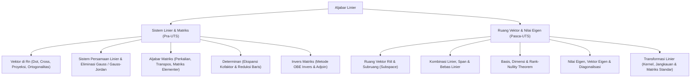

# Rangkuman Materi: Aljabar Linier (PAIK6201 / MIK1624201)

> **Bobot:** 3 SKS | **Semester:** 2 | **Fokus Utama:** Vektor, Sistem Persamaan Linier (SPL), Matriks, Determinan & Invers, Ruang Vektor, Basis & Dimensi, Nilai Eigen & Vektor Eigen, dan Transformasi Linier

---

## 1. Gambaran Besar Mata Kuliah (*Grand View*)
Mata kuliah **Aljabar Linier (Alin)** adalah pilar matematika paling esensial dalam era komputasi modern dan sains data. Di dunia nyata dan industri teknologi informasi, aljabar linier menjadi bahasa fundamental bagi:
* **Machine Learning & Artificial Intelligence:** Representasi dataset dalam bentuk tensor/matriks berdimensi tinggi, reduksi dimensi dengan *Principal Component Analysis* (PCA via Nilai Eigen), dan *Latent Semantic Analysis*.
* **Grafika Komputer & Game Engine:** Transformasi geometri 3D (rotasi, translasi, *scaling*, *camera projection*) menggunakan perkalian matriks koordinat homogen $4 \times 4$.
* **Algoritma Pencarian Mesin Pencari (Google PageRank):** Perhitungan bobot halaman web menggunakan *Markov Chains* dan *Perron-Frobenius Theorem* untuk mencari vektor eigen dominan.
* **Kriptografi & Pemrosesan Citra Digital:** Operasi filter konvolusi spasial citra dan enkripsi matriks (Hill Cipher).

---

## 2. Peta Silabus & Konsep Inti Perkuliahan

### A. Bagian Pra-UTS (Vektor, SPL, Matriks, Determinan & Invers)

#### 1. Vektor di $\mathbb{R}^n$ & Operasi Geometris
* **Dot Product (Perkalian Titik):**
  $$\mathbf{u} \cdot \mathbf{v} = u_1 v_1 + u_2 v_2 + \dots + u_n v_n = \|\mathbf{u}\| \|\mathbf{v}\| \cos \theta$$
  * Dua vektor $\mathbf{u}$ dan $\mathbf{v}$ **ortogonal (saling tegak lurus)** $\iff \mathbf{u} \cdot \mathbf{v} = 0$.
* **Norma / Panjang Vektor (Euclidean Norm):**
  $$\|\mathbf{v}\| = \sqrt{v_1^2 + v_2^2 + \dots + v_n^2}$$
* **Proyeksi Ortogonal $\mathbf{u}$ pada $\mathbf{a}$:**
  $$\text{proj}_{\mathbf{a}} \mathbf{u} = \frac{\mathbf{u} \cdot \mathbf{a}}{\|\mathbf{a}\|^2} \mathbf{a}$$
* **Cross Product (Perkalian Silang di $\mathbb{R}^3$):** Menghasilkan vektor baru yang tegak lurus terhadap bidang yang dibentuk kedua vektor.

#### 2. Sistem Persamaan Linier (SPL) & Eliminasi Gauss
* Bentuk Matriks: $A \mathbf{x} = \mathbf{b}$.
  * Bentuk Matriks Terdamping (*Augmented Matrix*): $[A \mid \mathbf{b}]$.
* **Operasi Baris Elementer (OBE):**
  1. Mengalikan sebuah baris dengan konstanta tak nol ($R_i \leftarrow k R_i$).
  2. Menukar posisi dua baris ($R_i \leftrightarrow R_j$).
  3. Menambahkan kelipatan suatu baris ke baris lainnya ($R_i \leftarrow R_i + k R_j$).
* **Bentuk Eselon Baris (Eliminasi Gauss):**
  * Angka pertama tak nol pada setiap baris adalah 1 (*leading 1* / satu utama).
  * Satu utama pada baris lebih bawah berada lebih ke kanan.
  * Baris yang seluruhnya nol diletakkan paling bawah.
* **Bentuk Eselon Baris Tereduksi (Eliminasi Gauss-Jordan):**
  * Memenuhi semua syarat eselon baris, ditambah: setiap kolom yang memuat satu utama memiliki angka nol di semua posisi lainnya.
* **Tiga Kemungkinan Solusi SPL:**
  1. **Solusi Tunggal (*Unique Solution*):** $\text{rank}(A) = \text{rank}([A \mid \mathbf{b}]) = n$ (jumlah variabel).
  2. **Banyak Solusi (*Infinite Solutions*):** $\text{rank}(A) = \text{rank}([A \mid \mathbf{b}]) < n$ (memiliki parameter bebas).
  3. **Tidak Ada Solusi (*Inconsistent*):** $\text{rank}(A) < \text{rank}([A \mid \mathbf{b}])$ (terdapat baris $\left[ 0 \; 0 \; \dots \; 0 \mid c \right]$ dengan $c \ne 0$).

#### 3. Aljabar Matriks, Determinan & Invers
* **Perkalian Matriks:** Matriks $A_{m \times p} \times B_{p \times n} = C_{m \times n}$. Bersifat asosiatif, distributif, tetapi **tidak komutatif** ($AB \ne BA$).
* **Determinan Matriks Bujur Sangkar:**
  * Sifat Determinan: $\det(AB) = \det(A)\det(B)$, $\det(A^T) = \det(A)$, $\det(A^{-1}) = \frac{1}{\det(A)}$.
  * Menukar dua baris mengalikan determinan dengan $-1$.
  * Mengalikan satu baris dengan skalar $k$ mengalikan determinan dengan $k$.
  * Matriks dapat dibalik (*invertible / non-singular*) $\iff \det(A) \ne 0$.
* **Mencari Invers Matriks:**
  * **Metode Gauss-Jordan:** $[A \mid I] \xrightarrow{\text{OBE}} [I \mid A^{-1}]$.
  * **Metode Matriks Adjoin:** $A^{-1} = \frac{1}{\det(A)} \text{adj}(A) = \frac{1}{\det(A)} [C_{ij}]^T$.

---

### B. Bagian Pasca-UTS (Ruang Vektor, Basis, Nilai Eigen & Transformasi Linier)

#### 1. Ruang Vektor & Subruang (Subspace)
* Suatu himpunan $V$ dengan operasi penjumlahan dan perkalian skalar disebut Ruang Vektor jika memenuhi 10 aksioma penutupan, asosiatif, komutatif, identitas, invers, dan distributif.
* **Uji Subruang (*Subspace Test*):** Subset tak kosong $W \subseteq V$ adalah subruang jika dan hanya jika:
  1. Vektor nol $\mathbf{0} \in W$.
  2. Tertutup terhadap penjumlahan: $\mathbf{u}, \mathbf{v} \in W \implies \mathbf{u} + \mathbf{v} \in W$.
  3. Tertutup terhadap perkalian skalar: $k \in \mathbb{R}, \mathbf{u} \in W \implies k\mathbf{u} \in W$.

#### 2. Kombinasi Linier, Span & Bebas Linier
* **Kombinasi Linier:** $\mathbf{v} = c_1 \mathbf{v}_1 + c_2 \mathbf{v}_2 + \dots + c_k \mathbf{v}_k$.
* **Membangun / Span:** $\text{span}\{\mathbf{v}_1, \dots, \mathbf{v}_k\}$ adalah himpunan semua kombinasi linier dari vektor-vektor tersebut.
* **Bebas Linier (*Linear Independence*):**
  $$c_1 \mathbf{v}_1 + c_2 \mathbf{v}_2 + \dots + c_k \mathbf{v}_k = \mathbf{0}$$
  * Jika persamaan di atas **hanya** dipenuhi oleh solusi trivial $c_1 = c_2 = \dots = c_k = 0$, maka himpunan vektor tersebut **Bebas Linier**.
  * Jika terdapat sekurang-kurangnya satu $c_i \ne 0$, maka himpunan vektor **Bergantung Linier (*Linearly Dependent*)**.

#### 3. Basis, Dimensi & Teorema Rank-Nullity
* **Basis:** Himpunan vektor $S = \{\mathbf{v}_1, \dots, \mathbf{v}_n\}$ merupakan basis untuk ruang vektor $V$ jika:
  1. $S$ **bebas linier**.
  2. $S$ **merentang / membangun** $V$ ($\text{span}(S) = V$).
* **Dimensi ($\dim(V)$):** Jumlah vektor yang terdapat dalam sembarang basis untuk $V$.
* **Ruang Fundamental Matriks $A_{m \times n}$:**
  * Ruang Baris $\text{Row}(A)$ dan Ruang Kolom $\text{Col}(A)$ (keduanya memiliki dimensi sama yang disebut **$\text{rank}(A)$**).
  * Ruang Nol / *Nullspace* $\text{Null}(A) = \{\mathbf{x} \mid A\mathbf{x} = \mathbf{0}\}$ (dimensinya disebut **$\text{nullity}(A)$**).
* **Teorema Rank-Nullity:**
  $$\text{rank}(A) + \text{nullity}(A) = n \quad (\text{jumlah kolom matriks } A)$$

#### 4. Nilai Eigen (*Eigenvalues*) & Vektor Eigen (*Eigenvectors*)
* Diberikan matriks bujur sangkar $A_{n \times n}$. Vektor tak nol $\mathbf{x}$ disebut vektor eigen dan skalar $\lambda$ disebut nilai eigen jika:
  $$A\mathbf{x} = \lambda \mathbf{x} \iff (\lambda I - A)\mathbf{x} = \mathbf{0}$$
* **Persamaan Karakteristik:**
  $$\det(\lambda I - A) = 0 \quad \text{atau} \quad \det(A - \lambda I) = 0$$
* **Ruang Eigen ($E_\lambda$):** Ruang solusi dari sistem homogen $(\lambda I - A)\mathbf{x} = \mathbf{0}$.
* **Diagonalisasi:** Matriks $A$ dapat didiagonalisasi ($A = PDP^{-1}$) jika dan hanya jika $A$ memiliki $n$ vektor eigen yang bebas linier.

#### 5. Transformasi Linier
* Pemetaan $T: V \to W$ disebut linier jika:
  1. $T(\mathbf{u} + \mathbf{v}) = T(\mathbf{u}) + T(\mathbf{v})$
  2. $T(k\mathbf{u}) = k T(\mathbf{u})$
* **Kernel & Jangkauan:**
  * $\ker(T) = \{\mathbf{v} \in V \mid T(\mathbf{v}) = \mathbf{0}\}$.
  * $\text{Range}(T) = \{T(\mathbf{v}) \mid \mathbf{v} \in V\}$.
* **Matriks Transformasi Standar:** $T(\mathbf{x}) = [T] \mathbf{x}$, di mana $[T] = \big[ T(\mathbf{e}_1) \; T(\mathbf{e}_2) \; \dots \; T(\mathbf{e}_n) \big]$.

---

## 3. Rumus Kunci Wajib Hafal untuk Kompre

1. **Uji Bebas Linier Matriks Bujur Sangkar:** Vektor kolom matriks $A$ bebas linier $\iff \det(A) \ne 0$.
2. **Teorema Rank-Nullity:** $\text{rank}(A) + \text{nullity}(A) = n$.
3. **Persamaan Karakteristik Eigen:** $\det(\lambda I - A) = 0$.
4. **Trace & Determinan Matriks vs Nilai Eigen:**
   * $\sum_{i=1}^n \lambda_i = \text{tr}(A)$ (jumlah elemen diagonal utama).
   * $\prod_{i=1}^n \lambda_i = \det(A)$.
5. **Ortogonalitas:** $\mathbf{u} \perp \mathbf{v} \iff \mathbf{u} \cdot \mathbf{v} = 0$.
