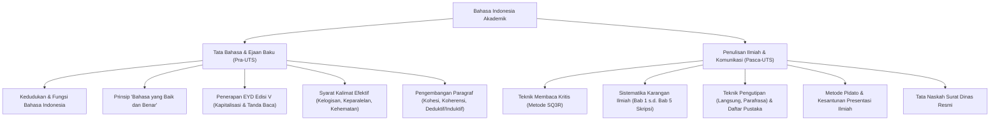

# Rangkuman Materi: Bahasa Indonesia (UNW00006)

> **Bobot:** 2 SKS | **Semester:** 2 | **Fokus Utama:** Ejaan Bahasa Indonesia yang Disempurnakan (EYD V), Kalimat Efektif, Paragraf Akademik, Tata Tulis Karya Ilmiah, Teknik Pengutipan, dan Kesantunan Komunikasi Ilmiah

---

## 1. Gambaran Besar Mata Kuliah (*Grand View*)
Mata kuliah **Bahasa Indonesia** di Universitas Diponegoro merupakan Mata Kuliah Wajib Kurikulum (MKWK) yang bertujuan mengasah keterampilan literasi akademik mahasiswa tingkat sarjana. Di lingkungan **Informatika**, bahasa Indonesia bukan sekadar sarana percakapan harian, melainkan instrumen komunikasi formal yang menentukan kualitas:
* **Penulisan Skripsi & Tugas Akhir:** Menjamin argumen komputasi, metodologi algoritma, dan hasil pengujian disajikan secara logis, koheren, dan memenuhi standar ejaan baku.
* **Publikasi Artikel Jurnal Ilmiah Nasional:** Kepatuhan terhadap gaya selingkung, teknik parafrasa untuk mencegah plagiarisme (*Turnitin*), dan sistematika rujukan.
* **Dokumentasi Teknis Perangkat Lunak (*Software Documentation*):** Menulis manual pengguna (*User Manual*), dokumen spesifikasi kebutuhan perangkat lunak (SKPL/SRS), dan surat dinas profesional.

---

## 2. Peta Silabus & Konsep Inti Perkuliahan

### A. Bagian Pra-UTS (Kedudukan Bahasa, EYD V, Kalimat Efektif & Paragraf)

#### 1. Kedudukan dan Fungsi Bahasa Indonesia
* **Sebagai Bahasa Nasional (Berdasarkan Ikrar Sumpah Pemuda 28 Oktober 1928):**
  * Lambang kebanggaan nasional.
  * Lambang identitas nasional.
  * Alat pemersatu berbagai suku bangsa yang berbeda bahasa daerah dan budaya.
  * Alat perhubungan antardaerah dan antarbudaya.
* **Sebagai Bahasa Negara (Berdasarkan Pasal 36 UUD NRI 1945):**
  * Bahasa resmi kenegaraan dalam upacara dan dokumen resmi.
  * Bahasa pengantar resmi di dunia pendidikan nasional.
  * Alat perhubungan tingkat nasional dalam perencanaan dan pelaksanaan pembangunan.
  * Alat pengembangan kebudayaan, ilmu pengetahuan, dan teknologi nasional.

#### 2. Konsep "Berbahasa yang Baik dan Benar"
* **Bahasa yang Baik:** Penggunaan ragam bahasa yang disesuaikan dengan **konteks situasi dan mitra tutur** (tempat, suasana resmi/santai, topik pembicaraan, dan norma kesantunan sosial).
* **Bahasa yang Benar:** Penggunaan bahasa yang patuh secara konsisten pada **kaidah tata bahasa baku** (fonologi, morfologi, sintaksis, semantik, serta ejaan resmi EYD).
* *Prinsip:* Kalimat yang "benar" belum tentu "baik" jika dipakai dalam konteks pasar tradisional; sebaliknya kalimat yang "baik/komunikatif" belum tentu "benar" jika menyalahi kaidah dalam forum seminar akademik.

#### 3. Kaidah Ejaan Bahasa Indonesia yang Disempurnakan (EYD Edisi V)
* **Penggunaan Huruf Kapital:**
  * Awal kalimat dan petikan langsung.
  * Nama diri geografis yang diikuti nama (contoh: *Selat Sunda, Sungai Ciliwung*, tetapi *berlayar ke selat, mandi di sungai*).
  * Nama bangsa, suku, dan bahasa (contoh: *bangsa Indonesia, suku Jawa*, tetapi *mengindonesiakan istilah*).
* **Penulisan Kata Depan vs Awalan:**
  * Kata Depan (*di, ke, dari*) ditulis **terpisah** jika menunjukkan tempat/arah: *di kampus, ke Semarang, dari server*.
  * Awalan (*di-, ke-*) ditulis **serangkai** jika membentuk kata kerja pasif atau nominal: *dijalankan, diprogram, ketua*.
* **Tanda Baca:**
  * Tanda Koma (`,`): Dipakai sebelum kata penghubung pertentangan (*tetapi, melainkan, sedangkan*) dalam kalimat majemuk setara; tidak dipakai sebelum kata *karena* atau *bahwa*.
  * Tanda Titik Dua (`:`): Dipakai pada akhir suatu pernyataan lengkap yang diikuti rincian/penjelasan.

#### 4. Ciri-Ciri Kalimat Efektif
Kalimat yang mampu menyampaikan gagasan penulis kepada pembaca secara tepat dan tanpa ambiguitas:
1. **Kesepadanan Struktur:** Memiliki Subjek dan Predikat yang jelas (tidak mendahului subjek dengan preposisi seperti *"Dalam penelitian ini membuktikan"* $\rightarrow$ salah, seharusnya *"Penelitian ini membuktikan"*).
2. **Kesejajaran Bentuk (*Paralelisme*):** Menggunakan bentuk gramatikal yang seragam untuk rincian koordinatif.
   * *Salah:* "Tahapan penelitian meliputi pengumpulan data, menganalisis algoritma, dan pengujian sistem."
   * *Benar:* "Tahapan penelitian meliputi *pengumpulan* data, *penganalisisan* algoritma, dan *pengujian* sistem."
3. **Kehematan Kata:** Menghindari pleonasme atau pemborosan kata yang bersinonim (contoh keliru: *"agar supaya"*, *"para dosen-dosen"*, *"sangat optimal sekali"*).
4. **Kelogisan Bahasa:** Makna kalimat dapat diterima akal sehat (contoh keliru: *"Untuk mempersingkat waktu, acara kami mulai"* $\rightarrow$ waktu tidak dapat dipersingkat, seharusnya *"Untuk mengefisienkan waktu"*).
5. **Kecermatan & Ketegasan:** Tidak menimbulkan multitafsir (*ambiguitas*).

---

### B. Bagian Pasca-UTS (Karya Ilmiah, Membaca Kritis, Kutipan & Komunikasi)

#### 1. Teknik Membaca Kritis (Metode SQ3R)
Metode sistematis membaca karya tulis akademik untuk memahami inti substansi secara mendalam:
1. **S (Survey):** Memindai cepat judul, abstrak, subbab, dan kesimpulan untuk memperoleh gambaran umum.
2. **Q (Question):** Menyusun daftar pertanyaan kritis terkait apa yang ingin dicari dari teks.
3. **R (Read):** Membaca aktif paragraf demi paragraf untuk menemukan jawaban atas pertanyaan.
4. **R (Recite):** Mengungkapkan kembali poin-poin utama dengan kata-kata sendiri tanpa melihat teks.
5. **R (Review):** Meninjau ulang secara berkala seluruh pemahaman yang diperoleh.

#### 2. Sistematika Penulisan Karya Ilmiah (Skripsi Informatika)
* **Bagian Pendahuluan (Bab 1):**
  * Latar Belakang Masalah: Disusun dengan pola **Deduktif Piramida Terbalik** (isu makro global $\rightarrow$ gap riset spesifik $\rightarrow$ usulan solusi berbasis komputasi).
  * Rumusan Masalah: Pertanyaan penelitian yang spesifik, terukur, dan dapat diselesaikan.
  * Batasan Masalah: Ruang lingkup agar riset fokus.
  * Tujuan & Manfaat Penelitian.
* **Tinjauan Pustaka & Landasan Teori (Bab 2):** Sintesis penelitian terdahulu dan konsep teoretis penunjang.
* **Metodologi Penelitian (Bab 3):** Alur tahapan rekayasa (Waterfall, Agile, CRISP-DM) dan instrumen eksperimen.
* **Hasil dan Pembahasan (Bab 4):** Penyajian data hasil komputasi dan analisis kritis terhadap hipotesis.
* **Penutup (Bab 5):** Kesimpulan (menjawab rumusan masalah) dan Saran perbaikan riset ke depan.

#### 3. Etika Pengutipan & Penulisan Daftar Pustaka
* **Kutipan Langsung:**
  * *Kutipan Pendek ($\le 4$ baris):* Diintegrasikan langsung dalam teks narasi, diapit tanda petik ganda (`"..."`), spasi ganda, disertai sumber sitasi (Nama, Tahun: Halaman).
  * *Kutipan Panjang ($> 4$ baris / Block Quote):* Ditulis terpisah dari teks utama, diberi inden masuk ke dalam 5-7 ketukan dari margin kiri, berspasi tunggal, tanpa tanda petik ganda.
* **Kutipan Tidak Langsung (Parafrasa):** Mengambil gagasan inti penulis lain namun diungkapkan kembali dengan susunan kalimat dan diksi sendiri. Ini adalah standar wajib penulisan akademik untuk menghindari skor plagiasi tinggi.
* **Sistem Rujukan Standar:** Menggunakan gaya **IEEE** (sistem nomor numerik berurutan `[1]`, umum di bidang Informatika) atau gaya **APA** (sistem penulis-tahun: *Nama, Tahun*).

#### 4. Metode Pidato & Presentasi Ilmiah
* **Metode Naskah (Manuskrip):** Membaca naskah lengkap kata demi kata. Digunakan pada pidato kenegaraan resmi agar tidak ada salah ucap, namun kaku dan minim kontak mata.
* **Metode Memoriter (Hafalan):** Menghafal seluruh naskah tulisan. Berisiko tinggi mengalami kegagalan jika lupa satu kata.
* **Metode Impromptu (Spontan):** Berbicara langsung tanpa persiapan naskah sebelumnya.
* **Metode Ekstemporan (Kerangka Catatan - Sangat Dianjurkan untuk Sidang Skripsi):** Menyiapkan materi secara matang, namun saat presentasi hanya membawa catatan garis besar/slide poin-poin utama. Pembicara bebas mengekspresikan kalimat secara alami dengan kontak mata optimal.

---

## 3. Catatan Relevansi Ujian Komprehensif S1 Informatika
> [!NOTE]
> Mata kuliah Bahasa Indonesia adalah mata kuliah pembentuk keterampilan sintaksis akademik dan integritas penulisan laporan. Mata kuliah ini **tidak diujikan sebagai materi teknis inti** pada sidang komprehensif tertulis, namun **dosen penguji komprehensif dan dewan penguji sidang skripsi secara ketat menilai penerapan kaidah kalimat efektif, tata bahasa baku, dan format sitasi ilmiah** pada draf dokumen Tugas Akhir mahasiswa.
