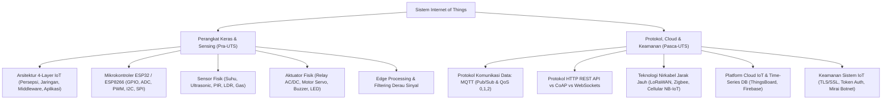

# Rangkuman Materi: Internet of Things (PAIK6204 / MIK1624204)

> **Bobot:** 3 SKS | **Semester:** 2 (Kurikulum 2020) / Semester 7 (Kurikulum 2024) | **Fokus Utama:** Arsitektur IoT, Mikrokontroler & Sensor/Aktuator, Protokol Komunikasi (MQTT, HTTP, CoAP), Cloud IoT Platform, Edge Computing, dan Keamanan IoT

---

## 1. Gambaran Besar Mata Kuliah (*Grand View*)
Mata kuliah **Internet of Things (IoT)** menghubungkan dunia komputasi digital dengan lingkungan fisik nyata (*Cyber-Physical Systems*). IoT memperluas konektivitas internet melampaui perangkat standar (laptop/ponsel) ke miliaran benda sehari-hari (*smart devices*) yang dilengkapi sensor untuk mengumpulkan data, mikrokontroler untuk memproses, dan aktuator untuk melakukan aksi fisik.

Dalam peta keilmuan **Informatika**, IoT mengintegrasikan berbagai domain:
* **Embedded Programming:** Pemrograman mikrokontroler (C/C++ Arduino framework, MicroPython pada ESP32).
* **Jaringan Komputer & Protokol Ringan:** MQTT, CoAP, WebSockets, Bluetooth Low Energy (BLE), LoRaWAN.
* **Cloud Computing & Big Data:** Manajemen *time-series data*, broker pesan, dan visualisasi dasbor (ThingsBoard, InfluxDB, Grafana).
* **Artificial Intelligence of Things (AIoT):** *Edge AI / TinyML* untuk inferensi model *machine learning* langsung di mikrokontroler tanpa latensi internet.

---

## 2. Peta Silabus & Konsep Inti Perkuliahan

### A. Bagian Pra-UTS (Arsitektur IoT, Hardware ESP32 & Sensor/Aktuator)

#### 1. Arsitektur Berlapis Sistem IoT (*4-Layer IoT Architecture*)
1. **Perception / Sensing Layer (Lapisan Fisik):**
   * Berinteraksi langsung dengan lingkungan fisik.
   * Komponen: Sensor (pengumpul data), Aktuator (penggerak fisik), RFID tag, kamera.
2. **Network / Transmission Layer (Lapisan Jaringan):**
   * Mentransmisikan data dari perangkat *edge* menuju gateway atau server pusat.
   * Teknologi: Wi-Fi (802.11), BLE, Zigbee, LoRaWAN, Cellular (4G/5G/NB-IoT).
3. **Middleware / Data Processing Layer (Lapisan Pengolahan):**
   * Mengelola penyimpanan basis data skala besar (*Big Data* / *Time-Series Database*), analitik data, *Message Broker*, dan inferensi AI.
   * Platform: Apache Kafka, Mosquitto MQTT Broker, AWS IoT Core, Google Cloud IoT.
4. **Application Layer (Lapisan Pengguna):**
   * Menampilkan dasbor antarmuka grafis kepada pengguna akhir (*Smart Home, Smart Agriculture, Smart City, Smart Healthcare, Industrial IoT*).

#### 2. Mikrokontroler ESP32: Fitur & Antarmuka Perangkat Keras
ESP32 adalah mikrokontroler SoC (*System on Chip*) standar industri yang menjadi fokus perkuliahan:
* **Spesifikasi:** Dual-Core 32-bit Xtensa LX6, frekuensi clock hingga 240 MHz, memori SRAM 520 KB, Wi-Fi 802.11 b/g/n terintegrasi, dan Bluetooth v4.2 BR/EDR & BLE.
* **Antarmuka Peripheral (Pinout):**
  * **GPIO (*General Purpose Input/Output*):** Pin digital input/output.
  * **ADC (*Analog to Digital Converter*):** Mengubah tegangan analog (0 – 3.3V) menjadi nilai digital (resolusi default 12-bit: $0 - 4095$).
  * **DAC (*Digital to Analog Converter*):** Menghasilkan tegangan analog murni.
  * **PWM (*Pulse Width Modulation*):** Mengatur kecepatan motor atau kecerahan LED melalui manipulasi *duty cycle*.
  * **Protokol Bus:**
    * **I2C (*Inter-Integrated Circuit*):** Komunikasi 2 kabel (SDA = data, SCL = clock), mendukung multi-slave via pengalamatan 7-bit (misal: layar LCD OLED $0x3C$).
    * **SPI (*Serial Peripheral Interface*):** Komunikasi 4 kabel berkecepatan tinggi (MOSI, MISO, SCK, CS/SS).
    * **UART (*Universal Asynchronous Receiver-Transmitter*):** Komunikasi serial (TX, RX).

#### 3. Sensor dan Aktuator Standar
* **Sensor Digital vs Analog:**
  * Sensor Suhu/Kelembaban: DHT11/DHT22 (Digital 1-wire), BME280 (I2C/SPI presisi tinggi).
  * Sensor Jarak: Ultrasonic HC-SR04 (mengukur waktu pantul gelombang suara via pin *Trig* dan *Echo*: $\text{Jarak} = \frac{\text{Waktu} \times 0.0343}{2}\text{ cm}$).
  * Sensor Kehadiran: PIR (*Passive Infrared* - mendeteksi radiasi panas tubuh).
  * Sensor Intensitas Cahaya: LDR (*Light Dependent Resistor* dengan rangkaian pembagi tegangan).
* **Aktuator:**
  * **Relay:** Saklar mekanis/elektromagnetis yang memungkinkan pin mikrokontroler tegangan rendah (3.3V/5V DC) mengendalikan beban tegangan tinggi (220V AC, misal lampu, pompa air).
  * **Motor Servo:** Motor dengan kontrol posisi sudut presisi ($0^\circ - 180^\circ$) via sinyal PWM.

---

### B. Bagian Pasca-UTS (Protokol Komunikasi, Cloud, & Keamanan)

#### 1. Protokol Komunikasi: MQTT vs HTTP
* **MQTT (*Message Queuing Telemetry Transport*):**
  * Protokol standar de facto IoT berbasis pola **Publish / Subscribe (Pub/Sub)** di atas layer TCP/IP.
  * *Komponen Arsitektur:*
    * **Publisher:** Klien yang mempublikasikan data sensor ke sebuah **Topic**.
    * **Broker:** Server pusat penerima pesan (misal: Eclipse Mosquitto, EMQX, HiveMQ) yang meneruskan data ke klien yang berlangganan.
    * **Subscriber:** Klien yang mendaftar pada topic tertentu untuk menerima data secara instan (*event-driven*).
    * **Topic:** String hierarkis alamat data (contoh: `kampus/fsm/lab_if/suhu`).
  * *Tiga Level Kualitas Layanan (Quality of Service - QoS):*
    * **QoS 0 (At most once / Kirim dan Lupakan):** Pesan dikirim sekali tanpa konfirmasi penerimaan (*No ACK*). Paling cepat, risiko pesan hilang jika jaringan putus.
    * **QoS 1 (At least once / Minimal sekali):** Pengirim menunggu pesan `PUBACK`. Jika tidak diterima, pesan dikirim ulang. Menjamin sampai, tetapi berpotensi duplikasi.
    * **QoS 2 (Exactly once / Tepat sekali):** Jaminan transaksi 4 langkah (`PUBLISH` $\rightarrow$ `PUBREC` $\rightarrow$ `PUBREL` $\rightarrow$ `PUBCOMP`). Menjamin pesan sampai tepat sekali tanpa duplikasi, overhead terbesar.
* **Perbandingan MQTT vs HTTP/REST:**

| Parameter | MQTT | HTTP / REST |
|:---|:---|:---|
| **Pola Arsitektur** | Publish / Subscribe via Broker | Client - Server Request / Response |
| **Ukuran Header** | Sangat Ringan (Minimal 2 Byte) | Berat (Ratusan Byte per Request) |
| **Konsumsi Daya & Bandwidth** | Sangat Rendah (Hemat Baterai) | Tinggi |
| **Komunikasi Realtime** | *Push* otomatis secara instan | Harus melakukan *Polling* berkala |
| **Kesesuaian IoT** | Sangat Ideal untuk perangkat *constrained* | Cocok untuk transfer file besar / Web API |

#### 2. Protokol Komunikasi Alternatif: CoAP & WebSocket
* **CoAP (*Constrained Application Protocol*):** Mengadopsi model REST (GET, POST, PUT, DELETE) namun berjalan di atas protokol **UDP** (bukan TCP) untuk meminimalkan *handshake latency* pada perangkat bersumber daya amat terbatas.
* **WebSocket:** Koneksi dua arah (*full-duplex*) persisten melalui satu socket TCP, ideal untuk pembaruan dasbor web secara interaktif.

#### 3. Platform Cloud IoT & Time-Series Database
* Data sensor IoT memiliki karakteristik terikat waktu (*time-series*).
* **Time-Series DB (TSDB):** InfluxDB, TimescaleDB, Prometheus (jauh lebih efisien daripada RDBMS MySQL untuk menyimpan jutaan titik data sensor per detik).
* **Platform IoT:** ThingsBoard (open-source), Blynk (kontrol seluler instan), Adafruit IO, Firebase Realtime Database.

#### 4. Keamanan Sistem IoT (*IoT Cybersecurity*)
* **Titik Rentan IoT:**
  * Penggunaan kredensial *default* pabrik (misal `admin/admin` pada kamera IP yang dimanfaatkan oleh **Mirai Botnet** untuk serangan DDoS global).
  * Saluran komunikasi tidak terenkripsi (teks biasa / *plaintext sniffing*).
  * Firmware yang tidak dapat diperbarui secara aman (*Over-The-Air / OTA update* tanpa verifikasi tanda tangan digital).
* **Solusi Keamanan Standar:**
  * Enkripsi jalur komunikasi menggunakan **TLS/SSL** (MQTTS port 8883, HTTPS port 443).
  * Otentikasi perangkat berbasis sertifikat X.509 atau JWT (*JSON Web Token*).

---

## 3. Rumus & Jebakan Kunci Ujian IoT

1. **Jebakan Tegangan Toleransi GPIO ESP32:** ESP32 bekerja pada level logika **3.3 Volt**. Menghubungkan sensor bertegangan 5 Volt secara langsung ke pin input ESP32 tanpa *Logic Level Converter* atau rangkaian pembagi tegangan (*voltage divider*) akan merusak mikrokontroler secara permanen.
2. **Perhitungan Resolusi ADC ESP32:**
   $$\text{Tegangan Terbaca} = \frac{\text{Nilai ADC}}{4095} \times 3.3\text{ Volt}$$
3. **Penyusunan Wildcard Topic MQTT:**
   * Tanda tambah (`+`): *Single-level wildcard*. Contoh: `fsm/+/suhu` mencakup `fsm/if/suhu` dan `fsm/mat/suhu`.
   * Tanda pagar (`#`): *Multi-level wildcard* (hanya di akhir). Contoh: `fsm/#` mencakup seluruh sub-topik di bawah `fsm`.
