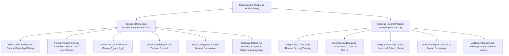

# Rangkuman Materi: Matematika II (Kalkulus Peubah Banyak) (PAIK6203 / MIK1624203)

> **Bobot:** 3 SKS | **Semester:** 2 | **Fokus Utama:** Vektor 3D, Fungsi Peubah Banyak, Turunan Parsial, Gradien & Turunan Berarah, Optimasi Ekstrem & Pengali Lagrange, dan Integral Lipat Dua (*Double Integrals*)

---

## 1. Gambaran Besar Mata Kuliah (*Grand View*)
Mata kuliah **Matematika II (Kalkulus II / Kalkulus Multivariabel)** memperluas konsep kalkulus satu peubah pada semester 1 ke ruang berdimensi banyak ($\mathbb{R}^2, \mathbb{R}^3, \dots, \mathbb{R}^n$). Dalam kenyataan komputasi nyata, sebagian besar fungsi matematis melibatkan ratusan hingga jutaan variabel masukan.

Kalkulus multivariabel memegang peranan mutlak dalam:
* **Machine Learning & Optimasi AI:** Fungsi kerugian (*loss function*) $\mathcal{L}(w_1, w_2, \dots, w_n)$ dioptimasi menggunakan **Vektor Gradien ($\nabla f$)** pada algoritma *Gradient Descent*, *Stochastic Gradient Descent (SGD)*, dan *Adam Optimizer*.
* **Grafika Komputer & Shading 3D:** Perhitungan **Vektor Normal Bidang Singgung** pada permukaan mesh 3D untuk kalkulasi pencahayaan (*Lambertian & Phong Reflection Model*).
* **Pengolahan Citra Digital:** Operator Sobel/Prewitt untuk deteksi tepi (*edge detection*) diturunkan langsung dari aproksimasi diskrit gradien spasial $\left[ \frac{\partial I}{\partial x}, \frac{\partial I}{\partial y} \right]^T$.

---

## 2. Peta Silabus & Konsep Inti Perkuliahan

### A. Bagian Pra-UTS (Geometri Ruang, Turunan Parsial, Gradien & Optimasi)

#### 1. Geometri Vektor di Ruang Tiga Dimensi ($\mathbb{R}^3$)
* **Persamaan Vektor & Parametrik Garis:**
  Garis melalui titik $P_0(x_0, y_0, z_0)$ dengan vektor arah $\mathbf{v} = \langle a, b, c \rangle$:
  $$\mathbf{r}(t) = \mathbf{r}_0 + t\mathbf{v} \implies x = x_0 + at, \quad y = y_0 + bt, \quad z = z_0 + ct$$
* **Persamaan Bidang Datar di $\mathbb{R}^3$:**
  Bidang melalui titik $P_0(x_0, y_0, z_0)$ dengan vektor normal tegak lurus $\mathbf{n} = \langle a, b, c \rangle$:
  $$a(x - x_0) + b(y - y_0) + c(z - z_0) = 0 \iff ax + by + cz = d$$

#### 2. Fungsi Peubah Banyak & Turunan Parsial
* **Fungsi Dua Variabel:** $z = f(x, y)$ memetakan pasangan $(x, y) \in \mathbb{R}^2$ ke nilai riil $z \in \mathbb{R}$.
* **Turunan Parsial Pertama:**
  * $\frac{\partial f}{\partial x}$ ($f_x$): Menurunkan fungsi terhadap variabel $x$, memperlakukan variabel $y$ sebagai sebuah **konstanta tetap**.
  * $\frac{\partial f}{\partial y}$ ($f_y$): Menurunkan fungsi terhadap variabel $y$, memperlakukan variabel $x$ sebagai **konstanta tetap**.
* **Turunan Parsial Campuran & Teorema Clairaut / Schwarz:**
  Jika $f_{xy}$ dan $f_{yx}$ kontinu pada cakram terbuka yang memuat titik $(a, b)$, maka urutan penurunan tidak mempengaruhi hasil akhir:
  $$\mathbf{f_{xy} = f_{yx}} \quad \left( \frac{\partial^2 f}{\partial y \partial x} = \frac{\partial^2 f}{\partial x \partial y} \right)$$

#### 3. Vektor Gradien ($\nabla f$) & Turunan Berarah
* **Operator Del / Gradien ($\nabla f$):** Vektor yang komponen-komponennya adalah turunan parsial pertama:
  $$\nabla f(x, y) = \left\langle \frac{\partial f}{\partial x}, \frac{\partial f}{\partial y} \right\rangle = f_x \mathbf{i} + f_y \mathbf{j}$$
  * *Sifat Fisis Geometris:* Vektor gradien $\nabla f$ selalu menunjuk ke **arah laju kenaikan nilai fungsi yang paling curam / tercepat (*steepest ascent*)**, dengan laju maksimum sebesar $\|\nabla f\|$.
  * Arah laju penurunan tercepat (*steepest descent*) adalah sebaliknya: $-\nabla f$.
* **Turunan Berarah (*Directional Derivative*):**
  Laju perubahan fungsi $f$ pada arah vektor satuan $\mathbf{u} = \langle u_1, u_2 \rangle$ ($\|\mathbf{u}\| = 1$):
  $$D_{\mathbf{u}} f(x, y) = \nabla f(x, y) \cdot \mathbf{u} = f_x u_1 + f_y u_2 = \|\nabla f\| \cos \theta$$

#### 4. Bidang Singgung dan Garis Normal
Untuk permukaan kurva implisit $F(x, y, z) = c$:
* Vektor normal pada titik $(x_0, y_0, z_0)$ adalah: $\mathbf{n} = \nabla F(x_0, y_0, z_0) = \langle F_x, F_y, F_z \rangle$.
* **Persamaan Bidang Singgung (*Tangent Plane*):**
  $$F_x(x - x_0) + F_y(y - y_0) + F_z(z - z_0) = 0$$

#### 5. Optimasi Ekstrem Bebas & Uji Determinan Hessian
* Titik kritis diperoleh dari kondisi gradien nol: $\nabla f(x, y) = \mathbf{0} \iff f_x(x, y) = 0 \text{ dan } f_y(x, y) = 0$.
* **Uji Turunan Parsial Kedua (Diskriminan Hessian $D$):**
  $$D = f_{xx} f_{yy} - (f_{xy})^2$$
  1. Jika $D > 0$ dan $f_{xx} > 0 \implies$ Titik **Minimum Lokal**.
  2. Jika $D > 0$ dan $f_{xx} < 0 \implies$ Titik **Maksimum Lokal**.
  3. Jika $D < 0 \implies$ Titik **Pelana (*Saddle Point*)** (bukan ekstrem).
  4. Jika $D = 0 \implies$ Uji tidak memberikan kesimpulan (*inconclusive*).

#### 6. Optimasi Berkendala dengan Metode Pengali Lagrange (*Lagrange Multipliers*)
Untuk mencari nilai maksimum/minimum dari fungsi objektif $f(x, y, z)$ yang dibatasi oleh fungsi kendala $g(x, y, z) = k$:
* Selesaikan sistem persamaan vektor gradien sejajar:
  $$\mathbf{\nabla f = \lambda \nabla g} \quad \text{dan} \quad g(x, y, z) = k$$
  *(di mana $\lambda$ adalah skalar pengali Lagrange).*

---

### B. Bagian Pasca-UTS (Integral Lipat Dua & Aplikasinya)

#### 1. Integral Lipat Dua (*Double Integrals*)
* Integral lipat dua dari fungsi $z = f(x, y)$ di atas daerah bidang $R$:
  $$\iint_R f(x, y) \, dA$$
  Secara geometris merepresentasikan **volume padat** yang berada di bawah permukaan permukaan $z = f(x, y) \ge 0$ dan di atas daerah alas $R$ pada bidang $xy$.
* **Teorema Fubini:** Pada daerah persegi panjang $R = [a, b] \times [c, d]$, urutan integrasi dapat dibalik:
  $$\iint_R f(x, y) \, dA = \int_a^b \int_c^d f(x, y) \, dy \, dx = \int_c^d \int_a^b f(x, y) \, dx \, dy$$

#### 2. Integral Lipat Dua pada Daerah Umum
* **Daerah Tipe I (Batas $x$ konstan, $y$ kurva):**
  $$R = \{(x, y) \mid a \le x \le b, \; g_1(x) \le y \le g_2(x)\} \implies \int_a^b \left[ \int_{g_1(x)}^{g_2(x)} f(x, y) \, dy \right] dx$$
* **Daerah Tipe II (Batas $y$ konstan, $x$ kurva):**
  $$R = \{(x, y) \mid c \le y \le d, \; h_1(y) \le x \le h_2(y)\} \implies \int_c^d \left[ \int_{h_1(y)}^{h_2(y)} f(x, y) \, dx \right] dy$$

#### 3. Integral Lipat Dua dalam Koordinat Polar (Kutub)
Sangat efisien untuk daerah $R$ yang berbentuk lingkaran, cakram, atau cincin:
* Hubungan transformasi: $x = r \cos \theta, \quad y = r \sin \theta, \quad x^2 + y^2 = r^2$.
* **Elemen Luas Jacobian Polar ($dA$):**
  $$\mathbf{dA = r \, dr \, d\theta} \quad \text{(Wajib memuat faktor } r \text{!)}$$
  $$\iint_R f(x, y) \, dA = \int_{\alpha}^{\beta} \int_{r_1(\theta)}^{r_2(\theta)} f(r\cos\theta, r\sin\theta) \cdot \mathbf{r} \, dr \, d\theta$$

#### 4. Aplikasi Fisik & Geometri Integral Lipat
* **Luas Daerah $R$:** $A = \iint_R 1 \, dA$.
* **Massa Total Pelat Tipis (*Lamina*) dengan Rapat Massa $\rho(x, y)$:**
  $$M = \iint_R \rho(x, y) \, dA$$
* **Pusat Massa $(\bar{x}, \bar{y})$:**
  $$\bar{x} = \frac{M_y}{M} = \frac{1}{M} \iint_R x \, \rho(x, y) \, dA, \quad \bar{y} = \frac{M_x}{M} = \frac{1}{M} \iint_R y \, \rho(x, y) \, dA$$

---

## 3. Rumus Cepat & Jebakan Kunci Ujian Kompre

1. **Jebakan Jacobian Polar:** Jangan pernah menulis $dA = dr \, d\theta$. Lupa menyertakan faktor pengali $r$ pada $dA = r \, dr \, d\theta$ akan menyebabkan seluruh integrasi salah fatal.
2. **Jebakan Teorema Clairaut:** Turunan silang $f_{xy} = f_{yx}$ hanya berlaku jika fungsi dan turunan parsialnya kontinu.
3. **Arah Gradient Descent:** Arah kenaikan tercepat adalah $+\nabla f$, sedangkan arah penyesuaian bobot pada Machine Learning adalah menuju minimum, yaitu arah berlawanan: $-\nabla f$.
