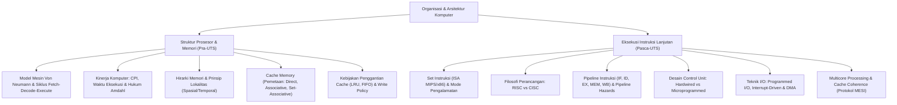

# Rangkuman Materi: Organisasi dan Arsitektur Komputer (PAIK6205 / MIK1624205)

> **Bobot:** 3 SKS | **Semester:** 2 | **Fokus Utama:** Arsitektur Von Neumann, Set Instruksi (ISA), RISC vs CISC, Hirarki & Pemetaan Cache Memory, Pipelining & Hazard, Control Unit, Sistem I/O & DMA, serta Multicore

---

## 1. Gambaran Besar Mata Kuliah (*Grand View*)
Mata kuliah **Organisasi dan Arsitektur Komputer (Orkom / Arkod)** menjembatani kesenjangan antara perangkat keras elektronik tingkat rendah (*hardware digital circuits*) dengan perangkat lunak tingkat tinggi (*software stack*). Mata kuliah ini membedah bagaimana instruksi biner yang dihasilkan oleh *compiler* diterjemahkan dan dieksekusi secara fisik oleh silikon prosesor:
* **Arsitektur Komputer (*Computer Architecture*):** Atribut sistem komputer yang terlihat (*visible*) oleh pemrogram bahasa rakitan / *assembly*. Meliputi set instruksi (ISA), jumlah bit representasi data, mekanisme I/O, dan teknik pengalamatan memori.
* **Organisasi Komputer (*Computer Organization*):** Unit-unit operasional fisik beserta interkoneksinya yang merealisasikan spesifikasi arsitektural tersebut. Meliputi sinyal kontrol perangkat keras, antarmuka memori, teknologi sirkuit, dan *clock speed*.

---

## 2. Peta Silabus & Konsep Inti Perkuliahan

### A. Bagian Pra-UTS (Arsitektur Dasar, Siklus Instruksi, & Cache Memory)

#### 1. Arsitektur Von Neumann & Siklus Instruksi
* **Komponen Kunci Arsitektur Von Neumann (1945):**
  * Konsep Program Tersimpan (*Stored-Program Concept*): Data dan program instruksi disimpan bersama dalam ruang memori baca-tulis yang sama.
  * Memori utama dialamati secara linier tanpa memandang jenis data di dalamnya.
  * Unit Pemroses Sentral (CPU) terdiri atas: **ALU** (aritmetika/logika), **Control Unit**, dan **Register Internal**.
* **Register Internal Kunci CPU:**
  * **PC (*Program Counter*):** Menyimpan alamat memori instruksi berikutnya yang akan dieksekusi.
  * **IR (*Instruction Register*):** Menyimpan kode biner instruksi yang baru saja diambil dan sedang didekode.
  * **MAR (*Memory Address Register*):** Menyimpan alamat memori fisik yang akan diakses untuk operasi baca/tulis.
  * **MBR / MDR (*Memory Buffer / Data Register*):** Menyimpan kata data yang baru dibaca dari atau akan ditulis ke memori.
* **Siklus Instruksi Dasar (*Instruction Cycle*):**
  1. **Fetch Cycle:** CPU mengambil instruksi dari alamat memori `[PC]` ke `IR`, lalu menaikkan nilai `PC` ke instruksi berikutnya.
  2. **Decode Cycle:** Control Unit menafsirkan *Opcode* untuk menentukan operasi dan operand.
  3. **Execute Cycle:** ALU menjalankan operasi komputasi atau memanipulasi register.
  4. **Interrupt Cycle:** CPU memeriksa apakah ada sinyal interupsi perangkat keras. Jika ada, status program saat ini disimpan ke *stack*, dan CPU melompat ke *Interrupt Service Routine* (ISR).

#### 2. Metrik Kinerja Prosesor & Hukum Amdahl
* **Waktu Eksekusi CPU (*CPU Execution Time*):**
  $$\text{CPU Time} = \text{Instruction Count (IC)} \times \text{CPI} \times \text{Clock Cycle Time} = \frac{\text{IC} \times \text{CPI}}{\text{Clock Rate}}$$
  *(di mana $\text{CPI} = \text{Cycles Per Instruction}$).*
* **Hukum Amdahl (*Amdahl's Law*):**
  Peningkatan performa total (*Speedup* $S$) sistem yang dibatasi oleh fraksi program $f$ yang dapat ditingkatkan kecepatannya sebanyak $k$ kali:
  $$S = \frac{1}{(1 - f) + \frac{f}{k}}$$
  *Konsekuensi:* Jika $20\%$ bagian program bersifat sekuensial murni ($f = 0.8$), penambahan prosesor tak terhingga ($k \to \infty$) hanya akan menghasilkan *speedup* maksimal $\frac{1}{1 - 0.8} = 5\times$ lipat.

#### 3. Hirarki Memori & Prinsip Lokalitas
* **Prinsip Lokalitas Referensi (*Locality of Reference*):**
  * **Lokalitas Temporal:** Jika sebuah lokasi memori diakses sekarang, lokasi yang sama cenderung akan diakses kembali dalam waktu dekat (contoh: variabel loop `i`).
  * **Lokalitas Spasial:** Jika sebuah lokasi memori diakses sekarang, lokasi memori di sekitarnya cenderung akan segera diakses (contoh: elemen array sekuensial).
* **Organisasi Hirarki Memori:**
  Register CPU ($< 1$ ns) $\rightarrow$ Cache L1/L2/L3 (sub-nanodetik s.d. belasan ns) $\rightarrow$ RAM Utama (puluhan ns) $\rightarrow$ Solid State Drive / HDD (mikrodetik s.d. milidetik).

#### 4. Cache Memory: Fungsi Pemetaan & Kebijakan
* **Waktu Akses Rata-Rata (*Average Memory Access Time - AMAT*):**
  $$\text{AMAT} = \text{Hit Time} + (\text{Miss Rate} \times \text{Miss Penalty})$$
* **Tiga Fungsi Pemetaan Alamat Cache (*Mapping Functions*):**
  1. **Direct Mapping (Pemetaan Langsung):** Setiap blok memori utama hanya dapat dipetakan ke tepat satu *line* cache tertentu:
     $$\text{Line Number} = (\text{Block Address}) \pmod{\text{Number of Lines in Cache}}$$
     *Struktur Alamat:* `[ Tag | Line / Slot Index | Word Offset ]`.
     *Sifat:* Murah dan sangat cepat, namun rentan *conflict miss* jika dua blok bersaing di line yang sama.
  2. **Fully Associative Mapping:** Sebuah blok memori utama bebas diletakkan di *line* cache mana saja yang kosong.
     *Struktur Alamat:* `[ Tag | Word Offset ]`.
     *Sifat:* Meminimalkan *conflict miss*, namun membutuhkan sirkuit pembanding (*hardware comparator*) paralel yang mahal dan kompleks.
  3. **$k$-Way Set-Associative Mapping (Kompromi Standar CPU Modern):** Cache dibagi menjadi beberapa *Set*, dan setiap set terdiri atas $k$ buah *line*. Blok dipetakan ke set tertentu, namun bebas memilih line di dalam set tersebut.
     *Struktur Alamat:* `[ Tag | Set Index | Word Offset ]`.
* **Kebijakan Penggantian Line (*Replacement Policy*):**
  * **LRU (*Least Recently Used*):** Mengganti blok yang paling lama tidak diakses (paling optimal mendekati ideal).
  * **FIFO (*First-In First-Out*):** Mengganti blok yang paling lama berada di cache.
* **Kebijakan Penulisan (*Write Policy*):**
  * **Write-Through:** Setiap operasi penulisan data ke cache langsung dituliskan secara serempak ke RAM utama. Menjamin konsistensi data, namun lambat.
  * **Write-Back:** Data hanya ditulis ke cache. Penulisan ke RAM utama ditunda hingga blok tersebut digusur (*evicted*), ditandai dengan **Dirty Bit = 1**. Jauh lebih cepat.

---

### B. Bagian Pasca-UTS (ISA, RISC/CISC, Pipelining, & I/O)

#### 1. Set Instruksi (ISA) & Mode Pengalamatan
* **Format Instruksi:** Terdiri atas *Opcode* (kode operasi yang dieksekusi) dan *Operand Reference* (alamat/register sumber dan tujuan).
* **Mode Pengalamatan Utama (*Addressing Modes*):**
  * **Immediate:** Nilai operand berada langsung di dalam instruksi (`ADD R1, #5`). Sangat cepat, ukuran rentang angka terbatas.
  * **Direct:** Bidang alamat memuat alamat fisik memori dari operand (`ADD R1, 1000`).
  * **Indirect:** Bidang alamat memuat alamat memori dari sel yang menyimpan alamat fisik operand sebenarnya (`ADD R1, (1000)`).
  * **Register & Register Indirect:** Operand disimpan di dalam register CPU (`ADD R1, R2` dan `ADD R1, (R2)`).
  * **Displacement / Base-Register / Indexing:** Alamat efektif $= \text{Isi Register} + \text{Offset}$ (fondasi pengaksesan array dan objek *struct*).

#### 2. Filosofi Perancangan: RISC vs CISC
* **CISC (*Complex Instruction Set Computer* - contoh: Intel x86):**
  * Menekankan kekayaan fungsionalitas pada perangkat keras.
  * Ratusan instruksi dengan format panjang bervariasi (*variable-length*).
  * Operasi memori dapat dilakukan langsung di dalam instruksi aritmetika (misal: `ADD [EAX], EBX`).
  * Kontroler internal diimplementasikan via **Microprogrammed Control**.
* **RISC (*Reduced Instruction Set Computer* - contoh: ARM, MIPS, RISC-V):**
  * Menekankan efisiensi eksekusi pipelining perangkat keras.
  * Set instruksi sederhana dan sedikit, ukuran instruksi seragam (*fixed 32-bit*).
  * **Load/Store Architecture:** Operasi aritmetika hanya dapat dieksekusi antar-register internal CPU; akses memori dibatasi secara eksklusif hanya melalui instruksi `LOAD` dan `STORE`.
  * Jumlah register umum (*GPR*) sangat banyak.
  * Kontroler diimplementasikan secara **Hardwired Control** murni untuk kecepatan maksimal 1 siklus per instruksi.

#### 3. Pipeline Instruksi (Instruction Pipelining)
Memecah eksekusi instruksi menjadi beberapa tahapan independen yang berjalan serempak secara paralel seperti ban berjalan pabrik (*assembly line*).
* **Standar 5-Stage Pipeline MIPS:**
  1. **IF (Instruction Fetch):** Ambil instruksi dari memori instruksi.
  2. **ID (Instruction Decode & Register Fetch):** Baca opcode dan ambil isi register sumber.
  3. **EX (Execution / Address Calculation):** Hitung operasi di ALU.
  4. **MEM (Memory Access):** Baca/tulis data ke memori data (hanya aktif untuk `Load/Store`).
  5. **WB (Write Back):** Tuliskan hasil akhir kembali ke register tujuan.
* **Tiga Hambatan Pipeline (*Pipeline Hazards*):**
  1. **Structural Hazard:** Dua tahapan pipeline berebut komponen fisik perangkat keras yang sama pada siklus clock yang sama (misal memori instruksi dan memori data disatukan tanpa cache terpisah $\rightarrow$ Solusi: *Harvard Architecture* memisahkan Instruction Cache dan Data Cache).
  2. **Data Hazard (Ketergantungan Data / RAW - Read After Write):** Instruksi membutuhkan hasil perhitungan dari instruksi sebelumnya yang belum selesai ditulis ke register.
     * *Solusi Perangkat Keras:* **Data Forwarding / Bypassing** (mengalirkan hasil langsung dari output ALU tahap EX ke input ALU tahap berikutnya tanpa menunggu tahap WB selesai) atau penyisipan jeda (*Pipeline Stall / Bubble*).
  3. **Control / Branch Hazard:** Pipeline tidak tahu instruksi mana yang harus diambil berikutnya saat menemui instruksi percabangan bersyarat (`beq/bne`) sebelum kondisi cabang selesai dievaluasi.
     * *Solusi:* **Branch Prediction** (statik atau dinamik menggunakan tabel histori *Branch Target Buffer*) dan *Delayed Branching*.

#### 4. Teknik Transfer Input/Output (I/O)
* **Programmed I/O:** CPU memegang kendali penuh dan terus-menerus melakukan pemeriksaan status (*polling loop*) pada modul I/O hingga perangkat siap. CPU membuang banyak siklus berharga dalam status menunggu.
* **Interrupt-Driven I/O:** CPU mengeluarkan perintah I/O ke modul, lalu melanjutkan eksekusi program lain. Ketika modul I/O siap mengirim/menerima data, modul mengirimkan sinyal interupsi perangkat keras ke CPU. CPU menangguhkan pekerjaannya untuk mentransfer 1 kata data, lalu melanjutkan kembali.
* **Direct Memory Access (DMA):** Untuk pertukaran data berukuran besar (misal disk drive). Modul DMA mengambil alih bus (*bus mastering*) dan mentransfer seluruh blok data **secara langsung antara perangkat I/O dan RAM utama** tanpa melibatkan CPU. CPU hanya diinterupsi sekali setelah seluruh blok transfer selesai.

---

## 3. Rumus & Rumus Cepat Komprehensif

1. **Jumlah Bit Alamat untuk Cache Set-Associative:**
   $$\text{Ukuran Alamat} = \text{Tag Bits} + \text{Set Index Bits} + \text{Word Offset Bits}$$
   * $\text{Word Offset} = \log_2(\text{Ukuran Blok dalam Byte})$
   * $\text{Set Index} = \log_2(\text{Jumlah Set})$
   * $\text{Jumlah Set} = \frac{\text{Kapasitas Cache}}{\text{Ukuran Blok} \times k}$ (untuk $k$-way)
2. **Speedup Pipeline Ideal:**
   $$S_k = \frac{n \times k}{k + (n - 1)} \xrightarrow{n \to \infty} k$$
   *(di mana $k$ adalah jumlah tahapan pipeline, $n$ adalah jumlah instruksi).*
