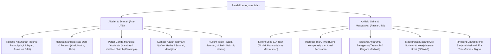

# Rangkuman Materi: Pendidikan Agama (MPK6002 / UNW00001)

> **Bobot:** 2 SKS | **Semester:** 2 | **Fokus Utama:** Konsep Ketuhanan (Tauhid), Hakikat Manusia, Sumber Hukum Islam (Al-Qur'an, Hadits, Ijtihad), Akhlak & Moralitas, Integrasi Islam & Sains Komputasi, serta Kerukunan Umat Beragama

---

## 1. Catatan Integritas & Karakteristik Mata Kuliah
> [!NOTE]
> **Kedudukan Mata Kuliah dalam Kurikulum:**
> Mata kuliah **Pendidikan Agama** adalah Mata Kuliah Wajib Umum (MKWU) Pembinaan Kepribadian dari Kementerian Pendidikan Tinggi dan Universitas Diponegoro. Repositori Google Drive DMW HMIF Undip secara spesifik menghimpun silabus dan arsip ujian **Pendidikan Agama Islam** (kode berkas `UNW00001`). Mahasiswa beragama lain (Kristen, Katolik, Hindu, Buddha, Khonghucu) menempuh silabus pembinaan teologi dan etika sesuai agamanya masing-masing.

---

## 2. Gambaran Besar Mata Kuliah (*Grand View*)
Pendidikan Agama bertujuan membentuk sarjana Informatika yang tidak hanya unggul secara intelektual dan kompetensi teknis, melainkan memiliki integritas spiritual (*iman*), landasan moral ketuhanan (*ihsan*), dan tanggung jawab etis (*akhlak karimah*) dalam pemanfaatan teknologi informasi di tengah masyarakat:
* **Integrasi Keilmuan & Iman:** Menghilangkan dikotomi antara ilmu agama dan sains sekuler; komputasi dan sains dipandang sebagai ayat-ayat kauniyah (tanda kebesaran Tuhan di alam semesta).
* **Etika Rekayasa Teknologi Informasi:** Membangun benteng moral terhadap penyalahgunaan kecerdasan buatan, manipulasi data digital, pornografi siber, dan pelanggaran privasi (*cybercrime*).

---

## 3. Peta Silabus & Konsep Inti Perkuliahan

### A. Bagian Pra-UTS (Teologi, Hakikat Manusia & Sumber Ajaran)

#### 1. Konsep Ketuhanan dan Akidah Islam
* **Makna Tauhid:** Mengesakan Allah SWT dalam segala aspek eksistensi dan peribadahan.
* **Tiga Dimensi Tauhid:**
  1. **Tauhid Rububiyah:** Meyakini bahwa Allah adalah satu-satunya Pencipta, Pemelihara, Pengatur, dan Pemilik alam semesta beserta isinya.
  2. **Tauhid Uluhiyah:** Mengesakan Allah dalam segala bentuk ibadah dan penghambaan murni; menolak segala bentuk perbuatan syirik.
  3. **Tauhid Asma' wa Sifat:** Mengimani nama-nama (*Asmaul Husna*) dan sifat-sifat kesempurnaan Allah sebagaimana yang termaktub dalam Al-Qur'an dan Hadits sahih tanpa menolaknya (*ta'thil*), menyerupakannya dengan makhluk (*tasybih*), atau mempertanyakan rincian bentuk hakikinya (*takyif*).

#### 2. Hakikat dan Eksistensi Manusia
* **Unsur Pembentuk Manusia:**
  * Unsur Materi / Jasmani (berasal dari tanah / saripati bumi).
  * Unsur Imateri / Ruhani (ditiupkan ruh oleh Allah yang memuat fitrah ketuhanan, kalbu, akal pikiran, dan hawa nafsu).
* **Fungsi dan Kedudukan Manusia di Bumi:**
  1. Sebagai **'Abdullah (Hamba Allah):** Menjalankan ibadah vertikal dan kepatuhan total kepada syariat Pencipta (QS. Adz-Dzariyat: 56).
  2. Sebagai **Khalifah fil Ardh (Pemakmur Bumi):** Memimpin, mengelola alam semesta, memajukan peradaban, dan menebarkan kemaslahatan (*rahmatan lil 'alamin*) melalui penguasaan sains dan teknologi (QS. Al-Baqarah: 30).

#### 3. Sumber-Sumber Hukum Islam
1. **Al-Qur'an:** Sumber rujukan hukum tertinggi dan utama yang diturunkan secara mutawatir kepada Nabi Muhammad SAW. Memuat prinsip-prinsip universal akidah, syariat, dan akhlak.
2. **Hadits / As-Sunnah:** Perkataan, perbuatan, dan ketetapan Nabi Muhammad SAW. Berfungsi sebagai penjelas (*bayan*), merinci hal umum dalam Al-Qur'an (*bayan tafshil*), menetapkan hukum yang belum ada di Al-Qur'an, atau menguatkan hukum yang ada.
3. **Ijtihad:** Pengerahan daya nalar intelektual secara optimal oleh para ulama/ahli hukum untuk menetapkan status hukum suatu perkara kontemporer yang tidak ditemukan nash tegasnya secara langsung:
   * **Ijma':** Kesepakatan bulat para mujtahid pada suatu masa setelah wafatnya Rasulullah mengenai hukum syara'.
   * **Qiyas:** Menganalogikan hukum perkara baru dengan perkara lama yang sudah ada nashnya karena memiliki kesamaan *'illat* (sebab hukum).
   * **Maslahah Mursalah:** Penetapan hukum berdasarkan pertimbangan kemaslahatan umum demi memelihara tujuan syariat (*Maqashid Syariah*: menjaga agama, jiwa, akal, keturunan, dan harta).

#### 4. Kategori Hukum Taklifi
* **Wajib (Fardhu):** Dikerjakan berpahala, ditinggalkan berdosa (Wajib 'Ain dan Wajib Kifayah).
* **Sunnah (Mandub):** Dikerjakan berpahala, ditinggalkan tidak berdosa.
* **Mubah (Jaiz):** Bebas memilih; dikerjakan atau ditinggalkan tidak berdosa dan tidak berpahala.
* **Makruh:** Ditinggalkan berpahala, dikerjakan tidak berdosa (dibenci Allah).
* **Haram:** Ditinggalkan berpahala, dikerjakan berdosa secara mutlak.

---

### B. Bagian Pasca-UTS (Akhlak, Sains Komputasi & Kerukunan Beragama)

#### 1. Konsep Akhlak, Moral, dan Etika
* **Etika:** Sistem penilaian baik-buruk yang bersumber dari konsensus akal manusia dan filosofi budaya.
* **Moral:** Tolok ukur kepatutan perilaku yang bersumber dari norma dan tradisi masyarakat tertentu.
* **Akhlak:** Perilaku yang tertanam kuat dalam jiwa manusia yang memancar secara spontan tanpa memerlukan pertimbangan yang rumit, dengan tolok ukur wahyu Ilahi (Al-Qur'an dan Sunnah).
  * **Akhlak Mahmudah (Terpuji):** Jujur (*shidq*), amanah, adil, rendah hati (*tawadhu*), pemaaf.
  * **Akhlak Mazmumah (Tercela):** Khianat, dusta, sombong (*takabbur*), iri dengki (*hasad*), tamak.

#### 2. Hubungan Islam dengan Ilmu Pengetahuan dan Teknologi
* Islam memandang menuntut ilmu sebagai kewajiban mutlak bagi setiap muslim (*faridhatun 'ala kulli muslim*). Ayat pertama Al-Qur'an adalah perintah literasi dan investigasi empiris: *"Iqra'"* (Bacalah!).
* **Peran Komputasi:** Teknologi komputer, kecerdasan buatan, dan internet adalah instrumen modern yang wajib dikuasai umat Islam untuk memajukan peradaban, efisiensi pelayanan kemanusiaan, dan kemaslahatan publik.
* **Etika Penggunaan Teknologi Digital:** Menghindari penyebaran hoaks/fitnah (*namimah*), mengintip rahasia orang lain (*tajassus* / pelanggaran privasi siber), dan menjaga integritas kejujuran akademik.

#### 3. Kerukunan Antarumat Beragama & Moderasi Beragama
* **Prinsip Kebebasan Beragama:** *"Tidak ada paksaan dalam memeluk agama"* (QS. Al-Baqarah: 256) dan *"Untukmu agamamu, dan untukku agamaku"* (QS. Al-Kafirun: 6).
* **Tasamuh (Toleransi):** Menghormati perbedaan keyakinan dan bekerja sama dalam urusan sosial-kemasyarakatan (*muamalah*), tanpa mencampuradukkan ajaran ritual teologis (*akidah*).
* **Preseden Historis Piagam Madinah (*Constitution of Medina*):** Konstitusi tertulis pertama di dunia yang digagas Nabi Muhammad SAW, menyatukan masyarakat majemuk Madinah (Muslim Muhajirin-Anshar, Yahudi berbagai kabilah, dan kaum pagan) sebagai satu kesatuan warga negara (*ummah*) yang setara di depan hukum.

#### 4. Masyarakat Madani & Kesejahteraan Sosial
* Konsep masyarakat beradab yang menjunjung tinggi hukum, keadilan, kebebasan yang bertanggung jawab, dan transparansi publik.
* Instrumen Pengentasan Kemiskinan: **ZISWAF** (Zakat, Infaq, Shadaqah, dan Wakaf) sebagai pilar pemerataan ekonomi umat.

---

## 4. Catatan Khusus Ujian Komprehensif S1 Informatika
> [!NOTE]
> **Relevansi Sidang Komprehensif:** **TIDAK DIUJIKAN**
>
> Mata kuliah Pendidikan Agama adalah mata kuliah pembinaan karakter dan nilai spiritualitas personal mahasiswa. Mata kuliah ini **tidak termasuk dalam mata uji keilmuan komputer pada Ujian Komprehensif Tertulis maupun Sidang Ujian Lisan Komprehensif S1 Informatika**. Mahasiswa cukup memastikan telah lulus mata kuliah ini dengan nilai minimal C sebagai syarat kelulusan yudisium sarjana.
