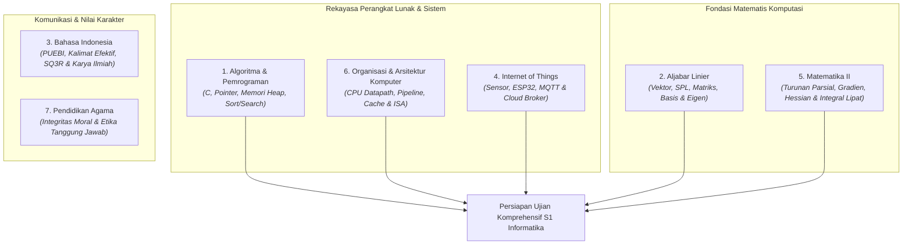

# 🎓 Rangkuman Belajar Ujian Komprehensif Informatika — Semester 2

> **Sintesis Komprehensif Semester 2:** Pemrograman Prosedural C, Aljabar Linier, Arsitektur CPU, IoT, Kalkulus Multivariabel, dan Komunikasi Ilmiah  
> **Departemen:** Informatika, Fakultas Sains dan Matematika, Universitas Diponegoro  
> **Basis Rujukan:** Repositori Resmi [BelajarKompre](https://github.com/khairys/BelajarKompre) (Kurikulum 2020)

---

## 🧭 Peta Besar Kurikulum Semester 2

Semester 2 membangun fondasi rekayasa perangkat lunak dan komputasi fisik yang krusial. Jika di Semester 1 Anda mempelajari logika komputasi dan pemrograman fungsional dasar, di Semester 2 Anda mulai mendalami:
1. **Pemrograman Prosedural & Manajemen Memori Mesin:** Bahasa C, pointer, alokasi memori dinamis heap, serta algoritma pencarian dan pengurutan (*Algoritma dan Pemrograman*).
2. **Perangkat Matematis Komputasi Lanjut:** Matriks, vektor, transformasi linier, eigenvalue (*Aljabar Linier*), serta kalkulus multivariabel dan optimasi ekstrim (*Matematika II*).
3. **Eksekusi Fisik Instruksi oleh Mesin:** Cara kerja CPU, jalur data ALU, siklus *Fetch-Decode-Execute*, *pipelining*, hirarki memori cache, dan sistem I/O (*Organisasi dan Arsitektur Komputer*).
4. **Komputasi Fisik & Komunikasi Jaringan:** Integrasi mikrokontroler dengan sensor lingkungan dan protokol IoT (*Internet of Things*).
5. **Komunikasi Ilmiah & Karakter Moral:** Standar penulisan akademik bahasa baku (*Bahasa Indonesia*) dan integritas moral (*Pendidikan Agama*).



---

## 1. Algoritma dan Pemrograman

> Dokumen acuan lengkap: [`RANGKUMAN_MATERI.md`](https://github.com/khairys/BelajarKompre/blob/main/RANGKUMAN_DAN_CONTOH_SOAL/02_Semester_2/Algoritma_dan_Pemrograman/RANGKUMAN_MATERI.md)

### Apa yang Dipelajari?
Mata kuliah ini mengajarkan paradigma **pemrograman prosedural/imperatif** menggunakan bahasa C. Berbeda dengan pemrograman fungsional murni, bahasa C memberikan kendali penuh terhadap manipulasi status program (*state*), perulangan eksplisit, pointer memori fisik, serta alokasi memori dinamis manual.

### Urutan Materi Inti:
1. **Konsep Dasar Prosedural & Struktur Program C:**
   * Program dieksekusi secara sekuensial baris demi baris, diawali dari fungsi `main(void)`.
   * Tipe data primitif: `int` (bilangan bulat), `float` (presisi tunggal 32-bit), `double` (presisi ganda 64-bit), dan `char` (karakter ASCII).
   * Pembedaan operator penugasan (`=`) dan pembanding kesetaraan (`==`).
2. **Struktur Percabangan (*Conditionals*):**
   * Percabangan evaluasi kondisi: `if`, `if-else`, dan `if-else if-else` bersarang.
   * `switch-case` untuk pencocokan nilai diskrit integer/karakter; wajib memahami fungsi `break` guna mencegah lompatan eksekusi ke case berikutnya (*fall-through*).
3. **Struktur Perulangan (*Loops*):**
   * `for`: Perulangan dengan variabel pencacah yang batas iterasinya telah ditentukan.
   * `while`: Pemeriksaan kondisi di awal (*pre-test loop*).
   * `do-while`: Pemeriksaan kondisi di akhir; badan perulangan dijalankan minimal satu kali (*post-test loop*).
   * Pengendali iterasi: `break` (terminasi paksa perulangan) dan `continue` (melewati sisa iterasi saat ini).
   * Pencegahan galat pergeseran indeks satu langkah (*off-by-one error*, misal `i < n` vs `i <= n`).
4. **Fungsi, Prosedur, & Mekanisme Pengiriman Parameter:**
   * Modularisasi kode: Subprogram bernilai balik (`return`) dan prosedur tanpa nilai balik (`void`).
   * **Pass-by-Value:** Nilai argumen disalin ke parameter fungsi, perubahan di dalam fungsi tidak mempengaruhi variabel asli pemanggil.
   * **Simulasi Pass-by-Reference via Pointer:** Mengirimkan alamat memori variabel menggunakan operator `&` agar fungsi dapat memodifikasi nilai aslinya secara langsung:
     ```c
     void tambahSatu(int *x) {
         (*x)++;
     }
     ```
5. **Tipe Data Bentukan (`struct`):**
   * Mengelompokkan berbagai atribut bertipe berbeda ke dalam satu kesatuan struktur data (contoh: struct `Mahasiswa` dengan atribut `nim`, `nama`, dan `ipk`). Diakses menggunakan operator titik (`mhs.ipk`) atau panah pointer (`ptr->ipk`).
6. **Array & Manipulasi String:**
   * Array: Kumpulan data sejenis berbasis indeks 0. Array multi-dimensi untuk representasi matriks matematika.
   * String dalam C: Array karakter yang diakhiri oleh karakter null terminator (`'\0'`).
   * Fungsi pustaka `<string.h>`: `strlen()` (menghitung panjang), `strcpy()` (menyalin), `strcmp()` (membandingkan leksikografis), dan `strcat()` (menggabungkan). Wajib mengalokasikan buffer yang memadai untuk mencegah *buffer overflow*.
7. **Pointer & Manajemen Memori Dinamis (*Heap*):**
   * Pointer menyimpan alamat memori (`&` untuk mengambil alamat, `*` untuk *dereference* isi alamat).
   * Alokasi dinamis via `<stdlib.h>`:
     * `malloc(size)`: Mengalokasikan blok memori mentah dalam ukuran byte.
     * `calloc(n, size)`: Mengalokasikan dan menginisialisasi byte dengan nilai 0.
     * `realloc(ptr, new_size)`: Mengubah ukuran alokasi memori aktif.
     * `free(ptr)`: Mengembalikan memori ke heap sistem.
   * *Jebakan Memori Kompre:* **Memory Leak** (lupa memanggil `free()`), **Dangling Pointer** (mengakses memori yang sudah di-free), dan **Null Pointer Dereference**.
8. **Algoritma Pencarian (*Searching*):**
   * **Linear Search:** Memeriksa elemen satu per satu. Kompleksitas: Terbaik $\mathcal{O}(1)$, Terburuk $\mathcal{O}(n)$.
   * **Binary Search:** Memeriksa elemen tengah dan membuang separuh data. **Syarat mutlak: Data harus terurut**. Kompleksitas: Terbaik $\mathcal{O}(1)$, Terburuk $\mathcal{O}(\log n)$.
9. **Algoritma Pengurutan (*Sorting*):**
   * Algoritma Kuadratik $\mathcal{O}(n^2)$: **Bubble Sort** (tukar elemen bersebelahan), **Selection Sort** (cari elemen ekstrem), **Insertion Sort** (sisip ke bagian terurut).
   * Algoritma Logaritmik $\mathcal{O}(n \log n)$: **Merge Sort** (*Divide and Conquer*, stabil, butuh memori tambahan $\mathcal{O}(n)$) dan **Quick Sort** (partisi berbasis elemen pivot).
10. **Pemrosesan Berkas (*File Handling*):**
    * Operasi I/O sekunder: `fopen()`, `fclose()`, `fprintf()`, `fscanf()`, dan `fgets()`.
    * Mode akses berkas: `"r"` (baca), `"w"` (tulis ulang / overwrite), dan `"a"` (tambah / append).

---

## 2. Aljabar Linier

> Dokumen acuan lengkap: [`RANGKUMAN_MATERI.md`](https://github.com/khairys/BelajarKompre/blob/main/RANGKUMAN_DAN_CONTOH_SOAL/02_Semester_2/Aljabar_Linier/RANGKUMAN_MATERI.md)

### Apa yang Dipelajari?
Aljabar Linier mempelajari struktur ruang vektor, sistem persamaan linier, matriks, transformasi linier, dan konsep nilai eigen. Bidang ini adalah pilar matematis paling penting bagi *Machine Learning*, pengolahan citra digital (*Computer Vision*), grafika 3D, dan komputasi data besar.

### Urutan Materi Inti:
1. **Aljabar Vektor dalam Ruang $\mathbb{R}^n$:**
   * Operasi dasar penjumlahan komponen dan perkalian skalar:
     $$\mathbf{u} = (2, 3), \quad \mathbf{v} = (4, 1) \implies \mathbf{u} + \mathbf{v} = (6, 4)$$
   * **Panjang / Norma Vektor (*Norm*):**
     $$\|\mathbf{v}\| = \sqrt{v_1^2 + v_2^2 + \cdots + v_n^2}$$
   * **Dot Product (Hasil Kali Titik):**
     $$\mathbf{u} \cdot \mathbf{v} = \sum_{i=1}^n u_i v_i = \|\mathbf{u}\| \|\mathbf{v}\| \cos\theta$$
     *Dua vektor nonnol saling tegak lurus (ortogonal) jika dan hanya jika $\mathbf{u} \cdot \mathbf{v} = 0$.*
   * **Proyeksi Ortogonal:**
     $$\operatorname{proj}_{\mathbf{a}}\mathbf{u} = \frac{\mathbf{u} \cdot \mathbf{a}}{\|\mathbf{a}\|^2}\mathbf{a}$$
   * **Cross Product:** Menghasilkan vektor baru yang ortogonal terhadap dua vektor di $\mathbb{R}^3$.
2. **Sistem Persamaan Linier (SPL):**
   * Representasi matriks $A\mathbf{x} = \mathbf{b}$ dan matriks *augmented* $[A \mid \mathbf{b}]$.
   * Operasi Baris Elementer (OBE): (1) Tukar baris, (2) Kalikan skalar non-nol, (3) Tambahkan kelipatan baris.
   * **Eliminasi Gauss:** Mengubah matriks ke bentuk Eselon Baris dilanjutkan substitusi balik.
   * **Eliminasi Gauss-Jordan:** Mengubah matriks langsung ke bentuk Eselon Baris Tereduksi.
   * Karakteristik solusi SPL: Tepat satu solusi (*konsisten*), tak hingga banyak solusi (*variabel bebas*), atau tidak ada solusi (*inkonsisten*, misal muncul baris $0 = c$).
3. **Matriks, Determinan, & Invers:**
   * Perkalian matriks $A_{m \times p} B_{p \times n} = C_{m \times n}$ (bersifat asosiatif namun **tidak komutatif** $AB \neq BA$).
   * Determinan matriks $2 \times 2$: $\det(A) = ad - bc$.
   * Matriks memiliki invers $A^{-1}$ jika dan hanya jika $\det(A) \neq 0$ (matriks non-singular).
   * Pencarian invers melalui metode Gauss-Jordan:
     $$[A \mid I] \xrightarrow{\text{OBE}} [I \mid A^{-1}]$$
4. **Ruang Vektor & Subruang:**
   * Himpunan yang memenuhi 10 aksioma penambahan dan perkalian skalar.
   * **Uji Subruang:** Cukup membuktikan 3 syarat: (1) Memuat vektor nol $\mathbf{0}$, (2) Tertutup terhadap penjumlahan $\mathbf{u} + \mathbf{v} \in W$, dan (3) Tertutup terhadap perkalian skalar $c\mathbf{u} \in W$.
5. **Kombinasi Linier, Rentang (*Span*), & Kebebasan Linier:**
   * Himpunan vektor $\{\mathbf{v}_1, \dots, \mathbf{v}_k\}$ dikatakan **bebas linier** (*linearly independent*) jika persamaan:
     $$c_1\mathbf{v}_1 + c_2\mathbf{v}_2 + \cdots + c_k\mathbf{v}_k = \mathbf{0}$$
     hanya memiliki satu-satunya solusi trivial $c_1 = c_2 = \cdots = c_k = 0$.
6. **Basis, Dimensi, & Teorema Rank-Nullity:**
   * **Basis:** Himpunan vektor yang bebas linier sekaligus merentang (*spans*) ruang vektor.
   * **Dimensi:** Jumlah vektor pada basis ruang vektor tersebut.
   * **Teorema Rank-Nullity:** Untuk matriks $A$ berukuran $m \times n$:
     $$\operatorname{rank}(A) + \operatorname{nullity}(A) = n$$
     (di mana $n$ adalah jumlah kolom matriks).
7. **Eigenvalue & Eigenvector:**
   * Memenuhi persamaan linier fundamental:
     $$A\mathbf{v} = \lambda\mathbf{v} \quad (\mathbf{v} \neq \mathbf{0})$$
   * **Persamaan Karakteristik:**
     $$\det(A - \lambda I) = 0$$
   * Diterapkan dalam Principal Component Analysis (PCA), grafika komputer (rotasi/scaling), dan algoritma PageRank Google.

---

## 3. Bahasa Indonesia

> Dokumen acuan lengkap: [`RANGKUMAN_MATERI.md`](https://github.com/khairys/BelajarKompre/blob/main/RANGKUMAN_DAN_CONTOH_SOAL/02_Semester_2/Bahasa_Indonesia/RANGKUMAN_MATERI.md)

### Apa yang Dipelajari?
Mata kuliah umum wajib ini membangun kompetensi komunikasi ilmiah berbahasa Indonesia baku. Keterampilan ini menjadi bekal fundamental mahasiswa Informatika untuk menyusun Laporan Praktikum, Laporan PKL, Proposal Proyek Perangkat Lunak, Publikasi Jurnal Ilmiah, hingga Naskah Skripsi Bab I–V.

### Urutan Materi Inti:
1. **Kedudukan & Fungsi Bahasa Indonesia:**
   * Sebagai **Bahasa Nasional** (lambang identitas, kebanggaan nasional, dan pemersatu antar suku).
   * Sebagai **Bahasa Negara** (bahasa resmi kenegaraan, bahasa pengantar pendidikan, dan bahasa dokumen hukum/akademik).
2. **Prinsip Berbahasa yang Baik dan Benar:**
   * *Bahasa yang Baik:* Penggunaan bahasa yang sesuai dengan situasi komunikasi, audiens, dan konteks sosial.
   * *Bahasa yang Benar:* Penggunaan bahasa yang taat pada kaidah gramatika dan ejaan baku (Pedoman Umum Ejaan Bahasa Indonesia / PUEBI / EYD Edisi V).
3. **Kaidah Ejaan & Penulisan Kata Teknis:**
   * Penulisan huruf kapital, tanda baca koma (`,`), titik koma (`;`), dan tanda hubung.
   * Pembedaan penulisan kata depan *"di"* (menunjukkan tempat $\rightarrow$ dipisah, misal: *di server*, *di memori*) dengan awalan *"di-"* (kata kerja pasif $\rightarrow$ digabung, misal: *dieksekusi*, *disimpan*).
   * Penulisan unsur serapan istilah asing komputasi (*computer network* $\rightarrow$ jaringan komputer, *download* $\rightarrow$ unduh).
4. **Kalimat Efektif dalam Teks Teknis:**
   * Kalimat yang menyampaikan pesan secara utuh, hemat, logis, dan tidak menimbulkan multi-tafsir.
   * Ciri utama: (1) Kejelasan subjek dan predikat, (2) Kesejajaran bentuk (*paralelisme*), (3) Kehematan kata (tanpa pleonasme), dan (4) Kelogisan penalaran.
5. **Pengembangan Paragraf Ilmiah:**
   * Kesatuan gagasan: Satu paragraf hanya memiliki satu kalimat utama (ide pokok).
   * Pola penalaran: Paragraf Deduktif (umum ke khusus) dan Paragraf Induktif (khusus ke umum).
   * Unsur **Kohesi** (keterpaduan bentuk kata/konjungsi) dan **Koherensi** (keterpaduan alur logika pemikiran).
6. **Membaca Kritis dengan Metode SQ3R:**
   * *Survey* (memindai cepat judul, abstrak, kesimpulan).
   * *Question* (menyusun pertanyaan kunci).
   * *Read* (membaca mendalam untuk menjawab pertanyaan).
   * *Recite* (menyebutkan kembali pemahaman dengan bahasa sendiri).
   * *Review* (meninjau ulang keseluruhan struktur artikel).
7. **Sistematika Karya Ilmiah & Pencegahan Plagiarisme:**
   * Struktur baku makalah/skripsi: Pendahuluan, Tinjauan Pustaka, Metodologi, Hasil & Pembahasan, Kesimpulan.
   * Teknik sitasi baku (IEEE dan APA format).
   * Parafrase ilmiah untuk menjaga *similarity index* Turnitin di bawah batas $20\%$.

---

## 4. Internet of Things (IoT)

> Dokumen acuan lengkap: [`RANGKUMAN_MATERI.md`](https://github.com/khairys/BelajarKompre/blob/main/RANGKUMAN_DAN_CONTOH_SOAL/02_Semester_2/Internet_of_Things/RANGKUMAN_MATERI.md)

### Apa yang Dipelajari?
Mata kuliah Internet of Things (IoT) membahas integrasi antara dunia fisik dan dunia digital melalui mikrokontroler bersensor cerdas yang saling berkomunikasi menggunakan protokol jaringan ringan (*lightweight protocols*) menuju platform awan (*cloud*).

### Urutan Materi Inti:
1. **Arsitektur 4-Lapis Sistem IoT:**
   * **Perception Layer:** Sensor fisik (suhu DHT22, jarak ultrasonik, gerak PIR) dan aktuator (relay, motor servo, buzzer).
   * **Network Layer:** Komunikasi nirkabel (Wi-Fi, Bluetooth BLE, LoRaWAN, Zigbee, GSM/4G).
   * **Middleware / Processing Layer:** Broker data, filtering komputasi tepi (*Edge Computing*), penyimpanan basis data time-series.
   * **Application Layer:** Antarmuka dashboard pemantauan (*monitoring*), kendali jarak jauh, dan analitik bisnis.
2. **Mikrokontroler & Pemrosesan Sinyal:**
   * Arsitektur modul ESP32 / ESP8266 dengan modul Wi-Fi terintegrasi.
   * Pembedaan GPIO digital (`HIGH`/`LOW`) dan pin analog berbasis ADC (*Analog-to-Digital Converter*) serta DAC/PWM (*Pulse Width Modulation*).
3. **Protokol Komunikasi Jaringan IoT:**
   * **MQTT (Message Queuing Telemetry Transport):** Protokol standar IoT berbasis model *Publish-Subscribe* melalui broker terpusat. Berjalan di atas TCP, sangat hemat bandwidth (*overhead* header hanya 2 byte).
     * Level Kualitas Layanan (*Quality of Service / QoS*):
       * `QoS 0` (*At most once*): Pengiriman tanpa konfirmasi (bisa hilang).
       * `QoS 1` (*At least once*): Pengiriman dengan konfirmasi PUBACK (bisa duplikat).
       * `QoS 2` (*Exactly once*): Jaminan tiba tepat satu kali melalui *four-step handshake*.
   * **HTTP vs CoAP:** HTTP memiliki *overhead* besar untuk perangkat IoT baterai terbatas. CoAP (*Constrained Application Protocol*) berjalan di atas UDP untuk efisiensi tinggi pada mikrokontroler minim daya.
4. **Edge Computing & Cloud IoT Dashboard:**
   * Pengolahan filter data langsung di mikrokontroler (*edge filtering*) untuk mengurangi lalu lintas jaringan ke server.
   * Integrasi visualisasi data ke platform cloud (Blynk, ThingsBoard, Node-RED, atau AWS IoT Core).

---

## 5. Matematika II

> Dokumen acuan lengkap: [`RANGKUMAN_MATERI.md`](https://github.com/khairys/BelajarKompre/blob/main/RANGKUMAN_DAN_CONTOH_SOAL/02_Semester_2/Matematika_II/RANGKUMAN_MATERI.md)

### Apa yang Dipelajari?
Matematika II memperluas kalkulus satu peubah dari Semester 1 menuju **Kalkulus Multivariabel (Fungsi Dua atau Tiga Peubah)** serta pengantar Persamaan Diferensial Biasa (PDB). Konsep ini merupakan fondasi komputasi untuk optimasi algoritma AI (seperti *Gradient Descent* dan *Backpropagation*), simulasi fluida, serta pemodelan sistem dinamik.

### Urutan Materi Inti:
1. **Fungsi Multivariabel & Peta Kontur:**
   * Fungsi bentuk $z = f(x, y)$ yang memetakan titik di bidang $\mathbb{R}^2$ ke nilai real $\mathbb{R}$.
   * Representasi permukaan 3D dan kurva ketinggian (*level curves / contour lines*).
2. **Turunan Parsial (*Partial Derivatives*):**
   * Mengukur laju perubahan fungsi terhadap satu peubah dengan menganggap peubah lainnya sebagai konstanta:
     $$f_x = \frac{\partial f}{\partial x}, \quad f_y = \frac{\partial f}{\partial y}$$
   * Turunan parsial kedua dan Teorema Clairaut (kesamaan turunan parsial silang $f_{xy} = f_{yx}$).
3. **Gradien & Bidang Singgung (*Tangent Plane*):**
   * **Vektor Gradien:** Vektor yang selalu menunjuk ke arah kenaikan fungsi paling curam (*direction of steepest ascent*):
     $$\nabla f(x, y) = \left( \frac{\partial f}{\partial x}, \frac{\partial f}{\partial y} \right)$$
   * Turunan Berarah (*Directional Derivative*) pada arah vektor satuan $\mathbf{u}$: $D_{\mathbf{u}}f = \nabla f \cdot \mathbf{u}$.
4. **Optimasi Multivariabel & Titik Pelana (*Saddle Points*):**
   * Mencari titik kritis di mana $\nabla f(x, y) = \mathbf{0}$.
   * **Uji Turunan Kedua dengan Determinan Hessian:**
     $$D = \det(H) = f_{xx}f_{yy} - (f_{xy})^2$$
     * Jika $D > 0$ dan $f_{xx} > 0 \implies$ Titik Minimum Lokal.
     * Jika $D > 0$ dan $f_{xx} < 0 \implies$ Titik Maksimum Lokal.
     * Jika $D < 0 \implies$ **Titik Pelana (*Saddle Point*)**.
5. **Optimasi Bersyarat dengan Pengali Lagrange (*Lagrange Multipliers*):**
   * Mencari nilai ekstrem fungsi $f(x, y)$ di bawah kendala persamaan $g(x, y) = k$:
     $$\nabla f(x, y) = \lambda \nabla g(x, y) \quad \text{dan} \quad g(x, y) = k$$
6. **Integral Lipat Dua (*Double Integrals*):**
   * Akumulasi volume benda padat di bawah permukaan $z = f(x, y)$ pada daerah bidang $R$:
     $$\iint_R f(x, y) \, dA = \int_c^d \int_a^b f(x, y) \, dx \, dy$$
   * Transformasi ke **Koordinat Polar** ($x = r\cos\theta, y = r\sin\theta$) dengan Jacobian $dA = r \, dr \, d\theta$.
7. **Pengantar Persamaan Diferensial Biasa (PDB Orde 1):**
   * Pemodelan sistem perubahan: Persamaan Diferensial Terpisah (*Separable ODEs*) dan PDB Linier Orde 1 dengan Faktor Pengintegrasi $\mu(x) = e^{\int P(x) \, dx}$.

---

## 6. Organisasi dan Arsitektur Komputer

> Dokumen acuan lengkap: [`RANGKUMAN_MATERI.md`](https://github.com/khairys/BelajarKompre/blob/main/RANGKUMAN_DAN_CONTOH_SOAL/02_Semester_2/Organisasi_dan_Arsitektur_Komputer/RANGKUMAN_MATERI.md)

### Apa yang Dipelajari?
Mata kuliah ini membahas arsitektur tingkat rendah bagaimana instruksi perangkat lunak diterjemahkan dan dieksekusi secara fisik oleh komponen prosesor (CPU), interaksi memori cache, hierarki bus data, dan manajemen antarmuka I/O.

### Urutan Materi Inti:
1. **Model Arsitektur Von Neumann vs Harvard:**
   * *Von Neumann:* Memori data dan instruksi program berbagi ruang memori dan bus tunggal (*bottleneck Von Neumann*).
   * *Harvard:* Memori data dan instruksi dipisahkan secara fisik dengan jalur bus mandiri.
2. **Struktur Internal CPU & Jalur Data (*Datapath*):**
   * **Arithmetic Logic Unit (ALU):** Melakukan komputasi matematika dan logika.
   * **Control Unit (CU):** Mengatur alur detak sinyal kendali pemrosesan instruksi.
   * **Register Internal:** *Program Counter* (PC - penunjuk alamat instruksi berikutnya), *Instruction Register* (IR), *Memory Address Register* (MAR), *Memory Data Register* (MDR), dan *Accumulator*.
3. **Siklus Instruksi (*Instruction Cycle*):**
   * **Fetch:** Mengambil instruksi dari RAM/Cache ke IR berdasarkan alamat di PC.
   * **Decode:** CU menerjemahkan opcode instruksi.
   * **Execute:** ALU mengeksekusi operasi data.
   * **Write-back:** Menyimpan hasil eksekusi kembali ke register atau memori.
4. **Teknik Pipelining CPU & Bahaya Hazard:**
   * Eksekusi beberapa instruksi secara paralel tumpang-tindih melalui tahapan: IF (*Instruction Fetch*), ID (*Instruction Decode*), EX (*Execute*), MEM (*Memory Access*), WB (*Write Back*).
   * **3 Jenis Hazard Pipelining:**
     * *Structural Hazard:* Perebutan sumber daya perangkat keras secara bersamaan.
     * *Data Hazard:* Instruksi membutuhkan hasil dari instruksi sebelumnya yang belum selesai ditulis (*Read-After-Write / RAW*). Diatasi dengan teknik *Forwarding/Bypassing*.
     * *Control / Branch Hazard:* Terjadi saat percabangan instruksi (`jump`/`branch`) menyebabkan instruksi yang sudah di-fetch salah arah. Diatasi dengan *Branch Prediction*.
5. **Set Instruksi: RISC vs CISC:**
   * *Reduced Instruction Set Computer (RISC):* Instruksi sederhana, format tetap, siklus eksekusi 1 clock per instruksi, arsitektur Load/Store (contoh: ARM, MIPS, RISC-V).
   * *Complex Instruction Set Computer (CISC):* Instruksi kompleks banyak format, hemat memori kode program, instruksi dapat langsung mengakses memori (contoh: x86 Intel/AMD).
6. **Hirarki Memori Komputer & Prinsip Lokalitas:**
   * *Prinsip Lokalitas:* **Lokalitas Temporal** (data yang baru diakses cenderung akan diakses lagi segera) dan **Lokalitas Spasial** (data di alamat terdekat cenderung akan diakses berikutnya).
   * Piramida Kecepatan: Register $\rightarrow$ L1/L2/L3 Cache $\rightarrow$ RAM $\rightarrow$ SSD/HDD Penyimpanan Sekunder.
   * **Metode Pemetaan Cache (*Cache Mapping*):**
     * *Direct Mapping:* Setiap blok memori dipetakan ke tepat satu baris cache.
     * *Fully Associative Mapping:* Blok memori dapat diletakkan di baris cache mana saja.
     * *Set-Associative Mapping:* Gabungan keduanya (memori dibagi ke dalam set-set cache).
7. **Sistem Bus & Manajemen I/O:**
   * Bus sistem: Bus Alamat (*Address Bus*), Bus Data (*Data Bus*), dan Bus Kontrol (*Control Bus*).
   * Metode Transfer I/O: *Programmed I/O* (CPU aktif melakukan polling), *Interrupt-Driven I/O* (perangkat menyela CPU), dan **Direct Memory Access (DMA)** (transfer blok data besar langsung antara perangkat I/O dan RAM tanpa membebani siklus CPU).

---

## 7. Pendidikan Agama

> Dokumen acuan lengkap: [`RANGKUMAN_MATERI.md`](https://github.com/khairys/BelajarKompre/blob/main/RANGKUMAN_DAN_CONTOH_SOAL/02_Semester_2/Pendidikan_Agama/RANGKUMAN_MATERI.md)

### Apa yang Dipelajari?
Mata Kuliah Wajib Kurikulum (MKWK) ini menanamkan fondasi spiritualitas, nilai moral ketuhanan, budi pekerti, dan etika tanggung jawab bagi calon sarjana. Di bidang Informatika, nilai-nilai agama menjadi benteng integritas dalam menjaga etika keilmuan digital: menolak plagiarisme kode, tidak menyalahgunakan keahlian untuk peretasan jahat (*black-hat hacking*), menghormati privasi sesama manusia, serta memanfaatkan teknologi demi kemaslahatan umat.

### Urutan Materi Inti:
1. **Hakikat Ketuhanan & Keimanan:**
   * Menanamkan keimanan sebagai landasan spiritual dalam berpikir, bersikap, dan bertindak di lingkungan akademis dan profesional.
2. **Moralitas & Integritas Ilmiah:**
   * Menjunjung kejujuran akademik: Larangan kecurangan (*cheating*), plagiarisme, fabrikasi data penelitian, dan pelanggaran hak cipta perangkat lunak.
3. **Kerukunan & Toleransi Beragama:**
   * Menumbuhkan sikap moderasi beragama, menghargai keberagaman keyakinan di lingkungan kampus dan masyarakat majemuk Indonesia.
4. **Tanggung Jawab Moral Pemanfaatan Teknologi:**
   * Menggunakan keahlian rekayasa sistem untuk tujuan positif (pendidikan, efisiensi pelayanan masyarakat, pemberdayaan ekonomi umat), serta menghindari perusakan sistem, judi daring (*online gambling*), dan penyebaran konten hoaks/fitnah.

> [!NOTE]
> **Catatan Ujian Komprehensif:** Mata kuliah Pendidikan Agama bertujuan pada pembentukan moral dan karakter mahasiswa, dan **tidak diujikan secara teori** dalam sidang ujian lisan komprehensif keilmuan informatika. Mahasiswa wajib memastikan nilai mata kuliah ini lulus minimal C pada transkrip sebagai syarat yudisium kelulusan.

---

## 🎯 Kesimpulan Sintesis Semester 2

Semester 2 menghubungkan teori abstrak dengan implementasi fisik perangkat keras:
* **Penguasaan Mesin & Memori:** Memahami pemrograman bahasa C di *Algoritma dan Pemrograman* sekaligus memahami bagaimana CPU mengeksekusinya secara fisik melalui *Organisasi dan Arsitektur Komputer*.
* **Komputasi Fisik (*Hardware-Software Interface*):** Diterapkan secara nyata melalui mikrokontroler dan protokol nirkabel pada *Internet of Things*.
* **Matematika Tingkat Lanjut:** *Aljabar Linier* dan *Matematika II* membekali mahasiswa dengan kemampuan analisis vektor, kalkulus multivariabel, dan optimasi gradien yang menjadi bahan bakar utama semester-semester berikutnya (Basis Data, Kecerdasan Buatan, dan Jaringan).
* **Integritas Akademik:** Diperkuat oleh tata bahasa baku *Bahasa Indonesia* dan fondasi moral *Pendidikan Agama*.
