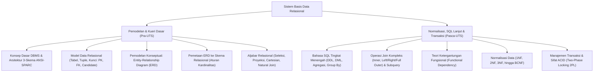

# Rangkuman Materi: Basis Data (PAIK6301 / MIK1624301)

> **Bobot:** 4 SKS (Kuliah + Praktikum) | **Semester:** 3 | **Fokus Utama:** Arsitektur DBMS 3-Skema, Model Relasional, Pemodelan ERD, Aljabar Relasional, SQL (DDL, DML, Join, Subquery), Teori Normalisasi (1NF s.d. BCNF), dan Transaksi ACID

---

## 1. Gambaran Besar Mata Kuliah (*Grand View*)
Mata kuliah **Basis Data (Basdat)** meletakkan prinsip fundamental penyimpanan, pengorganisasian, dan manipulasi data terstruktur yang persisten, aman, dan efisien dalam skala besar. Sistem Basis Data menggantikan sistem pemrosesan berkas tradisional (*file system*) yang sarat dengan redundansi, inkonsistensi data, dan ketiadaan isolasi konkuren.

Dalam lanskap komputasi modern, basis data menjadi pondasi utama bagi:
* **Pengembangan Aplikasi Web & Mobile:** Backend API (REST/GraphQL) yang berinteraksi dengan database relasional (PostgreSQL, MySQL) via ORM (*Object-Relational Mapping*).
* **Enterprise Software & ERP:** Transaksi bisnis bernilai tinggi yang menuntut keandalan transaksi finansial tingkat tinggi.
* **Data Engineering & Business Intelligence:** Gudang data (*Data Warehouse*), pemodelan skema bintang (*Star Schema*), dan integrasi pipeline ETL.



---

## 2. Peta Silabus & Konsep Inti Perkuliahan

### A. Bagian Pra-UTS (Arsitektur, Model Relasional, ERD, & Aljabar Relasional)

#### 1. Konsep Dasar & Arsitektur 3-Skema ANSI-SPARC
* **Kelemahan File-Based System:** Redundansi data tinggi, inkonsistensi data, isolasi data, masalah integritas data, dan keterbatasan akses konkuren (*concurrent access anomalies*).
* **Tiga Tingkat Abstraksi Data (ANSI-SPARC):**
  1. **Tingkat Eksternal / View Level:** Sudut pandang pengguna akhir terhadap data. Satu basis data dapat memiliki banyak view berbeda sesuai hak akses pengguna.
  2. **Tingkat Konseptual / Logical Level:** Mendeskripsikan *data apa* yang disimpan di basis data dan *hubungan relasional apa* yang ada di antaranya (didesain oleh Database Administrator).
  3. **Tingkat Internal / Physical Level:** Mendeskripsikan *bagaimana* data secara fisik disimpan pada media penyimpanan disk (struktur indeks B-Tree, alokasi blok, kompresi).
* **Kemandirian Data (*Data Independence*):**
  * **Logical Data Independence:** Kemampuan mengubah skema konseptual tanpa harus merusak skema eksternal / aplikasi pengguna.
  * **Physical Data Independence:** Kemampuan mengubah struktur penyimpanan fisik atau metode pengindeksan tanpa mengubah skema konseptual.

#### 2. Model Data Relasional & Kunci Relasional
* **Terminologi Relasional:**
  * Relasi = Tabel
  * Tuple = Baris data (*Record*)
  * Atribut = Kolom (*Field*)
  * Domain = Himpunan nilai yang valid untuk suatu atribut
  * Derajat (*Degree*) = Jumlah kolom atribut
  * Kardinalitas = Jumlah baris tuple
* **Hierarki Kunci (*Keys*):**
  * **Super Key:** Satu atau gabungan beberapa atribut yang mengidentifikasi tuple secara unik.
  * **Candidate Key:** Super key yang minimal (tidak ada subset atribut darinya yang dapat menjadi kunci unik).
  * **Primary Key (PK):** Satu candidate key yang dipilih secara resmi oleh desainer untuk mengidentifikasi tuple secara unik dalam relasi.
  * **Alternate Key:** Candidate key yang tidak terpilih menjadi primary key.
  * **Foreign Key (FK):** Atribut pada suatu tabel yang merujuk pada Primary Key tabel lain untuk merepresentasikan keterkaitan relasional.
* **Integritas Relasional:**
  * **Entity Integrity:** Nilai Primary Key **tidak boleh NULL**.
  * **Referential Integrity:** Nilai Foreign Key harus merujuk ke nilai Primary Key yang valid pada tabel relasi induknya, atau bernilai NULL (jika diperbolehkan).

#### 3. Pemodelan Konseptual: Entity-Relationship Diagram (ERD)
* **Entitas:** Objek nyata atau abstrak yang dapat diidentifikasi secara unik.
  * Entitas Kuat (*Strong Entity*): Keberadaannya tidak bergantung pada entitas lain.
  * Entitas Lemah (*Weak Entity*): Keberadaannya bergantung pada entitas pemilik (*identifying owner*), ditandai dengan garis ganda dan memiliki *Partial Key* (kunci pembeda).
* **Jenis Atribut:**
  * *Simple* vs *Composite* (misal Nama Lengkap terdiri atas Nama Depan dan Belakang).
  * *Single-valued* vs *Multi-valued* (misal Nomor HP yang bisa lebih dari satu, digambar lingkaran ganda).
  * *Derived Attribute* (atribut turunan hasil kalkulasi, misal Umur dihitung dari Tanggal Lahir, digambar garis putus-putus).
* **Kardinalitas Rasio Relasi:**
  * Satu ke Satu ($1:1$)
  * Satu ke Banyak ($1:N$)
  * Banyak ke Banyak ($M:N$)
* **Aturan Pemetaan ERD ke Tabel Relasional:**
  * Relasi $1:N$: Letakkan Primary Key dari sisi $1$ sebagai Foreign Key pada tabel di sisi $N$.
  * Relasi $M:N$: Wajib dipecah menjadi **Tabel Asosiatif (Junction Table)** baru yang berisi gabungan Primary Key dari kedua tabel sebagai *Composite Primary Key*.
  * Multi-valued Attribute: Wajib dibuatkan tabel terpisah.

#### 4. Aljabar Relasional (*Relational Algebra*)
Bahasa kueri prosedural formal matematis pembentuk fondasi optimasi mesin SQL:
* **Operator Dasar:**
  * **Seleksi ($\sigma$):** Memilih subset baris (tuple) yang memenuhi predikat kondisi: $\sigma_{\text{gaji} > 5000000}(\text{Pegawai})$.
  * **Proyeksi ($\pi$):** Memilih subset kolom (atribut) tertentu: $\pi_{\text{nama}, \text{gaji}}(\text{Pegawai})$.
  * **Cartesian Product ($\times$):** Menggabungkan setiap tuple relasi $R$ dengan setiap tuple relasi $S$ (ukuran hasil $= |R| \times |S|$).
  * **Union ($\cup$), Intersection ($\cap$), Difference ($-$).**
* **Operator Turunan:**
  * **Theta Join ($R \bowtie_\theta S$):** Cartesian product diikuti operasi seleksi kondisi $\theta$: $\sigma_\theta(R \times S)$.
  * **Natural Join ($R \bowtie S$):** Penggabungan otomatis berdasarkan kesamaan nama atribut yang identik di kedua tabel dengan mengeliminasi duplikasi kolom.

---

### B. Bagian Pasca-UTS (SQL Lanjut, Teori Normalisasi, & Transaksi ACID)

#### 1. Structured Query Language (SQL)
* **DDL (Data Definition Language):**
  ```sql
  CREATE TABLE Mahasiswa (
      nim VARCHAR(15) PRIMARY KEY,
      nama VARCHAR(100) NOT NULL,
      id_prodi INT,
      ipk DECIMAL(3,2) CHECK (ipk >= 0.00 AND ipk <= 4.00),
      CONSTRAINT fk_prodi FOREIGN KEY (id_prodi) REFERENCES Prodi(id) ON DELETE CASCADE
  );
  ```
* **Kueri Agregasi & Pengelompokan:**
  ```sql
  SELECT id_prodi, AVG(ipk) AS rata_ipk, COUNT(*) AS total_mhs
  FROM Mahasiswa
  WHERE status = 'Aktif'
  GROUP BY id_prodi
  HAVING COUNT(*) > 10;
  ```
  *(Catatan: `WHERE` memfilter baris sebelum pengelompokan; `HAVING` memfilter kelompok setelah agregasi).*
* **Operasi Join:**
  * `INNER JOIN`: Hanya menampilkan baris yang memiliki kecocokan di kedua tabel.
  * `LEFT OUTER JOIN`: Menampilkan seluruh baris dari tabel kiri, dan baris yang cocok dari tabel kanan (jika tidak cocok, bernilai NULL).
* **Subquery (Kueri Bersarang):**
  * Subquery mandiri (*Independent Subquery*) vs Subquery berkorelasi (*Correlated Subquery* yang dievaluasi per baris menggunakan operator `EXISTS` atau `NOT EXISTS`).

#### 2. Teori Normalisasi Basis Data
Proses sistematis dekomposisi tabel untuk menghilangkan **Anomali Modifikasi** (Anomali Sisip/Insert, Anomali Hapus/Delete, dan Anomali Ubah/Update) serta meminimalkan redundansi data.
* **Ketergantungan Fungsional (*Functional Dependency - FD*):**
  Atribut $Y$ bergantung fungsional pada $X$ ($X \to Y$) jika untuk setiap nilai $X$ yang sama, nilai $Y$ pasti sama.
* **Bentuk Normal Pertama (1NF):**
  * Setiap sel data hanya memuat **nilai tunggal atomik** (*atomic values*).
  * Tidak ada grup atribut berulang (*repeating groups*).
* **Bentuk Normal Kedua (2NF):**
  * Memenuhi syarat 1NF.
  * **Tidak ada Ketergantungan Parsial (*No Partial Dependency*)**: Seluruh atribut non-kunci harus bergantung penuh pada *seluruh* komponen Primary Key (relevan jika Primary Key berupa kunci komposit multi-atribut).
* **Bentuk Normal Ketiga (3NF):**
  * Memenuhi syarat 2NF.
  * **Tidak ada Ketergantungan Transitif (*No Transitive Dependency*)**: Tidak ada atribut non-kunci yang bergantung pada atribut non-kunci lainnya ($X \to Y$ dan $Y \to Z \implies X \to Z$). Setiap atribut non-kunci hanya boleh bergantung langsung pada Primary Key.
* **Boyce-Codd Normal Form (BCNF):**
  * Bentuk normal yang lebih ketat dari 3NF.
  * Untuk setiap ketergantungan fungsional non-trivial $X \to Y$, maka determinan **$X$ wajib merupakan Super Key**.

#### 3. Manajemen Transaksi & Protokol Konkurensi
* **Transaksi:** Satu unit eksekusi program logis yang membaca atau memperbarui isi basis data.
* **Sifat-Sifat ACID Transaksi:**
  1. **Atomicity (Keutuhan):** Prinsip *all-or-nothing*. Seluruh operasi dalam transaksi harus berhasil diselesaikan (`COMMIT`), atau jika gagal di tengah jalan, seluruh perubahan dibatalkan total (`ROLLBACK`).
  2. **Consistency (Konsistensi):** Transaksi harus membawa basis data dari satu status valid ke status valid lainnya sesuai seluruh aturan integritas.
  3. **Isolation (Isolasi):** Eksekusi transaksi yang berjalan bersamaan (*konkuren*) tidak boleh saling mengganggu; hasil eksekusi harus sama seolah-olah transaksi berjalan berurutan (*serializable*).
  4. **Durability (Ketahanan):** Sekali transaksi berhasil di-commit, perubahannya bersifat permanen pada disk dan tidak boleh hilang meskipun sistem mati mendadak (*power failure*).
* **Protokol Two-Phase Locking (2PL):**
  * **Growing Phase:** Transaksi boleh meminta kunci baru (*shared/exclusive lock*), namun tidak boleh melepaskan kunci.
  * **Shrinking Phase:** Transaksi boleh melepaskan kunci, namun dilarang meminta kunci baru.
  * Menjamin eksekusi transaksi bersifat *serializable*.

---

## 3. Rumus Cepat & Jebakan Kunci Ujian Kompre

1. **Jebakan `WHERE` vs `HAVING`:** Fungsi agregat seperti `COUNT()`, `AVG()`, `MAX()` **dilarang keras** diletakkan di dalam klausa `WHERE`. Agregasi hanya boleh disaring di klausa `HAVING`.
2. **Jebakan Kardinalitas Relasi M:N:** Jika menjumpai relasi Many-to-Many pada soal pemetaan ERD, jangan pernah menambahkan Foreign Key pada salah satu tabel awal; **selalu ciptakan tabel junction baru**.
3. **Jebakan Uji 2NF:** Uji 2NF hanya perlu diperhatikan jika Primary Key tabel terdiri dari **gabungan lebih dari satu atribut (Composite Key)**. Jika Primary Key berupa atribut tunggal, tabel 1NF otomatis memenuhi syarat 2NF!
