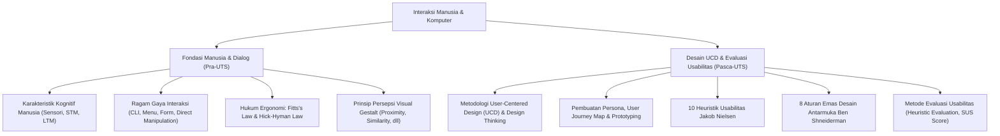

# Rangkuman Materi: Interaksi Manusia dan Komputer (PAIK6302 / MIK1624302)

> **Bobot:** 3 SKS | **Semester:** 3 (Kurikulum 2020) / Semester 6 (Kurikulum 2024) | **Fokus Utama:** Faktor Manusia (Kognisi & Memori), Ragam Dialog Interaksi, Prinsip Gestalt, UCD/HCD, 10 Heuristik Nielsen, 8 Aturan Emas Shneiderman, dan Usability Testing (SUS)

---

## 1. Gambaran Besar Mata Kuliah (*Grand View*)
Mata kuliah **Interaksi Manusia dan Komputer (IMK / Human-Computer Interaction - HCI)** adalah studi interdisipliner yang menggabungkan ilmu komputer, psikologi kognitif, ergonomi, dan desain grafis untuk memastikan sistem perangkat lunak dapat digunakan oleh manusia secara efektif, efisien, aman, dan memuaskan (*Usability & User Experience - UI/UX*).

Prinsip utama IMK: *"Sistem yang baik harus beradaptasi dengan keterbatasan kognitif manusia, bukan memaksa manusia beradaptasi dengan kerumitan mesin."*
* **Kognisi Manusia:** Pemrosesan informasi, kapasitas memori kerja (*Short-Term Memory* terbatas $7 \pm 2$ chunk), dan model mental (*mental model*).
* **Desain Antarmuka (*User Interface*):** Tata letak visual, konsistensi navigasi, keterjangkauan tombol (*affordance*), dan umpan balik (*feedback*).
* **Evaluasi Pengalaman Pengguna (*User Experience Evaluation*):** Pengujian usabilitas empiris, survei kuesioner baku (SUS), dan audit heuristik.

---

## 2. Peta Silabus & Konsep Inti Perkuliahan

### A. Bagian Pra-UTS (Faktor Manusia, Ragam Dialog & Prinsip Persepsi)

#### 1. Manusia sebagai Pemroses Informasi (*Human Information Processor*)
* **Memori Sensoris (*Sensory Memory*):**
  * *Iconic Memory* (visual): Menyimpan citra visual sesaat ($< 0.5$ detik).
  * *Echoic Memory* (auditori): Menyimpan suara sesaat (sekitar $2 - 3$ detik).
* **Memori Jangka Pendek (*Short-Term Memory - STM* / Working Memory):**
  * Kapasitas sangat terbatas: **Hukum Miller ($7 \pm 2$ bongkahan informasi / *chunks*)**.
  * Waktu retensi cepat hilang ($20 - 30$ detik tanpa pengulangan).
  * *Implikasi Desain UI:* Jangan pernah memaksa pengguna mengingat kode panjang dari layar sebelumnya (*Recognition rather than Recall*).
* **Memori Jangka Panjang (*Long-Term Memory - LTM*):**
  * Kapasitas tidak terbatas, penyimpanan permanen.
  * Terdiri atas *Episodic Memory* (pengalaman masa lalu) dan *Semantic Memory* (fakta, konsep, makna hubungan).

#### 2. Ragam Dialog Interaksi (*Interaction Styles*)
1. **Command Line Interface (CLI / Baris Perintah):**
   * *Kelebihan:* Eksekusi cepat bagi pengguna ahli (*expert users*), hemat memori, mendukung otomasi skrip.
   * *Kekurangan:* *Learning curve* curam, beban memori tinggi (harus hafal sintaks perintah), tidak ramah pemula.
2. **Sistem Menu (*Menu-Driven Interface*):**
   * *Kelebihan:* Mengubah beban mengingat (*recall*) menjadi mengenali (*recognition*), minim pengetikan, navigasi terstruktur.
   * *Kekurangan:* Lambat jika hierarki menu terlalu dalam (*deep hierarchy*), memakan ruang layar.
3. **Form Fill-in (Pengisian Formulir):**
   * *Kelebihan:* Sangat terstruktur untuk pemasukan data (*data entry*), familiar bagi pengguna awam.
   * *Kekurangan:* Memerlukan validasi input yang ketat dan pesan error yang jelas.
4. **Direct Manipulation (Manipulasi Langsung):**
   * *Karakteristik:* Representasi visual berkelanjutan dari objek minat, aksi fisik (seret dan lepas / *drag-and-drop*) menggantikan perintah teks, dampak aksi terlihat seketika (*instant feedback*), dan aksi dapat dibatalkan (*reversible / Undo*).
   * *Kelebihan:* Mudah dipelajari, model mental intuitif, waktu pelatihan singkat.
   * *Kekurangan:* Sulit diimplementasikan pada perangkat kecil atau untuk instruksi logika makro berulang.

#### 3. Hukum-Hukum Ergonomi dan Kognitif dalam IMK
* **Hukum Fitts (*Fitts's Law*):**
  Memprediksi waktu ($MT$) yang dibutuhkan pengguna untuk mengarahkan penunjuk (*mouse/finger*) ke suatu target sasaran:
  $$MT = a + b \log_2 \left( \frac{2D}{W} \right)$$
  *(di mana $D$ adalah jarak ke target, $W$ adalah lebar ukuran target).*
  * *Implikasi Desain:* Tombol aksi utama (seperti *Submit* atau *Checkout*) harus berukuran cukup besar dan mudah dijangkau. Sudut dan tepi layar adalah target tercepat (*infinite width* karena kursor tertahan di tepi).
* **Hukum Hick-Hyman (*Hick's Law*):**
  Waktu yang dibutuhkan pengguna untuk mengambil keputusan meningkat secara logaritmik seiring bertambahnya jumlah pilihan opsi:
  $$T = b \log_2(n + 1)$$
  * *Implikasi Desain:* Pecah formulir atau menu yang panjang menjadi tahapan bertingkat (*progressive disclosure*).

#### 4. Prinsip Persepsi Visual Gestalt
* **Proximity (Kedekatan):** Objek yang berdekatan secara spasial dipersepsikan sebagai satu kelompok logis yang saling berhubungan.
* **Similarity (Kesamaan):** Objek yang memiliki warna, bentuk, atau ukuran serupa dianggap memiliki fungsi yang sama (misal seluruh tombol aksi utama berwarna biru).
* **Closure (Ketertutupan):** Otak manusia secara otomatis melengkapi pola visual yang terpotong untuk melihat bentuk yang utuh.
* **Continuity (Keterlanjutan):** Mata manusia terbiasa mengikuti alur garis visual yang kontinu.
* **Figure-Ground (Sosok-Latar):** Kemampuan membedakan objek utama di latar depan dari latar belakangnya (kontras warna yang memadai).

---

### B. Bagian Pasca-UTS (UCD, 10 Heuristik Nielsen, 8 Aturan Emas & Evaluasi)

#### 1. Desain Berpusat pada Pengguna (*User-Centered Design - UCD*)
Proses perancangan iteratif yang menempatkan kebutuhan, keterbatasan, dan konteks pengguna di setiap fase:
1. **Empathize:** Memahami pengguna melalui wawancara, observasi, dan survei lapangan.
2. **Define:** Menentukan *Problem Statement*, menyusun **User Persona** (karakter fiktif representatif pengguna), dan memetakan **User Journey Map**.
3. **Ideate:** Mengembangkan berbagai alternatif solusi (brainstorming, *crazy eights*).
4. **Prototype:**
   * *Low-Fidelity (Lo-Fi):* Sketsa kertas (*paper sketch*), wireframe grayscale untuk memvalidasi alur informasi tanpa distraksi estetika.
   * *High-Fidelity (Hi-Fi):* Mockup interaktif Figma dengan warna, tipografi, dan animasi mikro menyerupai aplikasi nyata.
5. **Test:** Menguji prototipe ke pengguna nyata dan mengumpulkan umpan balik untuk iterasi perbaikan.

#### 2. 10 Prinsip Heuristik Usabilitas Jakob Nielsen (Wajib Hafal Kompre!)
1. **Visibility of System Status:** Sistem harus selalu mengabari pengguna apa yang sedang terjadi melalui umpan balik tepat waktu (contoh: *progress bar* saat mengunggah berkas).
2. **Match Between System and The Real World:** Menggunakan bahasa, frasa, dan konsep yang akrab bagi pengguna, bukan istilah internal teknis pengembang (contoh: ikon tempat sampah untuk menghapus).
3. **User Control and Freedom:** Menyediakan "pintu darurat" yang jelas saat pengguna salah menekan tombol tanpa harus melalui proses berbelit (contoh: fitur *Undo*, *Redo*, tombol *Cancel*).
4. **Consistency and Standards:** Pengguna tidak boleh bertanya-tanya apakah kata, situasi, atau aksi yang berbeda memiliki arti yang sama (kepatuhan pada konvensi platform seperti logo di kiri atas kembali ke beranda).
5. **Error Prevention:** Mencegah terjadinya kesalahan sejak awal jauh lebih baik daripada menampilkan pesan kesalahan yang bagus (contoh: konfirmasi sebelum aksi destruktif *"Apakah Anda yakin ingin menghapus database ini?"*, penonaktifan tombol submit sebelum form valid).
6. **Recognition Rather Than Recall:** Meminimalkan beban memori pengguna dengan membuat objek, aksi, dan opsi terlihat jelas di layar.
7. **Flexibility and Efficiency of Use:** Menyediakan akselerator bagi pengguna mahir (*keyboard shortcuts*) tanpa membingungkan pengguna pemula.
8. **Aesthetic and Minimalist Design:** Dialog tidak boleh memuat informasi yang tidak relevan atau jarang dibutuhkan (setiap unit informasi tambahan bersaing dengan informasi penting).
9. **Help Users Recognize, Diagnose, and Recover from Errors:** Pesan kesalahan harus ditulis dalam bahasa manusia biasa (bukan kode error raw `Error 0x800412`), menjelaskan masalah secara spesifik, dan menawarkan solusi perbaikan yang konstruktif.
10. **Help and Documentation:** Meskipun sistem lebih baik jika dapat digunakan tanpa manual, dokumentasi dan bantuan yang mudah dicari tetap harus disediakan.

#### 3. Delapan Aturan Emas Ben Shneiderman (*Eight Golden Rules*)
1. Berusaha konsisten (*Strive for consistency*).
2. Memenuhi kegunaan universal (*Cater to universal usability*).
3. Memberikan umpan balik yang informatif (*Offer informative feedback*).
4. Merancang dialog untuk menghasilkan penutupan akhir (*Design dialogs to yield closure*).
5. Mencegah terjadinya kesalahan (*Prevent errors*).
6. Memungkinkan pembalikan aksi yang mudah (*Permit easy reversal of actions*).
7. Mendukung pusat kendali internal pengguna (*Support internal locus of control*).
8. Mengurangi beban memori jangka pendek (*Reduce short-term memory load*).

#### 4. Pengujian Usabilitas (*Usability Testing*) & System Usability Scale (SUS)
* **Metode Evaluasi:**
  * *Heuristic Evaluation:* 3–5 orang pakar usabilitas mengaudit antarmuka secara independen berdasarkan 10 Heuristik Nielsen.
  * *Think-Aloud Protocol:* Pengguna diminta mengoperasikan prototipe sambil mengucapkan dengan keras apa yang mereka pikirkan dan rasakan secara spontan.
* **System Usability Scale (SUS):**
  * Kuesioner standar industri dengan 10 pertanyaan skala Likert 5-poin (bergantian antara pernyataan positif bernomor ganjil dan pernyataan negatif bernomor genap).
  * Skor akhir dihitung dengan rentang **$0 - 100$**.
  * **Nilai Rata-rata Industri:** **$68$** (Skor $> 68$ dianggap di atas rata-rata / *acceptable*; skor $\ge 80.3$ mendapat *Grade A* / *excellent*).

---

## 3. Konsep Kunci Wajib Hafal untuk Kompre

1. **Hukum Miller:** Kapasitas Memori Kerja manusia hanya mampu menampung $7 \pm 2$ item informasi.
2. **Skor Benchmark SUS:** Rata-rata global usabilitas aplikasi adalah $68$.
3. **Affordance & Signifier:** *Affordance* adalah sifat fisik objek yang menentukan bagaimana objek dapat digunakan (misal tombol dapat ditekan); *Signifier* adalah tanda visual yang memberitahu pengguna apa aksi yang harus dilakukan (misal bayangan 3D atau teks *"Klik di Sini"*).
