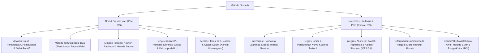

# Rangkuman Materi: Metode Numerik (PAIK6304 / MIK1624304)

> **Bobot:** 3 SKS | **Semester:** 3 (Kurikulum 2020) / Semester 2 (Kurikulum 2024) | **Fokus Utama:** Analisis Galat, Pencarian Akar Persamaan Non-Linier, Solusi SPL Numerik (Gauss-Seidel), Interpolasi, Integrasi Numerik (Trapezoida & Simpson), serta Solusi PDB (Euler & RK4)

---

## 1. Gambaran Besar Mata Kuliah (*Grand View*)
Mata kuliah **Metode Numerik (Metnum)** mengajarkan teknik-teknik formulasi matematis untuk menyelesaikan persoalan komputasi yang tidak dapat dipecahkan secara eksak (*analitis*). Komputer bekerja menggunakan representasi bilangan floating-point dengan presisi terbatas, sehingga komputasi numerik berfokus pada **pendekatan (*approximation*)** yang disertai kontrol toleransi galat (*error bound*).

Penerapan metode numerik dalam ilmu komputer meliputi:
* **Fisika Game & Simulasi Grafika:** Perhitungan trajektori gerak proyektil, tabrakan partikel, dan dinamika fluida menggunakan integrasi numerik PDB (Euler / Verlet).
* **Machine Learning & Deep Learning:** Optimasi non-linier kuadratik, pemfaktoran matriks berskala masif (LU / Cholesky Decomposition), dan interpolasi *spline*.
* **Visi Komputer & Pemrosesan Sinyal:** Penurunan gradien diskrit menggunakan formula beda hingga (*Finite Difference Method*).

---

## 2. Peta Silabus & Konsep Inti Perkuliahan

### A. Bagian Pra-UTS (Analisis Galat, Akar Non-Linier & Solusi SPL)

#### 1. Teori Galat (*Error Analysis*)
* **Galat Sejati ($E_t$) dan Galat Relatif Sejati ($\epsilon_t$):**
  $$E_t = \text{Nilai Sejati} - \text{Nilai Aproksimasi}, \quad \epsilon_t = \left| \frac{E_t}{\text{Nilai Sejati}} \right| \times 100\%$$
* **Galat Relatif Aproksimasi Semu ($\epsilon_a$ - Digunakan saat nilai sejati tidak diketahui):**
  $$\epsilon_a = \left| \frac{x_{n+1} - x_n}{x_{n+1}} \right| \times 100\%$$
  *Kriteria Berhenti Iterasi:* $|\epsilon_a| < \epsilon_s$ (di mana $\epsilon_s = 0.5 \times 10^{2-n}\%$ untuk menjamin ketelitian $n$ angka signifikan).
* **Sumber Galat Utama:**
  * **Galat Pemotongan (*Truncation Error*):** Terjadi akibat penghentian deret tak terhingga (misal aproksimasi deret Taylor dipotong hanya sampai suku kuadrat).
  * **Galat Pembulatan (*Round-off Error*):** Terjadi akibat keterbatasan jumlah bit register mantissa pada standar *IEEE 754 Floating-Point*.

#### 2. Pencarian Akar Persamaan Non-Linier ($f(x) = 0$)
* **Metode Tertutup (*Bracketing Methods*):**
  Memerlukan dua tebakan awal $[a, b]$ sedemikian rupa sehingga $f(a) \cdot f(b) < 0$ (berdasarkan Teorema Nilai Antara, pasti terdapat minimal 1 akar di dalam interval).
  * **Metode Bagi-Dua (*Bisection Method*):**
    $$x_r = \frac{a + b}{2}$$
    *Sifat:* Selalu konvergen (*guaranteed convergence*), namun laju konvergensinya lambat (linier).
  * **Metode Regula Falsi (*False Position*):**
    Menghubungkan titik $(a, f(a))$ dan $(b, f(b))$ dengan garis lurus; titik potong garis dengan sumbu-$X$ menjadi tebakan akar baru:
    $$x_r = b - \frac{f(b)(b - a)}{f(b) - f(a)}$$
* **Metode Terbuka (*Open Methods*):**
  Hanya memerlukan satu atau dua titik tebakan awal tanpa harus mengurung akar.
  * **Metode Newton-Raphson:**
    Menggunakan garis singgung kurva turunan pertama:
    $$\mathbf{x_{n+1} = x_n - \frac{f(x_n)}{f'(x_n)}}$$
    *Sifat:* Memiliki laju **konvergensi kuadratik** (jumlah digit benar berlipat ganda setiap iterasi).
    *Kelemahan:* Gagal divergen jika $f'(x_n) \approx 0$ (terjadi pembagian dengan nol) atau titik awal berada dekat titik infleksi/ekstrem lokal.
  * **Metode Secant:**
    Menggantikan turunan analitik $f'(x)$ dengan aproksimasi kemiringan beda hingga:
    $$x_{n+1} = x_n - \frac{f(x_n)(x_n - x_{n-1})}{f(x_n) - f(x_{n-1})}$$

#### 3. Solusi Sistem Persamaan Linier (SPL) Numerik
* **Metode Eliminasi Gauss dengan Partial Pivoting:**
  Pada setiap kolom pivot, cari elemen di bawahnya yang memiliki nilai absolut terbesar, lalu tukar baris tersebut ke baris pivot untuk menghindari kesalahan pembagian angka mendekati nol (*floating-point instability*).
* **Metode Iteratif: Gauss-Seidel vs Jacobi:**
  * **Metode Gauss-Seidel:** Nilai variabel baru $x_i^{(k+1)}$ yang baru saja dihitung pada iterasi ke-$(k+1)$ **langsung digunakan seketika** untuk menghitung variabel berikutnya $x_{i+1}^{(k+1)}$ dalam baris yang sama.
    $$x_i^{(k+1)} = \frac{1}{a_{ii}} \left( b_i - \sum_{j=1}^{i-1} a_{ij} x_j^{(k+1)} - \sum_{j=i+1}^n a_{ij} x_j^{(k)} \right)$$
  * **Syarat Konvergensi Mutlak:** Matriks $A$ harus bersifat **Dominan Secara Diagonal (*Strictly Diagonally Dominant*)**:
    $$|a_{ii}| > \sum_{j \ne i} |a_{ij}| \quad (\text{untuk setiap baris } i)$$

---

### B. Bagian Pasca-UTS (Interpolasi, Integrasi Numerik & PDB)

#### 1. Interpolasi Polinomial
Mencari kurva polinomial kontinu derajat $n$ yang melewati $n+1$ titik data diskrit secara presisi:
* **Interpolasi Polinomial Lagrange:**
  $$P_n(x) = \sum_{i=0}^n y_i L_i(x), \quad \text{di mana } L_i(x) = \prod_{j=0, j \ne i}^n \frac{x - x_j}{x_i - x_j}$$
* **Interpolasi Beda Terbagi Newton (*Newton's Divided Differences*):**
  $$P_n(x) = f[x_0] + f[x_0, x_1](x - x_0) + f[x_0, x_1, x_2](x - x_0)(x - x_1) + \dots$$
  *Kelebihan Newton:* Penambahan titik data baru tidak memerlukan perhitungan ulang dari awal (cukup menambahkan satu suku orde berikutnya).

#### 2. Integrasi Numerik (*Numerical Quadrature*)
Menghitung aproksimasi $\int_a^b f(x) \, dx$ dengan membagi interval $[a, b]$ menjadi $n$ pias berjarak seragam $h = \frac{b - a}{n}$:
* **Kaidah Trapesium Komposit (*Composite Trapezoidal Rule*):**
  Aproksimasi luas menggunakan trapesium linier (orde galat $O(h^2)$):
  $$\int_a^b f(x) \, dx \approx \frac{h}{2} \left[ f(x_0) + 2\sum_{i=1}^{n-1} f(x_i) + f(x_n) \right]$$
* **Kaidah Simpson 1/3 Komposit (Menggunakan Parabola Kuadratik):**
  *Syarat Mutlak:* Jumlah pias $n$ **wajib genap**. Orde galat $O(h^4)$.
  $$\int_a^b f(x) \, dx \approx \frac{h}{3} \left[ f(x_0) + 4\sum_{i=1, 3, 5}^{n-1} f(x_i) + 2\sum_{j=2, 4, 6}^{n-2} f(x_j) + f(x_n) \right]$$
  *(Pola koefisien: $1, 4, 2, 4, 2, \dots, 4, 1$).*
* **Kaidah Simpson 3/8 Komposit (Menggunakan Polinomial Kubik):**
  *Syarat Mutlak:* Jumlah pias $n$ **wajib kelipatan 3**.
  $$\int_a^b f(x) \, dx \approx \frac{3h}{8} \left[ f(x_0) + 3 f(x_1) + 3 f(x_2) + 2 f(x_3) + 3 f(x_4) + \dots + f(x_n) \right]$$

#### 3. Diferensiasi Numerik Beda Hingga (*Finite Differences*)
* Beda Maju (*Forward*): $f'(x) \approx \frac{f(x + h) - f(x)}{h}$ (Galat $O(h)$).
* Beda Mundur (*Backward*): $f'(x) \approx \frac{f(x) - f(x - h)}{h}$ (Galat $O(h)$).
* Beda Pusat (*Central Difference* - Paling Akurat):
  $$\mathbf{f'(x) \approx \frac{f(x + h) - f(x - h)}{2h}} \quad (\text{Galat } O(h^2))$$

#### 4. Persamaan Diferensial Biasa (PDB Masalah Nilai Awal $\frac{dy}{dx} = f(x, y)$)
* **Metode Euler:**
  $$y_{n+1} = y_n + h \cdot f(x_n, y_n) \quad (\text{Metode orde-1, galat lokal } O(h^2))$$
* **Metode Runge-Kutta Orde 4 (RK4 - Standar Emas Simulasi Komputasi):**
  Menghitung rata-rata tertimbang dari 4 nilai kemiringan tangen:
  $$\mathbf{y_{n+1} = y_n + \frac{h}{6} (k_1 + 2k_2 + 2k_3 + k_4)}$$
  * $k_1 = f(x_n, y_n)$
  * $k_2 = f\left(x_n + \frac{h}{2}, \; y_n + \frac{h}{2}k_1\right)$
  * $k_3 = f\left(x_n + \frac{h}{2}, \; y_n + \frac{h}{2}k_2\right)$
  * $k_4 = f(x_n + h, \; y_n + h k_3)$
  *(Memiliki ketelitian sangat tinggi dengan galat lokal $O(h^5)$).*

---

## 3. Rumus & Jebakan Kunci Ujian Kompre

1. **Jebakan Kaidah Simpson 1/3:** Jangan pernah menerapkan kaidah Simpson 1/3 jika jumlah pias sub-interval $n$ adalah **ganjil**. Jika $n$ ganjil, kombinasikan: gunakan Simpson 1/3 untuk $n-3$ pias pertama dan Simpson 3/8 untuk 3 pias terakhir!
2. **Kondisi Divergen Newton-Raphson:** Jika $f'(x_n) = 0$, rumus akan membagi dengan nol dan proses perhitungan gagal (*crash*).
3. **Penyusunan Persamaan Gauss-Seidel:** Sebelum melakukan iterasi, periksa baris matriks. Tukar posisi baris persamaan sedemikian rupa sehingga elemen diagonal utama $|a_{ii}|$ menjadi koefisien terbesar di baris tersebut.
