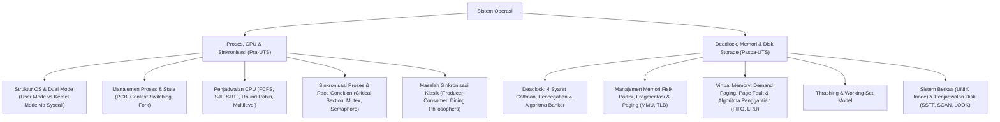

# Rangkuman Materi: Sistem Operasi (PAIK6305 / MIK1624305)

> **Bobot:** 4 SKS (Kuliah + Praktikum) | **Semester:** 3 | **Fokus Utama:** Manajemen Proses & Thread, Algoritma Penjadwalan CPU, Sinkronisasi & Deadlock, Manajemen Memori (Paging & Virtual Memory), serta File System & Penjadwalan Disk

---

## 1. Gambaran Besar Mata Kuliah (*Grand View*)
Mata kuliah **Sistem Operasi (Sisop)** membedah perangkat lunak sistem paling fundamental yang mengontrol dan mengoordinasikan seluruh sumber daya perangkat keras (*CPU, RAM, Storage, I/O devices*) untuk berbagai aplikasi pengguna. Sistem operasi bertindak ganda sebagai:
1. **Pengalokasi Sumber Daya (*Resource Allocator*):** Mengatur pembagian CPU time, ruang memori, dan bandwidth I/O secara adil (*fairness*) dan optimal antar-proses yang bersaing.
2. **Program Pengendali (*Control Program*):** Mengisolasi ruang eksekusi program pengguna untuk mencegah instruksi berbahaya merusak integritas sistem (*Dual-Mode Operation: User Mode vs Kernel Mode*).

---

## 2. Peta Silabus & Konsep Inti Perkuliahan

### A. Bagian Pra-UTS (Proses, Penjadwalan CPU, dan Sinkronisasi)

#### 1. Arsitektur Sistem Operasi & Dual-Mode Operation
* **Dual-Mode Operation:**
  * **User Mode (Bit Mode = 1):** Aplikasi pengguna dieksekusi dengan batasan hak akses (tidak dapat langsung menyentuh hardware fisik atau mengeksekusi instruksi istimewa / *privileged instructions*).
  * **Kernel Mode / Supervisor Mode (Bit Mode = 0):** Kode inti OS (*kernel*) memiliki kendali penuh terhadap seluruh CPU dan memori.
  * **System Call & Software Interrupt (Trap):** Jalur formal satu-satunya bagi aplikasi user mode untuk meminta layanan kernel (misal: `read()`, `write()`, `fork()`). Transisi mode terjadi otomatis via instruksi hardware trap.

#### 2. Manajemen Proses dan Thread
* **Definisi Proses:** Program yang sedang dalam status eksekusi aktif (*program in execution*).
* **Process Control Block (PCB):** Blok data kernel yang menyimpan seluruh status sebuah proses: PID (*Process ID*), Program Counter (PC), Register CPU, Informasi Penjadwalan, Status I/O, dan Batasan Memori.
* **5 Status Siklus Hidup Proses (*Process State Transition*):**
  * `New` $\rightarrow$ `Ready` (menunggu alokasi CPU di antrean *Ready Queue*) $\rightarrow$ `Running` (sedang dieksekusi oleh core CPU) $\rightarrow$ `Waiting / Blocked` (menunggu penyelesaian operasi I/O atau sinyal) $\rightarrow$ `Terminated` (selesai).
* **Context Switching:** Mekanisme penghentian proses yang sedang berjalan, menyimpan status PCB-nya ke memori, dan memuat status PCB proses lain untuk dijalankan. Waktu context switch adalah **overhead murni** (CPU tidak melakukan komputasi produktif).
* **Proses vs Thread:**
  * Proses memiliki ruang alamat memori sendiri (*isolated memory space*).
  * Thread (*Lightweight Process*) berada di dalam suatu proses dan berbagi ruang kode, segmen data, dan berkas terbuka bersama thread lain dalam proses yang sama, namun masing-masing thread memiliki Program Counter, Register, dan Stack sendiri.

#### 3. Algoritma Penjadwalan CPU (*CPU Scheduling*)
* **Kriteria Penjadwalan:** Turnaround Time (Waktu selesai - Waktu tiba), Waiting Time (Total waktu menunggu di *Ready Queue*), Response Time.
* **Algoritma Utama:**
  1. **FCFS (*First-Come, First-Served*):** Non-preemptive. Rentan terhadap **Convoy Effect** (proses pendek tertahan di belakang proses panjang yang rakus CPU, menyebabkan average waiting time melonjak).
  2. **SJF (*Shortest Job First* - Non-Preemptive):** Memilih proses dengan burst time CPU terpendek. Menghasilkan rata-rata waiting time paling optimal secara teoritis, namun membutuhkan estimasi masa depan.
  3. **SRTF (*Shortest Remaining Time First* - Preemptive SJF):** Jika tiba proses baru dengan sisa burst lebih pendek dari sisa burst proses yang sedang berjalan, proses yang berjalan dihentikan paksa (*preempted*).
  4. **Round Robin (RR):** Preemptive. Setiap proses diberi jatah waktu eksekusi kecil bernama **Time Quantum ($q$)**.
     * Jika $q$ terlalu besar $\implies$ Perilaku mirip FCFS.
     * Jika $q$ terlalu kecil $\implies$ Terjadi degradasi performa akibat *overhead context switching* yang terlalu sering. Standar: $80\%$ CPU burst harus selesai dalam satu quantum ($10 - 100\text{ ms}$).
  5. **Priority Scheduling:** Rawan masalah **Starvation (Kelaparan)** pada proses berprioritas rendah. Solusi: **Aging** (menaikkan prioritas proses secara bertahap seiring lamanya ia menunggu di antrean).

#### 4. Sinkronisasi Proses & Masalah Critical Section
* **Race Condition:** Kondisi ketika beberapa proses mengakses dan memanipulasi data bersama secara serempak, dan hasil akhir eksekusi bergantung pada urutan waktu pergantian eksekusi proses.
* **Critical Section:** Bagian kode program di mana proses mengakses variabel bersama (*shared resource*).
* **3 Syarat Mutlak Solusi Critical Section:**
  1. **Mutual Exclusion:** Jika proses $P_i$ sedang berada di critical section-nya, maka tidak ada proses lain yang diizinkan masuk ke critical section mereka.
  2. **Progress:** Jika tidak ada proses di critical section dan ada proses yang ingin masuk, hanya proses yang tidak sedang berada di *remainder section* yang berhak memilih siapa yang masuk berikutnya.
  3. **Bounded Waiting:** Terdapat batas toleransi jumlah giliran proses lain diizinkan masuk sebelum suatu proses dikabulkan masuk (mencegah *starvation*).
* **Primitif Sinkronisasi:**
  * **Mutex Lock:** Kunci biner sederhana (`acquire()` dan `release()`).
  * **Semaphore:** Variabel integer yang diakses hanya melalui dua fungsi atomik standar:
    * `wait(S)` / $P(S)$: `while (S <= 0); S--;`
    * `signal(S)` / $V(S)$: `S++;`

---

### B. Bagian Pasca-UTS (Deadlock, Memori Virtual, File System & Disk)

#### 1. Kebuntuan (*Deadlock*)
Kondisi di mana sekumpulan proses saling terblokir permanen karena setiap proses memegang sumber daya sambil menunggu sumber daya lain yang sedang dipegang oleh proses lain dalam kelompok tersebut.
* **4 Syarat Mutlak Coffman Penyebab Deadlock (Wajib Terpenuhi Bersamaan):**
  1. **Mutual Exclusion:** Sumber daya bersifat non-shareable (hanya 1 proses yang dapat menggunakannya pada satu waktu).
  2. **Hold and Wait:** Proses sedang memegang minimal satu sumber daya sambil menunggu dialokasikan sumber daya tambahan lainnya.
  3. **No Preemption:** Sumber daya tidak dapat dirampas secara paksa; hanya dapat dilepaskan sukarela oleh proses yang memegangnya.
  4. **Circular Wait:** Terdapat rantai proses $\{P_0, P_1, \dots, P_n\}$ sedemikian rupa sehingga $P_0$ menunggu sumber daya milik $P_1$, $P_1$ menunggu milik $P_2$, dan $P_n$ menunggu milik $P_0$.
* **Algoritma Banker (Dijkstra - Deadlock Avoidance):**
  Menjamin sistem selalu berada dalam **Safe State** (terdapat setidaknya satu urutan eksekusi aman $\langle P_1, P_2, \dots, P_n \rangle$ yang dapat memenuhi kebutuhan sumber daya maksimal setiap proses).
  * Vektor & Matriks: $\text{Available}[m]$, $\text{Max}[n][m]$, $\text{Allocation}[n][m]$, $\text{Need}[n][m] = \text{Max} - \text{Allocation}$.

#### 2. Manajemen Memori Fisik & Paging
* **Memory Management Unit (MMU):** Perangkat keras yang memetakan alamat logika CPU (*Logical Address*) ke alamat fisik RAM (*Physical Address*).
* **Sistem Paging:**
  * Membagi memori fisik menjadi blok-blok berukuran tetap yang disebut **Frame**.
  * Membagi memori logis menjadi blok-blok berukuran sama yang disebut **Page**.
  * Menghilangkan **Fragmentasi Eksternal** secara total. Namun, masih menyisakan sedikit **Fragmentasi Internal** pada page terakhir proses.
  * **Struktur Alamat Logis:** `[ Page Number (p) | Page Offset (d) ]`.
  * **Translation Lookaside Buffer (TLB):** Cache memori asosiatif berkecepatan tinggi pada MMU untuk menyimpan entri pemetaan page table yang baru saja diakses guna mempercepat pencarian alamat fisik.

#### 3. Memori Virtual & Algoritma Penggantian Halaman
* **Demand Paging:** Halaman (*page*) hanya dimuat ke RAM fisik saat benar-benar dibutuhkan oleh proses (*lazy swapper*).
* **Page Fault:** Terjadi ketika CPU mencoba mengakses halaman yang memiliki valid-invalid bit bernilai `Invalid` (halaman belum berada di RAM, melainkan masih di disk). OS akan menghentikan proses, membaca halaman dari disk ke frame kosong, memperbarui page table, dan memulai ulang instruksi.
* **Algoritma Page Replacement:**
  1. **FIFO (*First-In, First-Out*):** Mengganti halaman yang paling pertama masuk. Mengalami **Belady's Anomaly** (penambahan alokasi frame fisik justru menyebabkan jumlah page fault meningkat!).
  2. **Optimal (OPT / MIN):** Mengganti halaman yang tidak akan digunakan untuk kurun waktu terpanjang di masa depan. Algoritma ideal untuk tolok ukur benchmark teoritis (tidak dapat diimplementasikan nyata karena OS tidak bisa memprediksi masa depan).
  3. **LRU (*Least Recently Used*):** Mengganti halaman yang paling lama tidak diakses di masa lalu. Mendekati performa OPT dan tidak mengalami anomali Belady.
* **Thrashing:** Kondisi fatal di mana proses menghabiskan waktu lebih banyak untuk melakukan paging (*swap-in/swap-out* terus-menerus) daripada mengeksekusi instruksi program, menyebabkan utilisasi CPU merosot tajam. Solusi: mengalokasikan frame sesuai **Working-Set Model**.

#### 4. Penjadwalan Head Hard Disk (*Disk Scheduling*)
Meminimalkan waktu pencarian lintasan (*Seek Time*):
* **FCFS:** Berdasarkan urutan permintaan antrean.
* **SSTF (*Shortest Seek Time First*):** Melayani permintaan silinder yang jaraknya paling dekat dari posisi kepala disk saat ini (rentan starvation pada track yang jauh).
* **SCAN (Elevator Algorithm):** Head disk bergerak menyapu ke satu arah melayani seluruh permintaan hingga mencapai ujung silinder terluar/terdalam, lalu berbalik arah menyapu kembali.
* **C-SCAN (*Circular SCAN*):** Menyapu ke satu arah melayani permintaan, namun saat mencapai ujung, head langsung meluncur kembali ke awal tanpa melayani permintaan saat perjalanan pulang.

---

## 3. Rumus & Jebakan Kunci Ujian Kompre

1. **Effective Access Time (EAT) Paging dengan TLB:**
   $$\text{EAT} = (\text{Hit Ratio} \times (t_{\text{TLB}} + t_{\text{RAM}})) + ((1 - \text{Hit Ratio}) \times (t_{\text{TLB}} + 2 \times t_{\text{RAM}}))$$
2. **Kondisi Safe State Algoritma Banker:** Sistem tidak berada dalam kondisi deadlock jika dan hanya jika seluruh proses dapat dialokasikan sumber daya hingga selesai dalam suatu urutan tertentu ($\text{Need} \le \text{Work}$).
3. **Belady's Anomaly:** Ingat bahwa anomali ini **hanya terjadi pada algoritma FIFO**, dan **tidak pernah terjadi** pada algoritma Stack-based seperti LRU atau Optimal.
