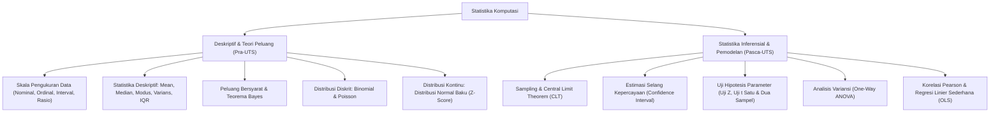

# Rangkuman Materi: Statistika (PAIK6303 / MIK1624303)

> **Bobot:** 3 SKS | **Semester:** 3 (Kurikulum 2020) / Semester 2 (Kurikulum 2024) | **Fokus Utama:** Statistika Deskriptif, Teori Peluang & Bayes, Distribusi Probabilitas (Binomial, Poisson, Normal), Uji Hipotesis, ANOVA, dan Regresi Linier

---

## 1. Catatan Integritas & Status Ketersediaan Berkas
> [!IMPORTANT]
> **Transparansi Ketersediaan Berkas:**
> Berdasarkan inventarisasi repositori Google Drive DMW HMIF Undip:
> * **Folder Bank Soal:** **KOSONG (0 berkas)** di Drive mahasiswa.
> * **Folder Materi Kuliah:** **LENGKAP (23 berkas)** slide presentasi dan diktat perkuliahan, termasuk modul praktikum pemrograman R (*R Programming for Data Science*).
>
> Rangkuman materi ini disusun secara sistematis mengacu pada 23 berkas modul resmi perkuliahan Statistika Departemen Informatika Universitas Diponegoro.

---

## 2. Gambaran Besar Mata Kuliah (*Grand View*)
Mata kuliah **Statistika** adalah fondasi inferensi matematis dan penarikan kesimpulan ilmiah berdasarkan data empiris yang mengandung ketidakpastian (*uncertainty*). Dalam era komputasi modern, ilmu statistika merupakan inti dari:
* **Data Science & Machine Learning:** Algoritma klasifikasi Naive Bayes, regresi linier/logistik, Principal Component Analysis, dan evaluasi metrik model (A/B testing).
* **Evaluasi Kinerja Sistem & Pengujian Perangkat Lunak:** Pengujian hipotesis untuk membandingkan performa latensi dua arsitektur sistem (*t-test* atau ANOVA).
* **Pemodelan Jaringan & Teori Antrean:** Distribusi Poisson dan Eksponensial untuk memodelkan kedatangan paket data internet pada router.

---

## 3. Peta Silabus & Konsep Inti Perkuliahan

### A. Bagian Pra-UTS (Statistika Deskriptif, Teori Peluang, & Distribusi)

#### 1. Konsep Data & Skala Pengukuran
* **Populasi:** Seluruh kumpulan objek yang menjadi sasaran penyelidikan.
* **Sampel:** Sebagian dari populasi yang diambil secara representatif untuk diamati.
* **4 Skala Pengukuran Data:**
  1. **Nominal:** Pengkategorian kualitatif tanpa tingkatan/urutan (misal: Jenis Kelamin, Sistem Operasi: Linux/Windows/macOS).
  2. **Ordinal:** Kategori yang memiliki tingkatan/peringkat bertingkat, namun selisih antar-tingkatan tidak terukur secara matematis (misal: Tingkat Kepuasan Pengguna: Sangat Buruk, Buruk, Cukup, Baik, Sangat Baik).
  3. **Interval:** Data numerik dengan selisih yang konsisten, namun **tidak memiliki nilai nol mutlak** (misal: Suhu dalam Celcius: $0^\circ\text{C}$ tidak berarti ketiadaan suhu).
  4. **Rasio:** Data numerik dengan interval seragam dan **memiliki nilai nol mutlak** yang bermakna ketiadaan (misal: Waktu eksekusi algoritma, memori RAM, jumlah bug program).

#### 2. Statistika Deskriptif
* **Ukuran Pemusatan Data (*Measures of Central Tendency*):**
  * **Mean (Rata-rata):** $\bar{x} = \frac{1}{n} \sum_{i=1}^n x_i$ (sensitif terhadap nilai ekstrem/*outlier*).
  * **Median:** Nilai tengah data yang telah diurutkan (tahan terhadap *outlier*).
  * **Modus:** Nilai yang paling sering muncul dalam sampel.
* **Ukuran Penyebaran Data (*Measures of Dispersion*):**
  * **Varians Sampel ($s^2$):**
    $$s^2 = \frac{1}{n - 1} \sum_{i=1}^n (x_i - \bar{x})^2$$
  * **Standar Deviasi ($s$):** $s = \sqrt{s^2}$ (akar kuadrat varians, memiliki satuan yang sama dengan data asli).
  * **Jangkauan Antar-Kuartil (*Interquartile Range - IQR*):** $\text{IQR} = Q_3 - Q_1$. Batas pencilan (*outlier rule*): data di luar $[Q_1 - 1.5\text{IQR}, \; Q_3 + 1.5\text{IQR}]$.

#### 3. Teori Peluang & Teorema Bayes
* **Aksioma Peluang:** $0 \le P(A) \le 1$, $P(S) = 1$.
* **Peluang Bersyarat (*Conditional Probability*):**
  $$P(A \mid B) = \frac{P(A \cap B)}{P(B)} \quad (P(B) > 0)$$
* **Hukum Peluang Total & Teorema Bayes:**
  Fondasi utama algoritma filter spam dan Naive Bayes Classifier:
  $$\mathbf{P(A_i \mid B) = \frac{P(B \mid A_i) \cdot P(A_i)}{\sum_{j=1}^k P(B \mid A_j) \cdot P(A_j)}}$$
  * $P(A_i)$: *Prior Probability* (probabilitas awal).
  * $P(B \mid A_i)$: *Likelihood* (kemungkinan data muncul).
  * $P(A_i \mid B)$: *Posterior Probability* (probabilitas setelah bukti diobservasi).

#### 4. Distribusi Probabilitas Diskrit & Kontinu
* **Distribusi Binomial ($X \sim B(n, p)$):**
  Eksperimen Bernoulli $n$ kali percobaan independen dengan probabilitas sukses $p$:
  $$P(X = k) = \binom{n}{k} p^k (1 - p)^{n - k}, \quad \mu = n \cdot p, \quad \sigma^2 = n \cdot p \cdot (1 - p)$$
* **Distribusi Poisson ($X \sim \text{Poisson}(\lambda)$):**
  Peluang sejumlah kejadian langka yang terjadi dalam rentang waktu/ruang tertentu dengan rata-rata laju $\lambda$:
  $$P(X = k) = \frac{\lambda^k e^{-\lambda}}{k!}, \quad \mu = \lambda, \quad \sigma^2 = \lambda$$
* **Distribusi Normal ($X \sim N(\mu, \sigma^2)$):**
  Kurva lonceng simetris Gaussian:
  $$Z = \frac{X - \mu}{\sigma} \sim N(0, 1) \quad (\text{Transformasi ke Z-Score Normal Baku})$$
  *Aturan Empiris 68-95-99.7:* Sekitar $68\%$ data berada di $[\mu \pm \sigma]$, $95\%$ di $[\mu \pm 2\sigma]$, dan $99.7\%$ di $[\mu \pm 3\sigma]$.

---

### B. Bagian Pasca-UTS (Inferensial, Uji Hipotesis, ANOVA, & Regresi)

#### 1. Central Limit Theorem (CLT) & Selang Kepercayaan
* **Teorema Limit Pusat (CLT):** Jika sampel berukuran $n$ diambil secara acak dari sembarang populasi dengan rata-rata $\mu$ dan varians $\sigma^2$, maka untuk ukuran sampel yang cukup besar ($n \ge 30$), distribusi rata-rata sampel $\bar{X}$ akan mendekati **Distribusi Normal**:
  $$\bar{X} \sim N\left( \mu, \; \frac{\sigma^2}{n} \right)$$
* **Selang Kepercayaan (*Confidence Interval* 95% untuk Rata-Rata):**
  * Jika $\sigma$ diketahui (Uji Z): $\bar{x} \pm Z_{\alpha/2} \frac{\sigma}{\sqrt{n}}$
  * Jika $\sigma$ tidak diketahui (Uji t dengan derajat bebas $df = n - 1$): $\bar{x} \pm t_{\alpha/2, df} \frac{s}{\sqrt{n}}$

#### 2. Uji Hipotesis (*Hypothesis Testing*)
Metode pembuktian klaim parameter populasi:
* **Hipotesis Nol ($H_0$):** Pernyataan status quo (tidak ada perbedaan atau tidak ada pengaruh).
* **Hipotesis Alternatif ($H_1$):** Pernyataan riset yang ingin dibuktikan.
* **Tipe Kesalahan (*Errors*):**
  * **Galat Tipe I ($\alpha$ / Level Signifikansi):** Menolak $H_0$ padahal $H_0$ sebenarnya benar (*False Positive*). Standar $\alpha = 0.05$ ($5\%$).
  * **Galat Tipe II ($\beta$):** Menerima $H_0$ padahal $H_0$ sebenarnya salah (*False Negative*).
* **Kriteria Keputusan:**
  * Tolak $H_0$ jika nilai statistik uji berada di daerah kritis, atau jika **$p\text{-value} \le \alpha$**.

#### 3. Analisis Variansi (One-Way ANOVA)
Digunakan untuk membandingkan rata-rata dari **lebih dari dua kelompok perlakuan** secara simultan (misal menguji efisiensi 3 algoritma sorting yang berbeda):
* Memecah total variabilitas data menjadi: Total Sum of Squares ($SS_{\text{Total}} = SS_{\text{Between}} + SS_{\text{Within}}$).
* Statistik Uji $F$:
  $$F = \frac{MS_{\text{Between}}}{MS_{\text{Within}}} = \frac{SS_{\text{Between}} / (k - 1)}{SS_{\text{Within}} / (N - k)}$$
* Tolak $H_0$ jika $F_{\text{hitung}} > F_{\text{tabel}}$, mengindikasikan minimal terdapat satu kelompok yang memiliki rata-rata signifikan berbeda.

#### 4. Korelasi Pearson & Regresi Linier Sederhana
* **Koefisien Korelasi Pearson ($r$):** Mengukur kekuatan dan arah hubungan linier antara dua variabel kontinyu (rentang $-1 \le r \le +1$):
  $$r = \frac{n \sum xy - (\sum x)(\sum y)}{\sqrt{[n\sum x^2 - (\sum x)^2][n\sum y^2 - (\sum y)^2]}}$$
* **Model Regresi Linier Sederhana:**
  $$\hat{Y} = a + bX$$
  * Kemiringan (*Slope*) $b = \frac{n \sum xy - (\sum x)(\sum y)}{n \sum x^2 - (\sum x)^2}$
  * Titik Potong (*Intercept*) $a = \bar{Y} - b\bar{X}$
* **Koefisien Determinasi ($R^2 = r^2$):** Persentase varians variabel dependen $Y$ yang dapat dijelaskan oleh variabel independen $X$.

---

## 4. Rumus Kunci Wajib Hafal untuk Kompre

1. **Transformasi Z-Score:** $Z = \frac{x - \mu}{\sigma}$ (populasi) atau $Z = \frac{\bar{x} - \mu}{s / \sqrt{n}}$ (sampel).
2. **Teorema Bayes:** $P(A \mid B) = \frac{P(B \mid A) P(A)}{P(B)}$.
3. **Standar Deviasi Rata-Rata Sampel (*Standard Error*):** $SE = \frac{s}{\sqrt{n}}$.
4. **Kaidah Keputusan $p$-value:** Jika $p \le \alpha \implies$ Tolak $H_0$ (Signifikan secara statistik).
