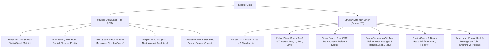

# Rangkuman Materi: Struktur Data (PAIK6306 / MIK1624306)

> **Bobot:** 4 SKS (Kuliah + Praktikum) | **Semester:** 3 | **Fokus Utama:** Tipe Data Bentukan (ADT), Stack & Queue, Pointer & Linked List Linier, Double Linked List, Binary Tree & BST, AVL Tree, Heap, dan Hash Table

---

## 1. Gambaran Besar Mata Kuliah (*Grand View*)
Mata kuliah **Struktur Data (Strukdat)** adalah jantung keilmuan informatika yang mempelajari bagaimana data diorganisasikan, disimpan, dan dimanipulasi di dalam memori komputer (RAM) secara efisien dari segi **waktu eksekusi (*Time Complexity*)** dan **ruang penyimpanan (*Space Complexity*)**.

Mengacu pada tradisi kuat kurikulum Informatika Undip (berbasis Diktat Algoritma & Struktur Data Inggriani Liem):
* **Pemisahan Definisi & Realisasi:** Konsep **Abstract Data Type (ADT)** memisahkan secara tegas antara spesifikasi antarmuka primitif (*header file .h*) dan implementasi internal kode (*source file .c*).
* **Alokasi Memori Dinamis:** Mahasiswa menguasai manipulasi pointer murni bahasa C (`malloc`, `free`) untuk membentuk struktur data rantai yang fleksibel (*linked representation*).



---

## 2. Peta Silabus & Konsep Inti Perkuliahan

### A. Bagian Pra-UTS (ADT Statis, Stack, Queue, & Single Linked List)

#### 1. Konsep Abstract Data Type (ADT)
* ADT membungkus struktur data dan fungsi-fungsi operasionalnya (enkapsulasi).
* Komponen ADT: Tipe Data, Konstruktor (pembentuk nilai awal), Selektor (pengakses elemen), Predikat (pengujian kondisi boolean, misal `IsEmpty`), dan Mutator (prosedur pengubah data).

#### 2. ADT Stack (Tumpukan - LIFO: Last-In, First-Out)
* Elemen yang terakhir disisipkan akan menjadi elemen yang pertama dikeluarkan.
* **Primitif Pokok:**
  * `CreateEmpty(S)`: Menginisialisasi tumpukan kosong (`Top(S) = Nil`).
  * `IsEmpty(S)`: Menghasilkan `true` jika tumpukan kosong.
  * `IsFull(S)`: Menghasilkan `true` jika tumpukan penuh (pada representasi tabel statis).
  * `Push(S, X)`: Menambahkan elemen $X$ di posisi paling atas (`Top`).
  * `Pop(S, X)`: Menghapus dan mengambil elemen dari posisi paling atas (`Top`).
* **Aplikasi Stack:** Evaluasi ekspresi aritmetika (*Infix to Postfix conversion*), pemanggilan fungsi rekursif (*Call Stack*), dan fitur *Undo-Redo*.

#### 3. ADT Queue (Antrean - FIFO: First-In, First-Out)
* Elemen yang pertama disisipkan akan menjadi elemen yang pertama dikeluarkan.
* Penambahan elemen dilakukan di ujung belakang (**Tail / Rear**), dan pengambilan elemen dilakukan di ujung depan (**Head / Front**).
* **Circular Queue (Antrean Melingkar):**
  Untuk mencegah terbuangnya ruang memori di depan array saat operasi penghapusan, indeks `Head` dan `Tail` bergerak melingkar menggunakan operasi modulo:
  $$\text{Tail} = (\text{Tail} \pmod{\text{MaxEl}}) + 1$$
* **Aplikasi Queue:** Penjadwalan proses CPU (*Round Robin Ready Queue*), *spooling* printer, dan algoritma penelusuran graf Breadth-First Search (BFS).

#### 4. Senarai Berantai Linier (Single Linked List)
Struktur data dinamis di mana setiap elemen dialokasikan secara independen di memori Heap dan dirangkai menggunakan pointer:
```c
typedef int infotype;
typedef struct tElmtList *address;
typedef struct tElmtList {
    infotype info;
    address next;
} ElmtList;

typedef struct {
    address First;
} List;
```
* **Manajemen Alokasi Memori:**
  * `Alokasi(X)`: Memesan blok memori dengan `malloc(sizeof(ElmtList))`. Jika berhasil, isi field `info = X` dan `next = Nil`; jika gagal mengembalikan `Nil`.
  * `Dealokasi(P)`: Membebaskan blok memori kembali ke heap menggunakan `free(P)`.
* **Primitif Penyisipan (Insert):**
  * `InsertFirst(L, P)`: Sisip di awal list ($O(1)$).
  * `InsertAfter(Pred, P)`: Sisip setelah simpul `Pred` ($O(1)$ jika prediktor diketahui).
  * `InsertLast(L, P)`: Sisip di akhir list ($O(N)$ jika hanya memiliki pointer `First`).
* **Primitif Penghapusan (Delete):**
  * `DeleteFirst(L, P)`: Menghapus simpul pertama ($O(1)$).
  * `DeleteAfter(L, P, Pred)`: Menghapus simpul tepat setelah `Pred` ($O(1)$).
  * `DeleteLast(L, P)`: Menghapus simpul terakhir ($O(N)$ karena harus mencari simpul sebelum simpul terakhir).

---

### B. Bagian Pasca-UTS (Double Linked List, Binary Tree, AVL, Heap, & Hash)

#### 1. Variasi Linked List
* **Double Linked List:** Setiap simpul memiliki dua pointer: `Next` (menunjuk simpul berikutnya) dan `Prev` (menunjuk simpul sebelumnya). Memudahkan traversal dua arah dan operasi `Delete` simpul tertentu secara langsung tanpa mencari pendahulu ($O(1)$).
* **Circular Linked List:** Pointer `Next` pada elemen terakhir tidak bernilai `Nil`, melainkan menunjuk kembali ke elemen `First`.

#### 2. Pohon Biner (Binary Tree) & Kunjungan (*Traversal*)
* Pohon di mana setiap simpul maksimal memiliki 2 anak (*Left Child* dan *Right Child*).
* **4 Metode Kunjungan Pohon Biner:**
  1. **Preorder (Root, Left, Right):** Kunjungi akar $\rightarrow$ kunjungi subpohon kiri $\rightarrow$ kunjungi subpohon kanan.
  2. **Inorder (Left, Root, Right):** Kunjungi subpohon kiri $\rightarrow$ kunjungi akar $\rightarrow$ kunjungi subpohon kanan.
     *(Catatan: Inorder traversal pada Binary Search Tree selalu menghasilkan urutan data terurut menaik!).*
  3. **Postorder (Left, Right, Root):** Kunjungi subpohon kiri $\rightarrow$ kunjungi subpohon kanan $\rightarrow$ kunjungi akar (ideal untuk menghapus pohon dari daun).
  4. **Level-order (Breadth-First):** Menelusuri simpul tingkat demi tingkat dari atas ke bawah menggunakan bantuan antrean (*Queue*).

#### 3. Pohon Biner Pencarian (*Binary Search Tree - BST*)
* Properti Fundamental: Untuk setiap simpul $N$:
  $$\text{Semua simpul di Subpohon Kiri } < N < \text{Semua simpul di Subpohon Kanan}$$
* **Operasi Pencarian & Penyisipan:** Kompleksitas rata-rata $O(\log N)$, namun dapat memburuk menjadi $O(N)$ jika pohon condong (*skewed/degenerate tree*).
* **Operasi Penghapusan (*Deletion* - 3 Kasus):**
  1. *Kasus 1 (Simpul Daun / Tanpa Anak):* Langsung hapus simpul dan ubah pointer induknya menjadi `Nil`.
  2. *Kasus 2 (Simpul Memiliki 1 Anak):* Gantikan posisi simpul tersebut dengan anak tunggalnya.
  3. *Kasus 3 (Simpul Memiliki 2 Anak):* Gantikan nilai simpul dengan **Inorder Successor** (simpul terkecil di subpohon kanan) atau **Inorder Predecessor** (simpul terbesar di subpohon kiri), lalu hapus simpul suksesor tersebut dari posisi aslinya.

#### 4. Pohon Seimbang AVL Tree
* BST yang menjamin tinggi pohon selalu seimbang sehingga operasi search/insert/delete dijamin $O(\log N)$ pada kasus terburuk.
* **Faktor Keseimbangan (*Balance Factor - BF*):**
  $$BF(N) = \text{Tinggi(Subpohon Kiri)} - \text{Tinggi(Subpohon Kanan)} \in \{-1, 0, 1\}$$
* Jika $BF$ menjadi $\pm 2$, lakukan rotasi penyeimbang:
  * **Kasus LL (Left-Left):** Rotasi Tunggal Kanan (*Single Right Rotation*).
  * **Kasus RR (Right-Right):** Rotasi Tunggal Kiri (*Single Left Rotation*).
  * **Kasus LR (Left-Right):** Rotasi Ganda: Rotasi Kiri anak kiri, lalu Rotasi Kanan pada akar.
  * **Kasus RL (Right-Left):** Rotasi Ganda: Rotasi Kanan anak kanan, lalu Rotasi Kiri pada akar.

#### 5. Priority Queue & Binary Heap
* **Complete Binary Tree** yang disimpan efisien di dalam array flat:
  * Indeks Akar $= 1$ (atau $0$).
  * Anak kiri simpul $i = 2i$, Anak kanan $= 2i + 1$, Induk $= \lfloor i/2 \rfloor$.
* **Max-Heap:** Nilai setiap simpul induk selalu $\ge$ nilai anak-anaknya (nilai maksimum selalu berada di akar).
* Operasi `Heapify` / `Percolate Down`: $O(\log N)$. Membangun heap dari array acak (*Build-Heap*): $O(N)$.
* **Heapsort:** Algoritma sorting dengan jaminan kompleksitas waktu terburuk $O(N \log N)$ dan ruang in-place $O(1)$.

#### 6. Tabel Hash (Hash Table)
* Memetakan kunci (*Key*) ke indeks array menggunakan **Fungsi Hash** $h(k)$ untuk pencarian instan rata-rata $O(1)$.
* **Penanganan Tabrakan (*Collision Resolution*):**
  * **Separate Chaining (Open Hashing):** Setiap slot array merupakan sebuah Linked List yang menampung seluruh elemen yang menghasilkan nilai hash sama.
  * **Open Addressing (Closed Hashing):** Mencari slot kosong lain di dalam array:
    * *Linear Probing:* $h(k, i) = (h(k) + i) \pmod M$ (rentan *Primary Clustering*).
    * *Quadratic Probing:* $h(k, i) = (h(k) + c_1 i + c_2 i^2) \pmod M$.
    * *Double Hashing:* $h(k, i) = (h_1(k) + i \cdot h_2(k)) \pmod M$.

---

## 3. Rumus & Jebakan Kunci Ujian Kompre

1. **Jebakan Dereferensi Null Pointer pada List:** Selalu periksa apakah pointer `P == Nil` sebelum mengakses `Info(P)` atau `Next(P)`. Memanggil `Next(P)` saat `P == Nil` adalah penyebab nomor satu ujian bernilai nol (*Segmentation Fault*).
2. **Karakteristik Inorder BST:** Hasil penelusuran traversal *Inorder* pada Binary Search Tree **pasti terurut menaik (*strictly sorted*)**. Jika tidak terurut, pohon tersebut bukan BST!
3. **Kompleksitas Array vs Linked List:**
   * Akses elemen acak: Array $O(1)$ vs Linked List $O(N)$.
   * Sisip di awal: Array $O(N)$ (harus geser elemen) vs Linked List $O(1)$.
