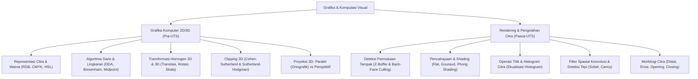

# Rangkuman Materi: Grafika dan Komputasi Visual (PAIK6405 / MIK1624405)

> **Bobot:** 3 SKS | **Semester:** 4 (Kurikulum 2020) / Kurikulum 2024 (Grafik & Teknik Interaktif) | **Fokus Utama:** Algoritma Primitif 2D (Bresenham), Transformasi Geometri 2D & 3D, Clipping (Cohen-Sutherland), Proyeksi 3D, Hidden Surface Removal (Z-Buffer), Shading (Phong), dan Pemrosesan Citra Digital

---

## 1. Gambaran Besar Mata Kuliah (*Grand View*)
Mata kuliah **Grafika dan Komputasi Visual (GKV)** menggabungkan dua sisi dari spektrum komputasi visual:
1. **Grafika Komputer (*Computer Graphics* - Sintesis Visual):** Mengubah representasi model matematis dan deskripsi geometri 2D/3D menjadi gambar visual fotorealistik pada layar monitor (*Image Synthesis / Rendering Pipeline*).
2. **Pengolahan Citra Digital (*Digital Image Processing* - Analisis Visual):** Memanipulasi citra digital nyata masukan (*input image*) untuk meningkatkan kualitas visual (*enhancement*), mendeteksi tepi (*edge detection*), ekstraksi fitur bentuk, atau kompresi data.

Bidang ini menjadi fondasi industri Game Engine (Unity, Unreal Engine), Animasi 3D, CAD/CAM, Virtual Reality (VR), serta *Computer Vision* dan Pengenalan Pola Medis.

---

## 2. Peta Silabus & Konsep Inti Perkuliahan

### A. Bagian Pra-UTS (Algoritma Primitif 2D, Transformasi & Clipping)

#### 1. Algoritma Pembentukan Garis & Lingkaran Primitif
* **Algoritma Garis DDA (*Digital Differential Analyzer*):**
  * Menghitung $\Delta x = x_2 - x_1$ dan $\Delta y = y_2 - y_1$.
  * Melakukan inkrementasi bertahap menggunakan aritmetika *floating-point* ($y_{i+1} = y_i + m$).
  * *Kelemahan:* Lambat karena operasi pembagian dan pembulatan pecahan pada setiap piksel.
* **Algoritma Garis Bresenham (Standar Industri):**
  * Menghilangkan komputasi pecahan murni; hanya menggunakan **aritmetika bilangan bulat (*integer addition & bit-shift*)**.
  * Parameter keputusan awal (untuk $|m| < 1$):
    $$p_0 = 2\Delta y - \Delta x$$
  * Aturan Rekursif:
    * Jika $p_k < 0 \implies x_{k+1} = x_k + 1, \quad y_{k+1} = y_k, \quad p_{k+1} = p_k + 2\Delta y$.
    * Jika $p_k \ge 0 \implies x_{k+1} = x_k + 1, \quad y_{k+1} = y_k + 1, \quad p_{k+1} = p_k + 2\Delta y - 2\Delta x$.
* **Algoritma Lingkaran Midpoint:**
  * Memanfaatkan simetri 8-arah (*eight-way symmetry*) lingkaran $x^2 + y^2 = R^2$. Cukup menghitung 1 oktan ($0 \le x \le y$), sisanya diperoleh melalui pencerminan tanda koordinat.
  * Parameter keputusan awal: $p_0 = 1 - R$.

#### 2. Transformasi Geometri 2D Menggunakan Koordinat Homogen
Representasi koordinat kartesius $(x, y)$ diubah ke koordinat homogen $(x, y, 1)$ agar operasi translasi non-linier dapat diekspresikan sebagai perkalian matriks standar:
* **Matriks Translasi:**
  $$\begin{bmatrix} x' \\ y' \\ 1 \end{bmatrix} = \begin{bmatrix} 1 & 0 & t_x \\ 0 & 1 & t_y \\ 0 & 0 & 1 \end{bmatrix} \begin{bmatrix} x \\ y \\ 1 \end{bmatrix}$$
* **Matriks Penskalaan (*Scaling*):**
  $$\begin{bmatrix} x' \\ y' \\ 1 \end{bmatrix} = \begin{bmatrix} s_x & 0 & 0 \\ 0 & s_y & 0 \\ 0 & 0 & 1 \end{bmatrix} \begin{bmatrix} x \\ y \\ 1 \end{bmatrix}$$
* **Matriks Rotasi terhadap Titik Asal $(0,0)$ Berlawanan Arah Jarum Jam Sebesar $\theta$:**
  $$\begin{bmatrix} x' \\ y' \\ 1 \end{bmatrix} = \begin{bmatrix} \cos\theta & -\sin\theta & 0 \\ \sin\theta & \cos\theta & 0 \\ 0 & 0 & 1 \end{bmatrix} \begin{bmatrix} x \\ y \\ 1 \end{bmatrix}$$
* **Rotasi terhadap Titik Pusat Sembarang $(x_p, y_p)$:**
  Dilakukan melalui 3 langkah matriks komposit:
  $$M = T(x_p, y_p) \cdot R(\theta) \cdot T(-x_p, -y_p)$$

#### 3. Pemotongan Garis 2D (*Line Clipping* - Algoritma Cohen-Sutherland)
* Membagi bidang layar menjadi 9 daerah menggunakan **Kode Biner 4-bit (Outcode: T B R L / Top, Bottom, Right, Left)** terhadap jendela kliping $[x_{\min}, x_{\max}] \times [y_{\min}, y_{\max}]$.
  * Bit 1 (Top): $y > y_{\max}$
  * Bit 2 (Bottom): $y < y_{\min}$
  * Bit 3 (Right): $x > x_{\max}$
  * Bit 4 (Left): $x < x_{\min}$
* **Aturan Keputusan Cepat:**
  1. *Trivial Accept (Diterima Penuh):* $\text{Code}_1 = 0000$ dan $\text{Code}_2 = 0000$ (seluruh garis berada di dalam jendela).
  2. *Trivial Reject (Ditolak Penuh):* $\text{Code}_1 \text{ AND } \text{Code}_2 \ne 0000$ (kedua ujung berada di sisi luar yang sama).
  3. *Clipping Needed:* Hitung titik potong garis dengan tepi batas jendela.

---

### B. Bagian Pasca-UTS (Rendering 3D, Shading, & Pengolahan Citra Digital)

#### 1. Proyeksi 3D & Deteksi Permukaan Tampak
* **Proyeksi Paralel vs Proyeksi Perspektif:**
  * *Proyeksi Paralel (Ortografik):* Garis proyeksi sejajar, ukuran objek tidak berubah terhadap jarak (cocok untuk gambar teknik arsitektur CAD).
  * *Proyeksi Perspektif:* Garis proyeksi memusat pada satu titik fokus (*Center of Projection*), objek yang lebih jauh tampak lebih kecil (*foreshortening*), memiliki titik hilang (*vanishing point*), menyerupai persepsi mata manusia.
* **Deteksi Permukaan Tampak (*Hidden Surface Removal*):**
  * **Z-Buffer (Depth Buffer Algorithm):** Menggunakan dua buffer memori berukuran layar: *Frame Buffer* (menyimpan warna) dan *Z-Buffer* (menyimpan kedalaman $z$).
    * Jika kedalaman piksel poligon baru $z_{\text{baru}} < z_{\text{buffer}}(x, y)$, maka piksel tersebut lebih dekat ke kamera: perbarui $z_{\text{buffer}}(x, y) = z_{\text{baru}}$ dan gambar warnanya.
  * **Back-Face Culling:** Menghilangkan poligon yang menghadap membelakangi kamera dengan menguji perkalian dot antara vektor normal poligon $\mathbf{N}$ dan vektor pandang kamera $\mathbf{V}$ ($\mathbf{N} \cdot \mathbf{V} \ge 0 \implies$ abaikan poligon).

#### 2. Model Pencahayaan (*Illumination*) & Shading
* **Model Refleksi Phong:**
  $$I_{\text{total}} = I_a k_a + I_d k_d (\mathbf{N} \cdot \mathbf{L}) + I_s k_s (\mathbf{R} \cdot \mathbf{V})^n$$
  * $I_a k_a$: Cahaya Ambien (penerangan dasar konstan tanpa arah).
  * $I_d k_d (\mathbf{N} \cdot \mathbf{L})$: Refleksi Baur (*Diffuse / Lambertian* - kasar, menyebar ke segala arah sebanding dengan sudut datang cahaya).
  * $I_s k_s (\mathbf{R} \cdot \mathbf{V})^n$: Refleksi Spekular (*Highlight kilap mengkilat* - bergantung sudut pandang mata dan koefisien kekilapan $n$).
* **Tiga Teknik Shading Poligon:**
  1. **Flat Shading:** Menghitung satu warna di pusat poligon, mewarnai seluruh wajah poligon dengan warna seragam yang sama (cepat, namun terlihat seperti balok bersudut kaku / *faceted*).
  2. **Gouraud Shading:** Menghitung warna pencahayaan pada setiap vertex/simpul, lalu melakukan **interpolasi linier warna** di sepanjang permukaan poligon (menghaluskan sudut, namun sering kehilangan *specular highlight*).
  3. **Phong Shading:** Melakukan **interpolasi linier vektor normal** pada setiap piksel, lalu menghitung rumus pencahayaan Phong secara presisi per-piksel (kualitas visual fotorealistik tinggi, komputasi paling intensif).

#### 3. Pengolahan Citra Digital (*Digital Image Processing*)
* **Ekualisasi Histogram (*Histogram Equalization*):**
  Mendistribusikan ulang intensitas derajat keabuan (*grayscale*) secara merata ke seluruh rentang dinamis $[0, 255]$ menggunakan fungsi distribusi kumulatif (CDF) untuk meningkatkan kontras citra yang terlalu gelap atau terlalu silau.
* **Filter Spasial Konvolusi:**
  Operasi pergeseran matriks bobot (*Kernel Mask*) $K_{m \times m}$ di atas matriks citra $f(x, y)$:
  $$g(x, y) = \sum_{s=-a}^a \sum_{t=-b}^b K(s, t) \cdot f(x+s, y+t)$$
  * *Low-Pass Filter (Smoothing / Blur):* Kernel rata-rata (*Box Filter*) atau Gaussian Filter untuk mereduksi derau (*noise*).
  * *High-Pass Filter (Sharpening):* Operator Laplacian untuk menonjolkan transisi tepi intensitas.
* **Deteksi Tepi (*Edge Detection*):**
  Menggunakan operator gradien spasial Sobel ($G_x$ horizontal dan $G_y$ vertikal):
  $$G_x = \begin{bmatrix} -1 & 0 & 1 \\ -2 & 0 & 2 \\ -1 & 0 & 1 \end{bmatrix}, \quad G_y = \begin{bmatrix} -1 & -2 & -1 \\ 0 & 0 & 0 \\ 1 & 2 & 1 \end{bmatrix}, \quad M = \sqrt{G_x^2 + G_y^2}$$
* **Operasi Morfologi Citra Biner:**
  * **Dilasi ($A \oplus B$):** Memperbesar/mempertebal batas objek putih (mengisi lubang-lubang kecil).
  * **Erosi ($A \ominus B$):** Mengikis/memperkecil batas objek (menghilangkan bintik derau kecil).
  * **Opening:** Erosi diikuti Dilasi (menghilangkan derau tanpa mengubah ukuran objek asli).
  * **Closing:** Dilasi diikuti Erosi (menutup celah dan lubang di dalam objek).

---

## 3. Rumus & Jebakan Kunci Ujian Kompre

1. **Jebakan Matriks Komposit 2D:** Urutan perkalian matriks adalah **dari kanan ke kiri** sesuai urutan kronologis aksi:
   $$\text{Aksi: Translasi dulu } (T) \text{ baru Rotasi } (R) \implies \mathbf{x}' = R \cdot T \cdot \mathbf{x}$$
2. **Kondisi Outcode Cohen-Sutherland:** Jika $\text{Code}_1 \text{ AND } \text{Code}_2 = 0000$, jangan langsung disimpulkan bahwa garis pasti diterima! Garis tersebut **harus dihitung titik potongnya** karena memotong jendela kliping.
3. **Perbedaan Gouraud vs Phong Shading:** Gouraud menginterpolasi **warna/intensitas**, sedangkan Phong menginterpolasi **vektor normal**.
