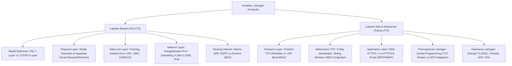

# Rangkuman Materi: Jaringan Komputer (PAIK6401 / MIK1624401)

> **Bobot:** 3 SKS | **Semester:** 4 (Kurikulum 2020 / Kurikulum 2024) | **Fokus Utama:** Model Arsitektur Jaringan (OSI 7-Layer vs TCP/IP), Media Transmisi & Data Link (Framing, CRC, CSMA/CD), Pengalamatan IP & Subnetting (VLSM, CIDR), Protokol Routing (RIP, OSPF, BGP), Transport Layer (TCP vs UDP, 3-Way Handshake, Congestion Control), Application Layer (DNS, HTTP, Sockets), dan Dasar Keamanan Jaringan

---

## 1. Gambaran Besar Mata Kuliah (*Grand View*)
Mata kuliah **Jaringan Komputer** mempelajari prinsip-prinsip komunikasi data antarsistem komputer otonom, mulai dari transmisi fisik bit di media transmisi hingga penyediaan antarmuka layanan aplikasi global. Topik diorganisasikan menggunakan model lapisan (*layered architecture*), dengan acuan utama buku teks standar industri *Computer Networking: A Top-Down Approach* (Kurose & Ross).

Mahasiswa mempelajari bagaimana paket data dienkapsulasi dari lapisan teratas (Application) menuju bit biner di lapisan fisik, ditransmisikan melintasi router dan switch melalui algoritma routing global, serta dirakit kembali di sisi penerima dengan jaminan integritas (*reliability*) dan efisiensi aliran (*flow & congestion control*).

---

## 2. Peta Silabus & Konsep Inti Perkuliahan

### A. Bagian Pra-UTS (Arsitektur, Data Link, IP Addressing & Routing)

#### 1. Model Referensi Arsitektur: OSI 7-Layer vs TCP/IP
Proses pertukaran data antarkomputer distandarisasi menggunakan model berlapis:
* **OSI 7-Layer Reference Model:**
  1. *Physical:* Transmisi deretan bit biner mentah melalui media fisik (kabel tembaga, fiber optik, gelombang radio). PDU: **Bit**.
  2. *Data Link:* Pengelompokan bit menjadi frame, pengalamatan fisik (*MAC Address*), deteksi galat (*error detection*), dan kontrol akses media. PDU: **Frame**.
  3. *Network:* Pengalamatan logika global (*IP Address*) dan penentuan rute terbaik (*routing*) antarjaringan yang berbeda. PDU: **Packet / Datagram**.
  4. *Transport:* Komunikasi ujung-ke-ujung (*end-to-end / process-to-process*), multiplexing port, segmentasi data, kontrol keandalan dan aliran. PDU: **Segment**.
  5. *Session:* Pengelolaan sesi komunikasi (pembuatan, pemeliharaan, dan terminasi koneksi).
  6. *Presentation:* Translasi format data, enkripsi/dekripsi, dan kompresi.
  7. *Application:* Antarmuka langsung dengan perangkat lunak pengguna (HTTP, DNS, FTP, SMTP). PDU: **Message**.
* **TCP/IP 5-Layer Practical Model:**
  Menggabungkan layer Session dan Presentation ke dalam **Application Layer**: (Application $\rightarrow$ Transport $\rightarrow$ Network / Internet $\rightarrow$ Data Link $\rightarrow$ Physical).
* **Prinsip Enkapsulasi & Dekapsulasi:** Setiap lapisan menambahkan header kendali miliknya sendiri saat paket bergerak ke bawah (*encapsulation*), dan memotong header tersebut saat diterima bergerak ke atas (*decapsulation*).

#### 2. Data Link Layer & Deteksi Galat
* **Framing & Deteksi Galat dengan CRC (*Cyclic Redundancy Check*):**
  * Menggunakan pembagian polinomial biner modulo-2 (operasi XOR tanpa simpanan/pinjaman).
  * Pengirim menambahkan bit redundansi (FCS - *Frame Check Sequence*) berukuran $r$ bit ke data utama $D$, sehingga deretan bit $(D \cdot 2^r + R)$ habis dibagi oleh generator polinomial $G$.
* **Kontrol Akses Media (MAC Sublayer):**
  * **CSMA/CD (*Carrier Sense Multiple Access with Collision Detection*):** Digunakan pada Ethernet kabel. Komputer mendengarkan jalur (*Carrier Sense*); jika bebas, ia mengirim. Jika dua host mengirim bersamaan, terjadi tabrakan (*Collision*), pengiriman dihentikan seketika, sinyal *Jamming* disebarkan, dan kedua host menunggu durasi acak menggunakan *Exponential Backoff*.
  * **CSMA/CA (*Collision Avoidance*):** Digunakan pada Wi-Fi (802.11) karena radio tidak dapat mendengar saat memancar (*hidden terminal problem*). Menggunakan mekanisme pertukaran kendali RTS (*Request to Send*) dan CTS (*Clear to Send*).

#### 3. Pengalamatan IP & Subnetting (VLSM & CIDR)
* **Format IPv4:** Alamat logika 32-bit yang dipisah menjadi 4 oktet (desimal bertitik, misal `192.168.1.1`).
* **Kelas Alamat IP Klasik (Classful):**
  * Kelas A: `0.0.0.0` – `127.255.255.255` (Subnet mask default `/8` atau `255.0.0.0`).
  * Kelas B: `128.0.0.0` – `191.255.255.255` (Subnet mask default `/16` atau `255.255.0.0`).
  * Kelas C: `192.0.0.0` – `223.255.255.255` (Subnet mask default `/24` atau `255.255.255.0`).
* **CIDR (*Classless Inter-Domain Routing*) & VLSM (*Variable Length Subnet Masking*):**
  * Notasi prefix `/n` menyatakan jumlah bit biner `1` pada subnet mask (menunjukkan porsi Network ID).
  * Jumlah Host Tersedia per Subnet: $2^{32 - n} - 2$ (dikurangi 2 untuk *Network Address* dan *Broadcast Address*).
  * *Network Address:* Bit host di-NOL-kan semua (`IP AND Subnet Mask`).
  * *Broadcast Address:* Bit host di-SATU-kan semua.

#### 4. Protokol Routing (Interior vs Exterior Gateway Protocols)
* **Autonomous System (AS):** Kumpulan jaringan di bawah satu kendali administratif teknis tunggal.
* **Intra-AS Routing (IGP - Interior Gateway Protocol):**
  * **Distance Vector (RIP - Routing Information Protocol):** Metrik berbasis jumlah lompatan (*hop count*, maksimal 15). Menerapkan algoritma Bellman-Ford. Rawan masalah *Count-to-Infinity* (diatasi dengan *Split Horizon* dan *Poison Reverse*).
  * **Link-State (OSPF - Open Shortest Path First):** Setiap router menyebarkan informasi topologi lokal (*Link State Advertisement*) ke seluruh area. Setiap router merekonstruksi peta graf lengkap jaringan dan menghitung rute terpendek menggunakan **Algoritma Dijkstra**. Metrik berbasis *Cost* (invers dari bandwidth).
* **Inter-AS Routing (EGP - Exterior Gateway Protocol):**
  * **BGP (*Border Gateway Protocol*):** Protokol standar penentu rute antar-AS di tulang punggung internet global (*Path Vector Protocol*). Keputusan routing dipengaruhi oleh kebijakan bisnis, peering, dan atribut AS-PATH untuk mencegah perulangan rute (*routing loops*).

---

### B. Bagian Pasca-UTS (Transport, Application, Sockets & Security)

#### 1. Lapisan Transport (TCP vs UDP)
| Parameter | TCP (*Transmission Control Protocol*) | UDP (*User Datagram Protocol*) |
|:---|:---|:---|
| **Koneksi** | *Connection-Oriented* (wajib handshake awal) | *Connectionless* (kirim langsung) |
| **Keandalan** | *Reliable* (ACK, retransmisi paket hilang, checksum) | *Unreliable* (Best effort, tanpa jaminan tiba) |
| **Urutan Data** | Terurut rapi (*Sequence number*) | Tidak dijamin urut |
| **Kontrol Aliran** | Ada (*Flow Control* via Advertised Window) | Tidak ada |
| **Kontrol Kongesti** | Ada (*Slow Start*, Congestion Avoidance) | Tidak ada |
| **Overhead Header** | 20 – 60 bytes | Ringan, tepat 8 bytes |
| **Contoh Aplikasi** | HTTP/HTTPS, FTP, SSH, SMTP | DNS query, VoIP, Streaming Video, Game Real-time |

#### 2. Mekanisme Kunci TCP
* **Pembuatan Koneksi: TCP 3-Way Handshake:**
  1. Klien $\rightarrow$ Server: `SYN` (Sequence Number = $x$)
  2. Server $\rightarrow$ Klien: `SYN-ACK` (Sequence Number = $y$, Acknowledgment Number = $x + 1$)
  3. Klien $\rightarrow$ Server: `ACK` (Sequence Number = $x + 1$, Acknowledgment Number = $y + 1$)
* **Penutupan Koneksi: TCP 4-Way Teardown:**
  1. Klien $\rightarrow$ Server: `FIN` $\rightarrow$ Server: `ACK`
  2. Server $\rightarrow$ Klien: `FIN` $\rightarrow$ Klien: `ACK` (diikuti fase `TIME_WAIT` untuk memastikan ACK tiba).
* **Kontrol Kongesti (*Congestion Control* - AIMD):**
  * **Slow Start:** Ukuran *Congestion Window* ($cwnd$) dimulai dari 1 MSS (*Maximum Segment Size*) dan berlipat ganda secara eksponensial ($2, 4, 8, \dots$) setiap RTT (*Round Trip Time*) hingga mencapai ambang batas $ssthresh$.
  * **Congestion Avoidance (Additive Increase):** Setelah melewati $ssthresh$, $cwnd$ naik secara linier sebesar 1 MSS per RTT.
  * **Multiplicative Decrease:** Jika terjadi kehilangan paket (indikasi kemacetan jaringan):
    * Terdeteksi *Triple Duplicate ACK*: $ssthresh = cwnd / 2$, $cwnd = ssthresh$ (*Fast Recovery*).
    * Terdeteksi *Timeout*: $ssthresh = cwnd / 2$, $cwnd = 1$ MSS (kembali ke Slow Start penuh).

#### 3. Lapisan Aplikasi (*Application Layer*)
* **DNS (*Domain Name System*):** Basis data terdistribusi hierarki untuk memetakan nama domain ke alamat IP.
  * Struktur Hierarki: Root Server (`.`) $\rightarrow$ Top-Level Domain (TLD: `.com`, `.id`) $\rightarrow$ Authoritative DNS Server.
  * Tipe Record: `A` (IPv4), `AAAA` (IPv6), `CNAME` (Kanonikal alias), `MX` (Mail server), `NS` (Name server).
* **HTTP (*Hypertext Transfer Protocol*):**
  * **HTTP/1.1:** *Persistent Connection*, namun mengalami masalah *Head-of-Line (HoL) Blocking* pada level HTTP (permintaan antre berurutan).
  * **HTTP/2:** Multiplexing biner pada satu koneksi TCP tunggal, *header compression* (HPACK), dan *server push*.
  * **HTTP/3:** Berjalan di atas protokol transport berbasis UDP baru (**QUIC**) untuk mengeliminasi HoL Blocking pada level transport TCP dan mendukung *zero RTT connection*.

#### 4. Pemrograman Jaringan (*Socket Programming*)
* **Abstraksi Socket:** Kombinasi unik antara `IP Address` dan `Port Number` yang menjadi ujung tombak komunikasi proses aplikasi.
* **Alur TCP Stream Socket (Connection-oriented):**
  * *Server:* `socket()` $\rightarrow$ `bind()` $\rightarrow$ `listen()` $\rightarrow$ `accept()` (membuat *connected socket* baru) $\rightarrow$ `recv()` / `send()` $\rightarrow$ `close()`.
  * *Client:* `socket()` $\rightarrow$ `connect()` $\rightarrow$ `send()` / `recv()` $\rightarrow$ `close()`.
* **Alur UDP Datagram Socket (Connectionless):**
  * Tidak ada pemanggilan `listen()` dan `accept()`. Pertukaran data dilakukan menggunakan `sendto()` dan `recvfrom()` dengan menyertakan alamat tujuan pada setiap datagram.

---

## 3. Rumus-Rumus Inti Jaringan Komputer

1. **Kapasitas Kanal Bebas Derau (Teorema Nyquist):**
   $$C = 2B \log_2(M) \quad \text{[bps]}$$
   ($B$ = Bandwidth dalam Hz, $M$ = Jumlah level diskrit sinyal).

2. **Kapasitas Kanal Berderau Maksimal (Teorema Shannon-Hartley):**
   $$C = B \log_2\left(1 + \frac{S}{N}\right) \quad \text{[bps]}$$
   ($S/N$ = *Signal-to-Noise Ratio* linier; jika diketahui dalam dB: $\text{SNR}_{\text{dB}} = 10 \log_{10}(S/N)$).

3. **Perhitungan Delay Total Paket (*End-to-End Delay*):**
   $$d_{\text{total}} = d_{\text{trans}} + d_{\text{prop}} + d_{\text{proc}} + d_{\text{queue}}$$
   * *Transmission Delay:* $d_{\text{trans}} = \frac{L}{R}$ ($L$ = ukuran paket dalam bit, $R$ = bandwidth transmisi dalam bps).
   * *Propagation Delay:* $d_{\text{prop}} = \frac{d}{s}$ ($d$ = jarak fisik kabel dalam meter, $s$ = kecepatan rambat cahaya $\approx 2 \times 10^8 \text{ m/s}$ pada tembaga).
