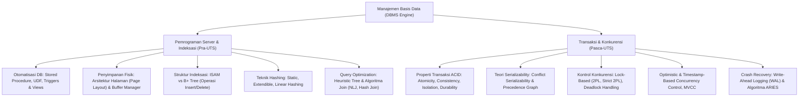

# Rangkuman Materi: Manajemen Basis Data (PAIK6404 / MIK1624404)

> **Bobot:** 3 SKS | **Semester:** 4 (Kurikulum 2020 / Kurikulum 2024) | **Fokus Utama:** Otomatisasi Database Tingkat Lanjut (Stored Procedure, Function, Trigger), Arsitektur Penyimpanan & Indeksasi (B+ Tree, Hash Index), Optimasi Kueri (Aljabar Relasional, Heuristic Tree, Algoritma Join), Pemrosesan Transaksi (ACID, Serializability), Kontrol Konkurensi (2PL, Deadlock, MVCC), dan Pemulihan Sistem (ARIES, WAL)

---

## 1. Gambaran Besar Mata Kuliah (*Grand View*)
Jika mata kuliah *Basis Data* (Semester 3) berfokus pada desain skema relasional, normalisasi (1NF–BCNF), dan kueri SQL deklaratif dasar, maka **Manajemen Basis Data (MBD)** berfokus pada **mekanisme internal *Database Management System (DBMS Engine)*** dalam menjamin performa, integritas data berskala besar, eksekusi konkuren, dan keandalan sistem saat terjadi kegagalan perangkat keras.

Mata kuliah ini membekali mahasiswa dengan kemampuan merancang otomatisasi sisi server (*Server-Side Automation*), menganalisis struktur fisik penyimpanan file di disk, menghitung biaya I/O query planner, serta membuktikan kebenaran matematis dari jadwal transaksi konkuren menggunakan teori graf serializability.

---

## 2. Peta Silabus & Konsep Inti Perkuliahan

### A. Bagian Pra-UTS (Otomatisasi Server, Indeksasi & Query Optimization)

#### 1. Otomatisasi Basis Data (*Server-Side Scripting*)
* **Stored Procedure & User-Defined Function (UDF):**
  * Kumpulan instruksi prosedural SQL yang dikompilasi dan disimpan langsung di server basis data.
  * *Keunggulan:* Mereduksi *network traffic* secara drastis (hanya 1 pemanggilan jaringan), meningkatkan keamanan (mencegah SQL Injection via *parameterized query*), dan modularitas logika bisnis.
  * Perbedaan: Procedure dipanggil dengan perintah `CALL` dan dapat mengembalikan nilai melalui parameter `OUT/INOUT`; Function dipanggil di dalam klausa `SELECT/WHERE` dan wajib mengembalikan tepat satu skalar (*scalar return*).
* **Database Triggers:**
  * Prosedur otomatis yang dieksekusi (*fire*) sebagai respon terhadap aksi DML (`INSERT`, `UPDATE`, `DELETE`).
  * Tipe: `BEFORE` (validasi dan pembersihan data) vs `AFTER` (pencatatan audit log atau sinkronisasi denormalisasi).
  * Pengubah status baris: `OLD.column` (nilai sebelum operasi) dan `NEW.column` (nilai baru yang disisipkan).

#### 2. Arsitektur Penyimpanan Fisik & Struktur Indeks Pohon B+
* **Buffer Manager:** Komponen DBMS yang bertugas menukar blok halaman (*pages*, umumnya 4KB/8KB) antara memori sekunder (Hard Disk/SSD) dan RAM. Menggunakan algoritma penggantian seperti LRU (*Least Recently Used*) atau Clock Policy.
* **Indeks B+ Tree (Paling Banyak Digunakan):**
  * Struktur pohon seimbang (*balanced tree*) di mana semua simpul daun (*leaf nodes*) berada pada kedalaman yang tepat sama.
  * *Perbedaan Kunci dengan B-Tree Tradisional:*
    1. Pada B+ Tree, simpul internal (*non-leaf*) **hanya menyimpan penunjuk (*pointer*) dan kunci pemandu**, tanpa menyimpan pointer record data sesungguhnya.
    2. Semua record data atau penunjuk tuple aktual tersimpan secara eksklusif pada **simpul daun (*leaf nodes*)**.
    3. Seluruh simpul daun saling terhubung membentuk **Doubly Linked List** berurutan horizontal, memungkinkan eksekusi kueri rentang (*range scan*, e.g., `WHERE gaji BETWEEN 5M AND 10M`) dieksekusi secara instan $O(\log N + K)$.
  * *Karakteristik Kapasitas:* Jika simpul memiliki orde $m$, maka setiap simpul memuat maksimal $m-1$ kunci dan minimal $\lceil m/2 \rceil - 1$ kunci (kecuali akar).
  * *Operasi Splitting:* Jika simpul daun penuh saat disisipi kunci baru, simpul dibelah dua; kunci tengah dinaikkan (*copied up*) ke simpul induk.

#### 3. Pemrosesan & Optimasi Kueri (*Query Optimization*)
* **Pohon Aljabar Relasional (*Query Execution Tree*):**
  Representasi graf hierarki dari kueri SQL di mana daun adalah relasi tabel dasar dan simpul internal adalah operator aljabar relasional ($\sigma, \pi, \bowtie$).
* **Heuristik Optimasi Kueri Standar:**
  1. **Push Selections Down ($\sigma$):** Eksekusi operasi seleksi kondisi secepat mungkin pada level relasi terbawah untuk mereduksi jumlah baris (kardinalitas) sebelum dilakukan operasi gabungan (*join*).
  2. **Push Projections Down ($\pi$):** Buang atribut kolom yang tidak relevan sesegera mungkin untuk memperkecil ukuran tuple di memori (*memory footprint*).
  3. **Reordering Joins ($\bowtie$):** Urutkan operasi join tabel dari relasi yang menghasilkan ukuran perantara terkecil terlebih dahulu.
* **Algoritma Implementasi Operator Join:**
  * *Nested Loop Join (NLJ):* Sederhana $O(M \cdot N)$, efisien jika salah satu tabel sangat kecil.
  * *Block Nested Loop Join (BNLJ):* Membaca tabel luar berbasis blok halaman memori untuk meminimalkan I/O disk.
  * *Sort-Merge Join:* Mengurutkan kedua tabel berdasarkan kunci join, lalu melakukan pencocokan linier $O(M \log M + N \log N)$.
  * *Hash Join:* Membangun tabel hash di memori untuk tabel kecil, lalu menelusuri (*probe*) tabel besar. Kompleksitas mendekati linier $O(M + N)$.

---

### B. Bagian Pasca-UTS (Transaksi, Konkurensi & Recovery)

#### 1. Properti Transaksi (ACID)
* **Atomicity:** Prinsip "Semua atau Tidak Sama Sekali" (*All or Nothing*). Jika terjadi kegagalan di tengah eksekusi, seluruh perubahan dibatalkan (*Rollback*). Dijamin oleh modul **Recovery**.
* **Consistency:** Transaksi membawa basis data dari satu status valid ke status valid lainnya sesuai aturan integritas (*Constraints/Triggers*).
* **Isolation:** Eksekusi transaksi konkuren berjalan seolah-olah transaksi tersebut dieksekusi secara terisolasi tanpa intervensi transaksi lain. Dijamin oleh modul **Concurrency Control**.
* **Durability:** Setelah transaksi sukses melakukan `COMMIT`, perubahan data bersifat permanen dan tidak akan hilang meskipun sistem listrik padam seketika. Dijamin oleh **Write-Ahead Logging (WAL)**.

#### 2. Teori Serializability & Precedence Graph
* **Anomali Eksekusi Konkuren:**
  1. *Dirty Read (Read Uncommitted):* Membaca data yang diubah transaksi lain namun belum di-commit dan kemudian di-rollback.
  2. *Non-Repeatable Read:* Membaca baris yang sama dua kali, namun nilainya berubah karena transaksi lain melakukan `UPDATE` di antaranya.
  3. *Phantom Read:* Kueri rentang baris membaca jumlah record yang bertambah karena transaksi lain melakukan `INSERT` baru.
* **Conflict Serializability:**
  Dua operasi $O_i$ dan $O_j$ dikatakan berkonflik jika:
  1. Berasal dari dua transaksi yang berbeda ($T_i \ne T_j$),
  2. Mengakses item data yang tepat sama, dan
  3. Minimal salah satu operasinya adalah operasi penulisan (**Write**).
  Tiga pasangan konflik: **Read-Write (RW)**, **Write-Read (WR)**, dan **Write-Write (WW)**.
* **Pengujian Serializability via Serialization Graph (Precedence Graph):**
  * Simpul: Setiap transaksi $T_i$.
  * Busur Berarah: Busur $T_i \rightarrow T_j$ ditarik jika operasi $T_i$ mendahului dan berkonflik dengan operasi $T_j$.
  * **Teorema:** Suatu jadwal konkuren dikatakan **Conflict Serializable** jika dan hanya jika Graf Presedensi yang dihasilkan **TIDAK MEMILIKI SIKLUS (*Acyclic / No Cycle*)**.

#### 3. Kontrol Konkurensi (*Concurrency Control*) & Deadlock
* **Two-Phase Locking (2PL):**
  * *Growing Phase:* Transaksi hanya boleh memperoleh kunci (*acquire Shared/Exclusive Lock*), tidak boleh melepaskan kunci satupun.
  * *Shrinking Phase:* Transaksi hanya boleh melepaskan kunci (*release Lock*), tidak boleh meminta kunci baru lagi.
  * **Strict 2PL (Standar Industri):** Semua kunci Eksklusif (X-Lock) ditahan hingga transaksi selesai (`COMMIT` atau `ABORT`), mencegah anomali *Cascading Rollbacks*.
* **Deadlock Handling:**
  * Kondisi ketika dua transaksi atau lebih saling menunggu kunci yang ditahan oleh transaksi lain.
  * *Skema Deteksi:* DBMS secara berkala membangun *Wait-For Graph (WFG)*; jika terdapat siklus, pilih satu transaksi korban (*victim*) untuk di-rollback.
  * *Skema Pencegahan Berbasis Timestamp ($TS(T_i)$):*
    * **Wait-Die (Non-preemptive):** Jika transaksi tua ($T_{\text{tua}}$) meminta kunci yang dipegang transaksi muda ($T_{\text{muda}}$), $T_{\text{tua}}$ boleh **menunggu (*Wait*)**. Jika $T_{\text{muda}}$ meminta kunci dari $T_{\text{tua}}$, $T_{\text{muda}}$ langsung **dibunuh (*Die*)**.
    * **Wound-Wait (Preemptive):** Jika $T_{\text{tua}}$ meminta kunci yang dipegang $T_{\text{muda}}$, $T_{\text{tua}}$ **melukai/membatalkan (*Wound*)** $T_{\text{muda}}$ dan merebut kunci. Jika $T_{\text{muda}}$ meminta dari $T_{\text{tua}}$, $T_{\text{muda}}$ diizinkan **menunggu (*Wait*)**.

#### 4. Pemulihan Kerusakan Basis Data (*Crash Recovery & ARIES*)
* **Prinsip Write-Ahead Logging (WAL):**
  1. Setiap perubahan data wajib dicatat di log pada disk sebelum halaman data yang sebenarnya (*dirty page*) ditulis ke disk (*WAL Rule*).
  2. Semua log record transaksi wajib berada di disk stabil sebelum operasi `COMMIT` dianggap tuntas.
* **Algoritma ARIES (*Algorithm for Recovery and Isolation Exploiting Semantics*):**
  Terdiri dari 3 fase pemulihan pasca-crash:
  1. **Analysis Phase:** Memindai log maju dari checkpoint terakhir untuk mengidentifikasi status transaksi aktif (*loser transactions*) dan halaman kotor di *Dirty Page Table (DPT)*.
  2. **Redo Phase:** Mengulang seluruh perubahan (*Redo History*) dari titik tertua DPT maju ke depan, mengembalikan status basis data ke detik tepat sebelum terjadi kecelakaan.
  3. **Undo Phase:** Memindai log mundur dari belakang untuk membatalkan seluruh operasi transaksi yang belum sempat commit (*loser transactions*) dan menulis *Compensation Log Records (CLR)*.
