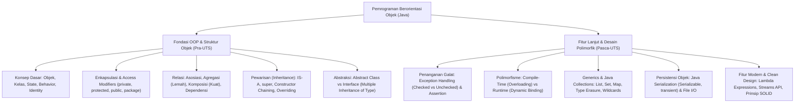

# Rangkuman Materi: Pemrograman Berorientasi Objek (PAIK6402 / MIK1624402)

> **Bobot:** 3 SKS | **Semester:** 4 (Kurikulum 2020 / Kurikulum 2024) | **Bahasa Implementasi Utama:** Java | **Fokus Utama:** Paradigma OOP, Enkapsulasi, Relasi Antar-Objek (Asosiasi, Agregasi, Komposisi), Pewarisan (Inheritance), Kelas Abstrak & Interface, Exception Handling & Asersi, Polimorfisme (Static & Dynamic Binding), Generics & Collection Framework, Objek Persisten (Serialisasi), Ekspresi Lambda, dan Prinsip Desain SOLID

---

## 1. Gambaran Besar Mata Kuliah (*Grand View*)
Mata kuliah **Pemrograman Berorientasi Objek (PBO)** mengubah cara pandang pemrograman dari paradigma prosedural/sekuensial menuju pemodelan sistem dunia nyata sebagai kumpulan **objek otonom yang saling berinteraksi melalui pengiriman pesan (*message passing*)**. Objek memadukan struktur data (*state/attributes*) dan fungsi perilaku (*behavior/methods*) dalam satu kesatuan modular.

Di Departemen Informatika Undip, PBO diajarkan menggunakan bahasa **Java** sebagai wahana utama untuk memahami disiplin rekayasa perangkat lunak: *clean code*, keamanan tipe (*type safety*), penggunaan kembali kode (*code reusability* via pewarisan dan polimorfisme), penanganan galat tangguh (*robust exception handling*), serta penerapan prinsip desain berorientasi objek (**SOLID Principles**).

---

## 2. Peta Silabus & Konsep Inti Perkuliahan

### A. Bagian Pra-UTS (Fondasi OOP, Enkapsulasi, Relasi & Abstraksi)

#### 1. Konsep Dasar Objek & Enkapsulasi
* Tiga Karakteristik Objek:
  1. **State:** Keadaan/nilai data yang disimpan dalam variabel atribut (*instance variables*).
  2. **Behavior:** Perilaku atau fungsionalitas yang dapat dijalankan oleh objek (*methods*).
  3. **Identity:** Identitas unik pembeda di memori (*memory reference address*), meskipun dua objek memiliki nilai atribut yang identik.
* **Enkapsulasi (*Information Hiding*):**
  * Menyembunyikan representasi internal objek dari akses langsung pihak luar untuk mencegah korupsi status tak valid.
  * Dilakukan dengan mendeklarasikan atribut sebagai `private` dan menyediakan metode pengakses `public`: *getter* (accessor) dan *setter* (mutator dengan validasi logika).
* **Tabel Tingkat Aksesibilitas (*Access Modifiers*) Java:**

| Modifier | Class Sendiri | Package Sama | Subclass (Beda Package) | Dunia Luar (Public) |
|:---|:---:|:---:|:---:|:---:|
| `private` | ✅ | ❌ | ❌ | ❌ |
| *(default / package-private)* | ✅ | ✅ | ❌ | ❌ |
| `protected` | ✅ | ✅ | ✅ | ❌ |
| `public` | ✅ | ✅ | ✅ | ✅ |

#### 2. Relasi Antar-Objek dalam Pemodelan Sistem
1. **Dependensi (*Dependency - "Uses-a"*):** Relasi paling lemah. Sebuah objek menggunakan objek lain untuk sementara waktu (misal sebagai parameter metode atau variabel lokal).
2. **Asosiasi (*Association*):** Hubungan struktural di mana dua kelas independen saling mengetahui dan berinteraksi. Memiliki atribut kardinalitas ($1:1, 1:N, N:M$).
3. **Agregasi (*Aggregation - "Has-a" Lemah*):** Hubungan bagian-keseluruhan (*whole-part*) yang longgar. Komponen anak **dapat tetap hidup mandiri** jika objek induk dimusnahkan. (Contoh: `Jurusan` memiliki `Dosen`. Jika jurusan dibubarkan, dosen tetap ada).
4. **Komposisi (*Composition - "Has-a" Kuat*):** Hubungan bagian-keseluruhan yang erat. Siklus hidup komponen anak **terikat mati hidupnya** pada objek induk. Jika induk dihancurkan, anak ikut musnah. (Contoh: `Mobil` dengan `Mesin`, atau `Rumah` dengan `Kamar`).
5. **Realisasi / Pewarisan (*Inheritance - "Is-a"*):** Hubungan hierarki taksonomi di mana subclass mewarisi properti dan metode dari superclass.

#### 3. Pewarisan (*Inheritance*) & Abstraksi (*Abstract Class vs Interface*)
* **Mekanisme Pewarisan:**
  * Menggunakan kata kunci `extends`. Java **tidak mendukung *Multiple Inheritance* antar-kelas** untuk mencegah kerancuan *Diamond Problem*.
  * Pemanggilan konstruktor induk dilakukan via `super(argumen)` yang **wajib menjadi baris kode pertama** di dalam konstruktor subclass (*Constructor Chaining*).
* **Perbandingan Kunci: Abstract Class vs Interface:**

| Parameter | Abstract Class | Interface |
|:---|:---|:---|
| **Hubungan** | Hierarki identitas ketat (*IS-A*) | Kemampuan / Perilaku (*CAN-DO / Contract*) |
| **Pewarisan** | Tunggal (`extends` 1 kelas) | Multipel (`implements` banyak interface) |
| **Atribut/Variabel** | Bebas (bisa `private`, `protected`, `non-static`, `mutable`) | Wajib `public static final` (konstanta murni) |
| **Metode** | Bebas memiliki metode konkret dan metode abstrak | Metode abstrak secara default (Java 8+ mendukung `default` dan `static` method) |
| **Konstruktor** | Memiliki konstruktor (dipanggil via `super`) | **Tidak memiliki konstruktor** |

---

### B. Bagian Pasca-UTS (Polimorfisme, Eksepsi, Generics, Persistensi & SOLID)

#### 1. Polimorfisme (*Polymorphism & Dynamic Binding*)
Polimorfisme memungkinkan satu antarmuka memicu aksi yang berbeda tergantung pada tipe objek nyata saat runtime:
* **Polimorfisme Waktu Kompilasi (*Compile-Time / Static Binding / Method Overloading*):**
  * Beberapa metode dalam kelas yang sama memiliki nama yang sama persis, namun berbeda parameter (jumlah, tipe data, atau urutan tipe data). Return type tidak membedakan overloading.
* **Polimorfisme Waktu Runtime (*Runtime / Dynamic Binding / Method Overriding*):**
  * Subclass menulis ulang implementasi metode superclass dengan tanda tangan (*signature*) yang identik.
  * Tipe referensi polimorfik: Variabel referensi bertipe superclass (`Bentuk b = new Lingkaran();`) memanggil metode `b.gambar()`. Java Virtual Machine (JVM) secara dinamis mengeksekusi metode `gambar()` milik `Lingkaran` melalui *Virtual Method Table (vtable)*.
* **Upcasting & Downcasting:**
  * *Upcasting:* Mengubah referensi subclass menjadi superclass (otomatis, aman).
  * *Downcasting:* Mengubah referensi superclass kembali ke tipe aslinya (manual, wajib diawali pengecekan `instanceof` untuk menghindari `ClassCastException`).

#### 2. Penanganan Eksepsi (*Exception Handling*) & Asersi
* **Hierarki Kelas Eksepsi Java:**
  * `Throwable` terbagi dua:
    1. **Error:** Kegagalan fatal sistem internal JVM di luar kendali program (e.g., `OutOfMemoryError`, `StackOverflowError`). Tidak boleh ditangkap (`catch`).
    2. **Exception:** Kondisi abnormal yang dapat diantisipasi dan dipulihkan.
* **Checked vs Unchecked Exception:**
  * **Unchecked Exception (`RuntimeException` dan turunannya):** Kesalahan logika pemrograman yang seharusnya dicegah programmer (e.g., `NullPointerException`, `ArrayIndexOutOfBoundsException`, `ArithmeticException`). Kompiler tidak memaksa klausa `try-catch`.
  * **Checked Exception (`Exception` non-Runtime):** Kegagalan lingkungan eksternal di luar kendali kode murni (e.g., `IOException`, `SQLException`, `ClassNotFoundException`). Wajib ditangani secara eksplisit menggunakan blok `try-catch-finally` atau dideklarasikan dengan klausa `throws`.
* **Asersi (`assert kondisi : pesan`):** Digunakan untuk memvalidasi *internal invariant* kode saat pengujian pengembang. Dinonaktifkan secara default saat produksi kecuali dijalankan dengan bendera `-ea` (*enable assertions*).

#### 3. Java Generics & Collections Framework
* **Generics (`<T>`, `<E>`, `<K, V>`):**
  * Menyediakan pemeriksaan tipe yang ketat saat kompilasi (*compile-time type safety*) dan mengeliminasi proses *explicit type-casting*.
  * Mengalami proses **Type Erasure** oleh kompiler demi kompatibilitas ke belakang (*backward compatibility*).
* **Struktur Java Collections:**
  * `List` (Terurut, mengizinkan duplikat): `ArrayList` (akses indeks cepat $O(1)$, ekspansi dinamis), `LinkedList` (sisip/hapus cepat di ujung $O(1)$).
  * `Set` (Tidak mengizinkan duplikat): `HashSet` (berbasis hash table, tak terurut, pencarian instan $O(1)$), `TreeSet` (berbasis Red-Black Tree, data selalu terurut rapi $O(\log N)$).
  * `Map` (Pasangan Key-Value unik): `HashMap` (akses $O(1)$), `TreeMap` (kunci selalu terurut $O(\log N)$).

#### 4. Objek Persisten & Serialisasi
* **Mekanisme Serialisasi Java:**
  * Proses mengonversi status graf objek di memori RAM menjadi aliran biner (*byte stream*) untuk disimpan ke file permanen di disk atau ditransmisikan melalui socket jaringan.
  * Kelas wajib mengimplementasikan interface penanda `java.io.Serializable`.
  * **Kata Kunci `transient`:** Menandai atribut sensitif atau sementara agar **dilewati (tidak ikut disimpan)** saat proses serialisasi (misal: password plaintext, koneksi database, pointer soket).
  * `serialVersionUID`: Pengenal versi unik kelas untuk memastikan integritas kompatibilitas saat proses deserialisasi.

#### 5. Prinsip Desain Berorientasi Objek (SOLID)
1. **S - Single Responsibility Principle (SRP):** Satu kelas hanya boleh memiliki satu alasan untuk berubah (fokus pada satu tanggung jawab tunggal).
2. **O - Open/Closed Principle (OCP):** Entitas perangkat lunak harus terbuka untuk ekstensi (*open for extension*), namun tertutup untuk modifikasi (*closed for modification*).
3. **L - Liskov Substitution Principle (LSP):** Objek subclass harus dapat menggantikan objek superclass tanpa merusak kebenaran jalannya program.
4. **I - Interface Segregation Principle (ISP):** Klien tidak boleh dipaksa bergantung pada antarmuka yang tidak mereka gunakan (buat interface spesifik berukuran kecil daripada satu interface raksasa).
5. **D - Dependency Inversion Principle (DIP):** Modul tingkat tinggi tidak boleh bergantung pada modul tingkat rendah; keduanya harus bergantung pada abstraksi (*interface*).
