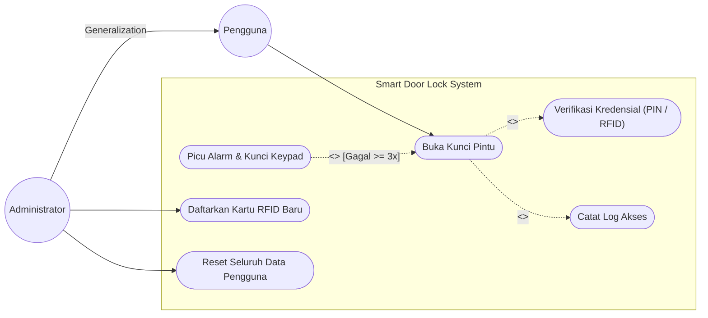
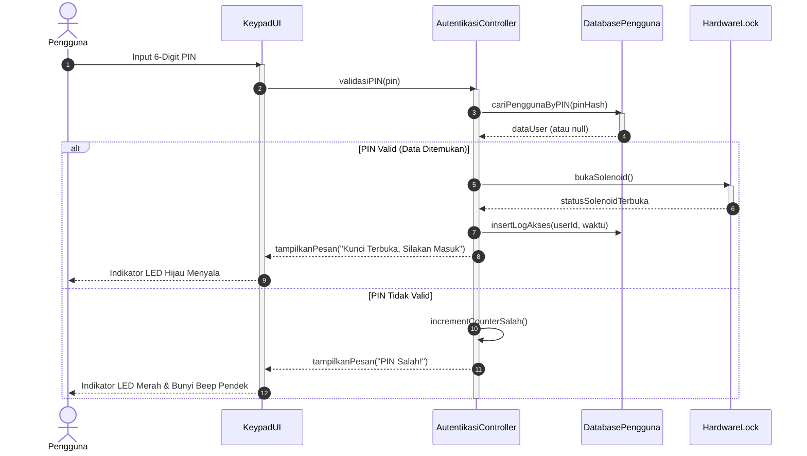

# Bank Contoh Soal & Pembahasan: Rekayasa Perangkat Lunak

> **Sumber Rujukan:** Kumpulan Berkas Ujian Tengah Semester (UTS) & Ujian Akhir Semester (UAS) Rekayasa Perangkat Lunak Departemen Informatika Universitas Diponegoro (Koleksi Pengampu Ragil Saputra, S.Si., M.Cs., Priyo Sidik Sasongko, S.Si., M.Kom., dkk. & Bank Soal HMIF 2018–2024).

---

## 🎯 BAGIAN 1: CONTOH SOAL UTS (REQUIREMENTS, USE CASE & SEQUENCE DIAGRAM)

### Soal UTS 1: Analisis Kebutuhan & Use Case Diagram (Soal Asli UAS/UTS Undip)
**Deskripsi Kasus:**
Sebuah perangkat *Smart Door Lock* berbasis IoT memiliki kemampuan mengunci dan membuka pintu menggunakan sebuah keypad dan pemindai RFID:
* Untuk membuka pintu, pengguna reguler cukup memasukkan PIN 6–8 digit angka atau menempelkan kartu RFID yang telah terdaftar.
* Jika PIN salah sebanyak 3 kali berturut-turut, sistem membunyikan alarm buzzer dan mengunci keypad selama 5 menit.
* Administrator memiliki hak istimewa untuk mendaftarkan kartu RFID baru, mengubah PIN master administrator, dan menghapus seluruh data pengguna sekaligus.
* Setiap kali pintu berhasil dibuka, sistem secara otomatis mencatat riwayat log akses (waktu dan ID pengguna).

**Tugas:**
1. Identifikasi minimal 4 Kebutuhan Fungsional (*Functional Requirements - FR*) dan 2 Kebutuhan Non-Fungsional (*NFR*) sistem!
2. Rancanglah **Use Case Diagram** lengkap dengan batasan sistem, aktor-aktor terkait, serta penggunaan relasi `<<include>>` dan `<<extend>>` yang tepat!

**Kunci Pembahasan & Solusi:**
1. **Identifikasi Kebutuhan Sistem:**
   * **Kebutuhan Fungsional (FR):**
     * FR-01: Sistem harus dapat memvalidasi PIN masukan pengguna (panjang 6–8 digit angka).
     * FR-02: Sistem harus dapat membaca dan memverifikasi UID kartu RFID yang ditempelkan.
     * FR-03: Sistem harus dapat menggerakkan motor solenoid untuk membuka kunci pintu jika autentikasi sukses.
     * FR-04: Administrator harus dapat mendaftarkan kartu RFID pengguna baru ke dalam memori.
     * FR-05: Administrator harus dapat melakukan penghapusan data seluruh pengguna (*factory reset users*).
     * FR-06: Sistem harus secara otomatis merekam log akses setiap pintu berhasil dibuka.
   * **Kebutuhan Non-Fungsional (NFR):**
     * NFR-01 (*Performance / Waktu Respon*): Sistem harus mampu memvalidasi PIN/RFID dan membuka solenoid dalam waktu kurang dari 1 detik sejak masukan selesai.
     * NFR-02 (*Security*): Sistem harus memblokir input keypad selama 5 menit dan memicu buzzer alarm jika terjadi kegagalan autentikasi sebanyak 3 kali berturut-turut.

2. **Perancangan Use Case Diagram (Representasi Teks & Logika Hubungan):**
   * **Aktor:**
     * `Pengguna` (Aktor Primer / Human User)
     * `Administrator` (Mewarisi hak akses Pengguna / Generalisasi Aktor)
     * `Sistem IoT / Hardware Solenoid` (Aktor Sekunder)
   * **Struktur Use Case & Relasi:**
     * Use Case `Buka Kunci Pintu`: Diinisiasi oleh `Pengguna`.
       * Memiliki relasi **`<<include>>`** ke use case `Verifikasi Kredensial` (karena setiap pembukaan pintu mutlak wajib melalui verifikasi).
       * Memiliki relasi **`<<include>>`** ke use case `Catat Log Akses` (karena logging selalu dieksekusi setiap pembukaan berhasil).
       * Memiliki relasi **`<<extend>>`** dari use case `Picu Alarm Buzzer & Blokir Keypad` dengan *Extension Point*: *"Kegagalan autentikasi $\ge 3$ kali"*.
     * Use Case `Kelola Kartu RFID Pengguna`: Diinisiasi secara eksklusif oleh `Administrator`.
     * Use Case `Reset Seluruh Pengguna`: Diinisiasi oleh `Administrator`.



---

### Soal UTS 2: Pemodelan Sequence Diagram Interaksi Berorientasi Objek
**Deskripsi Soal:**
Gambarkan interaksi pesan pada **Sequence Diagram** untuk skenario "Pengguna Melakukan Otentikasi PIN pada Sistem Pintu":
Melibatkan 4 entitas objek: Aktor `Pengguna`, Objek Boundary `KeypadUI`, Objek Controller `AutentikasiController`, dan Objek Entity `DatabasePengguna`. Sediakan percabangan (*alt fragment*) untuk kondisi PIN Valid vs PIN Salah!

**Kunci Pembahasan & Solusi:**


---

## 🎯 BAGIAN 2: CONTOH SOAL UAS (TESTING BLACK-BOX & WHITE-BOX COMPLEXITY)

### Soal UAS 1: Perancangan Kasus Uji Black-Box (Boundary Value Analysis)
**Deskripsi Soal:**
Sebuah modul pendaftaran perangkat lunak akademik memiliki kolom masukan:
* **Jumlah SKS yang diambil mahasiswa per semester ($S$):** Minimal 12 SKS, Maksimal 24 SKS. Masukan adalah bilangan bulat (*integer*).

Rancanglah kasus uji (*test cases*) menggunakan teknik **Boundary Value Analysis (BVA)** 6-nilai batas ($\min - 1, \min, \min + 1, \max - 1, \max, \max + 1$)! Tentukan nilai masukan, status kelas uji (Valid/Invalid), dan hasil yang diharapkan (*Expected Output*)!

**Kunci Pembahasan & Solusi:**
Batas domain valid: $[12, 24]$.
* Batas Bawah ($\min = 12$): Nilai uji adalah $11, 12, 13$.
* Batas Atas ($\max = 24$): Nilai uji adalah $23, 24, 25$.

*Tabel Kasus Uji Boundary Value Analysis (BVA):*

| Test Case ID | Nilai Uji ($S$) | Karakteristik Batas | Status Partisi | Hasil yang Diharapkan (*Expected Output*) |
|:---:|:---:|:---|:---:|:---|
| **TC-01** | 11 | $\min - 1$ | **Invalid** | Sistem menolak: Tampilkan pesan error *"SKS minimal adalah 12"* |
| **TC-02** | 12 | $\min$ | **Valid** | Sistem menerima: Penyimpanan KRS berhasil |
| **TC-03** | 13 | $\min + 1$ | **Valid** | Sistem menerima: Penyimpanan KRS berhasil |
| **TC-04** | 23 | $\max - 1$ | **Valid** | Sistem menerima: Penyimpanan KRS berhasil |
| **TC-05** | 24 | $\max$ | **Valid** | Sistem menerima: Penyimpanan KRS berhasil |
| **TC-06** | 25 | $\max + 1$ | **Invalid** | Sistem menolak: Tampilkan pesan error *"SKS melebihi batas maksimal 24"* |

---

### Soal UAS 2: Pengujian White-Box: Control Flow Graph & Cyclomatic Complexity
**Deskripsi Soal:**
Diberikan potongan kode program Java penentuan kelulusan berikut:
```java
1: public String evaluasiKelulusan(int nilai, int kehadiran) {
2:     String status;
3:     if (kehadiran < 75) {
4:         status = "TIDAK LULUS (Presensi Kurang)";
5:     } else {
6:         if (nilai >= 70) {
7:             status = "LULUS";
8:         } else {
9:             status = "TIDAK LULUS (Nilai Kurang)";
10:        }
11:    }
12:    return status;
13: }
```
1. Gambarkan **Control Flow Graph (CFG)** dari kode di atas!
2. Hitung nilai **Cyclomatic Complexity ($V(G)$)** menggunakan 3 rumus berbeda!
3. Daftarkan seluruh himpunan **Jalur Basis Independen (*Basis Paths*)** yang wajib dieksekusi dalam pengujian unit!

**Kunci Pembahasan & Solusi:**
1. **Identifikasi Simpul (Nodes) & Sisi (Edges) pada CFG:**
   * Node 1: Inisialisasi (Baris 1–2)
   * Node 2: Evaluasi Kondisi `if (kehadiran < 75)` (Baris 3)
   * Node 3: Penugasan Presensi Kurang (Baris 4)
   * Node 4: Evaluasi Kondisi `if (nilai >= 70)` (Baris 6)
   * Node 5: Penugasan LULUS (Baris 7)
   * Node 6: Penugasan Nilai Kurang (Baris 9)
   * Node 7: Pengembalian nilai `return status` (Baris 12–13)
   * *Edges:* $(1 \rightarrow 2)$, $(2 \rightarrow 3)$, $(2 \rightarrow 4)$, $(3 \rightarrow 7)$, $(4 \rightarrow 5)$, $(4 \rightarrow 6)$, $(5 \rightarrow 7)$, $(6 \rightarrow 7)$.
   * Jumlah Nodes ($N$) $= 7$, Jumlah Edges ($E$) $= 8$.

2. **Perhitungan Cyclomatic Complexity ($V(G)$):**
   * **Metode 1 (Edges & Nodes):**
     $$V(G) = E - N + 2P = 8 - 7 + 2(1) = \mathbf{3}$$
   * **Metode 2 (Jumlah Simpul Predikat):**
     Terdapat 2 simpul percabangan predikat (Node 2 dan Node 4):
     $$V(G) = P + 1 = 2 + 1 = \mathbf{3}$$
   * **Metode 3 (Jumlah Region Bidang Tertutup):**
     Terdapat 2 area tertutup di dalam graf $+ 1$ area luar bebas $\implies R_1 + R_2 + R_3 = \mathbf{3}$.
   * *Kesimpulan:* Kompleksitas siklomatis bernilai **3**, yang berarti tepat dibutuhkan **3 kasus uji independen** untuk mencapai 100% *Branch/Decision Coverage*.

3. **Himpunan Jalur Basis Independen (*Basis Paths*):**
   * **Jalur 1:** $1 \rightarrow 2 \rightarrow 3 \rightarrow 7$ (Kasus: Kehadiran $< 75$, misal: Kehadiran $= 60$, Nilai sembarang).
   * **Jalur 2:** $1 \rightarrow 2 \rightarrow 4 \rightarrow 5 \rightarrow 7$ (Kasus: Kehadiran $\ge 75$ dan Nilai $\ge 70$, misal: Kehadiran $= 80$, Nilai $= 85$).
   * **Jalur 3:** $1 \rightarrow 2 \rightarrow 4 \rightarrow 6 \rightarrow 7$ (Kasus: Kehadiran $\ge 75$ dan Nilai $< 70$, misal: Kehadiran $= 80$, Nilai $= 55$).

---

## 🎯 BAGIAN 3: SIMULASI UJIAN LISAN KOMPREHENSIF (*ORAL DEFENSE*)

### Q1: "Jelaskan mengapa kita harus mendesain modul perangkat lunak dengan High Cohesion dan Loose Coupling, serta berikan contoh nyata konsekuensi negatif jika aturan ini diabaikan!"
**Jawaban Komprehensif:**
* **High Cohesion (Kohesi Tinggi):** Berarti setiap kelas atau komponen memusatkan perhatiannya secara mendalam pada satu fungsi atau tanggung jawab logis yang spesifik.
* **Loose Coupling (Kopling Longgar):** Berarti antarmodul memiliki tingkat ketergantungan minimal dan hanya berinteraksi melalui antarmuka publik yang bersih (*clean API/interface contract*), tanpa mengetahui seluk-beluk internal masing-masing.
* **Konsekuensi Jika Diabaikan (*Low Cohesion & Tight Coupling*):**
  1. *Efek Riak Rusak (*Shotgun Surgery / Ripple Effect*):* Satu perubahan kecil pada skema database atau format data pada satu kelas akan memaksa pengembang mengubah puluhan kelas lain di seluruh aplikasi.
  2. *Uji Unit Mustahil Dilakukan (*Untestable Code*):* Kita tidak bisa melakukan *unit testing* pada modul bisnis secara terisolasi menggunakan *mocking/stubbing* karena modul tersebut mengikat mati objek infrastruktur lain.
  3. *Hambatan Kolaborasi Tim:* Beberapa programmer yang mengerjakan fitur berbeda akan terus menerus mengalami *merge conflict* kode karena semua fitur bertumpu pada kelas raksasa (*God Class*) yang sama.

### Q2: "Kapan tim rekayasa perangkat lunak harus memilih model Agile Scrum dibandingkan Waterfall Tradisional?"
**Jawaban Komprehensif:**
* **Pilih Waterfall jika:**
  1. Kebutuhan sistem sudah terdefinisi secara sangat matang, pasti, dan tidak akan berubah (*crystal-clear requirements*).
  2. Domain teknis dan tumpukan teknologi sudah sangat dipahami oleh tim pengembang tanpa faktor ketidakpastian tinggi.
  3. Sistem berada dalam ranah regulasi keselamatan kritis ketat (*safety-critical systems*, seperti perangkat medis bedah, autopilot dirgantara, atau sistem kontrol reaktor nuklir) di mana setiap artefak wajib diaudit dan diverifikasi tuntas sebelum fase konstruksi fisik dimulai.
* **Pilih Agile Scrum jika:**
  1. Kebutuhan sistem masih bersifat dinamis, berkembang mengikuti respon pengguna pasar riil (*market feedback / volatile requirements*, seperti startup SaaS, aplikasi e-commerce, atau produk inovasi digital baru).
  2. Klien atau *stakeholder* ingin segera melihat dan menggunakan prototipe produk fungsional (*working increment*) dalam waktu singkat (per 2 minggu).
  3. Proyek membutuhkan fleksibilitas adaptasi perubahan arah prioritas fitur tanpa harus mengulang kembali fase perencanaan kontrak dari awal.
