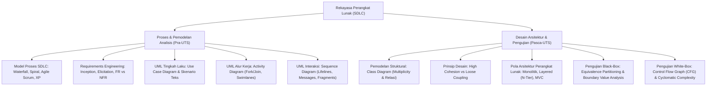

# Rangkuman Materi: Rekayasa Perangkat Lunak (PAIK6403 / MIK1624403)

> **Bobot:** 3 SKS | **Semester:** 4 (Kurikulum 2020 / Kurikulum 2024) | **Fokus Utama:** Paradigma SDLC (Waterfall, V-Model, Spiral, Agile Scrum), Rekayasa Kebutuhan (*Requirements Engineering* - FR & NFR), Pemodelan Berorientasi Objek UML (Use Case, Activity, Sequence, Class Diagram), Prinsip Perancangan Perangkat Lunak (Kohesi, Kopling, Arsitektur), dan Teknik Pengujian (*Software Testing* - Black-Box vs White-Box)

---

## 1. Gambaran Besar Mata Kuliah (*Grand View*)
Mata kuliah **Rekayasa Perangkat Lunak (RPL)** mentransformasikan kegiatan "sekadar menulis kode (*coding*)" menjadi suatu **disiplin teknik rekayasa terstruktur (*engineering discipline*)** untuk menghasilkan perangkat lunak berkualitas tinggi yang dapat diandalkan, selesai tepat waktu, sesuai anggaran biaya, serta mudah dirawat (*maintainable*) sepanjang siklus hidupnya.

Mahasiswa mempelajari seluruh tahapan siklus hidup pengembangan perangkat lunak (*Software Development Life Cycle - SDLC*): elisitasi kebutuhan pengguna menjadi dokumen spesifikasi formal (SRS IEEE 830), pemodelan sistem menggunakan bahasa standar industri **UML (Unified Modeling Language)**, penerapan prinsip modularitas desain (kohesi tinggi dan kopling longgar), hingga verifikasi dan validasi fungsional menggunakan teknik pengujian struktural dan kotak hitam.

---

## 2. Peta Silabus & Konsep Inti Perkuliahan

### A. Bagian Pra-UTS (Model Proses SDLC, Elisitasi Kebutuhan & Diagram UML)

#### 1. Model Proses Pengembangan Perangkat Lunak (SDLC)
* **Waterfall Model (Model Sekuensial Linier):**
  * Alur: *Communication $\rightarrow$ Planning $\rightarrow$ Modeling $\rightarrow$ Construction $\rightarrow$ Deployment*.
  * Setiap fase harus disetujui tuntas sebelum fase berikutnya dimulai (*formal sign-off*).
  * *Kelebihan:* Struktur sangat rapi dan dokumentasi lengkap.
  * *Kelemahan:* Sangat kaku; perubahan kebutuhan di tengah jalan sangat mahal dan berisiko gagal total jika kebutuhan awal keliru. Cocok untuk proyek dengan kebutuhan stabil dan teknologi yang dipahami dengan matang.
* **Agile Scrum (Model Adaptif Iteratif):**
  * Mengutamakan individu dan interaksi di atas proses, serta perangkat lunak yang berfungsi di atas dokumentasi komprehensif.
  * *Peran Scrum:*
    1. **Product Owner:** Bertanggung jawab atas nilai bisnis dan kepemilikan *Product Backlog*.
    2. **Scrum Master:** Fasilitator proses, pelindung tim dari gangguan luar, dan penghilang hambatan kerja (*impediment remover*).
    3. **Development Team:** Tim lintas fungsional (*cross-functional*) dan otonom mandiri (*self-organizing*).
  * *Upacara / Artefak Scrum:* *Sprint Planning*, *Daily Standup* (15 menit), *Sprint Review*, *Sprint Retrospective*, *Product Backlog*, *Sprint Backlog*, *Burndown Chart*. Siklus *Sprint* berdurasi 1–4 minggu menghasilkan *Potentially Shippable Increment*.

#### 2. Rekayasa Kebutuhan (*Requirements Engineering*)
* **Kebutuhan Fungsional (*Functional Requirements - FR*):** Pernyataan layanan atau fitur spesifik yang harus disediakan sistem terhadap masukan tertentu (Contoh: "Sistem harus memvalidasi PIN 6 digit dan membuka kunci pintu solenoid").
* **Kebutuhan Non-Fungsional (*Non-Functional Requirements - NFR*):** Batasan operasional, performa, atau kualitas sistem. Sering diklasifikasikan menggunakan kerangka **FURPS+**:
  * *Functionality:* Kemampuan fitur, keamanan.
  * *Usability:* Kemudahan pemakaian, aksesibilitas antarmuka pengguna.
  * *Reliability:* Frekuensi kegagalan, MTTF (*Mean Time to Failure*), ketersediaan (*availability* 99.9%).
  * *Performance:* Waktu respon ($< 200$ ms), throughput transaksi, konsumsi memori.
  * *Supportability:* Kemudahan pemeliharaan (*maintainability*), skalabilitas, portabilitas.

#### 3. Pemodelan UML Tingkah Laku & Alur Kerja (*Behavioral UML*)
* **Use Case Diagram:**
  * Menggambarkan batasan sistem (*system boundary*) dan interaksi fungsional antara Aktor luar dengan Use Case.
  * **Relasi `<<include>>`:** Menyatakan bahwa eksekusi use case sumber **secara mutlak dan wajib** menyertakan use case tujuan (ekstraksi fungsi yang berulang, misal: *Transfer Uang* `<<include>>` *Autentikasi Login*).
  * **Relasi `<<extend>>`:** Menyatakan tingkah laku opsional yang dieksekusi **hanya jika kondisi tertentu (extension point) terpenuhi** (misal: *Transaksi Pembelian* `<<extend>>` *Gunakan Kupon Diskon*).
* **Activity Diagram:**
  * Memodelkan alur proses bisnis prosedural.
  * *Decision Node vs Merge Node:* Percabangan kondisi alternatif berbasis boolean (*guard condition*).
  * *Fork Node vs Join Node:* Percabangan eksekusi aliran yang berjalan **secara paralel / konkuren** yang kemudian disinkronisasi kembali.
  * *Swimlanes:* Partisi visual untuk menunjukkan aktor atau departemen mana yang bertanggung jawab atas aktivitas tertentu.
* **Sequence Diagram:**
  * Memodelkan interaksi pertukaran pesan antar-objek dari waktu ke waktu.
  * Elemen: *Lifeline* (garis hidup vertikal objek), *Activation Bar* (periode aktif eksekusi), *Synchronous Message* (panah solid terisi), *Asynchronous Message* (panah terbuka), *Reply/Return Message* (garis putus-putus).

---

### B. Bagian Pasca-UTS (Pemodelan Struktural, Arsitektur & Pengujian)

#### 1. Pemodelan Struktural: Class Diagram
* Notasi Kotak 3 Bagian: Nama Kelas, Kompartemen Atribut, Kompartemen Operasi/Metode.
* Notasi Visibilitas: `+` (public), `-` (private), `#` (protected), `~` (package/default).
* Relasi Antar-Kelas:
  * Asosiasi (garis lurus polos dengan kardinalitas `1..*`, `0..1`).
  * Agregasi (garis dengan wajik/berlian berongga putih di sisi pemilik / whole).
  * Komposisi (garis dengan wajik/berlian hitam solid di sisi pemilik / whole).
  * Generalisasi/Inheritance (garis panah segitiga berongga mengarah ke superclass).
  * Ketergantungan/Dependency (garis panah putus-putus).

#### 2. Kualitas Desain: Kohesi (*Cohesion*) vs Kopling (*Coupling*)
* **Aturan Emas Desain Perangkat Lunak:** **High Cohesion & Loose Coupling**.
* **Kohesi (*Cohesion*):** Derajat keterkaitan internal antarelemen di dalam satu modul tunggal.
  * *Kohesi Fungsional (Terbaik):* Semua elemen di dalam modul bekerja sama untuk menjalankan satu tugas matematis/logika tunggal yang terdefinisi rapi.
  * *Kohesi Kebetulan / Coincidental (Terburuk):* Elemen-elemen dimasukkan ke dalam satu file sembarangan tanpa keterkaitan logis (e.g., file `Utils.java` serba guna).
* **Kopling (*Coupling*):** Derajat saling ketergantungan antar-modul yang berbeda.
  * *Data Coupling (Terbaik / Terlonggar):* Dua modul hanya berkomunikasi dengan saling melempar parameter data skalar sederhana.
  * *Content Coupling (Terburuk / Terketat):* Suatu modul mengakses dan memodifikasi langsung variabel internal privat milik modul lain.

#### 3. Teknik Pengujian Perangkat Lunak (*Software Testing Techniques*)
* **Verifikasi vs Validasi (Boehm):**
  * *Verifikasi:* "Apakah kita membangun produk dengan benar?" (*Are we building the product right?*) $\rightarrow$ Pemeriksaan kepatuhan terhadap dokumen spesifikasi teknis dan standar kode.
  * *Validasi:* "Apakah kita membangun produk yang benar?" (*Are we building the right product?*) $\rightarrow$ Memastikan perangkat lunak benar-benar memenuhi ekspektasi dan kebutuhan bisnis pengguna riil.
* **Black-Box Testing (Pengujian Fungsional / Kotak Hitam):**
  * Menguji fungsionalitas tanpa melihat struktur internal kode program.
  * **Equivalence Partitioning (EP):** Membagi domain masukan menjadi kelas-kelas partisi data yang valid dan tidak valid. Satu sampel uji diambil dari setiap partisi.
  * **Boundary Value Analysis (BVA):** Kesalahan logika paling sering muncul pada batas partisi. Menguji nilai batas: minimum, sedikit di atas minimum, nilai normal, sedikit di bawah maksimum, dan maksimum ($\min - 1, \min, \min + 1, \max - 1, \max, \max + 1$).
* **White-Box Testing (Pengujian Struktural / Kotak Kaca):**
  * Menguji alur kendali logika internal kode program.
  * **Control Flow Graph (CFG):** Merepresentasikan instruksi kode sebagai simpul (*nodes*) dan lompatan aliran eksekusi kondisi sebagai sisi (*edges*).
  * **Cyclomatic Complexity (McCabe - $V(G)$):**
    Menentukan batas atas jumlah kasus uji independen (*basis path*) yang wajib dibuat untuk menjamin bahwa seluruh cabang kode minimal dieksekusi satu kali:
    $$V(G) = E - N + 2P$$
    atau
    $$V(G) = \text{Jumlah Simpul Predikat (Kondisi If/While/For)} + 1$$
    atau
    $$V(G) = \text{Jumlah Daerah Tertutup (Regions)} + 1$$
    ($E$ = edges, $N$ = nodes, $P$ = connected components, umumnya $P=1$).
