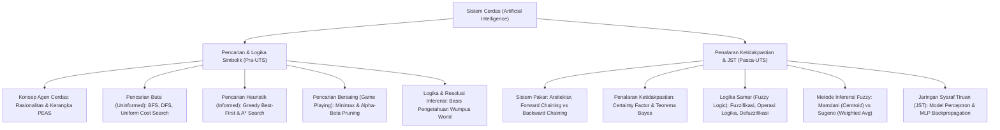

# Rangkuman Materi: Sistem Cerdas / Kecerdasan Buatan (PAIK6406 / MIK1624406)

> **Bobot:** 3 SKS | **Semester:** 4 (Kurikulum 2020 / Kurikulum 2024) | **Fokus Utama:** Agen Cerdas (Arsitektur PEAS), Algoritma Pencarian Ruang Status (Blind Search: BFS, DFS, UCS vs Heuristic: A*, Minimax & Alpha-Beta Pruning), Representasi Pengetahuan & Penalaran Logika (Wumpus World, Resolusi), Sistem Pakar (*Forward & Backward Chaining*, Certainty Factor), Logika Samar (*Fuzzy Logic* Mamdani & Sugeno), dan Pengantar Jaringan Syaraf Tiruan (Perceptron & Backpropagation)

---

## 1. Gambaran Besar Mata Kuliah (*Grand View*)
Mata kuliah **Sistem Cerdas (*Artificial Intelligence*)** mempelajari prinsip-prinsip perancangan sistem komputasi yang mampu meniru perilaku dan kemampuan kognitif manusia: kemampuan mempersepsi lingkungan melalui sensor, mengambil keputusan rasional (*rational decision making*), bernalar di bawah ketidakpastian, memecahkan masalah pencarian yang kompleks, serta belajar dari data.

Mata kuliah ini menggunakan buku teks standar kecerdasan buatan dunia, *Artificial Intelligence: A Modern Approach* (Russell & Norvig). Mahasiswa dibekali fondasi matematis mulai dari agen rasional berbasis logika klasik simbolik (*Good Old-Fashioned AI / GOFAI*), sistem inferensi berbasis aturan pakar (*Rule-Based Systems*), sistem samar (*Fuzzy Systems*), hingga paradigma komputasi sub-simbolik biologically-inspired seperti Jaringan Syaraf Tiruan (*Artificial Neural Networks*).

---

## 2. Peta Silabus & Konsep Inti Perkuliahan

### A. Bagian Pra-UTS (Agen Rasional, Ruang Pencarian & Inferensi Logika)

#### 1. Agen Rasional & Kerangka Kerja PEAS
* **Definisi Agen Rasional:** Entitas yang mengamati lingkungannya melalui sensor dan bertindak melalui aktuator untuk memaksimalkan ukuran kinerjanya (*performance measure*).
* **Kerangka Deskripsi Tugas PEAS:**
  1. **P - Performance Measure:** Kriteria kuantitatif penentu keberhasilan agen (e.g., keselamatan penumpang, ketepatan waktu, efisiensi bahan bakar).
  2. **E - Environment:** Lingkungan eksternal di mana agen beroperasi (e.g., jalan raya perkotaan, cuaca, pejalan kaki).
  3. **A - Actuators:** Perangkat fisik pembuat aksi (e.g., setir, rem, pedal gas, layar navigasi).
  4. **S - Sensors:** Perangkat penerima persepsi input (e.g., kamera video, LiDAR, radar, GPS).
* **Karakteristik Lingkungan:** *Fully vs Partially Observable*, *Deterministic vs Stochastic*, *Episodic vs Sequential*, *Static vs Dynamic*, *Discrete vs Continuous*, *Single-Agent vs Multi-Agent*.

#### 2. Algoritma Pencarian Ruang Status (*State Space Search*)
* **Pencarian Buta (*Uninformed / Blind Search*):**
  * **BFS (*Breadth-First Search*):** Menelusuri pohon secara melebar per level (FIFO Queue). *Karakteristik:* Bersifat **Complete** dan **Optimal** jika bobot langkah seragam, namun membutuhkan **memori eksponensial raksasa $O(b^d)$** ($b$ = branching factor, $d$ = kedalaman solusi).
  * **DFS (*Depth-First Search*):** Menelusuri cabang pohon hingga daun terdalam terlebih dahulu (LIFO Stack). *Karakteristik:* Sangat hemat memori ruang $O(b \cdot m)$ ($m$ = kedalaman maksimal), namun **tidak complete** jika terdapat jalur tak berhingga/siklus dan **tidak optimal**.
  * **UCS (*Uniform Cost Search*):** Mengembangkan simpul dengan biaya lintasan $g(n)$ terendah (Priority Queue). Ekuivalen dengan Algoritma Dijkstra.
* **Pencarian Berbasis Heuristik (*Informed Search*):**
  * **Greedy Best-First Search:** Memilih simpul dengan perkiraan jarak terdekat ke tujuan $f(n) = h(n)$. Cepat, namun tidak optimal karena mengabaikan biaya masa lalu yang telah ditempuh.
  * **Algoritma A\* Search (Standar Industri):**
    Menilai simpul menggunakan fungsi evaluasi total:
    $$f(n) = g(n) + h(n)$$
    * $g(n)$: Biaya eksak nyata yang telah dikeluarkan dari simpul awal ke simpul $n$.
    * $h(n)$: Estimasi heuristik biaya dari simpul $n$ menuju simpul tujuan (*goal*).
  * **Syarat Optimalitas A\* Search:**
    1. **Admissible Heuristic (Pada Tree Search):** Fungsi heuristik tidak boleh pernah melebih-lebihkan perkiraan biaya sebenarnya (*never overestimates the true cost*):
       $$h(n) \le h^*(n) \quad \text{untuk semua } n$$
    2. **Consistent / Monotonic Heuristic (Pada Graph Search):** Untuk setiap simpul $n$ dan tetangganya $n'$ via aksi $a$:
       $$h(n) \le c(n, a, n') + h(n')$$

#### 3. Pencarian Bersaing (*Adversarial Search / Game Playing*)
* **Algoritma Minimax:**
  * Digunakan pada permainan bergiliran deterministik dua pemain *zero-sum* (catur, tic-tac-toe).
  * Pemain MAX berusaha memaksimalkan nilai fungsi evaluasi; pemain MIN berusaha meminimalkan skor MAX.
* **Alpha-Beta Pruning:**
  * Memangkas cabang pohon permainan yang secara matematis terbukti tidak akan pernah dipilih oleh pemain rasional, tanpa mengubah hasil evaluasi akhir minimax.
  * Parameter:
    * $\alpha$ (Alpha): Nilai terbaik (tertinggi) yang telah ditemukan sepanjang jalur untuk pemain MAX.
    * $\beta$ (Beta): Nilai terbaik (terendah) yang telah ditemukan sepanjang jalur untuk pemain MIN.
  * **Kondisi Pemangkasan (*Pruning Condition*):** Pangkas cabang jika $\mathbf{\alpha \ge \beta}$.

#### 4. Basis Pengetahuan & Inferensi Logika Simbolik (Wumpus World)
* Pengetahuan direpresentasikan dalam proposisi logika ($P, Q, R$).
* Operasi Inferensi Resolusi Refutasi (*Resolution Refutation*):
  Untuk membuktikan klaim query $\alpha$ bernilai benar dari basis pengetahuan $KB$, tambahkan negasi tujuan $\neg\alpha$ ke dalam $KB$, ubah ke bentuk normal konjungtif (*Conjunctive Normal Form - CNF*), lalu lakukan resolusi hingga menghasilkan klausa kosong kontradiksi ($\square$).

---

### B. Bagian Pasca-UTS (Sistem Pakar, Fuzzy Logic & Jaringan Syaraf Tiruan)

#### 1. Sistem Pakar (*Expert Systems*)
* **Arsitektur Sistem Pakar:**
  1. *Knowledge Base:* Kumpulan fakta dan aturan (*Rules*: `IF <kondisi> THEN <aksi/kesimpulan>`) yang diekstrak dari pakar manusia.
  2. *Working Memory:* Menyimpan fakta-fakta spesifik dari kasus pengguna saat ini.
  3. *Inference Engine:* Mesin penggerak yang mencocokkan fakta dengan aturan.
  4. *Explanation Facility:* Menjelaskan alasan mengapa suatu pertanyaan diajukan atau bagaimana kesimpulan dicapai.
* **Dua Strategi Inferensi:**
  * **Forward Chaining (Pelacakan Maju / Data-Driven):** Dimulai dari fakta-fakta yang diketahui menuju penarikan kesimpulan baru. Cocok untuk aplikasi diagnosis, pemantauan kontrol, dan sintesis.
  * **Backward Chaining (Pelacakan Mundur / Goal-Driven):** Dimulai dari hipotesis tujuan (*goal*), lalu melacak mundur fakta-fakta pendukung yang dibutuhkan untuk membuktikan hipotesis tersebut. Cocok untuk aplikasi diagnosa medis dan pemecahan masalah (*troubleshooting*).

#### 2. Penalaran Ketidakpastian (*Certainty Factor*)
* Mengukur derajat keyakinan pakar terhadap suatu hipotesis $H$ berdasarkan bukti fakta $E$:
  $$CF(H, E) = MB(H, E) - MD(H, E)$$
  ($MB$ = *Measure of Belief*, $MD$ = *Measure of Disbelief*, rentang nilai $[-1.0, +1.0]$).
* *Propagasi CF dengan Fakta Berbobot:*
  $$CF(H) = CF(E) \times CF(\text{Rule})$$
* *Kombinasi Dua Aturan yang Menghasilkan Hipotesis yang Sama:*
  * Jika $CF_1 > 0$ dan $CF_2 > 0$:
    $$CF_{\text{combine}} = CF_1 + CF_2 \times (1 - CF_1)$$

#### 3. Logika Samar (*Fuzzy Logic*)
* Berbeda dari logika tegas (*Crisp Boolean: 0 atau 1*), Logika Fuzzy mengizinkan derajat keanggotaan bernilai riil kontinu $\mu_A(x) \in [0.0, 1.0]$.
* **Tiga Tahap Inferensi Fuzzy:**
  1. **Fuzzifikasi:** Mengonversi nilai numerik riil (*crisp input*) menjadi derajat keanggotaan himpunan fuzzy linguistik (misal: suhu $28^\circ\text{C} \implies \mu_{\text{Hangat}} = 0.7, \mu_{\text{Panas}} = 0.3$).
  2. **Evaluasi Aturan (*Rule Evaluation*):**
     * Operasi Fuzzy AND (Interseksi): $\mu_{A \cap B} = \min(\mu_A, \mu_B)$.
     * Operasi Fuzzy OR (Uni): $\mu_{A \cup B} = \max(\mu_A, \mu_B)$.
     * Operasi Implikasi (Mamdani: pemotongan $\min$; Sugeno: konstanta / persamaan linier).
  3. **Defuzzifikasi:** Mengonversi kembali himpunan fuzzy hasil inferensi menjadi satu nilai skalar riil (*crisp output*).
     * Metode Mamdani: **Centroid / Center of Gravity (COG)**:
       $$z^* = \frac{\int z \cdot \mu_C(z) \, dz}{\int \mu_C(z) \, dz}$$
     * Metode Sugeno: **Rata-rata Terbobot (*Weighted Average*)**:
       $$z^* = \frac{\sum w_i \cdot z_i}{\sum w_i}$$

#### 4. Pengantar Jaringan Syaraf Tiruan (JST / ANN)
* **Model Neuron Buatan (McCulloch-Pitts / Perceptron):**
  $$y = f\left(\sum_{i=1}^n w_i x_i + b\right)$$
  ($x_i$ = input masukan, $w_i$ = bobot sinaptik, $b$ = bias, $f$ = fungsi aktivasi).
* **Fungsi Aktivasi Populer:**
  * Sigmoid: $f(z) = \frac{1}{1 + e^{-z}}$ (menghasilkan probabilitas $[0, 1]$).
  * Hyperbolic Tangent: $\tanh(z) = \frac{e^z - e^{-z}}{e^z + e^{-z}}$ (rentang $[-1, 1]$).
  * ReLU (*Rectified Linear Unit*): $f(z) = \max(0, z)$ (standar arsitektur deep learning modern).
* **Keterbatasan Single-Layer Perceptron (Minsky & Papert):** Hanya mampu memisahkan kelas yang terpisahkan secara linier (*linearly separable*). Gagal menyelesaikan fungsi logika sederhana **XOR**.
* **Multi-Layer Perceptron (MLP) & Backpropagation:**
  Menggunakan lapisan tersembunyi (*hidden layers*) dan algoritma *Gradient Descent* melalui aturan rantai kalkulus parsial (*chain rule*) untuk memperbarui bobot mundur dari lapisan keluaran ke lapisan masukan:
  $$\Delta w_{ij} = -\eta \frac{\partial E}{\partial w_{ij}}$$
  ($\eta$ = *learning rate*, $E$ = fungsi galat kuadratik / *Mean Squared Error*).
