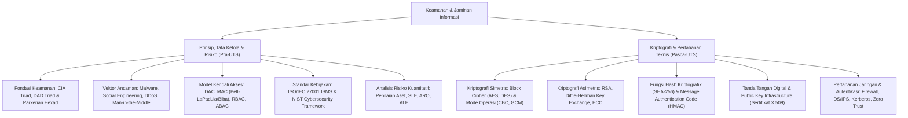

# Rangkuman Materi: Keamanan dan Jaminan Informasi (PAIK6501 / MIK1624501)

> **Bobot:** 3 SKS | **Semester:** 5 (Kurikulum 2020 / Kurikulum 2024) | **Fokus Utama:** Prinsip CIA Triad & Parkerian Hexad, Taksonomi Ancaman & Kerentanan, Kebijakan Keamanan Informasi (ISO/IEC 27001), Model Kendali Akses (DAC, MAC, RBAC), Analisis & Manajemen Risiko Kuantitatif (SLE, ARO, ALE), Kriptografi Modern (Simetris AES vs Asimetris RSA/ECC), Hash & Tanda Tangan Digital, Public Key Infrastructure (PKI), serta Keamanan Jaringan & Fisik

---

## 1. Gambaran Besar Mata Kuliah (*Grand View*)
Mata kuliah **Keamanan dan Jaminan Informasi (KJI)** memberikan pemahaman komprehensif tentang proteksi aset informasi organisasi dari berbagai ancaman siber, baik yang bersifat teknis (malware, eksploitasi celah perangkat lunak, penyadapan jaringan) maupun non-teknis (rekayasa sosial, ancaman orang dalam, kegagalan fisik/bencana).

Keamanan informasi dipandang bukan hanya sebagai masalah instalasi antivirus atau firewall, melainkan suatu **siklus tata kelola manajemen risiko yang holistik (*Information Security Governance*)** yang memadukan kebijakan organisasi (*policy*), kepatuhan standar internasional (ISO 27001), pelatihan manusia (*human awareness*), dan implementasi mekanisme kriptografi yang kokoh.

---

## 2. Peta Silabus & Konsep Inti Perkuliahan

### A. Bagian Pra-UTS (Fondasi CIA, Kendali Akses, Tata Kelola & Analisis Risiko)

#### 1. Fondasi Keamanan Informasi (CIA Triad & Parkerian Hexad)
* **Segitiga Klasik CIA Triad:**
  1. **Confidentiality (Kerahasiaan):** Menjamin bahwa informasi hanya dapat diakses oleh pihak yang memiliki hak otorisasi resmi. Pelanggaran: penyadapan (*eavesdropping*), pembocoran data (*data breach*). Solusi: enkripsi, kontrol akses.
  2. **Integrity (Integritas):** Menjamin bahwa data akurat, lengkap, dan tidak mengalami modifikasi tidak sah saat disimpan maupun ditransmisikan. Pelanggaran: *tampering*, man-in-the-middle. Solusi: fungsi hash, tanda tangan digital, checksum.
  3. **Availability (Ketersediaan):** Menjamin bahwa sistem dan data siap diakses oleh pengguna sah saat dibutuhkan. Pelanggaran: serangan Denial of Service (DoS/DDoS), kegagalan listrik/hardware. Solusi: redundansi hardware, failover clustering, backup berkala.
* **Lawan dari CIA (DAD Triad):** *Disclosure* (Pengungkapan Rahasia), *Alteration* (Perubahan Liar), *Destruction / Denial* (Perusakan / Penolakan Akses).
* **Parkerian Hexad (Perluasan Donn Parker):** Menambahkan 3 pilar: **Possession / Control** (kepemilikan fisik data), **Authenticity** (keaslian klaim identitas pembuat), dan **Utility** (kegunaan praktis data).

#### 2. Model Kendali Akses (*Access Control Models*)
Mekanisme penegakan otorisasi subjek (pengguna) terhadap objek (file/database):
1. **Discretionary Access Control (DAC):** Pemilik objek (*owner*) memiliki wewenang penuh untuk memberikan atau mencabut izin akses kepada subjek lain sesuai kebijakannya sendiri. Diterapkan pada sistem file Linux/Windows (izin `rwx`). *Kelemahan:* Rawan kebocoran jika pemilik ceroboh.
2. **Mandatory Access Control (MAC):** Otoritas pusat menentukan label keamanan (*security classification*: Unclassified, Confidential, Secret, Top Secret). Subjek diberikan *clearance*.
   * **Model Bell-LaPadula (Kerahasiaan Militer):**
     * *Simple Security Property (No Read Up):* Subjek tidak boleh membaca objek dengan tingkat klasifikasi lebih tinggi.
     * *$\star$-Property (No Write Down):* Subjek tidak boleh menulis/membocorkan data ke objek dengan klasifikasi lebih rendah.
   * **Model Biba (Integritas Komersial):**
     * *Simple Integrity Property (No Read Down):* Subjek tidak boleh membaca data dari sumber berintegritas lebih rendah (mencegah kontaminasi kotor).
     * *$\star$-Integrity Property (No Write Up):* Subjek tidak boleh menulis/merusak objek dengan integritas lebih tinggi.
3. **Role-Based Access Control (RBAC):** Hak akses dilekatkan pada **Peran Jabatan (*Roles*)** di organisasi (misal: Dokter, Perawat, Kasir), bukan pada individu pengguna. Paling populer di dunia industri.
4. **Attribute-Based Access Control (ABAC):** Hak akses dievaluasi dinamis berbasis atribut subjek, objek, aksi, dan konteks lingkungan (lokasi GPS, jam kerja, perangkat tepercaya). Menjadi fondasi arsitektur **Zero Trust**.

#### 3. Analisis & Manajemen Risiko Kuantitatif
Proses mengidentifikasi, mengukur, dan mereduksi risiko keamanan ke tingkat yang dapat diterima organisasi (*acceptable risk level*):
* **Single Loss Expectancy (SLE):** Perkiraan kerugian moneter akibat satu kali insiden terjadi:
  $$\text{SLE} = \text{Asset Value (AV)} \times \text{Exposure Factor (EF)}$$
  ($EF$ = persentase kerusakan nilai aset jika insiden terjadi, rentang $0.0 - 1.0$).
* **Annualized Rate of Occurrence (ARO):** Perkiraan frekuensi berapa kali suatu ancaman terjadi dalam kurun waktu satu tahun.
* **Annualized Loss Expectancy (ALE):** Total potensi kerugian moneter yang diperkirakan terjadi dalam satu tahun:
  $$\text{ALE} = \text{SLE} \times \text{ARO} = \text{AV} \times \text{EF} \times \text{ARO}$$
* **Analisis Kelayakan Finansial Kontrol Pengamanan (*Cost-Benefit Analysis - CBA*):**
  $$\text{Nilai Manfaat Pengamanan} = (\text{ALE}_{\text{sebelum}} - \text{ALE}_{\text{setelah}}) - \text{Biaya Tahunan Kontrol (ACS)}$$
  (Jika nilai manfaat positif, maka kontrol keamanan layak secara finansial untuk diimplementasikan).

---

### B. Bagian Pasca-UTS (Kriptografi, Hash, PKI & Pertahanan Jaringan)

#### 1. Kriptografi Simetris vs Asimetris
* **Kriptografi Kunci Simetris (*Secret-Key Cryptography*):**
  * Pengirim dan penerima menggunakan **satu kunci rahasia yang tepat sama** untuk enkripsi dan dekripsi ($C = E_K(P), P = D_K(C)$).
  * *Kelebihan:* Sangat cepat, hemat daya komputasi, ideal untuk enkripsi data massal (*bulk data*).
  * *Kelemahan:* Masalah distribusi kunci rahasia secara aman (*Key Distribution Problem*) dan jumlah kunci bertambah kuadratik pada jaringan besar ($N(N-1)/2$).
  * *Algoritma Standar:* **AES (Advanced Encryption Standard - Rijndael)** dengan panjang kunci 128, 192, atau 256 bit. Mode operasi: **CBC (*Cipher Block Chaining*)** dengan *Initialization Vector (IV)* acak, dan **GCM (*Galois/Counter Mode*)** untuk enkripsi terotentikasi (*Authenticated Encryption with Associated Data - AEAD*).
* **Kriptografi Kunci Asimetris (*Public-Key Cryptography*):**
  * Menggunakan **sepasang kunci matematis yang terkait**: *Public Key* (disebarkan bebas ke publik) dan *Private Key* (disimpan rahasia oleh pemilik).
  * *Dua Penggunaan Utama:*
    1. **Kerahasiaan (*Confidentiality*):** Pengirim mengenkripsi pesan menggunakan **Public Key Penerima**. Hanya penerima yang dapat mendekripsi menggunakan **Private Key miliknya sendiri**.
    2. **Autentikasi & Non-Repudiasi (*Digital Signature*):** Pengirim mengenkripsi hash pesan menggunakan **Private Key miliknya**. Siapapun dapat memverifikasi menggunakan **Public Key Pengirim**.
  * *Algoritma Standar:* **RSA** (berbasis faktorisasi dua bilangan prima raksasa), **Diffie-Hellman** (protokol pertukaran kunci aman), dan **ECC (Elliptic Curve Cryptography)** yang menawarkan keamanan setara RSA dengan ukuran kunci jauh lebih pendek (256-bit ECC setara 3072-bit RSA).

#### 2. Fungsi Hash Kriptografik & Integritas Data
* Sifat Wajib Fungsi Hash yang Aman:
  1. *Deterministic:* Input yang sama pasti menghasilkan digest hash yang identik.
  2. *One-Way (Pre-image Resistance):* Diberikan hash $h$, secara komputasi mustahil menemukan pesan asli $m$ sedemikian rupa sehingga $H(m) = h$.
  3. *Second Pre-image Resistance (Weak Collision Resistance):* Diberikan pesan $m_1$, mustahil menemukan $m_2 \ne m_1$ sehingga $H(m_1) = H(m_2)$.
  4. *Collision Resistance (Strong Collision Resistance):* Mustahil menemukan dua pesan sembarang yang berbeda $x$ dan $y$ yang menghasilkan hash sama $H(x) = H(y)$ (mengantisipasi *Birthday Attack*).
  5. *Avalanche Effect:* Mengubah satu bit masukan akan mengubah lebih dari 50% bit output hash secara dramatis.
* *Standar Algoritma:* **SHA-256 / SHA-3** (Algoritma lawas MD5 dan SHA-1 telah dinyatakan rusak dan dilarang digunakan karena rentan tabrakan hash).

#### 3. Public Key Infrastructure (PKI) & Sertifikat Digital X.509
* Mengatasi masalah pemalsuan identitas kunci publik (*Man-in-the-Middle Attack*).
* **Certificate Authority (CA):** Entitas pihak ketiga tepercaya (*Trusted Third Party*, e.g., Let's Encrypt, DigiCert) yang menerbitkan **Sertifikat Digital X.509**.
* Struktur Sertifikat: Memuat nama domain pemohon, Public Key pemohon, masa berlaku, dan **ditandatangani secara digital oleh Private Key CA**. Browser memverifikasi validitas sertifikat menggunakan daftar *Root CA Certificates* bawaan sistem operasi.
