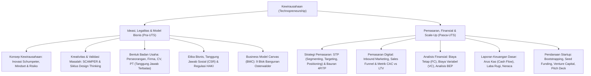

# Rangkuman Materi: Kewirausahaan / Technopreneurship (UNW00007 / MIK1624507)

> **Bobot:** 2 SKS | **Semester:** 5 (Mata Kuliah Wajib Universitas / Kurikulum 2020 & 2024) | **Fokus Utama:** Pola Pikir & Sikap Kewirausahaan (*Entrepreneurial Mindset*), Ideasi Inovatif & *Design Thinking*, Bentuk Badan Usaha & Hukum Kepemilikan (Perseorangan, CV, PT, Koperasi), Etika Bisnis & HAKI, Perancangan *Business Model Canvas* (BMC 9 Blok), Strategi Pemasaran Digital & STP (4P/7P), serta Manajemen Finansial Startup (Analisis Titik Impas BEP, Arus Kas, ROI)

---

## 1. Gambaran Besar Mata Kuliah (*Grand View*)
Mata kuliah **Kewirausahaan (*Technopreneurship*)** membekali mahasiswa Sarjana Informatika dengan pola pikir wirausaha (*entrepreneurial mindset*) untuk mampu mengidentifikasi peluang pasar, memvalidasi masalah nyata pengguna, serta mentransformasikan inovasi perangkat lunak dan keahlian teknologi digital menjadi entitas bisnis rintisan (*startup*) yang berkelanjutan, menguntungkan (*profitable*), dan berdaya saing global.

Materi memadukan konsep manajerial bisnis modern: metodologi *Lean Startup*, perancangan model bisnis menggunakan kanvas visual **Business Model Canvas (BMC)** Alexander Osterwalder, perlindungan Hak Kekayaan Intelektual (HAKI: Paten algoritma, Hak Cipta perangkat lunak), aspek hukum pendirian perseroan, hingga kalkulasi kelayakan finansial kuantitatif (Break-Even Point, Unit Economics, dan Proyeksi Arus Kas).

---

## 2. Peta Silabus & Konsep Inti Perkuliahan

### A. Bagian Pra-UTS (Mindset, Legalitas Bentuk Usaha & Business Model Canvas)

#### 1. Konsep Dasar Kewirausahaan & Karakteristik Wirausahawan
* **Definisi Kewirausahaan (Joseph Schumpeter):** Proses inovasi dinamis melalui "penghancuran kreatif" (*creative destruction*), yaitu memperkenalkan produk baru, proses produksi baru, pasar baru, sumber pasokan baru, atau bentuk organisasi baru yang mendisrupsi pasar yang sudah mapan.
* **Karakteristik Utama Wirausahawan:**
  1. *Calculated Risk-Taker:* Bersedia mengambil risiko yang terukur, bukan penjudi spekulatif.
  2. *Growth Mindset & Resiliency:* Memandang kegagalan sebagai umpan balik pembelajaran (*failing forward*).
  3. *Opportunity Seeker:* Mampu melihat masalah masyarakat sebagai celah peluang bisnis yang bernilai ekonomi.
  4. *Internal Locus of Control:* Meyakini bahwa keberhasilan atau kegagalan bisnis ditentukan oleh tindakan dan usahanya sendiri, bukan oleh faktor keberuntungan semata.

#### 2. Bentuk-Bentuk Kepemilikan Badan Usaha
Pemilihan bentuk badan usaha menentukan aspek legalitas, permodalan, dan tanggung jawab hukum pemilik:
1. **Perusahaan Perseorangan (*Sole Proprietorship*):**
   * Usaha yang dimiliki dan dijalankan langsung oleh satu individu tanpa pemisahan kekayaan pribadi dan perusahaan.
   * *Kelebihan:* Prosedur pendirian sangat mudah, kendali penuh 100%, seluruh laba dinikmati sendiri, pajak sederhana.
   * *Kelemahan:* **Tanggung Jawab Tidak Terbatas (*Unlimited Liability*)**—jika bisnis bangkrut dan berhutang, harta pribadi pemilik (rumah, tabungan) dapat disita untuk membayar kewajiban hutang.
2. **Persekutuan Komanditer (*Commanditaire Vennootschap - CV*):**
   * Didirikan oleh dua orang atau lebih dengan dua jenis sekutu:
     * *Sekutu Aktif (Komplementer):* Menjalankan operasional harian dan bertanggung jawab penuh tanpa batas (*unlimited liability*).
     * *Sekutu Pasif (Komanditer):* Hanya menyertakan modal finansial; tanggung jawab terbatas sebesar modal yang disetor.
3. **Perseroan Terbatas (*PT - Limited Liability Company*):**
   * Badan hukum resmi yang terpisah secara independen dari para pemiliknya (*separate legal entity*). Modal terbagi atas saham-saham.
   * *Kelebihan:* **Tanggung Jawab Terbatas (*Limited Liability*)**—tanggung jawab pemegang saham hanya sebatas nilai nominal saham yang dimilikinya; harta pribadi terlindungi dari tuntutan hukum kebangkrutan perusahaan. Mudah mengakses modal besar dan menerbitkan saham baru.
4. **Koperasi:** Badan usaha berasaskan kekeluargaan dan gotong royong dengan tujuan utama menyejahterakan para anggotanya (*one member one vote*).

#### 3. Perancangan Model Bisnis: Business Model Canvas (BMC)
Kanvas strategis 9 blok yang merangkum logika bagaimana sebuah organisasi menciptakan (*create*), menghantarkan (*deliver*), dan menangkap (*capture*) nilai:
1. **Customer Segments:** Target kelompok pengguna/konsumen spesifik yang ingin dilayani (e.g., Mahasiswa perantau, B2B UMKM).
2. **Value Propositions:** Paket produk/layanan yang memecahkan masalah atau memuaskan kebutuhan segmen pelanggan secara unik (e.g., Hemat waktu, harga terjangkau, kustomisasi AI).
3. **Channels:** Saluran komunikasi, distribusi, dan penjualan untuk menjangkau pelanggan (e.g., Aplikasi mobile, marketplace, website).
4. **Customer Relationships:** Jenis hubungan yang dibangun dengan pelanggan (e.g., *Self-service*, komunitas, asisten personal khusus).
5. **Revenue Streams:** Sumber arus kas masuk pendapatan yang dihasilkan dari setiap segmen (e.g., Biaya langganan SaaS, komisi transaksi, penjualan aset fisik).
6. **Key Resources:** Aset fisik, intelektual (kode sumber, paten), manusia, atau finansial terpenting yang dibutuhkan untuk menjalankan bisnis.
7. **Key Activities:** Tindakan operasional terpenting yang wajib dilakukan (e.g., Pengembangan software, pemeliharaan server, pemasaran konten).
8. **Key Partnerships:** Jaringan pemasok dan mitra kerja sama strategis (e.g., Payment gateway, penyedia cloud AWS/GCP, vendor logistik).
9. **Cost Structure:** Semua biaya operasional yang dikeluarkan untuk menjalankan model bisnis (*Cost-driven* vs *Value-driven*).

---

### B. Bagian Pasca-UTS (Pemasaran Digital, Finansial & Kelayakan Usaha)

#### 1. Strategi Pemasaran Modern: STP & Bauran Pemasaran (Marketing Mix)
* **Hierarki Strategi Pemasaran STP:**
  * **Segmentation:** Membagi pasar yang heterogen ke dalam kelompok-kelompok homogen berbasis geografis, demografis, psikografis, atau perilaku.
  * **Targeting:** Memilih satu atau beberapa segmen pasar paling potensial untuk dimasuki.
  * **Positioning:** Merancang citra dan diferensiasi produk di benak target konsumen relatif terhadap pesaing (*Value Proposition Unique Selling Point*).
* **Bauran Pemasaran (Marketing Mix 4P & 7P):**
  * *4P (Produk Fisik/Digital):* **Product** (kualitas, fitur), **Price** (strategi penetapan harga skimming/penetration), **Place** (distribusi), **Promotion** (iklan, promosi penjualan).
  * *Tambahan 3P untuk Layanan/Jasa:* **People** (SDM karyawan), **Process** (alur layanan cepat dan mulus), **Physical Evidence** (bukti fisik antarmuka, rating ulasan, sertifikat keamanan).

#### 2. Manajemen Finansial Startup & Analisis Titik Impas (BEP)
* **Klasifikasi Struktur Biaya:**
  * **Biaya Tetap (*Fixed Cost - FC*):** Biaya yang jumlahnya konstan dan tidak berubah terlepas dari berapa banyak volume produk yang diproduksi/dijual (e.g., Sewa kantor, gaji pokok tim inti, langganan server tahunan).
  * **Biaya Variabel (*Variable Cost - VC*):** Biaya yang bertambah secara proporsional dengan peningkatan volume produksi/transaksi (e.g., Biaya pemrosesan payment gateway per transaksi, lisensi API per kueri pengguna).
* **Rumus Analisis Titik Impas (*Break-Even Point - BEP*):**
  Kondisi di mana total pendapatan perusahaan tepat sama dengan total biaya yang dikeluarkan (Laba Operasional $= 0$).
  * **BEP dalam Unit:**
    $$\text{BEP}_{\text{unit}} = \frac{\text{Fixed Cost (FC)}}{P - \text{VC}_{\text{per unit}}}$$
    ($P$ = Harga jual per unit produk; $(P - \text{VC})$ disebut sebagai *Margin Kontribusi per Unit*).
  * **BEP dalam Nominal Rupiah Pendapatan:**
    $$\text{BEP}_{\text{rupiah}} = \frac{\text{Fixed Cost (FC)}}{1 - \left(\frac{\text{VC}_{\text{per unit}}}{P}\right)} = \text{BEP}_{\text{unit}} \times P$$
* **Metrik Ekonomi Startup Digital:**
  * **CAC (*Customer Acquisition Cost*):** Biaya pemasaran total dibagi jumlah pelanggan baru yang didapat.
  * **LTV (*Customer Lifetime Value*):** Total estimasi pendapatan kotor yang dihasilkan oleh satu pelanggan sepanjang masa aktifnya berlangganan.
  * *Rasio Sehat Startup:* Rasio $\mathbf{\text{LTV} / \text{CAC} \ge 3:1}$ menandakan model bisnis yang dapat di-scale up secara berkelanjutan.
