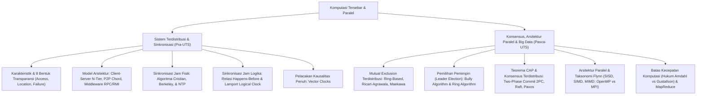

# Rangkuman Materi: Komputasi Tersebar dan Paralel (PAIK6505 / MIK1624505)

> **Bobot:** 3 SKS | **Semester:** 5 (Kurikulum 2020 / Kurikulum 2024) | **Fokus Utama:** Karakteristik & Transparansi Sistem Terdistribusi, Arsitektur (Client-Server, P2P, Middleware RPC/RMI), Waktu & Sinkronisasi Keadaan (Cristian, NTP, Lamport Logical Clocks, Vector Clocks), Koordinasi & Konsensus (Mutual Exclusion Terdistribusi, Bully Leader Election, Teorema CAP, 2PC, Raft), Taksonomi Flynn, Pemrograman Paralel (Shared Memory OpenMP vs Message Passing MPI), Hukum Amdahl & Gustafson, serta Komputasi Big Data (MapReduce)

---

## 1. Gambaran Besar Mata Kuliah (*Grand View*)
Mata kuliah **Komputasi Tersebar dan Paralel (KTP)** mengkaji dua paradigma komputasi modern yang saling melengkapi:
1. **Sistem Terdistribusi (*Distributed Systems*):** Kumpulan komputer independen yang terhubung melalui jaringan komputer dan dilengkapi dengan perangkat lunak perantara (*middleware*) sehingga pengguna mempersepsikannya sebagai **satu sistem komputer tunggal yang koheren**. Fokus utamanya adalah penanganan konkurensi, tidak adanya jam fisik global, toleransi kegagalan independen (*fault tolerance*), dan transparansi akses.
2. **Komputasi Paralel (*Parallel Computing*):** Pemanfaatan beberapa unit pemrosesan (inti CPU multi-core, cluster prosesor, atau GPU massively parallel) secara simultan untuk memecahkan satu tugas komputasi berskala besar dengan cara membagi beban kerja (*divide and conquer*) demi mencapai kecepatan eksekusi maksimum (*speedup*).

---

## 2. Peta Silabus & Konsep Inti Perkuliahan

### A. Bagian Pra-UTS (Karakteristik Sister, Middleware, Jam Fisik & Jam Logika)

#### 1. Karakteristik & Bentuk Transparansi Sistem Terdistribusi (Tanenbaum & Coulouris)
* Tiga Karakteristik Utama Sistem Terdistribusi:
  1. **Konkurensi Komponen:** Berbagai proses berjalan secara simultan pada mesin-mesin yang berbeda.
  2. **Tidak Adanya Jam Global (*Lack of a Global Clock*):** Tidak ada satu acuan waktu fisik mutlak yang dapat dipercaya 100% oleh seluruh simpul.
  3. **Kegagalan Independen Komponen (*Independent Failures*):** Beberapa komputer atau kabel jaringan dapat mati mendadak sementara komponen lainnya tetap berjalan normal.
* **Delapan Bentuk Transparansi Distribusi:**
  1. *Access Transparency:* Penyembunyian perbedaan representasi data dan cara mengakses sumber daya lokal vs remote.
  2. *Location Transparency:* Pengguna tidak perlu mengetahui lokasi fisik mesin tempat sumber daya berada.
  3. *Migration Transparency:* Sumber daya dapat dipindahkan ke mesin lain tanpa mengubah cara pengaksesan.
  4. *Relocation Transparency:* Sumber daya dapat dipindahkan saat sedang diakses oleh klien.
  5. *Replication Transparency:* Pengguna tidak menyadari bahwa data diduplikasi di beberapa server demi keandalan.
  6. *Concurrency Transparency:* Beberapa pengguna dapat mengakses sumber daya bersama secara simultan tanpa saling mengganggu.
  7. *Failure Transparency:* Sistem mampu menyembunyikan kegagalan komponen dan melakukan pemulihan otomatis.
  8. *Performance Transparency:* Sistem dapat dikonfigurasi ulang secara dinamis untuk mengoptimalkan kinerja.

#### 2. Waktu & Sinkronisasi Jam (*Time and Clock Synchronization*)
* **Masalah Clock Drift:** Osilator kristal kuarsa pada setiap komputer berdetak dengan frekuensi sedikit berbeda, menyebabkan perbedaan waktu fisik (*clock skew/drift*).
* **Sinkronisasi Jam Fisik:**
  * **Algoritma Cristian:** Klien meminta waktu ke Time Server $S$. Klien mencatat waktu kirim $T_0$ dan waktu terima balasan $T_1$. Waktu baru disetel:
    $$T_{\text{klien}} = T_{\text{server}} + \frac{T_1 - T_0}{2}$$
    (Dengan asumsi delay transmisi pergi dan pulang simetris).
  * **Algoritma Berkeley (Master-Worker Internal):** Server Master mengumpulkan waktu dari semua Worker, menghitung rata-rata waktu yang valid (mengabaikan pembacaan outlier ekstrim), lalu mengirimkan nilai selisih koreksi (*drift offset*) ke masing-masing Worker.
  * **Network Time Protocol (NTP):** Protokol hirarki berstratum global melalui internet menggunakan filter statistik presisi tinggi.
* **Jam Logika Lamport (*Lamport Logical Clocks*):**
  * Leslie Lamport membuktikan bahwa urutan kejadian kausal lebih penting daripada waktu fisik mutlak.
  * **Relasi *Happens-Before* ($a \rightarrow b$):**
    1. Jika $a$ dan $b$ terjadi dalam proses yang sama, dan $a$ terjadi sebelum $b$, maka $a \rightarrow b$.
    2. Jika $a$ adalah peristiwa pengiriman pesan oleh satu proses, dan $b$ adalah peristiwa penerimaan pesan tersebut oleh proses lain, maka $a \rightarrow b$.
    3. Bersifat transitif: Jika $a \rightarrow b$ dan $b \rightarrow c$, maka $a \rightarrow c$.
  * **Aturan Algoritma Jam Lamport:**
    * Setiap proses $P_i$ memiliki counter jam logika $L_i$ yang dimulai dari $0$.
    * Sebelum mengeksekusi peristiwa internal, proses menaikkan jamnya: $L_i = L_i + 1$.
    * Saat mengirim pesan $m$, proses menyertakan stempel waktu: $(m, L_i)$.
    * Saat menerima pesan $(m, t)$, proses penerima memperbarui jamnya:
      $$L_j = \max(L_j, t) + 1$$
* **Vector Clocks:**
  Mengatasi kelemahan Jam Lamport yang tidak bisa membedakan apakah dua kejadian berhubungan kausal atau bersifat konkuren bebas ($a \parallel b$). Menggunakan array integer berukuran $N$ proses.

---

### B. Bagian Pasca-UTS (Konsensus, Teorema CAP, Paralelisme & MapReduce)

#### 1. Koordinasi & Konsensus Terdistribusi
* **Mutual Exclusion Terdistribusi:**
  * *Algoritma Token Ring:* Sebuah token khusus diedarkan memutar dalam cincin logika proses. Hanya proses yang memegang token yang boleh masuk ke *Critical Section*. Bebas starvation, namun token bisa hilang jika simpul mati.
  * *Algoritma Ricart-Agrawala (Berbasis Lamport Timestamp):* Proses yang ingin masuk CS mengirim pesan request bertimestamp ke semua simpul. Simpul lain membalas OK jika tidak berminat masuk CS atau jika timestamp pemohon lebih tua (*prioritas lebih tinggi*). Membutuhkan $2(N-1)$ pesan.
* **Algoritma Pemilihan Pemimpin (*Leader Election - Bully Algorithm*):**
  * Asumsi: Setiap proses memiliki nomor ID unik. Proses dengan **ID terbesar** yang masih hidup akan menjadi Koordinator (Leader).
  * Alur: Jika suatu proses menyadari koordinator mati, ia mengirim pesan `ELECTION` ke semua proses dengan ID yang lebih tinggi. Jika tidak ada yang membalas `OK`, proses tersebut mendeklarasikan dirinya sebagai koordinator baru via pesan `COORDINATOR` ke seluruh jaringan.

#### 2. Teorema CAP (Eric Brewer) & Konsensus Data
Menyatakan bahwa sistem basis data terdistribusi yang terhubung jaringan **HANYA DAPAT MENJAMIN MAKSIMAL DUA DARI TIGA PROPERTI SECARA BERSAMAAN**:
1. **Consistency (C):** Setiap operasi pembacaan menerima data penulisan terbaru atau menghasilkan error.
2. **Availability (A):** Setiap permintaan yang masuk pasti menerima respon non-error, tanpa jaminan data tersebut adalah versi paling mutakhir.
3. **Partition Tolerance (P):** Sistem tetap dapat beroperasi meskipun terjadi partisi jaringan (kabel putus / paket antar-server drop).
* *Realita Praktis:* Karena partisi jaringan fisik tidak dapat dihindari ($P$ wajib diterima), sistem terdistribusi modern harus memilih antara **CP (Konsistensi Kuat, mengorbankan ketersediaan saat jaringan putus, e.g., HBase, etcd, MongoDB)** atau **AP (Ketersediaan Tinggi / Eventual Consistency, mengorbankan konsistensi sesaat, e.g., Cassandra, DynamoDB, DNS)**.

#### 3. Arsitektur Komputasi Paralel & Batas Peningkatan Kecepatan (*Speedup*)
* **Taksonomi Arsitektur Komputer Flynn:**
  * **SISD (*Single Instruction, Single Data*):** Arsitektur komputer sekuensial Von Neumann klasik.
  * **SIMD (*Single Instruction, Multiple Data*):** Satu instruksi mengeksekusi operasi matematika pada larik data vektor secara serempak (GPU Shader, AVX/SSE).
  * **MISD (*Multiple Instruction, Single Data*):** Sangat jarang, digunakan untuk toleransi kesalahan sistem antariksa berlebih (*redundant computing*).
  * **MIMD (*Multiple Instruction, Multiple Data*):** Sistem multi-core CPU modern dan superkomputer cluster.
* **Model Pemrograman Paralel:**
  * **Shared Memory (OpenMP / Threads):** Semua thread mengakses ruang alamat memori bersama yang sama. Sangat cepat, namun rawan *Race Condition* dan *Deadlock*.
  * **Distributed Memory (MPI - Message Passing Interface):** Setiap proses memiliki memori pribadi terisolasi dan berkomunikasi melalui pengiriman pesan eksplisit (`MPI_Send`, `MPI_Recv`). Sangat skalabel untuk ribuan simpul superkomputer.
* **Hukum Amdahl (Batas Peningkatan Kecepatan Workload Tetap):**
  Jika suatu program memiliki proporsi bagian serial yang tidak dapat diparalelkan sebesar $s = (1 - p)$ dan bagian yang dapat diparalelkan sebesar $p$, maka peningkatan kecepatan maksimal menggunakan $N$ prosesor adalah:
  $$\text{Speedup} = \frac{1}{(1 - p) + \frac{p}{N}}$$
  Jika $N \to \infty$, batas teoritis absolut peningkatan kecepatan adalah:
  $$\text{Speedup}_{\max} = \frac{1}{1 - p}$$
  *(Contoh: Jika 10% kode bersifat serial, percepatan maksimal tidak akan pernah melebihi $1/0.1 = 10\times$, berapapun jumlah prosesor yang digunakan).*

#### 4. Pemrosesan Data Terdistribusi: Model MapReduce
Model pemrograman terdistribusi Google untuk pemrosesan dataset berskala petabyte pada cluster komoditas:
1. **Fase Map:** Fungsi `map(k1, v1) -> list(k2, v2)` mengekstrak pasangan kunci-nilai perantara dari dokumen input secara paralel di setiap simpul pekerja (*worker*).
2. **Fase Shuffle & Sort:** Framework secara otomatis mengelompokkan semua nilai yang memiliki kunci perantara $k2$ yang sama ke worker Reducer yang tepat melintasi jaringan.
3. **Fase Reduce:** Fungsi `reduce(k2, list(v2)) -> list(v3)` menggabungkan atau menjumlahkan nilai-nilai tersebut untuk menghasilkan agregasi ringkasan akhir.
