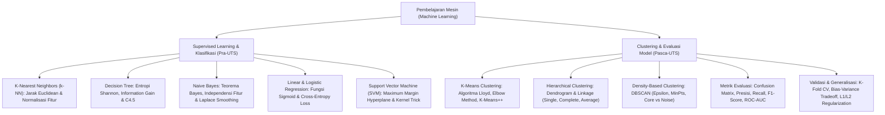

# Rangkuman Materi: Pembelajaran Mesin / Machine Learning (PAIK6502 / MIK1624502)

> **Bobot:** 3 SKS | **Semester:** 5 (Kurikulum 2020 / Kurikulum 2024) | **Fokus Utama:** Paradigma Pembelajaran Mesin (Supervised, Unsupervised, Reinforcement), Algoritma Klasifikasi (k-NN, Decision Tree ID3/C4.5, Naive Bayes Classifier, Support Vector Machine / SVM), Algoritma Pengelompokan / Klastering (K-Means, Hierarchical Clustering, DBSCAN), Model Evaluasi & Validasi (K-Fold CV, Confusion Matrix, Precision, Recall, F1-Score, ROC-AUC), serta Bias-Variance Tradeoff & Regularisasi

---

## 1. Gambaran Besar Mata Kuliah (*Grand View*)
Mata kuliah **Pembelajaran Mesin (*Machine Learning*)** mengajarkan bagaimana komputer dapat belajar secara otomatis dari pengalaman masa lalu (*data historis*) tanpa harus diprogram secara eksplisit berbasis aturan kaku (*explicit rule-based programming*). Sesuai definisi formal Tom Mitchell:
> *"Suatu program komputer dikatakan belajar dari Pengalaman ($E$) terkait sekumpulan Tugas ($T$) dan Ukuran Kinerja ($P$), jika kinerjanya pada tugas $T$ yang diukur oleh $P$ meningkat seiring bertambahnya pengalaman $E$."*

Mahasiswa mempelajari spektrum algoritma induktif: pemodelan terbimbing (*Supervised Learning*) untuk prediksi klasifikasi diskrit dan regresi kontinu, pemodelan tak terbimbing (*Unsupervised Learning*) untuk penemuan pola tersembunyi dan pengelompokan alami data, serta disiplin metodologi evaluasi empiris untuk mencegah jebakan *overfitting* dan *data leakage*.

---

## 2. Peta Silabus & Konsep Inti Perkuliahan

### A. Bagian Pra-UTS (Supervised Learning: k-NN, Decision Tree, Naive Bayes & SVM)

#### 1. K-Nearest Neighbors (k-NN)
* Merupakan algoritma *Instance-Based Learning* (*Lazy Learner*): Tidak membangun model matematika eksplisit saat pelatihan; seluruh komputasi jarak ditangguhkan hingga ada data uji (*query*) baru.
* **Metrik Jarak:**
  * Jarak Euclidean: $d(x, y) = \sqrt{\sum_{i=1}^n (x_i - y_i)^2}$
  * Jarak Manhattan: $d(x, y) = \sum_{i=1}^n |x_i - y_i|$
* **Urgensi Normalisasi Fitur:**
  Jika skala fitur tidak dinormalisasi (misal: Umur $[20 - 60]$ vs Gaji $[3.000.000 - 50.000.000]$), fitur dengan rentang besar akan mendominasi perhitungan jarak sepenuhnya. Digunakan Min-Max Scaling $[0, 1]$ atau Z-score Standardization ($\mu=0, \sigma=1$).
* **Penentuan Nilai $k$:**
  * $k$ terlalu kecil (misal $k=1$): Sangat sensitif terhadap outlier dan derau (*High Variance / Overfitting*).
  * $k$ terlalu besar: Batas keputusan menjadi terlalu kabur dan menggeneralisasi kelas mayoritas (*High Bias / Underfitting*). Biasanya dipilih bilangan ganjil untuk mencegah hasil voting seri.

#### 2. Pohon Keputusan (*Decision Tree - Algoritma ID3 & C4.5*)
Membangun pohon klasifikasi secara rekursif (*greedy top-down*) dengan memilih atribut pemecah terbaik pada setiap simpul:
* **Entropi Shannon ($H(S)$):** Mengukur derajat ketidakmurnian / keacakan (*impurity*) himpunan data $S$:
  $$H(S) = -\sum_{i=1}^c p_i \log_2(p_i)$$
  (Jika seluruh sampel bernilai homogen satu kelas $\implies H(S) = 0$; jika seimbang $50\%-50\% \implies H(S) = 1.0$).
* **Information Gain ($IG(S, A)$):** Pengurangan nilai entropi yang diperoleh setelah membagi data $S$ berdasarkan atribut $A$:
  $$IG(S, A) = H(S) - \sum_{v \in \text{Values}(A)} \frac{|S_v|}{|S|} H(S_v)$$
  Atribut dengan nilai $IG$ **tertinggi** dipilih sebagai simpul pemecah (*root/split node*).
* **Kelemahan ID3 & Perbaikan C4.5:**
  ID3 bias terhadap atribut dengan banyak nilai unik (seperti `Nomor_KTP` atau `Tanggal`). C4.5 memperbaiki bias ini menggunakan **Gain Ratio**:
  $$\text{Gain Ratio}(S, A) = \frac{IG(S, A)}{\text{Split Information}(S, A)}$$
  di mana $\text{SplitInfo}(S, A) = -\sum \frac{|S_v|}{|S|} \log_2 \frac{|S_v|}{|S|}$.

#### 3. Naive Bayes Classifier
* Berdasarkan Teorema Probabilitas Bayes:
  $$P(C_k \mid X) = \frac{P(X \mid C_k) \cdot P(C_k)}{P(X)}$$
* **Asumsi Naif (*Conditional Independence Assumption*):**
  Mengasumsikan bahwa semua fitur $x_1, x_2, \dots, x_n$ saling bebas secara statistik dengan diketahui kelas $C_k$:
  $$P(X \mid C_k) = \prod_{i=1}^n P(x_i \mid C_k)$$
* **Laplace Smoothing (*Pencegah Zero Probability*):**
  Jika suatu nilai fitur belum pernah muncul pada data latih kelas tertentu, probabilitasnya bernilai $0$ yang akan mematikan seluruh hasil perkalian probabilitas menjadi nol. Solusinya menambahkan konstanta smoothing $\alpha$ (umumnya $\alpha=1$):
  $$P(x_i \mid C_k) = \frac{N_{ik} + 1}{N_k + V}$$
  ($V$ = total jumlah kategori unik dari fitur tersebut).

#### 4. Support Vector Machine (SVM)
* Mencari **Maximum Margin Hyperplane**: Bidang pemisah optimal yang memaksimalkan jarak margin antara dua kelas terluar.
* **Support Vectors:** Titik-titik data latih kritis yang terletak tepat pada batas margin. Hanya titik-titik inilah yang menentukan orientasi dan posisi hyperplane pemisah; titik data lainnya tidak mempengaruhi model.
* **Kernel Trick:** Mentransformasikan data masukan berdimensi rendah yang tidak dapat dipisahkan secara linier ke ruang fitur berdimensi lebih tinggi ($\Phi(x)$) tanpa harus menghitung koordinat data di ruang tinggi tersebut secara eksplisit:
  * Kernel RBF / Gaussian: $K(x, x') = \exp(-\gamma \|x - x'\|^2)$
  * Kernel Polinomial: $K(x, x') = (x \cdot x' + c)^d$.

---

### B. Bagian Pasca-UTS (Unsupervised Clustering, Evaluasi Model & Bias-Variance)

#### 1. Algoritma Klastering Tak Terbimbing (*Clustering*)
* **K-Means Clustering:**
  * Algoritma partisi berbasis prototipe (*Lloyd's Algorithm*):
    1. Tentukan jumlah klaster $K$ dan inisialisasi $K$ buah titik centroid awal secara acak (atau via *K-Means++*).
    2. *Assignment Step:* Alokasikan setiap data ke centroid terdekat berdasarkan jarak Euclidean.
    3. *Update Step:* Hitung ulang posisi centroid sebagai nilai rata-rata (*mean*) dari seluruh data anggota klaster tersebut.
    4. Ulangi langkah 2 dan 3 hingga posisi centroid tidak berubah (*konvergen*) atau mencapai batas iterasi maksimum.
  * **Metode Elbow:** Memilih nilai $K$ optimal dengan memplot kurva *Within-Cluster Sum of Squares (WCSS / Inertia)* terhadap nilai $K$; titik di mana penurunan inersia melambat tajam seperti sudut siku tangan (*elbow*) dipilih sebagai $K$ terbaik.
* **Hierarchical Clustering (Agglomerative / Bottom-Up):**
  * Dimulai dengan menganggap setiap data sebagai satu klaster tunggal, lalu secara bertahap menggabungkan pasangan klaster terdekat hingga seluruh data menyatu menjadi satu klaster besar.
  * Divisualisasikan menggunakan diagram pohon **Dendrogram**.
  * Kriteria Linkage:
    * *Single Linkage:* Jarak minimum antar-elemen (rawan efek rantai / *chaining effect*).
    * *Complete Linkage:* Jarak maksimum antar-elemen (menghasilkan klaster bulat rapat).
    * *Average Linkage:* Jarak rata-rata antar seluruh pasangan elemen.

#### 2. Metrik Evaluasi Model Klasifikasi (Confusion Matrix)
| | Prediksi Positif | Prediksi Negatif |
|:---|:---:|:---:|
| **Aktual Positif** | **True Positive (TP)** | **False Negative (FN)** |
| **Aktual Negatif** | **False Positive (FP)** | **True Negative (TN)** |

* **Accuracy:** Rasio prediksi benar terhadap total sampel:
  $$\text{Accuracy} = \frac{\text{TP} + \text{TN}}{\text{TP} + \text{TN} + \text{FP} + \text{FN}}$$
  *(Hati-hati: Akurasi menyesatkan pada dataset dengan kelas yang timpang / Imbalanced Data, misal deteksi kanker 99% sehat vs 1% sakit).*
* **Precision:** Dari seluruh sampel yang diprediksi positif, berapa persen yang benar-benar positif:
  $$\text{Precision} = \frac{\text{TP}}{\text{TP} + \text{FP}}$$
  *(Krusial jika biaya False Positive sangat mahal, misal: klasifikasi email spam).*
* **Recall / Sensitivity:** Dari seluruh sampel yang aktual positif, berapa persen yang berhasil dideteksi:
  $$\text{Recall} = \frac{\text{TP}}{\text{TP} + \text{FN}}$$
  *(Krusial jika biaya False Negative sangat fatal, misal: diagnosis penyakit tumor ganas).*
* **F1-Score:** Rata-rata harmonik antara Presisi dan Recall:
  $$\text{F1-Score} = 2 \times \frac{\text{Precision} \times \text{Recall}}{\text{Precision} + \text{Recall}}$$

#### 3. Bias-Variance Tradeoff & Regularisasi
* **Komponen Galat Total Model:** $\text{Error} = \text{Bias}^2 + \text{Variance} + \text{Irreducible Error}$.
  * **High Bias (Underfitting):** Model terlalu sederhana untuk menangkap pola dasar data (contoh: memaksakan garis lurus pada data berbentuk parabola). Akurasi rendah pada data latih maupun data uji.
  * **High Variance (Overfitting):** Model terlalu kompleks dan menghafal noise data latih secara berlebihan. Akurasi sangat tinggi pada data latih, namun anjlok drastis pada data uji baru.
* **Teknik Mengatasi Overfitting:**
  1. *Cross-Validation (K-Fold CV):* Membagi dataset menjadi $K$ lipatan untuk evaluasi rotasi.
  2. *Regularisasi L1 (Lasso):* Menambahkan penalti bobot absolut $\lambda \sum |w_i|$ ke fungsi loss (mendorong seleksi fitur dengan membuat sebagian bobot menjadi nol).
  3. *Regularisasi L2 (Ridge):* Menambahkan penalti bobot kuadratik $\lambda \sum w_i^2$ (mengecilkan bobot mendekati nol secara merata).
