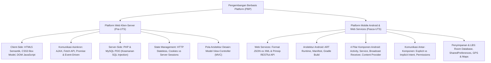

# Rangkuman Materi: Pengembangan Berbasis Platform (PAIK6503 / MIK1624503)

> **Bobot:** 4 SKS | **Semester:** 5 (Kurikulum 2020 / Kurikulum 2024) | **Fokus Utama:** Pemrograman Web Klien-Server (HTML5, CSS3/Bootstrap, JavaScript DOM, Asynchronous AJAX/Fetch), Backend PHP & Database PDO (Prepared Statements, Session & Cookie Management), Arsitektur Web Services & RESTful API (JSON, JWT), serta Pemrograman Platform Mobile Android (Activity Lifecycle, Intent, Service, Broadcast Receiver, RecyclerView, SQLite/Room, dan Location-Based Services)

---

## 1. Gambaran Besar Mata Kuliah (*Grand View*)
Mata kuliah **Pengembangan Berbasis Platform (PBP)** membekali mahasiswa dengan keahlian teknis membangun aplikasi terintegrasi lintas platform (*cross-platform computing*), berfokus pada dua ekosistem platform dominan di dunia komputasi modern:
1. **Platform Web (*Web Platform*):** Arsitektur bertingkat (*multi-tier web architecture*) yang memisahkan lapisan presentasi sisi klien (*Client-Side: HTML/CSS/JS*) dan lapisan logika bisnis sisi server (*Server-Side: PHP/NodeJS/Python*), terhubung melalui pertukaran data asinkron (*AJAX*) dan antarmuka pemrograman aplikasi standar (**RESTful Web Services**).
2. **Platform Bergerak (*Mobile Android Platform*):** Ekosistem sistem operasi mobile berbasis kernel Linux dan runtime ART, memahami daur hidup komponen aplikasi (*Android Application Lifecycle*), komunikasi antar-komponen via *Intent*, eksekusi proses latar belakang (*Background Services*), penyimpanan data lokal (*SQLite/Room*), serta integrasi sensor perangkat fisik (GPS, Kamera, Jaringan Nirkabel).

---

## 2. Peta Silabus & Konsep Inti Perkuliahan

### A. Bagian Pra-UTS (Platform Web, Klien-Server, AJAX & Session)

#### 1. Pemrograman Sisi Klien (*Client-Side Programming*)
* **HTML5 Semantik:** Penggunaan tag semantik (`<header>`, `<nav>`, `<main>`, `<article>`, `<section>`, `<footer>`) yang meningkatkan keterbacaan struktur dokumen, aksesibilitas (*screen readers*), dan optimasi mesin pencari (*SEO*).
* **CSS3 Box Model & Tata Letak:** Setiap elemen web dimodelkan sebagai kotak persegi: `Content` $\rightarrow$ `Padding` (ruang dalam) $\rightarrow$ `Border` (garis tepi) $\rightarrow$ `Margin` (ruang luar antarelemen). Tata letak modern menggunakan **Flexbox** (1 dimensi) dan **CSS Grid** (2 dimensi baris-kolom).
* **JavaScript DOM & Pemrograman Asinkron (AJAX):**
  * *DOM (Document Object Model):* Representasi pohon objek dari dokumen HTML yang dapat dimanipulasi secara dinamis saat runtime (`document.querySelector()`, `addEventListener()`).
  * *AJAX (*Asynchronous JavaScript and XML*):* Teknik memperbarui sebagian konten halaman web di latar belakang tanpa harus memuat ulang (*reload*) seluruh halaman secara penuh.
  * Menggunakan `XMLHttpRequest` atau API modern `fetch()` berbasis **Promises** dan sintaks `async / await`.

#### 2. Pemrograman Sisi Server (*Server-Side PHP*) & Keamanan Database
* **Penanganan Form:** `$_GET` (parameter terlihat di URL, cocok untuk kueri pencarian, batas panjang data) vs `$_POST` (parameter dikirim di badan request HTTP, aman untuk data sensitif/password dan ukuran file besar).
* **Pencegahan SQL Injection via PHP PDO Prepared Statements:**
  * Penyerang mengeksploitasi konkatenasi string SQL mentah (misal: `' OR '1'='1`).
  * Solusi Standar: Wajib menggunakan **Prepared Statements (Parametric Queries)** via PDO. DBMS memisahkan tahap kompilasi struktur query dari tahap pengisian nilai parameter, sehingga input berbahaya diperlakukan murni sebagai nilai string harfiah tanpa bisa mengubah logika sintaks SQL.

#### 3. Manajemen Status (*State Management: Cookies vs Sessions*)
Karena protokol HTTP bersifat tidak menyimpan status (*Stateless Protocol*), mekanisme tambahan diperlukan untuk melacak sesi login pengguna:
* **Cookies:**
  * Potongan teks kecil yang disimpan di sisi browser klien oleh server via header `Set-Cookie`.
  * Selalu dikirimkan kembali ke server pada setiap request HTTP berikutnya.
  * *Kerentanan:* Rawan dibaca oleh skrip jahat (*Cross-Site Scripting / XSS*) jika tidak diberi atribut bendera `HttpOnly` dan `Secure`.
* **Server Sessions (`$_SESSION`):**
  * Data sesi disimpan secara aman di memori/file sisi server.
  * Klien hanya menyimpan satu pengenal acak unik berupa cookie **Session ID** (e.g., `PHPSESSID`).
  * Saat request masuk, server mencocokkan Session ID dengan file sesi di disk untuk mengenali identitas pengguna yang sedang login.

---

### B. Bagian Pasca-UTS (RESTful API & Platform Mobile Android)

#### 1. Arsitektur Web Services & RESTful API
* **Prinsip Dasar REST (Representational State Transfer):**
  1. *Statelessness:* Setiap request dari klien harus memuat seluruh informasi yang dibutuhkan server untuk memprosesnya; server tidak menyimpan konteks sesi klien di memori.
  2. *Uniform Interface:* Sumber daya diidentifikasi melalui URI unik (e.g., `/api/v1/mahasiswa/24060122120034`).
* **Pemetaan Kata Kerja HTTP (*HTTP Verbs*) & Operasi CRUD:**
  * `GET /api/users`: Membaca daftar pengguna (*Read*). Bersifat *Idempotent & Safe*.
  * `POST /api/users`: Membuat pengguna baru (*Create*).
  * `PUT /api/users/{id}`: Memperbarui seluruh data pengguna secara utuh (*Full Update*). Bersifat *Idempotent*.
  * `PATCH /api/users/{id}`: Memperbarui sebagian atribut data pengguna (*Partial Update*).
  * `DELETE /api/users/{id}`: Menghapus data pengguna (*Delete*). Bersifat *Idempotent*.
* **HTTP Status Codes:**
  * `200 OK`, `201 Created` (Sukses).
  * `400 Bad Request`, `401 Unauthorized` (Belum login), `403 Forbidden` (Tidak berhak), `404 Not Found`.
  * `500 Internal Server Error` (Bug sisi backend server).
* **Autentikasi Modern via JWT (JSON Web Token):**
  Token mandiri (*self-contained*) yang terdiri dari 3 bagian yang dipisah titik: `Header.Payload.Signature`. Diotentikasi secara kriptografis tanpa perlu kueri session ke database.

#### 2. Komponen Inti Aplikasi Android (*Four Application Components*)
1. **Activity (Antarmuka Pengguna):**
   * Merepresentasikan satu layar visual tunggal yang berinteraksi langsung dengan pengguna.
   * **Siklus Hidup (*Activity Lifecycle*):**
     * `onCreate()`: Dipanggil saat pertama kali dibuat; inisialisasi view via `setContentView()`.
     * `onStart()`: Layar mulai terlihat oleh pengguna.
     * `onResume()`: Activity berada di baris depan (*foreground*) dan siap menerima interaksi input.
     * `onPause()`: Activity kehilangan fokus (misal: muncul dialog modal atau panggilan telepon masuk).
     * `onStop()`: Activity tidak lagi terlihat sepenuhnya di layar.
     * `onDestroy()`: Activity dihancurkan dari memori (oleh sistem atau via `finish()`).
2. **Service (Proses Latar Belakang):**
   * Komponen yang mengeksekusi operasi jangka panjang di latar belakang tanpa memiliki antarmuka visual (misal: pemutaran musik MP3, pengunduhan file besar di latar belakang).
   * Tipe: *Started Service* (dipanggil via `startService()`) dan *Bound Service* (terhubung via `bindService()`).
3. **Broadcast Receiver:**
   * Mendengarkan dan merespon pesan siaran (*broadcast announcements*) dari sistem Android atau aplikasi lain (misal: baterai lemah, mode pesawat aktif, koneksi internet terputus).
4. **Content Provider:**
   * Mengelola dan menyediakan akses data bersama antar-aplikasi yang berbeda (misal: aplikasi WhatsApp mengakses daftar kontak telepon bawaan HP).

#### 3. Komunikasi Antar-Komponen: Intent
Objek pesan asinkron untuk meminta tindakan dari komponen lain:
* **Explicit Intent:** Menyebutkan secara pasti nama kelas komponen tujuan yang akan dijalankan di dalam aplikasi sendiri (e.g., `new Intent(MainActivity.this, DetailActivity.class)`).
* **Implicit Intent:** Tidak menyebutkan nama kelas target secara langsung, melainkan menyatakan **Aksi (*Action*)** umum yang ingin dijalankan, membiarkan sistem Android menawarkan aplikasi yang mampu menanganinya (e.g., aksi `Intent.ACTION_VIEW` dengan URI peta atau URL browser web).
