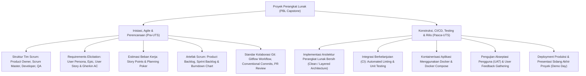

# Rangkuman Materi: Proyek Perangkat Lunak (PAIK6504 / MIK1624504)

> **Bobot:** 3 SKS | **Semester:** 5 (Kurikulum 2020 / Kurikulum 2024) | **Metode Pembelajaran:** *Project-Based Learning (PBL) & Capstone Team Project* | **Fokus Utama:** Manajemen Tim Rekayasa Perangkat Lunak Skala Penuh, Metodologi Agile Scrum (Roles, Artifacts, Ceremonies), Dekomposisi User Stories & Kriteria Penerimaan (*Acceptance Criteria*), Manajemen Kolaborasi Repositori Git (Gitflow, Branching, Pull Requests & Code Review), Otomatisasi CI/CD & Docker, serta Demonstrasi & Uji Penerimaan Pengguna (*User Acceptance Testing - UAT*)

---

## 1. Gambaran Besar Mata Kuliah (*Grand View*)
Mata kuliah **Proyek Perangkat Lunak (PPL)** merupakan mata kuliah puncak (*capstone project course*) praktikal yang mengintegrasikan seluruh keilmuan yang telah dipelajari pada semester-semester sebelumnya: Rekayasa Perangkat Lunak (RPL), Manajemen Basis Data (MBD), Pemrograman Berorientasi Objek (PBO), dan Pengembangan Berbasis Platform (PBP).

Mahasiswa dikelompokkan ke dalam tim pengembang otonom (*Scrum Teams*) yang berkolaborasi untuk merancang, mengimplementasikan, menguji, dan menyebarkan (*deploy*) satu produk perangkat lunak skala produksi nyata bagi pengguna/mitra industri. Penilaian difokuskan pada kedisiplinan proses rekayasa: manajemen backlog, komunikasi ritme *Sprint*, kualitas arsitektur kode (*clean code* dan *coverage testing*), serta ketepatan waktu penyelesaian *milestone*.

> [!NOTE]
> **Catatan Integritas Arsip:** Pada Google Drive DMW HMIF Undip, mata kuliah ini memuat materi slide pengantar metodologi dan arsip evaluasi proyek tim. Karena PPL berfokus pada proyek pengembangan produk nyata (*Project-Based Learning*), rangkuman ini mengonsolidasikan standar operasional prosedur baku pelaksanaan PPL di Departemen Informatika Undip.

---

## 2. Peta Silabus & Konsep Inti Perkuliahan

### A. Bagian Pra-UTS (Inisiasi Proyek, Manajemen Tim Scrum & Backlog)

#### 1. Peran & Tanggung Jawab dalam Tim Agile Scrum
* **Product Owner (PO):** Menjadi jembatan antara klien/pengguna dan tim teknis. Bertanggung jawab menentukan visi produk, memprioritaskan item pada *Product Backlog*, serta menerima atau menolak hasil pekerjaan tim (*acceptance decision*).
* **Scrum Master (SM):** Fasilitator proses dan pelindung tim (*servant leader*). Memastikan aturan main Scrum dijalankan dengan tertib, menghilangkan segala hambatan kerja (*blockers/impediments*) yang dihadapi developer, serta memfasilitasi upacara Scrum.
* **Development Team (Developers & QA Engineers):** Tim multi-disiplin (*cross-functional*) yang memiliki keahlian lengkap (UI/UX, Frontend, Backend, Database, QA) untuk mengubah backlog menjadi modul perangkat lunak fungsional yang siap rilis (*Done Increment*).

#### 2. Dekomposisi Kebutuhan Menjadi User Stories
* Format Standar Industri User Story:
  $$\text{"Sebagai } \mathbf{[Peran\ Pengguna]}, \text{ Saya ingin } \mathbf{[Aksi/Fitur]}, \text{ Sehingga } \mathbf{[Manfaat/Nilai\ Bisnis]}"$$
* **Prinsip Kualitas User Story (INVEST):**
  * *I - Independent:* Tidak bergantung erat pada story lain.
  * *N - Negotiable:* Fleksibel untuk didiskusikan detailnya.
  * *V - Valuable:* Memberikan nilai manfaat nyata bagi pengguna/bisnis.
  * *E - Estimable:* Dapat diperkirakan estimasi beban pengerjaannya.
  * *S - Small:* Berukuran ringkas (selesai dalam hitungan hari dalam 1 sprint).
  * *T - Testable:* Memiliki kriteria pengujian yang jelas.
* **Kriteria Penerimaan (*Acceptance Criteria*) Format Gherkin:**
  * `GIVEN [Kondisi awal/prasyarat]`
  * `WHEN [Aksi yang dilakukan pengguna]`
  * `THEN [Hasil keluaran sistem yang diharapkan]`

#### 3. Estimasi Kerja & Upacara Scrum
* **Story Points & Planning Poker:** Estimasi usaha relatif menggunakan deret Fibonacci ($1, 2, 3, 5, 8, 13$).
* **Empat Upacara (*Scrum Ceremonies*):**
  1. *Sprint Planning:* Menentukan *Sprint Goal* dan memilih item Product Backlog yang dimasukkan ke *Sprint Backlog*.
  2. *Daily Standup (15 Menit):* Pertemuan harian menjawab 3 pertanyaan: (1) Apa yang dikerjakan kemarin? (2) Apa yang dikerjakan hari ini? (3) Apakah ada kendala/blocker?
  3. *Sprint Review / Demo:* Mempresentasikan modul perangkat lunak yang berstatus *Done* kepada dosen/klien di akhir sprint.
  4. *Sprint Retrospective:* Evaluasi internal tim mengenai proses kerja: *What went well? What can be improved? Action items*.

#### 4. Disiplin Kolaborasi Repositori Git (Gitflow)
* Struktur Percabangan:
  * `main / master`: Kode produksi stabil yang telah di-deploy.
  * `develop`: Cabang integrasi pengembangan utama.
  * `feature/<nama-fitur>`: Dibuat dari `develop` untuk mengerjakan satu user story spesifik.
  * `hotfix/<nama-bug>`: Perbaikan darurat langsung dari `main`.
* **Protokol Pull Request (PR):**
  Setiap penggabungan (*merge*) wajib melalui PR dengan minimal persetujuan (*review & approve*) dari 1–2 rekan tim dan lulus pengujian otomatis (*CI pipeline*).

---

### B. Bagian Pasca-UTS (Konstruksi, CI/CD, Docker & Delivery)

#### 1. Arsitektur & Clean Code
* Pemisahan lapisan yang tegas (*Separation of Concerns*): Lapisan Presentasi (Controller/View) $\rightarrow$ Lapisan Logika Bisnis (Service/Use Case) $\rightarrow$ Lapisan Akses Data (Repository/Model).
* Penggunaan Environment Variables (`.env`) untuk memisahkan kredensial database dan rahasia API dari repositori kode publik.

#### 2. Integrasi Berkelanjutan (*Continuous Integration - CI*)
* Pipa otomatisasi (*CI Pipeline*, misal GitHub Actions atau GitLab CI) yang berjalan otomatis pada setiap aksi `git push` atau `pull request`:
  1. *Linting & Static Analysis:* Memeriksa kepatuhan penulisan kode (*coding standard*) dan mendeteksi potensi bug.
  2. *Automated Unit Testing:* Menjalankan serangkaian pengujian unit otomatis dan memeriksa batas minimal cakupan kode (*code coverage threshold*, misal minimal 80%).
  3. *Build Verification:* Memastikan aplikasi berhasil dikompilasi tanpa galat dependensi.

#### 3. Kontainerisasi Aplikasi Menggunakan Docker
* **Dockerfile:** Skrip cetak biru deklaratif untuk membungkus kode program, runtime lingkungan, dan dependensi pustaka menjadi satu unit kontainer portabel.
* **Docker Compose:** Mengorkestrasi beberapa kontainer terhubung sekaligus (misal: satu kontainer backend, satu kontainer database PostgreSQL, dan satu kontainer web server Nginx) dalam satu file konfigurasi `docker-compose.yml`.

#### 4. Pengujian Akseptasi Pengguna (UAT) & Penutupan Proyek
* **User Acceptance Testing (UAT):** Pengujian skenario menyeluruh yang dijalankan langsung oleh pengguna akhir atau perwakilan klien untuk memvalidasi bahwa sistem telah sesuai dengan kebutuhan bisnis sebelum peluncuran resmi.
* Dokumentasi Teknis Akhir: Dokumen Manual Pengguna (*User Manual*), Dokumentasi API (Swagger/Postman Collection), dan Panduan Penyebaran Sistem (*Deployment Guide*).
