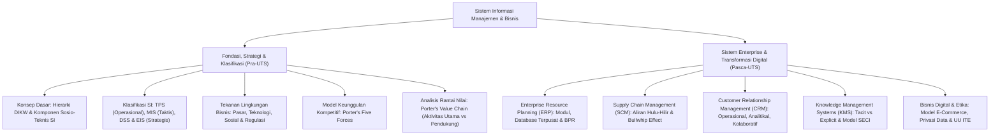

# Rangkuman Materi: Sistem Informasi (PAIK6506 / MIK1624506)

> **Bobot:** 3 SKS | **Semester:** 5 (Kurikulum 2020 / Kurikulum 2024) | **Fokus Utama:** Hierarki DIKW (Data, Information, Knowledge, Wisdom), Klasifikasi Sistem Berdasarkan Level Manajemen (TPS, MIS, DSS, EIS), Keunggulan Kompetitif Strategis (*Porter's Five Forces & Value Chain Analysis*), Sistem Perusahaan Terintegrasi (*Enterprise Systems: ERP, SCM, CRM, KMS*), Manajemen Pengetahuan (*Model SECI Nonaka-Takeuchi*), Model Bisnis E-Commerce, serta Dimensi Etika & Privasi Informasi

---

## 1. Gambaran Besar Mata Kuliah (*Grand View*)
Mata kuliah **Sistem Informasi (SI)** menempatkan teknologi komputasi dalam konteks sosio-teknis organisasi bisnis. Sistem Informasi bukan sekadar perangkat keras dan kode perangkat lunak, melainkan integrasi sinergis antara **Manusia (*People*)**, **Proses Bisnis (*Processes*)**, dan **Teknologi (*Technology*)** yang mengumpulkan, mengolah, menyimpan, dan mendistribusikan informasi untuk mendukung pengambilan keputusan operasional, taktis, hingga strategis organisasi.

Mahasiswa dibekali kerangka analisis strategis untuk mengevaluasi bagaimana adopsi teknologi informasi (seperti ERP SAP, supply chain terintegrasi, dan CRM analitikal) mampu mentransformasikan model bisnis konvensional menjadi entitas digital yang memiliki keunggulan kompetitif berkelanjutan (*Sustainable Competitive Advantage*) di tengah turbulensi pasar global.

---

## 2. Peta Silabus & Konsep Inti Perkuliahan

### A. Bagian Pra-UTS (Fondasi DIKW, Piramida Manajemen & Strategi Kompetitif Porter)

#### 1. Konsep Dasar & Hierarki DIKW
* **Data:** Fakta mentah, angka, atau simbol terisolasi yang belum diolah dan belum memiliki konteks makna (Contoh: `40`, `2024-10-15`).
* **Information (Informasi):** Data yang telah diproses, diorganisasikan, dan distrukturkan sehingga memiliki arti dan konteks bagi penerimanya (Contoh: *"Suhu ruang server terdeteksi $40^\circ\text{C}$ pada tanggal 15 Oktober"*).
* **Knowledge (Pengetahuan):** Pemahaman kontekstual dan wawasan yang diperoleh dari sintesis informasi yang dikaitkan dengan pengalaman, keahlian, dan aturan operasional (Contoh: *"Jika suhu server mencapai $40^\circ\text{C}$, sistem pendingin utama AC pasti sedang mengalami kerusakan kompresor"*).
* **Wisdom (Kebijaksanaan):** Kemampuan mengevaluasi pengetahuan untuk mengambil keputusan etis dan strategis jangka panjang terbaik (Contoh: *"Memutuskan untuk mematikan beban komputasi non-kritis dan mengalihkan trafik ke pusat data cadangan sebelum server meledak"*).

#### 2. Klasifikasi Sistem Informasi Berdasarkan Level Organisasi
Organisasi bisnis dibagi menjadi piramida 3 tingkatan manajemen:
1. **Transaction Processing System (TPS) - Level Operasional:**
   * Menangani transaksi rutin harian volume tinggi dengan aturan kaku.
   * *Karakteristik:* Sangat terstruktur, berorientasi efisiensi dan akurasi data masukan.
   * *Contoh:* Mesin kasir Point of Sale (POS), ATM perbankan, sistem absensi sidik jari.
2. **Management Information System (MIS) - Level Taktis (Manajer Menengah):**
   * Mengagregasi data dari TPS untuk menghasilkan laporan periodik dan ringkasan terjadwal (*scheduled summary reports*) guna memantau kinerja operasional.
   * *Karakteristik:* Terstruktur, laporan internal bulanan/mingguan.
   * *Contoh:* Laporan rekapitulasi penjualan bulanan per cabang, laporan varians anggaran biaya.
3. **Decision Support System (DSS) - Level Taktis & Analis:**
   * Membantu pengambilan keputusan untuk masalah **semi-terstruktur** menggunakan model simulasi matematis (*What-If Analysis*, *Sensitivity Analysis*, *Goal-Seeking*).
   * *Contoh:* Sistem penetapan harga dinamis tiket pesawat berdasarkan proyeksi permintaan dan cuaca.
4. **Executive Information / Support System (EIS / ESS) - Level Strategis (C-Level):**
   * Menyediakan visualisasi dashboard grafis tingkat tinggi (*KPI Executive Dashboards*) dari data internal dan data eksternal makro ekonomi untuk memecahkan masalah **tidak terstruktur**.

#### 3. Keunggulan Kompetitif: Analisis Michael Porter
* **Model Lima Kekuatan Bersaing (*Porter's Five Forces*):**
  1. *Rivalitas Antar-Kompetitor yang Ada:* Intensitas perang harga dan kampanye iklan.
  2. *Ancaman Pendatang Baru (*Threat of New Entrants*):* Kemudahan pemain baru menembus hambatan pasar (*barriers to entry*).
  3. *Daya Tawar Pembeli (*Bargaining Power of Buyers*):* Kekuatan konsumen menuntut harga lebih murah atau kualitas lebih tinggi.
  4. *Daya Tawar Pemasok (*Bargaining Power of Suppliers*):* Ketergantungan perusahaan pada vendor tunggal.
  5. *Ancaman Produk atau Layanan Pengganti (*Threat of Substitutes*):* Alternatif solusi lain yang memuaskan kebutuhan yang sama (misal: Kereta Cepat sebagai pengganti Pesawat Domestik).
* **Analisis Rantai Nilai (*Porter's Value Chain*):**
  * **Aktivitas Utama (*Primary Activities*):**
    * *Inbound Logistics:* Penerimaan dan penyimpanan bahan baku mentah.
    * *Operations:* Transformasi bahan baku menjadi produk jadi.
    * *Outbound Logistics:* Pengemasan dan pengiriman produk jadi ke konsumen.
    * *Marketing & Sales:* Promosi, penetapan harga, dan penjualan.
    * *Service:* Layanan purnajual, instalasi, dan garansi.
  * **Aktivitas Pendukung (*Support Activities*):**
    * *Infrastruktur Perusahaan:* Manajemen hukum, keuangan, dan akuntansi.
    * *Manajemen SDM:* Perekrutan, pelatihan, dan kompensasi.
    * *Pengembangan Teknologi / R&D:* Riset produk, software, otomasi.
    * *Pengadaan (*Procurement*):* Pembelian aset dan peralatan.

---

### B. Bagian Pasca-UTS (Sistem Enterprise, Manajemen Pengetahuan & Etika)

#### 1. Sistem Perusahaan Terintegrasi (*Enterprise Systems*)
* **Enterprise Resource Planning (ERP):**
  * Mengintegrasikan seluruh fungsi departemen (Finansial, HR, Logistik, Manufaktur, Sales) ke dalam **satu basis data relasional terpusat tunggal**.
  * Mengeliminasi pulau-pulau informasi (*Information Silos*) yang menyebabkan inkonsistensi data antar-divisi.
  * Memerlukan *Business Process Reengineering (BPR)* untuk menyelaraskan alur kerja perusahaan dengan praktik terbaik standar industri (*Best Practices*).
* **Supply Chain Management (SCM):**
  * Mengoordinasikan rantai pasokan dari pemasok hulu (*Upstream*), operasional internal (*Internal SCM*), hingga distributor/konsumen hilir (*Downstream*).
  * **Fenomena Bullwhip Effect:** Distorsi amplifikasi fluktuasi permintaan yang semakin membesar saat informasi bergerak mundur dari hilir (pengecer) ke hulu (pabrik pembuat bahan baku). Diatasi dengan integrasi visibilitas data real-time (*Point-of-Sale data sharing / Vendor Managed Inventory*).
* **Customer Relationship Management (CRM):**
  * *CRM Operasional:* Front-office automation (otomasi tenaga penjual / SFA, call center layanan pelanggan).
  * *CRM Analitikal:* Menggunakan data warehouse dan algoritma data mining untuk menganalisis perilaku pelanggan, menghitung *churn rate*, dan melakukan personalisasi penawaran.

#### 2. Manajemen Pengetahuan (*Knowledge Management & Model SECI*)
* **Dua Tipe Pengetahuan:**
  * **Tacit Knowledge:** Pengetahuan implisit yang tertanam dalam benak manusia, intuisi, pengalaman praktis, dan keahlian subjektif (sangat sulit diartikulasikan dan didokumentasikan dalam kata-kata).
  * **Explicit Knowledge:** Pengetahuan terstruktur yang telah dikodifikasikan dalam bentuk dokumen formal, buku panduan (*SOP*), rumus, atau video tutorial.
* **Model Spiral Konversi Pengetahuan SECI (Ikujiro Nonaka & Hirotaka Takeuchi):**
  1. **Socialization (Tacit ke Tacit):** Berbagi pengalaman langsung melalui observasi, bimbingan magang (*apprenticeship*), dan diskusi tatap muka informal.
  2. **Externalization (Tacit ke Explicit):** Mengartikulasikan intuisi dan keahlian ke dalam bentuk konsep tertulis, diagram, atau buku pedoman resmi.
  3. **Combination (Explicit ke Explicit):** Menggabungkan dan mengorganisasikan berbagai dokumen laporan dan basis data menjadi repositori pengetahuan terintegrasi.
  4. **Internalization (Explicit ke Tacit):** Proses "belajar sambil melakukan" (*learning by doing*), di mana karyawan membaca pedoman tertulis dan menyerapnya menjadi kebiasaan intuisi kerja baru.
