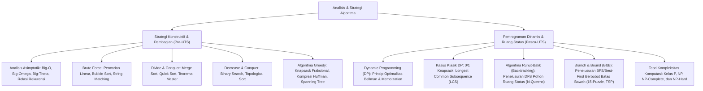

# Rangkuman Materi: Analisis dan Strategi Algoritma (PAIK6601 / MIK1624601)

> **Bobot:** 3 SKS | **Semester:** 6 (Kurikulum 2020 / Kurikulum 2024) | **Fokus Utama:** Notasi Asimptotik & Analisis Kompleksitas ($O, \Omega, \Theta$), Paradigma Algoritma: Brute Force, Algoritma Greedy (Knapsack Fraksional, Huffman Coding, MST Kruskal & Prim), Divide and Conquer (Merge Sort, Quick Sort, Teorema Master), Decrease and Conquer, Pemrograman Dinamis (*Dynamic Programming* - Prinsip Optimalitas Bellman, 0/1 Knapsack, LCS), Algoritma Runut-Balik (*Backtracking* - N-Queens), serta Algoritma *Branch and Bound* (15-Puzzle, TSP)

---

## 1. Gambaran Besar Mata Kuliah (*Grand View*)
Mata kuliah **Analisis dan Strategi Algoritma (ASA)** merupakan inti teoritis dari disiplin ilmu komputer yang mengkaji teknik-teknik sistematis dalam merancang solusi komputasional yang efisien serta menganalisis efisiensi penggunaan sumber daya (waktu eksekusi dan ruang memori) secara matematis terlepas dari platform mesin atau bahasa pemrograman tertentu.

Mahasiswa mempelajari spektrum strategi penyelesaian masalah: dari pendekatan paling lugas (*Brute Force*), pendekatan rakus yang mengambil pilihan optimal lokal (*Greedy*), pemecahan masalah menjadi sub-masalah independen (*Divide and Conquer*), pemecahan dengan memanfaatkan solusi sub-masalah yang tumpang tindih (*Dynamic Programming*), hingga teknik pemangkasan cerdas ruang status solusi eksponensial (*Backtracking* dan *Branch and Bound*).

---

## 2. Peta Silabus & Konsep Inti Perkuliahan

### A. Bagian Pra-UTS (Asimptotik, Brute Force, Divide & Conquer, dan Greedy)

#### 1. Analisis Kompleksitas Asimptotik
* **Tiga Notasi Asimptotik Standar:**
  1. **Big-O ($O(g(n))$):** Batas Atas Asimptotik (*Asymptotic Upper Bound / Worst-Case*). $f(n) \le c \cdot g(n)$ untuk semua $n \ge n_0$.
  2. **Big-Omega ($\Omega(g(n))$):** Batas Bawah Asimptotik (*Asymptotic Lower Bound / Best-Case*). $f(n) \ge c \cdot g(n)$ untuk semua $n \ge n_0$.
  3. **Big-Theta ($\Theta(g(n))$):** Batas Ketat Asimptotik (*Asymptotic Tight Bound / Average-Case*). $c_1 \cdot g(n) \le f(n) \le c_2 \cdot g(n)$.
* **Hierarki Laju Pertumbuhan:**
  $$O(1) < O(\log n) < O(n) < O(n \log n) < O(n^2) < O(n^3) < O(2^n) < O(n!)$$
* **Teorema Master untuk Relasi Rekurensi Divide and Conquer:**
  Bentuk relasi: $T(n) = a T(n/b) + f(n)$ dengan $f(n) = \Theta(n^d)$:
  1. Jika $d < \log_b(a) \implies T(n) = \Theta(n^{\log_b(a)})$
  2. Jika $d = \log_b(a) \implies T(n) = \Theta(n^d \log n)$
  3. Jika $d > \log_b(a) \implies T(n) = \Theta(n^d)$

#### 2. Strategi Divide and Conquer
* Memecah masalah berukuran $n$ menjadi beberapa sub-masalah yang lebih kecil, menyelesaikan masing-masing secara rekursif (*Divide*), lalu menggabungkan solusi sub-masalah menjadi solusi masalah asal (*Conquer & Combine*).
* **Merge Sort:** Selalu membagi array tepat dua bagian seimbang di tengah. Kompleksitas terbaik, rata-rata, dan terburuk selalu konsisten **$\Theta(n \log n)$**, namun membutuhkan memori tambahan $O(n)$.
* **Quick Sort:** Memilih elemen *Pivot*, lalu mempartisi array menjadi elemen yang lebih kecil dan lebih besar dari pivot. Kompleksitas rata-rata $O(n \log n)$, namun kasus terburuk (*worst-case*) dapat merosot menjadi $O(n^2)$ jika pemilihan pivot tidak seimbang (misal: array sudah terurut).

#### 3. Paradigma Algoritma Greedy (*Prinsip Ketamakan*)
* Membangun solusi langkah demi langkah dengan selalu mengambil pilihan yang tampak **paling menguntungkan pada saat itu (optimal lokal)** dengan harapan menghasilkan solusi optimal global (*global optimum*).
* Elemen Greedy: Himpunan kandidat, himpunan solusi, fungsi seleksi, fungsi kelayakan (*feasibility*), fungsi objektif.
* **Kasus di mana Greedy Menghasilkan Solusi Optimal:**
  * *Fractional Knapsack:* Benda boleh dipotong/diambil sebagian. Kriteria seleksi: urutkan berdasarkan nilai densitas tertinggi ($v_i / w_i$).
  * *Huffman Coding:* Algoritma kompresi data prefix-free optimal berbasis frekuensi kemunculan karakter menggunakan pohon biner.
  * *Minimum Spanning Tree (MST):* Algoritma Kruskal (berbasis himpunan *Disjoint Set / Union-Find*) dan Algoritma Prim.
* **Kasus di mana Greedy GAGAL Optimal:** Masalah *0/1 Knapsack* (barang tidak boleh dipotong) dan *Traveling Salesperson Problem (TSP)*.

---

### B. Bagian Pasca-UTS (Pemrograman Dinamis, Backtracking & Branch and Bound)

#### 1. Pemrograman Dinamis (*Dynamic Programming - DP*)
* Ditemukan oleh Richard Bellman. Digunakan jika masalah memiliki dua karakteristik:
  1. **Optimal Substructure:** Solusi optimal dari masalah global dibangun dari solusi optimal sub-masalahnya.
  2. **Overlapping Subproblems:** Masalah yang sama diselesaikan berulang kali pada pohon rekursif. DP menyelesaikan setiap sub-masalah tepat satu kali dan menyimpannya di memori (*Memoization / Tabulation*).
* **Kasus Klasik: 0/1 Knapsack Problem via DP:**
  Tabel berukuran $(n+1) \times (W+1)$ dengan fungsi transisi rekursif:
  $$K[i, w] = \begin{cases} 0 & \text{jika } i=0 \text{ atau } w=0 \\ K[i-1, w] & \text{jika } w_i > w \\ \max(K[i-1, w], \; v_i + K[i-1, w - w_i]) & \text{jika } w_i \le w \end{cases}$$
  Kompleksitas: $O(n \cdot W)$ (*Pseudo-polynomial time*).
* **Longest Common Subsequence (LCS):** Menemukan panjang urutan karakter terpanjang yang sama antara dua string tanpa harus berdampingan.

#### 2. Algoritma Runut-Balik (*Backtracking*)
* Pendekatan sistematis untuk mencari solusi dari masalah kombinatorial dengan menelusuri **Pohon Ruang Status (*State Space Tree*)** secara mendalam (*Depth-First Search - DFS*).
* **Mekanisme Pruning / Bounding:** Jika penelusuran sampai pada simpul yang terbukti tidak mungkin mengarah ke solusi yang valid (*Dead-end / Bounding condition dilanggar*), algoritma **memangkas cabang tersebut dan "berbalik mundur" (*backtrack*)** ke simpul induknya untuk mencoba alternatif cabang lain.
* *Contoh Aplikasi:* Permasalahan **N-Queens Problem** (menempatkan $N$ ratu pada papan catur $N \times N$ tanpa saling menyerang horizontal, vertikal, maupun diagonal), Masalah Pewarnaan Graf (*Graph Coloring*), Masalah Labirin (*Maze Solving*), dan *Subset Sum Problem*.

#### 3. Algoritma *Branch and Bound* (B&B)
* Digunakan khusus untuk menyelesaikan masalah optimasi kombinatorial diskrit bernilai diskrit (Minimasi atau Maksimasi).
* Berbeda dari Backtracking yang menggunakan DFS, Branch and Bound menelusuri pohon ruang status secara melebar (*Breadth-First Search - BFS*) atau berdasarkan prioritas heuristik (*Best-First Search* via Priority Queue).
* **Mekanisme Batas (*Cost & Bound*):**
  Setiap simpul dihitung nilai estimasi batas bawah (*Lower Bound*) dari solusi terbaik yang dapat dicapai dari cabang tersebut. Cabang simpul akan dipangkas (*killed / pruned*) jika nilai batas bawahnya sudah lebih buruk dari batas atas solusi terbaik yang telah ditemukan sejauh ini.
* *Contoh Aplikasi:* Permainan **15-Puzzle** (menggunakan fungsi biaya $c(x) = f(x) + \hat{h}(x)$ di mana $\hat{h}(x)$ adalah jumlah ubin yang tidak berada di posisi target) dan **Traveling Salesperson Problem (TSP)** berbasis reduksi baris-kolom matriks biaya.
