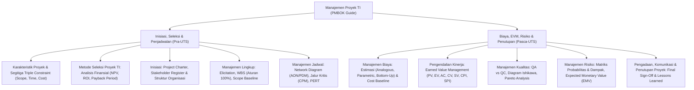

# Rangkuman Materi: Manajemen Proyek Teknologi Informasi (PAIK6603 / MIK1624603)

> **Bobot:** 3 SKS | **Semester:** 6 (Kurikulum 2020 / Kurikulum 2024) | **Standar Acuan:** *PMBOK Guide (Project Management Body of Knowledge - PMI)* | **Fokus Utama:** Kerangka Kerja Manajemen Proyek (*Triple Constraint: Scope, Time, Cost + Quality*), 5 Gugus Proses & 10 Bidang Pengetahuan (*Knowledge Areas*), Seleksi Proyek TI (NPV, ROI, Payback Analysis), Perencanaan Lingkup (*Project Charter & WBS*), Penjadwalan Jaringan Kerja (*Critical Path Method / CPM & PERT*), Pengendalian Kinerja Nilai Hasil (*Earned Value Management - EVM*), serta Manajemen Risiko Proyek

---

## 1. Gambaran Besar Mata Kuliah (*Grand View*)
Mata kuliah **Manajemen Proyek Teknologi Informasi (MPTI / MP)** membekali calon sarjana komputer dengan kompetensi kepemimpinan dan manajerial untuk merencanakan, mengorganisasi, mengalokasikan sumber daya, memantau kemajuan, dan mengendalikan proyek pengembangan sistem informasi/perangkat lunak agar selesai tepat waktu (*on-time*), sesuai batasan anggaran (*on-budget*), dan memenuhi standar kualitas spesifikasi yang disepakati (*on-scope/quality*).

Mahasiswa mempelajari kerangka kerja standar dunia **PMBOK Guide (*Project Management Institute*)**, memahami dinamika pengaruh struktur budaya organisasi (*Functional, Matrix, Projectized*), menyusun dekomposisi struktur rincian kerja (*Work Breakdown Structure - WBS*), menghitung jalur kritis proyek (*Critical Path Method*), memitigasi ketidakpastian durasi (*PERT*), hingga menghitung indikator deviasi biaya dan waktu secara kuantitatif (*Earned Value Management*).

> [!NOTE]
> **Catatan Integritas Arsip:** Pada Google Drive DMW HMIF Undip, folder materi slide mata kuliah ini kosong ($0$ berkas slide), namun memuat $4$ berkas bank soal ujian resmi tahun 2022–2025. Rangkuman materi ini disusun secara sistematis dan komprehensif mengacu pada silabus resmi Departemen Informatika Undip dan standar baku PMBOK Guide 6th/7th Edition.

---

## 2. Peta Silabus & Konsep Inti Perkuliahan

### A. Bagian Pra-UTS (Inisiasi, Seleksi Finansial, WBS & Jalur Kritis CPM)

#### 1. Definisi Proyek & Kerangka Kerja Manajemen Proyek
* **Definisi Proyek:** Usaha temporer yang dilakukan untuk menciptakan produk, layanan, atau hasil yang unik (*temporary endeavor undertaken to create a unique product, service, or result*). Berbeda dari operasional rutin (*ongoing operations*) yang bersifat repetitif dan berkelanjutan.
* **Segitiga Batasan Proyek (*The Triple Constraint*):**
  1. **Scope (Ruang Lingkup):** Apa saja pekerjaan yang harus diselesaikan (dan apa yang tidak termasuk).
  2. **Time (Waktu / Jadwal):** Batas waktu penyelesaian target *milestones*.
  3. **Cost (Biaya / Anggaran):** Batas pagu anggaran dana yang tersedia.
  *(Keempat pilar ini saling mengunci untuk menghasilkan sasaran **Kualitas / Quality**; perubahan pada salah satu sudut pasti berdampak pada sudut lainnya).*
* **Lima Gugus Proses (*Process Groups*):**
  *Inisiasi $\rightarrow$ Perencanaan (Planning) $\rightarrow$ Pelaksanaan (Executing) $\rightarrow$ Pemantauan & Pengendalian (Monitoring & Controlling) $\rightarrow$ Penutupan (Closing)*.
* **Pengaruh Struktur Organisasi terhadap Kekuasaan Project Manager:**
  * *Organisasi Fungsional:* Kekuasaan manajer proyek sangat lemah/hampir tidak ada; dikendalikan penuh oleh manajer fungsional departemen (keuangan, IT, HR).
  * *Organisasi Matriks (Weak, Balanced, Strong):* Kekuasaan dibagi antara manajer fungsional dan manajer proyek.
  * *Organisasi Projectized:* Manajer proyek memiliki otoritas independen mutlak atas alokasi sumber daya dan anggaran tim proyek.

#### 2. Metode Seleksi Kelayakan Finansial Proyek TI
1. **Net Present Value (NPV):** Selisih antara nilai sekarang arus kas masuk (*Present Value of Cash Inflows*) dan pengeluaran investasi awal (*Initial Investment*). Proyek layak jika $\mathbf{\text{NPV} > 0}$.
   $$\text{NPV} = \sum_{t=1}^n \frac{R_t}{(1 + r)^t} - \text{Investasi Awal}$$
2. **Return on Investment (ROI):** Persentase rasio laba bersih terhadap biaya investasi:
   $$\text{ROI} = \frac{\text{Total Manfaat} - \text{Total Biaya}}{\text{Total Biaya}} \times 100\%$$
3. **Payback Period:** Waktu yang dibutuhkan agar akumulasi pendapatan proyek dapat menutup kembali seluruh modal investasi awal. Proyek dengan payback period lebih singkat lebih diprioritaskan karena risiko modal tertahan lebih rendah.

#### 3. Manajemen Lingkup & Work Breakdown Structure (WBS)
* **Project Charter:** Dokumen resmi yang mengesahkan keberadaan proyek, menetapkan penunjukan Manajer Proyek dengan otoritasnya, serta merangkum tujuan bisnis tingkat tinggi dan anggaran garis besar.
* **Work Breakdown Structure (WBS):** Dekomposisi hierarkis berorientasi hasil (*deliverable-oriented hierarchical decomposition*) dari seluruh pekerjaan yang harus diselesaikan tim proyek.
  * **Aturan 100% (*The 100% Rule*):** WBS harus mencakup tepat 100% dari seluruh ruang lingkup pekerjaan proyek yang didefinisikan—tidak boleh ada pekerjaan yang tertinggal dan tidak boleh ada pekerjaan liar di luar lingkup (*Scope Creep*).
  * Unit terbawah dari WBS disebut sebagai **Work Package** (paket kerja yang dapat diestimasikan durasi, biaya, dan penanggung jawabnya).

#### 4. Penjadwalan Jaringan Kerja: Critical Path Method (CPM) & PERT
* **Metode Diagram Presedensi (*Precedence Diagramming Method - PDM / Activity-on-Node AON*):**
  Memodelkan ketergantungan antar-aktivitas: *Finish-to-Start (FS)*, *Start-to-Start (SS)*, *Finish-to-Finish (FF)*, *Start-to-Finish (SF)*.
* **Critical Path Method (CPM):**
  * Jalur terpanjang yang melintasi diagram jaringan kerja proyek yang menunjukkan **durasi waktu tercepat yang mungkin untuk menyelesaikan seluruh proyek**.
  * Aktivitas pada Jalur Kritis memiliki nilai **Slack / Float $= 0$** (keterlambatan satu hari saja pada aktivitas kritis akan memundurkan tanggal penyelesaian proyek secara keseluruhan).
  * Perhitungan Maju (*Forward Pass*): Menghitung *Early Start (ES)* dan *Early Finish (EF)*:
    $$\text{EF} = \text{ES} + \text{Durasi} - 1 \quad (\text{atau } \text{EF} = \text{ES} + \text{Durasi})$$
  * Perhitungan Mundur (*Backward Pass*): Menghitung *Late Finish (LF)* dan *Late Start (LS)*:
    $$\text{LS} = \text{LF} - \text{Durasi}$$
  * Total Float: $\text{TF} = \text{LS} - \text{ES} = \text{LF} - \text{EF}$.
* **PERT (*Program Evaluation and Review Technique*):**
  Menangani ketidakpastian durasi menggunakan 3 estimasi waktu berbasis Distribusi Beta:
  * Optimis ($o$), Paling Mungkin ($m$), Pesimis ($p$).
  * **Durasi Rata-rata Terbobot ($t_e$):**
    $$t_e = \frac{o + 4m + p}{6}$$
  * **Variansi Durasi ($\sigma^2$):**
    $$\sigma^2 = \left(\frac{p - o}{6}\right)^2$$

---

### B. Bagian Pasca-UTS (Pengendalian Kinerja EVM, Mutu & Risiko Proyek)

#### 1. Pengendalian Kinerja Proyek: Earned Value Management (EVM)
Metode objektif untuk mengukur integrasi kinerja ruang lingkup, jadwal, dan biaya secara bersamaan pada titik tanggal evaluasi (*status date*):
* **Tiga Metrik Parameter Dasar:**
  1. **Planned Value (PV):** Anggaran biaya yang direncanakan harus diselesaikan pada tanggal evaluasi.
  2. **Earned Value (EV):** Nilai anggaran dari pekerjaan yang secara aktual telah diselesaikan (*persentase selesai riil $\times$ anggaran total*).
  3. **Actual Cost (AC):** Total biaya riil yang telah dikeluarkan dan dibayarkan untuk menyelesaikan pekerjaan tersebut.
* **Analisis Varians:**
  * **Cost Variance (CV):** $\text{CV} = \text{EV} - \text{AC}$
    * $\text{CV} > 0 \implies$ Di bawah anggaran (*Under Budget / Hemat*).
    * $\text{CV} < 0 \implies$ Melebihi anggaran (*Over Budget / Boros*).
  * **Schedule Variance (SV):** $\text{SV} = \text{EV} - \text{PV}$
    * $\text{SV} > 0 \implies$ Lebih cepat dari jadwal (*Ahead of Schedule*).
    * $\text{SV} < 0 \implies$ Terlambat dari jadwal (*Behind Schedule*).
* **Indeks Kinerja Efisiensi (*Performance Indices*):**
  * **Cost Performance Index (CPI):**
    $$\text{CPI} = \frac{\text{EV}}{\text{AC}}$$
    * $\text{CPI} > 1.0 \implies$ Efisien biaya; $\text{CPI} < 1.0 \implies$ Biaya tidak efisien.
  * **Schedule Performance Index (SPI):**
    $$\text{SPI} = \frac{\text{EV}}{\text{PV}}$$
    * $\text{SPI} > 1.0 \implies$ Progres kerja cepat; $\text{SPI} < 1.0 \implies$ Progres kerja lambat.
* **Proyeksi Estimasi Biaya Akhir (*Estimate at Completion - EAC*):**
  $$\text{EAC} = \frac{\text{Budget at Completion (BAC)}}{\text{CPI}}$$

#### 2. Manajemen Risiko Proyek (*Project Risk Management*)
* **Matriks Probabilitas dan Dampak (*Probability and Impact Matrix*):**
  Menilai risiko kualitatif dengan memetakan peluang terjadinya ($0.0 - 1.0$) dengan tingkat keparahan dampak (Rendah, Sedang, Tinggi) untuk menentukan skor prioritas mitigasi.
* **Expected Monetary Value (EMV):**
  $$\text{EMV} = \text{Probabilitas Terjadinya Kejadian} \times \text{Dampak Finansial}$$
* **Empat Strategi Respons Risiko Ancaman (*Negative Risks / Threats*):**
  1. *Avoidance (Menghindari):* Mengubah rencana proyek untuk menghilangkan ancaman sepenuhnya (misal: mengganti teknologi eksperimental dengan teknologi yang sudah teruji).
  2. *Mitigation (Mitigasi):* Mengambil tindakan dini untuk memperkecil probabilitas atau keparahan dampak (misal: melakukan pengujian stres server berkala).
  3. *Transference (Mentransfer):* Mengalihkan beban dampak finansial risiko ke pihak ketiga (misal: membeli polis asuransi atau menggunakan subkontraktor garansi).
  4. *Acceptance (Menerima):* Menerima risiko secara pasif atau aktif dengan menyiapkan dana cadangan kontinjensi (*Contingency Reserve*).
