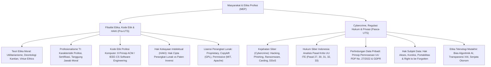

# Rangkuman Materi: Masyarakat dan Etika Profesi (PAIK6604 / MIK1624604)

> **Bobot:** 2 SKS | **Semester:** 6 (Kurikulum 2020 / Kurikulum 2024) | **Fokus Utama:** Teori Etika Moral Terapan, Profesionalisme & Kode Etik TI (ACM / IEEE-CS Software Engineering Code of Ethics), Hak Kekayaan Intelektual / HAKI (Hak Cipta Perangkat Lunak, Paten Invensi, Merek, Rahasia Dagang), Lisensi Perangkat Lunak Bebas & Terbuka (*Open Source: Copyleft GPL vs Permissive MIT*), Kejahatan Siber (*Cybercrime*) & Regulasi Hukum Indonesia (UU ITE), serta Tata Kelola Privasi Data Pribadi (UU PDP No. 27/2022 & GDPR)

---

## 1. Gambaran Besar Mata Kuliah (*Grand View*)
Mata kuliah **Masyarakat dan Etika Profesi (MEP)** membekali calon sarjana komputer dengan kesadaran kritis mengenai dampak sosial, hukum, budaya, dan moral dari penerapan teknologi informasi dalam kehidupan bermasyarakat. Lulusan informatika memegang kekuasaan teknis yang besar: mereka merancang algoritma penentu keputusan finansial, sistem pengamanan data rekam medis, dan sistem kontrol fisik yang menyangkut nyawa manusia.

Mata kuliah ini mengajarkan bagaimana seorang profesional TI menavigasi dilema etika menggunakan kerangka moral filosofis, mematuhi standar perilaku profesional internasional (**ACM / IEEE-CS Code of Ethics**), menghormati rezim hukum Hak Kekayaan Intelektual (HAKI), memahami sanksi delik pidana siber berdasarkan **UU ITE**, serta menegakkan hak-hak privasi warga negara sesuai **Undang-Undang Perlindungan Data Pribadi (UU PDP)**.

> [!NOTE]
> **Catatan Integritas Arsip:** Pada Google Drive DMW HMIF Undip, folder materi slide mata kuliah ini kosong ($0$ berkas slide), namun memuat $16$ berkas bank soal ujian resmi tahun 2018–2022. Rangkuman ini disusun secara komprehensif menyatukan silabus resmi Departemen Informatika Undip, peraturan perundang-undangan Republik Indonesia terkini, dan standar etika profesi komputasi global.

---

## 2. Peta Silabus & Konsep Inti Perkuliahan

### A. Bagian Pra-UTS (Teori Moral, Kode Etik ACM/IEEE & Rezim HAKI)

#### 1. Teori-Teori Etika Moral dalam Pengambilan Keputusan
* **Utilitarianisme (Jeremy Bentham & John Stuart Mill):**
  * Etika berbasis konsekuensi (*Consequentialism*). Suatu tindakan dinilai bermoral jika dan hanya jika tindakan tersebut menghasilkan **manfaat dan kebahagiaan terbesar bagi jumlah orang terbanyak (*The greatest good for the greatest number*)**.
  * *Dilema TI:* Melepaskan perangkat lunak yang masih memiliki bug kecil demi mengejar tenggat peluncuran aplikasi publik darurat bencana.
* **Deontologi (Immanuel Kant):**
  * Etika berbasis kewajiban mutlak (*Duty-based Ethics*). Tindakan dinilai bermoral berdasarkan pemenuhan kewajiban moral intrinsik (*Categorical Imperative*), terlepas dari hasil akhirnya.
  * Doktrin Inti: Jangan pernah memperlakukan manusia semata-mata sebagai sarana atau alat untuk mencapai tujuan (*Humans as ends, never merely as means*).
  * *Dilema TI:* Dilarang berbohong atau melanggar hak privasi data pengguna, meskipun penjualan data pengguna tersebut dapat menyelamatkan perusahaan dari kebangkrutan.
* **Etika Kebajikan (*Virtue Ethics* - Aristoteles):**
  * Menekankan pada pembentukan integritas karakter dan kebajikan moral pribadi (kejujuran, keadilan, keberanian moral) daripada ketaatan pada aturan kaku.

#### 2. Kode Etik Rekayasa Perangkat Lunak (ACM / IEEE-CS Code of Ethics)
Kode etik resmi yang mengikat para insinyur perangkat lunak profesional di seluruh dunia:
1. **PUBLIC (Masyarakat):** Insinyur perangkat lunak wajib bertindak konsisten demi kepentingan umum dan keselamatan publik di atas kepentingan pribadi atau perusahaan.
2. **CLIENT AND EMPLOYER (Klien & Atasan):** Bertindak demi kepentingan terbaik klien dan atasan secara jujur, sepanjang tidak bertentangan dengan kepentingan publik.
3. **PRODUCT (Produk):** Memastikan bahwa perangkat lunak dan modifikasi terkait memenuhi standar profesional kualitas tertinggi yang dapat dicapai.
4. **JUDGMENT (Pertimbangan):** Mempertahankan integritas dan independensi dalam penilaian profesional (tidak menerima suap atau bias kepentingan).
5. **MANAGEMENT (Manajemen):** Pemimpin dan manajer rekayasa wajib mendukung dan mempromosikan pendekatan etis dalam manajemen proyek.
6. **PROFESSION (Profesi):** Memajukan integritas dan reputasi profesi secara konsisten dengan kepentingan publik.
7. **COLLEAGUES (Rekan Sejawat):** Bersikap adil, suportif, dan membantu perkembangan rekan kerja.
8. **SELF (Diri Sendiri):** Terus berpartisipasi dalam pembelajaran seumur hidup (*lifelong learning*) dan mempromosikan praktik rekayasa etis.

#### 3. Hak Kekayaan Intelektual (HAKI) di Bidang Perangkat Lunak
* **Hak Cipta (*Copyright* - UU No. 28 Tahun 2014):**
  * **Melindungi ekspresi nyata bentuk karya**, bukan ide dasarnya.
  * Timbul secara deklaratif seketika saat karya diwujudkan (*Automatic Protection*), tanpa keharusan pendaftaran formal (namun pendaftaran ke DJKI Kemenkumham dianjurkan sebagai alat bukti hukum).
  * Pada perangkat lunak, Hak Cipta melindungi: **Kode sumber (*Source Code*)**, kode biner objek, struktur menu visual, dan buku panduan manual. Berlaku selama 50 tahun sejak pertama kali dipublikasikan secara sah.
* **Paten (*Patent* - UU No. 13 Tahun 2016):**
  * **Melindungi invensi teknologi** baru yang memiliki kebaruan (*novelty*), langkah inventif non-obvious, dan dapat diterapkan dalam industri.
  * Bersifat konstitutif (*First-to-File*): Perlindungan baru lahir setelah diajukan permohonan dan lulus pemeriksaan substantif.
  * *Perlakuan Perangkat Lunak:* Di Indonesia dan banyak negara, kode program komputer murni (*software as such*) **TIDAK DAPAT DIPATENKAN**. Software hanya dapat dipatenkan jika terintegrasi erat dengan perangkat keras dan menghasilkan efek teknis nyata (*Computer-Implemented Invention*). Masa berlaku: 20 tahun.
* **Lisensi Perangkat Lunak Terbuka (Open Source Licenses):**
  * **Lisensi Copyleft Resiprokal (e.g., GNU GPL v3):** Mengharuskan setiap perangkat lunak turunan yang memodifikasi atau menggunakan kode GPL **wajib membuka kode sumbernya ke publik di bawah lisensi GPL yang sama** (*Viral / Share-Alike License*).
  * **Lisensi Permisif (e.g., MIT, Apache 2.0, BSD):** Sangat longgar; mengizinkan pengguna untuk memodifikasi, mendistribusikan ulang, bahkan menggabungkannya ke dalam perangkat lunak komersial tertutup (*proprietary/closed-source*), asalkan tetap menyertakan hak cipta atribusi pengembang asli.

---

### B. Bagian Pasca-UTS (Kejahatan Siber, Regulasi UU ITE & Privasi Data Pribadi)

#### 1. Kejahatan Siber (*Cybercrime*) & Penegakan Hukum di Indonesia
* **Karakteristik Kejahatan Siber:** Bersifat tanpa batas teritorial (*borderless*), anonim (*anonymity*), cepat dieksekusi dari jarak jauh (*remote execution*), dan menuntut bukti digital (*digital forensics*).
* **Pasal-Pasal Kritis UU ITE (UU No. 11/2008 & UU No. 1/2024):**
  * **Pasal 30 (Akses Ilegal / Unauthorized Access / Hacking):**
    * Ayat (1): Mengakses komputer/sistem elektronik orang lain dengan cara apapun tanpa hak.
    * Ayat (2): Mengakses sistem untuk memperoleh data/informasi elektronik rahasia.
    * Ayat (3): Menerobos, melampaui, atau menjebol sistem pengamanan (*cracking/bypass security*). Ancaman pidana: penjara hingga 8 tahun / denda hingga Rp 800 juta.
  * **Pasal 31 (Penyadapan Ilegal / Interception / Wiretapping):** Melakukan interseksi transmisi informasi elektronik yang tidak bersifat publik.
  * **Pasal 32 (Perusakan & Modifikasi Data / Data Tampering):** Mengubah, merusak, menghapus, atau memindahkan data elektronik milik orang lain secara melawan hukum (e.g., serangan Ransomware, Web Defacement).
  * **Pasal 33 (Gangguan Sistem / System Interference):** Melakukan tindakan apapun yang mengakibatkan terganggunya sistem elektronik sehingga tidak berfungsi sebagaimana mestinya (e.g., serangan DDoS).

#### 2. Perlindungan Data Pribadi (UU No. 27 Tahun 2022 tentang PDP & GDPR)
* **Definisi Data Pribadi:** Data tentang orang perseorangan yang teridentifikasi atau dapat diidentifikasi secara tersendiri atau dikombinasi dengan informasi lainnya.
  * *Data Pribadi Spesifik (Sensitif):* Data biometrik, genetika, catatan kejahatan, data anak, data keuangan pribadi, dan data kesehatan rekam medis.
  * *Data Pribadi Umum:* Nama lengkap, jenis kelamin, kewarganegaraan, agama, status perkawinan.
* **Prinsip Utama Pemrosesan Data Pribadi:**
  1. Wajib memiliki dasar hukum yang sah (utamanya: persetujuan eksplisit / *explicit consent* subjek data).
  2. Pembatasan tujuan pemrosesan (*Purpose Limitation*).
  3. Minimisasi pengumpulan data (*Data Minimization*—hanya mengambil apa yang mutlak diperlukan).
  4. Kewajiban menjamin keamanan teknis via enkripsi dan kontrol akses (*Data Security*).
* **Hak-Hak Asasi Subjek Data Pribadi:**
  * Hak memperoleh informasi tentang kejelasan identitas pengendali data.
  * Hak mengakses dan meminta salinan data pribadinya.
  * Hak melengkapi dan memperbaiki data yang keliru (*Rectification*).
  * Hak menghapus data pribadinya (*Right to Erasure / Right to be Forgotten*).
  * Hak portabilitas data (*Data Portability*).
