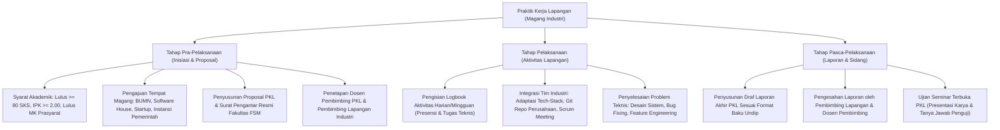

# Panduan & Rangkuman Materi: Praktik Kerja Lapangan (PAIK6605 / MIK1624605)

> **Bobot:** 2 SKS | **Semester:** 6 (Kurikulum 2020 / Kurikulum 2024) | **Metode:** *Industrial Internship / Magang Industri (1–3 Bulan)* | **Fokus Utama:** Penerapan Praktis Keilmuan Informatika di Dunia Industri, Prosedur Administrasi & Persyaratan PKL, Metodologi Pelaksanaan Tugas Teknis di Perusahaan Mitra, Standar Sistematika Penulisan Laporan Akhir PKL Undip, serta Rubrik Penilaian & Ujian Seminar Terbuka

---

## 1. Gambaran Besar Mata Kuliah (*Grand View*)
Mata kuliah **Praktik Kerja Lapangan (PKL)** atau Magang Kerja Industri merupakan wahana transisi kritis bagi mahasiswa S1 Informatika Universitas Diponegoro untuk mengaplikasikan teori akademis perkuliahan ke dalam lingkungan kerja industri teknologi nyata (*corporate real-world environment*).

Mahasiswa ditempatkan di perusahaan teknologi, startup digital, Badan Usaha Milik Negara (BUMN), instansi pemerintah, atau laboratorium riset selama kurun waktu minimal 1 hingga 3 bulan (atau ekuivalen Program Magang Merdeka / MSIB). Penilaian difokuskan pada kedisiplinan profesional, kontribusi teknis nyata dalam tim rekayasa industri, kemampuan memecahkan masalah sistem riil (*real-world problem solving*), serta pertanggungjawaban akademik dalam bentuk Laporan PKL dan Ujian Seminar Terbuka.

> [!NOTE]
> **Catatan Integritas Arsip:** Pada Google Drive DMW HMIF Undip, mata kuliah ini tidak memiliki berkas slide materi kuliah kelas reguler ($0$ berkas) maupun bank soal tertulis ($0$ berkas) karena PKL merupakan kegiatan magang terapan langsung di luar kampus. Dokumen ini merangkum secara utuh **Buku Panduan Resmi Pelaksanaan dan Ujian Seminar PKL Departemen Informatika FSM Universitas Diponegoro**.

---

## 2. Alur Pelaksanaan & Standar Sistematika Laporan PKL

### A. Alur Prosedur Pelaksanaan PKL di Undip
1. **Syarat Pendaftaran Akademik:**
   * Mahasiswa telah menempuh minimal $80$ SKS tanpa nilai $E$.
   * Telah lulus mata kuliah prasyarat kompetensi: Rekayasa Perangkat Lunak (RPL), Pemrograman Berorientasi Objek (PBO), Basis Data, dan Jaringan Komputer.
2. **Pengajuan Proposal & Mitra Industri:**
   * Mahasiswa menyusun Proposal PKL yang memuat latar belakang, tujuan, rencana jadwal kerja, serta divisi/lingkup teknis yang dituju.
   * Mengurus Surat Permohonan Magang resmi dari Fakultas Sains dan Matematika (FSM) Undip ke perusahaan mitra.
3. **Pelaksanaan Aktivitas Magang Lapangan:**
   * Durasi magang dilaksanakan secara penuh (*full-time*) minimal selama 1 bulan (160 jam kerja) hingga 3 bulan (atau 1 semester program Kampus Merdeka MSIB).
   * Wajib mengisi **Buku Catatan Harian (*Logbook*)** yang diparaf berkala oleh Pembimbing Lapangan.
4. **Evaluasi Industri:**
   * Di akhir periode magang, Pembimbing Lapangan menerbitkan formulir penilaian kinerja industri resmi (*Hard skills, Soft skills, Kedisiplinan, Kerjasama tim*) beserta Surat Keterangan Selesai Magang.

---

### B. Standar Sistematika Penulisan Laporan PKL Undip
Laporan PKL disusun secara terstruktur menggunakan panduan format penulisan ilmiah Departemen Informatika Undip:

* **Bagian Awal:**
  * Halaman Judul (Sampul Depan)
  * Lembar Pengesahan (Ditandatangani Pembimbing Lapangan berstempel resmi, Dosen Pembimbing, dan Ketua Departemen Informatika)
  * Kata Pengantar & Ucapan Terima Kasih
  * Daftar Isi, Daftar Tabel, Daftar Gambar, Daftar Lampiran
* **BAB I: PENDAHULUAN**
  * *1.1 Latar Belakang:* Urgensi pemilihan topik proyek magang di instansi terkait.
  * *1.2 Lingkup Kegiatan:* Batasan sistem atau modul perangkat lunak yang dikerjakan mahasiswa.
  * *1.3 Tujuan PKL:* Sasaran kompetensi teknis yang ingin dicapai.
  * *1.4 Manfaat PKL:* Manfaat bagi mahasiswa, departemen, dan instansi mitra.
* **BAB II: TINJAUAN UMUM INSTANSI / PERUSAHAAN**
  * *2.1 Profil Singkat Perusahaan:* Sejarah, visi, misi, dan nilai-nilai korporasi.
  * *2.2 Struktur Organisasi:* Bagan hierarki divisi kerja tempat mahasiswa ditempatkan.
  * *2.3 Produk & Layanan TI Perusahaan:* Portofolio teknologi bisnis perusahaan.
* **BAB III: METODOLOGI & PELAKSANAAN PRAKTIK KERJA**
  * *3.1 Metodologi Pengembangan:* Penerapan SDLC (e.g., Agile Scrum, Kanban).
  * *3.2 Lingkungan Teknis (*Tech Stack*):* Spesifikasi perangkat keras, sistem operasi, bahasa pemrograman, framework, dan arsitektur database yang digunakan.
  * *3.3 Analisis Kebutuhan Sistem:* Identifikasi kebutuhan fungsional dan non-fungsional proyek.
  * *3.4 Perancangan Sistem:* Diagram UML (Use Case, Sequence, Class Diagram, ERD skema database).
* **BAB IV: HASIL DAN PEMBAHASAN**
  * *4.1 Implementasi Sistem:* Pembahasan modul kode program yang dibangun oleh mahasiswa, struktur API, antarmuka UI/UX.
  * *4.2 Pengujian Sistem:* Hasil pengujian fungsionalitas (*Unit Testing, Black-Box Testing, UAT*).
  * *4.3 Kendala yang Dihadapi & Solusi:* Hambatan teknis/organisasional dan langkah pemecahannya.
* **BAB V: PENUTUP**
  * *5.1 Kesimpulan:* Rangkuman ketercapaian tujuan magang dan kontribusi produk akhir.
  * *5.2 Saran:* Rekomendasi teknis untuk pengembangan sistem lanjutan bagi perusahaan dan rekomendasi akademis bagi departemen.
* **Bagian Akhir:**
  * Daftar Pustaka (Standar IEEE)
  * Lampiran: Logbook aktivitas magang bertanda tangan, surat penerimaan dan keterangan selesai magang, sertifikat industri, dan potongan kode/dokumentasi sistem pendukung.

---

## 3. Rubrik Komponen Penilaian Akhir PKL

Nilai Akhir PKL merupakan gabungan dari dua komponen pembobotan:
1. **Nilai Pembimbing Lapangan Perusahaan ($40\% - 50\%$):**
   * Kedisiplinan kehadiran dan etos kerja profesional.
   * Kemampuan beradaptasi dengan tim kerja industri.
   * Kualitas hasil pekerjaan dan kontribusi terhadap target proyek perusahaan.
   * Inisiatif dan kemandirian dalam memecahkan masalah teknis.
2. **Nilai Ujian Seminar Terbuka oleh Dosen Penguji Undip ($50\% - 60\%$):**
   * *Kualitas Laporan PKL ($30\%$):* Ketepatan format ilmiah, kejelasan analisis rekayasa, kelengkapan diagram UML dan dokumentasi teknis.
   * *Penyajian / Presentasi ($30\%$):* Kejelasan artikulasi penyampaian materi, sistematika alur slide, dan manajemen waktu presentasi (15 menit).
   * *Penguasaan Materi & Tanya Jawab ($40\%$):* Kemampuan mahasiswa mempertahankan argumentasi teknis, menjelaskan arsitektur kode dan skema database yang dibangun, serta mengaitkan pengalaman industri dengan teori informatika.
