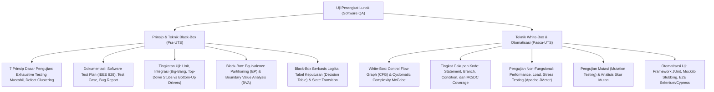

# Rangkuman Materi: Uji Perangkat Lunak / Software Testing (PAIK6602 / MIK1624602)

> **Bobot:** 3 SKS | **Semester:** 6 (Kurikulum 2020 / Kurikulum 2024) | **Standar Acuan:** *ISTQB Certified Tester Foundation Level & IEEE 829 / ISO/IEC/IEEE 29119* | **Fokus Utama:** Prinsip & Psikologi Pengujian Perangkat Lunak, Tingkatan Uji (Unit, Integration: Top-Down/Bottom-Up Stubs & Drivers, System, Acceptance), Teknik Black-Box (Equivalence Partitioning, BVA, Decision Table, State Transition), Teknik White-Box (Control Flow Graph, Cyclomatic Complexity McCabe, Basis Path, MC/DC), Pengujian Regresi & Mutasi, serta Otomatisasi Uji (Selenium, JUnit, Mockito, JMeter)

---

## 1. Gambaran Besar Mata Kuliah (*Grand View*)
Mata kuliah **Uji Perangkat Lunak (*Software Testing / Quality Assurance*)** membekali mahasiswa dengan disiplin rekayasa sistematis dalam melakukan verifikasi dan validasi produk perangkat lunak untuk menemukan cacat (*defects / bugs*), memastikan kepatuhan terhadap kebutuhan fungsional dan non-fungsional, serta mengukur derajat kualitas perangkat lunak sebelum dirilis ke lingkungan produksi.

Sesuai pepatah klasik Edsger W. Dijkstra:
> *"Pengujian program dapat secara efektif membuktikan keberadaan cacat (*defects*), namun tidak akan pernah dapat membuktikan ketiadaan cacat sepenuhnya."*

Mahasiswa mempelajari metodologi standar industri internasional (**ISTQB**): merancang dokumen rencana pengujian formal (*Software Test Plan IEEE 829*), membagi ruang masukan menggunakan teknik kotak hitam (*Black-Box*), menganalisis jalur independen eksekusi logika kode kotak putih (*White-Box Cyclomatic Complexity*), merancang pengujian beban & performa (*Stress/Load Testing*), hingga membangun skrip uji otomatis (*Test Automation Pipeline*).

> [!NOTE]
> **Catatan Integritas Arsip:** Pada Google Drive DMW HMIF Undip, folder materi slide mata kuliah ini kosong ($0$ berkas slide), namun memuat $10$ berkas bank soal ujian resmi tahun 2021–2026 dan artefak draf *Software Test Plan* mahasiswa. Rangkuman ini dikonsolidasikan secara komprehensif mengacu pada silabus standar Departemen Informatika Undip dan kurikulum internasional ISTQB Foundation Level.

---

## 2. Peta Silabus & Konsep Inti Perkuliahan

### A. Bagian Pra-UTS (Prinsip Dasar, Tingkatan Uji, Dokumentasi & Black-Box)

#### 1. Tujuh Prinsip Dasar Pengujian Perangkat Lunak (ISTQB)
1. **Testing shows the presence of defects, not their absence:** Pengujian membuktikan adanya bug, bukan membuktikan program 100% bebas dari kesalahan.
2. **Exhaustive testing is impossible:** Pengujian terhadap seluruh kemungkinan kombinasi masukan secara tuntas adalah kemustahilan matematis; gunakan analisis partisi risiko.
3. **Early testing saves time and money:** Pengujian harus dimulai sedini mungkin dalam SDLC (fase analisa kebutuhan). Biaya memperbaiki cacat pada fase rilis $100\times$ lebih mahal daripada fase desain.
4. **Defects cluster together:** Sebagian besar cacat kritis terkonsentrasi pada segelintir kecil modul modul yang kompleks (*Prinsip Pareto: 80% bug berada di 20% kode*).
5. **Beware of the pesticide paradox:** Jika rangkaian kasus uji yang sama diulang-ulang terus menerus, kasus uji tersebut tidak akan lagi mampu menemukan bug baru. Kasus uji wajib diperbarui secara berkala.
6. **Testing is context dependent:** Cara menguji aplikasi perbankan keselamatan kritis sangat berbeda dari cara menguji game mobile.
7. **Absence-of-errors is a fallacy:** Sistem yang 99% bebas bug tetap dianggap gagal jika tidak memenuhi kebutuhan bisnis dan harapan pengguna.

#### 2. Tingkatan Pengujian (*Levels of Testing*)
1. **Unit Testing:** Menguji komponen terkecil (fungsi, metode, kelas) secara terisolasi. Dijalankan oleh developer menggunakan framework xUnit (JUnit, PyTest).
2. **Integration Testing:** Menguji interaksi dan antarmuka komunikasi antar-modul yang digabungkan.
   * *Big-Bang Integration:* Menggabungkan semua modul sekaligus di akhir (buruk; sangat sulit melacak sumber bug).
   * *Top-Down Integration:* Menguji modul tingkat tinggi terlebih dahulu. Memerlukan **Stub** (program tiruan sederhana untuk menggantikan modul bawahan yang belum selesai).
   * *Bottom-Up Integration:* Menguji modul tingkat rendah terlebih dahulu. Memerlukan **Driver** (program pembungkus untuk memanggil modul bawahan).
3. **System Testing:** Menguji keseluruhan sistem yang terintegrasi penuh terhadap dokumen spesifikasi kebutuhan (*SRS*), mencakup aspek fungsional dan non-fungsional.
4. **Acceptance Testing (UAT):** Pengujian penerimaan formal oleh pengguna akhir atau klien (*Alpha Testing* di lingkungan internal developer, *Beta Testing* di lingkungan pengguna nyata).

#### 3. Teknik Pengujian Kotak Hitam (*Black-Box Testing Techniques*)
* **Equivalence Partitioning (EP):** Membagi domain masukan menjadi partisi-partisi ekuivalen (Valid dan Invalid) di mana sistem diasumsikan berperilaku sama untuk setiap anggota partisi.
* **Boundary Value Analysis (BVA):** Menguji nilai-nilai ekstrem pada batas partisi ($\min - 1, \min, \min + 1, \max - 1, \max, \max + 1$) karena kesalahan pemrogram paling sering berupa salah operator relasional (`<` vs `<=`).
* **Decision Table Testing:** Memodelkan kombinasi logika aturan bisnis yang kompleks antara beberapa input kondisi boolean dengan aksi yang harus diambil sistem.

---

### B. Bagian Pasca-UTS (White-Box, Kompleksitas Siklomatis & Otomatisasi)

#### 1. Teknik Pengujian Kotak Putih (*White-Box Testing Techniques*)
* **Control Flow Graph (CFG):**
  Merepresentasikan struktur alur eksekusi logika kode ke dalam graf berarah yang terdiri dari Simpul (*Nodes* mewakili instruksi sekuensial) dan Sisi (*Edges* mewakili transfer kendali percabangan).
* **Cyclomatic Complexity (McCabe - $V(G)$):**
  Mengukur kompleksitas logika kode dan menentukan **jumlah jalur independen minimum (*Basis Paths*)** yang wajib dieksekusi dalam pengujian:
  $$V(G) = E - N + 2P$$
  atau
  $$V(G) = \text{Jumlah Simpul Predikat Percabangan} + 1$$
  atau
  $$V(G) = \text{Jumlah Wilayah Tertutup Graf (Regions)} + 1$$
* **Hierarki Tingkat Cakupan Kode (*Code Coverage Hierarchy*):**
  1. *Statement Coverage:* Memastikan setiap baris kode dieksekusi minimal satu kali.
  2. *Branch / Decision Coverage:* Memastikan setiap cabang evaluasi kondisi (True dan False) dieksekusi minimal satu kali.
  3. *Condition Coverage:* Menguji setiap sub-kondisi boolean secara individual.
  4. *Modified Condition/Decision Coverage (MC/DC):* Standar ketat untuk perangkat lunak keselamatan kritis dirgantara (DO-178C); setiap sub-kondisi harus terbukti mempengaruhi keputusan keluaran secara independen.

#### 2. Pengujian Mutasi (*Mutation Testing*)
* Menguji kualitas dan ketangguhan dari **himpunan kasus uji (*Test Suites*) itu sendiri**.
* Caranya dengan menyuntikkan kesalahan kecil yang disengaja (*Fault Injection*) ke dalam kode sumber untuk menghasilkan program mutan (*Mutants*, misal mengubah `+` menjadi `-`, atau `>` menjadi `>=`).
* Jika kasus uji gagal saat dijalankan pada program mutan, maka mutan tersebut berhasil **dibunuh (*Killed Mutant*)** (Bagus). Jika kasus uji tetap lolos (*pass*), mutan tetap hidup (*Live Mutant*) yang mengindikasikan test case lemah.
* **Skor Mutasi:**
  $$\text{Mutation Score} = \frac{\text{Jumlah Mutan Terbunuh}}{\text{Total Mutan} - \text{Mutan Ekuivalen}} \times 100\%$$

#### 3. Otomatisasi Uji & Pengujian Kinerja Non-Fungsional
* **Kerangka Kerja Otomatisasi:**
  * Unit Testing: **JUnit 5** dengan teknik *Mocking* menggunakan **Mockito** untuk mengisolasi ketergantungan database atau API luar.
  * End-to-End (E2E) Testing: **Selenium WebDriver / Cypress** untuk mensimulasikan interaksi klik, ketik, dan navigasi pengguna di browser secara otomatis.
* **Pengujian Beban & Performa (*Performance Testing via Apache JMeter*):**
  * *Load Testing:* Menguji perilaku sistem di bawah beban volume pengguna normal yang diharapkan.
  * *Stress Testing:* Menguji batas ketahanan sistem dengan membebani trafik melebihi kapasitas maksimal hingga sistem mengalami *crash* untuk melihat bagaimana sistem pulih (*graceful degradation*).
  * *Endurance / Soak Testing:* Menguji stabilitas sistem di bawah beban konstan dalam durasi waktu lama (misal 48 jam) untuk mendeteksi *memory leak*.
