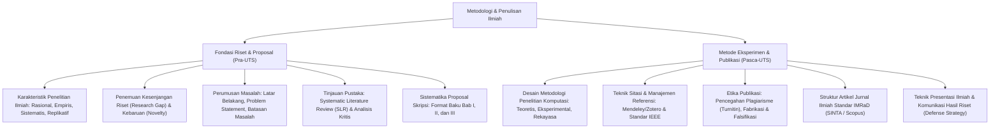

# Rangkuman Materi: Metodologi dan Penulisan Ilmiah (PAIK6701 / MIK1624701)

> **Bobot:** 2 SKS | **Semester:** 7 (Kurikulum 2020 / Kurikulum 2024) | **Fokus Utama:** Filsafat Ilmu & Metode Penelitian Komputasi, Identifikasi Kesenjangan Riset (*Research Gap*), Perumusan Masalah & Hipotesis, Sistematika Penulisan Proposal Skripsi (Bab I, II, III), Tinjauan Pustaka Sistematis (*Systematic Literature Review - SLR*), Standar Sitasi & Bibliografi (IEEE Style), Integritas Akademik & Anti-Plagiarisme, serta Penyusunan Artikel Publikasi Ilmiah

---

## 1. Gambaran Besar Mata Kuliah (*Grand View*)
Mata kuliah **Metodologi dan Penulisan Ilmiah (MPI)** merupakan jembatan akademis krusial yang mengantarkan mahasiswa tingkat akhir dari pembelajaran berbasis materi kuliah menuju kemampuan melakukan **penelitian ilmiah mandiri (*Independent Scientific Research*)** dalam rangka penyelesaian Tugas Akhir (Skripsi).

Mahasiswa dibimbing untuk berpikir kritis dan metodologis: bagaimana menemukan kebaruan ilmiah (*novelty*) dari literatur jurnal bereputasi (IEEE, ACM, ScienceDirect, Springer), merumuskan pertanyaan penelitian yang tajam, memilih metode eksperimen atau komputasi yang tepat untuk menjawab hipotesis, menyusun instrumen pengujian yang valid, serta mengomunikasikan temuan riset dalam bentuk naskah proposal skripsi dan artikel jurnal ilmiah yang bebas dari cacat fabrikasi, falsifikasi, dan plagiarisme.

> [!NOTE]
> **Catatan Integritas Arsip:** Pada Google Drive DMW HMIF Undip, folder materi slide mata kuliah ini kosong ($0$ berkas slide), namun memuat $8$ berkas bank soal ujian resmi tahun 2023–2026. Rangkuman ini dikonsolidasikan secara komprehensif mengacu pada Panduan Penulisan Skripsi Departemen Informatika Undip dan standar penulisan ilmiah internasional IEEE.

---

## 2. Peta Silabus & Konsep Inti Perkuliahan

### A. Bagian Pra-UTS (Fondasi Riset, Perumusan Masalah & Tinjauan Pustaka)

#### 1. Karakteristik Penelitian Ilmiah Bidang Informatika
Penelitian ilmiah di bidang ilmu komputer dan informatika diklasifikasikan ke dalam 3 paradigma:
1. **Penelitian Teoretis / Formal:** Berakar pada matematika diskrit dan logika (contoh: membuktikan batas kompleksitas algoritma baru, membuktikan formal verifikasi protokol kriptografi).
2. **Penelitian Eksperimental / Empiris:** Berakar pada sains alami (contoh: mengevaluasi akurasi dan waktu inferensi model deep learning baru dibandingkan model baseline pada dataset benchmark).
3. **Penelitian Rekayasa / *Design Science Research (DSR)*:** Mengembangkan artefak komputasi baru (arsitektur sistem, protokol jaringan, perangkat lunak) untuk memecahkan masalah praktis yang spesifik, diikuti dengan evaluasi kinerja empiris yang ketat.

#### 2. Menemukan Masalah Penelitian & Kesenjangan Riset (*Research Gap*)
* **Masalah Ilmiah vs Masalah Bisnis/Teknis:**
  * *Bukan Masalah Riset:* "Toko X belum memiliki website e-commerce, sehingga perlu dibuatkan website berbasis Laravel." (Ini adalah proyek implementasi kerja teknis rekayasa, bukan penelitian skripsi).
  * *Masalah Riset yang Sah:* "Algoritma rekomendasi produk collaborative filtering pada e-commerce mengalami penurunan akurasi drastis (*Cold-Start Problem*) ketika ada pengguna atau produk baru yang belum memiliki riwayat rating."
* **Empat Jenis Kesenjangan Riset (*Research Gaps*):**
  1. *Contradictory Evidence Gap:* Temuan penelitian sebelumnya saling bertentangan mengenai performa suatu algoritma.
  2. *Methodological Gap:* Metode yang ada memiliki kelemahan komputasi (misal terlalu lambat atau rawan overfitting) dan membutuhkan modifikasi/hibridisasi algoritma baru.
  3. *Knowledge Gap:* Kurangnya pemahaman mendalam tentang perilaku fenomena komputasi pada kondisi tertentu.
  4. *Application Gap:* Menguji efektivitas algoritma mutakhir pada domain spesifik baru yang belum pernah diteliti sebelumnya (misal: analisis sentimen teks bahasa daerah dengan dialek khusus).

#### 3. Tinjauan Pustaka Sistematis (*Systematic Literature Review - SLR*)
* Metode mengidentifikasi, mengevaluasi, dan menginterpretasikan semua bukti penelitian yang relevan terhadap pertanyaan penelitian tertentu dengan cara yang transparan dan dapat direplikasi (*replicable*).
* Tahapan SLR (Kitchenham Protocol):
  1. Menentukan *Research Questions (RQ)*.
  2. Menentukan kata kunci string pencarian (*Search String* dengan operator Boolean `AND / OR`).
  3. Menentukan basis data jurnal akademik tepercaya (IEEE Xplore, ACM Digital Library, Scopus, ScienceDirect, Google Scholar).
  4. Menerapkan Kriteria Inklusi dan Eksklusi (*Inclusion/Exclusion Criteria*).
  5. Ekstraksi data dan sintesis hasil perbandingan matriks komparasi penelitian terdahulu.

---

### B. Bagian Pasca-UTS (Metodologi Eksperimen, Etika Publikasi & IMRaD)

#### 1. Desain Eksperimen Komputasi & Metrik Evaluasi
* **Variabel Penelitian:**
  * *Variabel Bebas (Independent Variable):* Faktor yang dimanipulasi atau diuji oleh peneliti (misal: arsitektur algoritma, ukuran epoch, nilai learning rate).
  * *Variabel Terikat (Dependent Variable):* Respons atau keluaran yang diukur untuk melihat dampak variabel bebas (misal: akurasi model, latensi inferensi, penggunaan memori RAM).
  * *Variabel Kontrol:* Faktor yang dijaga tetap konstan agar tidak mengaburkan hasil eksperimen (misal: dataset benchmark yang sama, spesifikasi hardware CPU/GPU yang identik).
* **Baseline Comparison:** Wajib membandingkan algoritma yang diusulkan (*proposed method*) dengan model patokan standar industri (*baseline / state-of-the-art method*) pada dataset yang tepat sama untuk membuktikan keunggulan klaim kebaruan (*novelty*).

#### 2. Integritas Akademik & Pencegahan Pelanggaran Etika Riset
Tiga Dosa Besar Pelanggaran Ilmiah (*Scientific Misconduct - FFP*):
1. **Fabrication (Fabrikasi):** Mengarang atau menciptakan data/hasil eksperimen palsu yang sebenarnya tidak pernah dilakukan.
2. **Falsification (Falsifikasi):** Memanipulasi bahan penelitian, peralatan proses, atau mengubah/menghilangkan data secara selektif agar grafik hasil tampak mendukung hipotesis peneliti.
3. **Plagiarism (Plagiarisme):** Mengambil ide, kata-kata, kode program, atau data milik orang lain tanpa mencantumkan sitasi sumber aslinya secara patut.
* *Ambang Batas Plagiarisme di Undip:* Pengecekan kemiripan dokumen proposal dan skripsi wajib melalui perangkat lunak pemeriksa kemiripan (**Turnitin**) dengan ambang batas kesamaan (*Similarity Index*) **maksimal $20\%$**.

#### 3. Struktur Artikel Publikasi Jurnal Standar IMRaD
Format penulisan artikel ilmiah standar internasional:
* **I - Introduction:** Latar belakang masalah, kesenjangan riset, kelemahan metode terdahulu, dan tujuan kebaruan (*novelty/contribution statement*).
* **M - Method:** Deskripsi formal dataset, prapemrosesan data, arsitektur algoritma yang diusulkan, parameter eksperimen, dan metrik evaluasi.
* **R - Results:** Penyajian data empiris dalam bentuk tabel komparasi numerik dan grafik visual hasil uji coba.
* **a - and**
* **D - Discussion:** Interpretasi kritis mengapa metode yang diusulkan lebih unggul/gagal, analisis kondisi kesalahan (*error analysis*), keterbatasan penelitian, dan implikasi teoretis/praktis.
* **Standar Sitasi IEEE:** Menggunakan penomoran angka berurutan di dalam tanda kurung siku (misal: `[1]`, `[2]-[4]`) yang diurutkan berdasarkan urutan kemunculan kutipan di dalam teks artikel.
