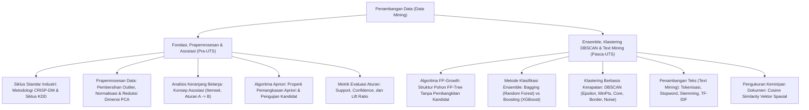

# Rangkuman Materi: Penambangan Data / Data Mining (PAIK6702 / MIK1624702)

> **Bobot:** 3 SKS | **Semester:** 7 (Kurikulum 2020 / Kurikulum 2024) | **Metodologi Acuan:** *KDD (Knowledge Discovery in Databases) & CRISP-DM Framework* | **Fokus Utama:** Siklus Hidup Data Mining (CRISP-DM 6 Fase), Prapemrosesan Data Lanjut (Data Cleaning, Imputasi, Normalisasi, Reduksi Dimensi PCA), Aturan Asosiasi (*Association Rule Mining: Algoritma Apriori, FP-Growth, Support, Confidence, Lift Ratio*), Klasifikasi Lanjut & Ensemble (*Bagging, Random Forest, Gradient Boosting, XGBoost*), Klastering Berbasis Kerapatan (*DBSCAN*), serta Penambangan Teks (*Text Mining & Pembobotan TF-IDF*)

---

## 1. Gambaran Besar Mata Kuliah (*Grand View*)
Mata kuliah **Penambangan Data (*Data Mining*)** mempelajari proses komputasi untuk menemukan pola (*patterns*), tren, anomali, dan pengetahuan baru yang bermakna, valid, dan dapat ditindaklanjuti (*actionable knowledge*) dari kumpulan data berskala masif (*Big Data*) yang tersimpan dalam basis data relasional, data warehouse, atau aliran data transaksi.

Data Mining memadukan teknik dari berbagai disiplin ilmu: statistika multivariat, kecerdasan buatan, pembelajaran mesin, dan sistem manajemen basis data. Mahasiswa mempelajari alur kerja terstruktur standar industri **CRISP-DM**, mengekstraksi asosiasi belanja konsumen (*Market Basket Analysis*), membangun model prediksi *ensemble* yang tangguh, mengelompokkan data tanpa pengawasan dengan bentuk geometri sembarang, serta mengolah data teks tidak terstruktur menjadi representasi vektor numerik.

> [!NOTE]
> **Catatan Integritas Arsip:** Pada Google Drive DMW HMIF Undip, folder materi slide mata kuliah ini kosong ($0$ berkas slide), namun memuat $5$ berkas bank soal ujian resmi tahun 2017–2023. Rangkuman ini dikonsolidasikan secara komprehensif mengacu pada silabus resmi Departemen Informatika Undip dan buku teks standar dunia *Data Mining: Concepts and Techniques* (Jiawei Han, Micheline Kamber, & Jian Pei).

---

## 2. Peta Silabus & Konsep Inti Perkuliahan

### A. Bagian Pra-UTS (Siklus CRISP-DM, Prapemrosesan & Aturan Asosiasi Apriori)

#### 1. Metodologi Standar Industri: CRISP-DM
Proses penambangan data diorganisasikan ke dalam 6 fase siklus iteratif **CRISP-DM (*Cross-Industry Standard Process for Data Mining*)**:
1. **Business Understanding:** Memahami tujuan bisnis dan kebutuhan proyek dari perspektif bisnis, lalu mentransformasikannya menjadi definisi masalah data mining dan rencana proyek awal.
2. **Data Understanding:** Mengumpulkan data mentah, melakukan analisis eksploratif (*Exploratory Data Analysis - EDA*), memeriksa kualitas data, dan mengidentifikasi potensi anomali.
3. **Data Preparation:** Fase yang menyerap waktu terbanyak ($70\%-80\%$ total waktu proyek). Melakukan pemilihan tabel/atribut, pembersihan data (*data cleaning*), penanganan nilai hilang (*missing values*), rekayasa fitur (*feature engineering*), dan transformasi data.
4. **Modeling:** Memilih dan menerapkan berbagai teknik pemodelan data mining (klasifikasi, klastering, asosiasi) serta menyetel parameter optimalnya.
5. **Evaluation:** Mengevaluasi kinerja model secara menyeluruh terhadap tujuan bisnis awal yang ditetapkan pada fase 1 sebelum model diimplementasikan.
6. **Deployment:** Mengintegrasikan model ke dalam sistem produksi organisasi (API, dashboard interaktif) dan menyusun rencana pemeliharaan berkala.

#### 2. Prapemrosesan Data (*Data Preprocessing*)
* **Penanganan Missing Values:** Menghapus baris/kolom jika persentase hilang $> 50\%$; atau melakukan imputasi statistik: Mean/Median untuk data numerik, Modus untuk data kategoris, atau imputasi berbasis k-NN / MICE.
* **Transformasi & Normalisasi:**
  * Min-Max Normalization: $x' = \frac{x - x_{\min}}{x_{\max} - x_{\min}} (new_{\max} - new_{\min}) + new_{\min}$
  * Z-Score Standardization: $x' = \frac{x - \mu}{\sigma}$ (bebas skala, berpusat pada rata-rata $0$).
* **Reduksi Dimensi (PCA - Principal Component Analysis):**
  Mentransformasikan sekumpulan variabel yang saling berkorelasi menjadi sekumpulan variabel baru yang saling bebas linier (*ortogonal*) yang disebut sebagai **Principal Components (PC)** melalui dekomposisi nilai eigen (*Eigenvalue Decomposition*) dari matriks kovarians data, mempertahankan variansi data maksimum dengan dimensi fitur minimal.

#### 3. Penambangan Aturan Asosiasi (*Association Rule Mining*)
Menemukan korelasi menarik antar-item dalam basis data transaksi besar (*Market Basket Analysis*). Aturan dinyatakan dalam bentuk implikasi:
$$X \implies Y \quad (\text{di mana } X, Y \subset I \text{ dan } X \cap Y = \emptyset)$$
* **Tiga Parameter Metrik Evaluasi Aturan:**
  1. **Support ($s$):** Probabilitas transaksi yang memuat kedua himpunan item $X$ dan $Y$ sekaligus terhadap total seluruh transaksi $N$:
     $$\text{Support}(X \implies Y) = P(X \cup Y) = \frac{\text{Jumlah Transaksi Memuat } (X \text{ dan } Y)}{N}$$
  2. **Confidence ($c$):** Tingkat kepastian / probabilitas bersyarat bahwa transaksi memuat $Y$ dengan diketahui transaksi tersebut telah memuat $X$:
     $$\text{Confidence}(X \implies Y) = P(Y \mid X) = \frac{\text{Support}(X \cup Y)}{\text{Support}(X)}$$
  3. **Lift Ratio:** Mengukur kekuatan ketergantungan aturan dibandingkan jika $X$ dan $Y$ terjadi secara independen:
     $$\text{Lift}(X \implies Y) = \frac{\text{Confidence}(X \implies Y)}{\text{Support}(Y)} = \frac{P(X \cup Y)}{P(X) \times P(Y)}$$
     * $\text{Lift} = 1 \implies X$ dan $Y$ saling bebas/independen (tidak ada hubungan asosiasi).
     * $\text{Lift} > 1 \implies$ **Korelasi Positif** (pembelian $X$ meningkatkan kecenderungan pembelian $Y$).
     * $\text{Lift} < 1 \implies$ Korelasi Negatif (pembelian $X$ menurunkan probabilitas pembelian $Y$).
* **Algoritma Apriori:**
  * **Properti Apriori (*Downward-Closure Property*):** Semua subset non-kosong dari sebuah *frequent itemset* pasti juga merupakan *frequent itemset*.
  * Konsekuensi logis pemangkasan: Jika suatu himpunan item berukuran $k$ tidak memenuhi ambang batas *minimum support* (*infrequent*), maka **seluruh superset-nya pada ukuran $k+1$ otomatis tidak sering dan langsung dipangkas tanpa perlu dihitung di database**.

---

### B. Bagian Pasca-UTS (FP-Growth, Ensemble, DBSCAN & Text Mining)

#### 1. Algoritma FP-Growth (*Frequent Pattern Growth*)
* Mengatasi kelemahan fatal Algoritma Apriori yang lambat karena harus memindai (*scan*) basis data berulang-ulang dan membangkitkan kombinasi kandidat yang sangat banyak.
* FP-Growth hanya memindai basis data tepat **dua kali**:
  1. Scan 1: Menghitung frekuensi item tunggal dan mengurutkan secara menurun (*F-List*).
  2. Scan 2: Memampatkan seluruh transaksi basis data ke dalam struktur pohon terkompresi yang kompak bernama **FP-Tree (*Frequent Pattern Tree*)**.
* Menambang *frequent itemsets* langsung dari FP-Tree secara rekursif menggunakan pendekatan *divide-and-conquer* berbasis **Conditional Pattern Base** dan **Conditional FP-Tree** tanpa pernah menghasilkan calon kandidat satupun.

#### 2. Klastering Berbasis Kerapatan: DBSCAN
* Berbeda dari K-Means yang memaksakan bentuk klaster bulat cembung (*spherical*) dan mewajibkan penentuan jumlah $K$ di awal, **DBSCAN (*Density-Based Spatial Clustering of Applications with Noise*)** mampu menemukan klaster dengan **bentuk geometri sembarang** dan secara otomatis memisahkan data derau (*noise/outlier*).
* Dua Parameter Kunci:
  * $\epsilon$ (Epsilon): Jarak radius ketetanggaan di sekitar suatu titik data.
  * $MinPts$: Jumlah titik data minimum yang harus berada di dalam radius $\epsilon$.
* Tiga Klasifikasi Titik dalam DBSCAN:
  1. **Core Point:** Titik yang memiliki minimal $MinPts$ tetangga di dalam radius $\epsilon$ (termasuk dirinya sendiri).
  2. **Border Point:** Titik yang berada di dalam radius $\epsilon$ dari suatu Core Point, namun dirinya sendiri memiliki tetangga kurang dari $MinPts$.
  3. **Noise / Outlier:** Titik yang bukan Core Point dan bukan Border Point (terisolasi di luar kerapatan).

#### 3. Penambangan Teks (*Text Mining & TF-IDF*)
* Mengubah dokumen teks bebas tak terstruktur (*unstructured text*) menjadi representasi matriks numerik terstruktur (*Vector Space Model*).
* **Tahapan Prapemrosesan Teks (*Text Preprocessing Pipeline*):**
  1. *Case Folding:* Mengonversi semua huruf menjadi huruf kecil (*lowercase*).
  2. *Tokenizing:* Memecah deretan kalimat menjadi token kata-kata individual.
  3. *Filtering / Stopword Removal:* Membuang kata-kata umum yang tidak memiliki makna diskriminatif (e.g., "dan", "yang", "di", "dari", "ke").
  4. *Stemming:* Mengembalikan kata berimbuhan ke bentuk kata dasarnya (menggunakan Algoritma Nazief-Adriani untuk Bahasa Indonesia atau Porter Stemmer untuk Bahasa Inggris).
* **Pembobotan Kata TF-IDF (*Term Frequency - Inverse Document Frequency*):**
  $$\text{TF-IDF}(t, d, D) = \text{TF}(t, d) \times \log_{10}\left(\frac{|D|}{\text{DF}(t)}\right)$$
  * $\text{TF}(t, d)$: Frekuensi kemunculan kata $t$ di dalam dokumen spesifik $d$.
  * $\text{IDF}(t) = \log_{10}(|D| / \text{DF}(t))$: Mengukur seberapa langka atau informatif kata tersebut di seluruh korpus koleksi dokumen $D$. Kata yang muncul di hampir semua dokumen akan memiliki bobot IDF mendekati nol.
