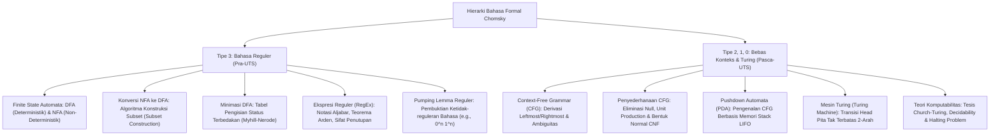

# Rangkuman Materi: Teori Bahasa dan Otomata (PAIK6703 / MIK1624703)

> **Bobot:** 3 SKS | **Semester:** 7 (Kurikulum 2020 / Kurikulum 2024) | **Fokus Utama:** Hierarki Tata Bahasa Chomsky (Tipe 0–3), Finite State Automata (DFA, NFA, $\epsilon$-NFA, Subset Construction, Minimasi Status Myhill-Nerode), Ekspresi Reguler (RegEx & Teorema Arden), Pumping Lemma Bahasa Reguler, Context-Free Grammar (CFG, Derivasi, Ambiguitas, Bentuk Normal CNF), Pushdown Automata (PDA Berbasis Stack), Mesin Turing (Turing Machine Transisi Pita), serta Teori Komputabilitas (*Halting Problem & Undecidability*)

---

## 1. Gambaran Besar Mata Kuliah (*Grand View*)
Mata kuliah **Teori Bahasa dan Otomata (TBO)** merupakan pilar fondasi ilmu komputasi teoretis murni (*Theoretical Computer Science*) yang mengkaji model-model abstrak mesin matematika (*automata*) dan kemampuan formalnya dalam mengenali berbagai kelas bahasa formal (*formal languages*).

Mata kuliah ini menjawab pertanyaan paling mendasar dalam ilmu komputer:
> *"Apa saja kelas masalah yang secara komputasi DAPAT dipecahkan oleh komputer (*computable / decidable*), dan apa saja batasan batas batas masalah yang secara matematis TIDAK AKAN PERNAH DAPAT dipecahkan oleh komputer manapun (*undecidable*)?"*

Materi berpusat pada **Hierarki Tata Bahasa Chomsky**, yang memetakan spektrum automata mulai dari mesin memori terbatas terkecil (*Finite State Automata* sebagai fondasi Lexical Analyzer kompiler dan Regex), mesin memori tumpukan (*Pushdown Automata* sebagai fondasi Parser sintaksis bahasa pemrograman), hingga model komputer universal paling kuat (**Mesin Turing**).

---

## 2. Peta Silabus & Konsep Inti Perkuliahan

### A. Bagian Pra-UTS (FSA, DFA/NFA, Ekivalensi, Minimasi & Bahasa Reguler)

#### 1. Definisi Formal Finite Automata & DFA
* **Deterministic Finite Automata (DFA):** Mesin abstrak status berhingga di mana untuk setiap status (*state*) dan setiap simbol masukan alfabet, terdapat **tepat satu transisi status berikutnya yang pasti**.
* Didefinisikan secara matematis melalui **5-Tuple**:
  $$M = (Q, \Sigma, \delta, q_0, F)$$
  1. $Q$: Himpunan berhingga status (*states*).
  2. $\Sigma$: Himpunan berhingga simbol alfabet masukan (*input alphabet*).
  3. $\delta$: Fungsi transisi deterministik: $\delta: Q \times \Sigma \to Q$.
  4. $q_0$: Status awal (*start/initial state*), di mana $q_0 \in Q$.
  5. $F$: Himpunan status akhir yang menerima (*accepting/final states*), $F \subseteq Q$.

#### 2. Non-Deterministic Finite Automata (NFA) & Konversi ke DFA
* **NFA:** Mengizinkan satu status memiliki **nol, satu, atau lebih dari satu transisi berikutnya** untuk simbol masukan yang sama ($\delta: Q \times \Sigma \to 2^Q$), serta transisi spontan tanpa membaca simbol masukan ($\epsilon$-NFA via $\epsilon$-closure).
* **Teorema Ekivalensi Daya:** Setiap NFA dapat dikonversi menjadi DFA yang menerima bahasa yang tepat sama (*Equivalence of NFA and DFA*).
* **Algoritma Konstruksi Subset (*Subset Construction Algorithm*):**
  * Status awal DFA adalah himpunan status awal NFA: $Q_0' = \epsilon\text{-closure}(q_0)$.
  * Setiap status baru pada DFA merepresentasikan **himpunan bagian (*subset*)** dari status-status pada NFA: $Q' \subseteq \mathcal{P}(Q)$.
  * Sebuah status DFA bertindak sebagai status penerima (*final state*) jika memuat minimal satu status penerima dari NFA asli.
  * Jika NFA memiliki $|Q| = n$ status, maka DFA hasil konversi memiliki maksimal $2^n$ status.

#### 3. Minimasi DFA (*DFA Minimization via Myhill-Nerode*)
* Menghasilkan DFA dengan jumlah status seminimal mungkin yang ekuivalen:
  1. Hapus semua status yang tidak dapat dicapai (*unreachable states*) dari status awal $q_0$.
  2. Buat tabel partisi pasangan status $(p, q)$ untuk menguji apakah status tersebut **terbedakan (*distinguishable*)** atau **ekuivalen (*indistinguishable*)**:
     * Status $p \in F$ dan $q \notin F$ otomatis terbedakan secara trivial (tandai $\mathbf{X}$).
     * Pasangan $(p, q)$ terbedakan jika untuk suatu simbol $a \in \Sigma$, pasangan transisi $(\delta(p, a), \delta(q, a))$ telah terbukti terbedakan.
  3. Gabungkan (*merge*) status-status yang tidak terbedakan menjadi satu status tunggal.

#### 4. Pumping Lemma untuk Bahasa Reguler
Digunakan untuk **membuktikan secara kontradiksi bahwa suatu bahasa TIDAK REGULER**:
* *Teorema:* Jika $L$ adalah bahasa reguler, maka terdapat konstanta panjang pemompaan $p \ge 1$ sedemikian rupa sehingga setiap string $w \in L$ dengan panjang $|w| \ge p$ dapat dipecah menjadi tiga bagian:
  $$w = xyz$$
  yang memenuhi tiga kondisi mutlak:
  1. $|y| \ge 1$ (bagian $y$ tidak boleh kosong)
  2. $|xy| \le p$ (bagian pemompaan berada di awal string)
  3. Untuk semua integer $i \ge 0$, berlaku: $xy^i z \in L$ (*dapat dipompa berulang kali tanpa keluar dari bahasa $L$*).
* *Aplikasi Klasik:* Membuktikan $L = \{0^n 1^n \mid n \ge 0\}$ bukan bahasa reguler (karena FSA tidak memiliki memori untuk menghitung jumlah $0$ agar seimbang dengan $1$).

---

### B. Bagian Pasca-UTS (CFG, Pushdown Automata, Mesin Turing & Komputabilitas)

#### 1. Context-Free Grammar (CFG) & Ambiguitas
* Didefinisikan melalui **4-Tuple**: $G = (V, T, P, S)$ di mana $V$ adalah variabel non-terminal, $T$ adalah simbol terminal, $P$ adalah aturan produksi berbentuk $A \to \alpha$ ($A \in V$), dan $S$ adalah simbol awal.
* **Ambiguitas Tata Bahasa (*Ambiguity*):** Suatu CFG dikatakan ambigu jika terdapat minimal satu string masukan yang memiliki **lebih dari satu pohon parse (*parse tree*) yang berbeda**, atau memiliki lebih dari satu derivasi paling kiri (*leftmost derivation*) yang berbeda. Dalam perancangan bahasa pemrograman, ambiguitas harus dihilangkan agar eksekusi kode deterministik.
* **Bentuk Normal Chomsky (Chomsky Normal Form - CNF):**
  Setiap aturan produksi pada CNF dibatasi hanya boleh memiliki salah satu dari dua bentuk:
  $$A \to BC \quad \text{atau} \quad A \to a$$
  (tepat menghasilkan 2 non-terminal atau tepat 1 terminal). Diperlukan untuk algoritma parsing efisien CYK (*Cocke-Younger-Kasami* $O(n^3)$).

#### 2. Pushdown Automata (PDA)
* Mesin penerima bahasa bebas konteks (*Context-Free Languages*) yang memperluas FSA dengan menambahkan **satu memori tumpukan eksternal (*Stack: LIFO*)** dengan kapasitas tak terbatas.
* Operasi Stack: *Push* (memasukkan simbol) dan *Pop* (mengeluarkan simbol teratas).
* Didefinisikan melalui **7-Tuple**:
  $$M = (Q, \Sigma, \Gamma, \delta, q_0, Z_0, F)$$
  ($\Gamma$ = alfabet simbol stack, $Z_0$ = simbol penanda dasar stack awal).
* Fungsi Transisi: $\delta(q, a, X) = (p, \gamma)$ (berpindah ke status $p$ dan mengganti simbol puncak stack $X$ dengan string $\gamma$).

#### 3. Mesin Turing (*Turing Machine*) & Batas Komputabilitas
* Model teoretis komputer modern yang paling umum dan kuat, diperkenalkan oleh Alan Turing (1936).
* Komponen Fisik:
  * Pita memori (*Tape*) satu dimensi yang dibagi menjadi sel-sel berhingga ke kiri dan tak terbatas ke kanan, berisi simbol alfabet pita $\Gamma$ atau simbol kosong (*Blank $B$*).
  * Kepala Baca/Tulis (*Read/Write Head*) yang dapat membaca simbol sel, menimpa simbol baru, dan bergeser satu langkah ke kiri ($L$) atau ke kanan ($R$).
* Didefinisikan melalui **7-Tuple**:
  $$M = (Q, \Sigma, \Gamma, \delta, q_0, B, F)$$
  Fungsi transisi: $\delta: Q \times \Gamma \to Q \times \Gamma \times \{L, R\}$.
* **Tesis Church-Turing:** Setiap fungsi matematika atau algoritma komputasi yang dapat dihitung oleh komputer fisik modern apapun di alam semesta, **pasti dapat dihitung oleh sebuah Mesin Turing standar**.
* **Masalah Keberhentian (*The Halting Problem*):**
  Alan Turing secara matematis membuktikan bahwa secara fundamental **TIDAK ADA ALGORITMA UNIVERSAL YANG MAMPU MEMPREDIKSI APAKAH SEBUAH PROGRAM KOMPUTER SEMBARANG AKAN BERHENTI ATAU TERJEBAK DALAM LOOP TAK BERHINGGA (*INFINITE LOOP*)**. Masalah Halting Problem terbukti bersifat **Undecidable (Tidak Terputuskan)**.
