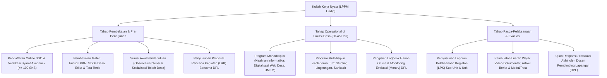

# Panduan & Rangkuman Materi: Kuliah Kerja Nyata (UNW00008 / MIK1624801)

> **Bobot:** 3 SKS | **Semester:** 8 (Mata Kuliah Wajib Universitas / LPPM Universitas Diponegoro) | **Metode:** *Community Service Learning / Pengabdian Masyarakat Multidisipliner (30–45 Hari)* | **Fokus Utama:** Filosofi & Prinsip Dasar KKN Tematik / Reguler, Peran Mahasiswa Informatika dalam Transformasi Digital Desa, Metodologi *Participatory Rural Appraisal (PRA)*, Program Kerja Monodisiplin & Multidisiplin, Sistematika Penyusunan Laporan Akhir KKN Undip, serta Evaluasi Luaran & Ujian Responsi DPL

---

## 1. Gambaran Besar Mata Kuliah (*Grand View*)
Mata kuliah **Kuliah Kerja Nyata (KKN)** merupakan pengejawantahan pilar ketiga Tri Dharma Perguruan Tinggi, yaitu **Pengabdian kepada Masyarakat**. Mahasiswa dari berbagai disiplin ilmu diterjunkan langsung ke masyarakat desa/kelurahan selama kurun waktu 30 hingga 45 hari untuk belajar bersama masyarakat (*learning with community*), mengidentifikasi potensi dan permasalahan lokal, serta memberikan solusi inovatif berbasis kepakaran akademis.

Bagi mahasiswa S1 Informatika, KKN menjadi ajang penerapan ilmu komputasi dan teknologi informasi secara langsung untuk memecahkan kesenjangan digital (*digital divide*): digitalisasi tata kelola administrasi desa (*Smart Village / E-Government*), pemberdayaan ekonomi digital UMKM pedesaan, pemetaan potensi wilayah berbasis WebGIS, edukasi keamanan data pribadi dan pencegahan penipuan online (*cyber safety*), serta peningkatan literasi teknologi bagi generasi muda desa.

> [!NOTE]
> **Catatan Integritas Arsip:** Pada Google Drive DMW HMIF Undip, mata kuliah ini tidak memiliki berkas slide materi perkuliahan kelas ($0$ berkas) maupun bank soal tertulis ($0$ berkas) karena KKN diselenggarakan secara terpusat oleh Lembaga Penelitian dan Pengabdian kepada Masyarakat (**LPPM Undip**). Dokumen ini merangkum secara utuh **Buku Pedoman Resmi Pelaksanaan KKN Tim I & Tim II Universitas Diponegoro**.

---

## 2. Alur Pelaksanaan & Kontribusi Bidang Informatika

### A. Alur Prosedur Pelaksanaan KKN Undip
1. **Persyaratan Akademik & Administrasi:**
   * Mahasiswa aktif yang telah menempuh minimal **$100$ SKS** dengan IPK minimal $2.00$.
   * Melakukan pendaftaran melalui portal resmi KKN LPPM Undip via akun Single Sign-On (SSO).
2. **Tahap Pembekalan (*Coaching*):**
   * Mengikuti rangkaian pembekalan umum tingkat universitas dan pembekalan khusus oleh Dosen Pembimbing Lapangan (DPL).
   * Materi mencakup: Filosofi pengabdian masyarakat, tujuan pembangunan berkelanjutan desa (*SDGs Desa*), protokol kesehatan, keselamatan kerja di lapangan, serta etika dan norma adat istiadat desa.
3. **Survei Pendahuluan & Penyusunan LRK:**
   * Tim mahasiswa melakukan survei lapangan (*field observation*) menggunakan metode *Participatory Rural Appraisal (PRA)* untuk mewawancarai Kepala Desa, perangkat desa, tokoh masyarakat, dan pelaku UMKM.
   * Menyusun dokumen **Lembar Rencana Kegiatan (LRK)** yang memuat minimal:
     * **2 Program Monodisiplin per mahasiswa** (program kerja individual sesuai keilmuan Informatika).
     * **1–2 Program Multidisiplin per kelompok sub-unit** (program kerja gabungan lintas fakultas).
4. **Pelaksanaan di Lapangan & Monev:**
   * Mahasiswa tinggal di pemukiman warga desa (*live-in*) selama 30–45 hari penuh.
   * DPL melakukan kunjungan Monitoring dan Evaluasi (Monev) berkala untuk menilai implementasi program dan relasi sosial mahasiswa dengan warga.

---

### B. Klaster Program Kerja Unggulan Mahasiswa Informatika
Mahasiswa S1 Informatika memiliki keunggulan kompetitif dalam menjalankan program-program monodisiplin bernilai tinggi bagi masyarakat pedesaan:
1. **Digitalisasi Administrasi & Pelayanan Publik Desa (*E-Government*):**
   * Perancangan dan aktivasi Website Resmi Profil Desa berbasis CMS ramah kelola (seperti OpenSID atau WordPress) untuk mempublikasikan transparansi anggaran APBDes, struktur perangkat desa, dan potensi pariwisata lokal.
   * Digitalisasi arsip kependudukan desa dari buku catatan manual menjadi database terstruktur.
2. **Pemberdayaan Ekonomi Digital UMKM Pedesaan:**
   * Pelatihan literasi digital bagi pelaku UMKM lokal: pendaftaran titik lokasi usaha di Google Maps / Google My Business, pembuatan foto katalog produk digital, dan pembuatan akun toko di marketplace online (Shopee/Tokopedia).
   * Pemanfaatan pembayaran digital non-tunai berbasis QRIS (Quick Response Code Indonesian Standard) untuk pedagang pasar desa.
3. **Pemetaan Spasial & Informasi Geografis (*WebGIS*):**
   * Pembuatan Peta Digital Tata Guna Lahan, peta persebaran fasilitas umum desa, atau peta kerawanan bencana alam berbasis *Quantum GIS (QGIS)* dan Google My Maps.
4. **Edukasi Keamanan Siber & Literasi Digital Warga:**
   * Sosialisasi pencegahan penipuan online (*social engineering*, phishing APK bodong di WhatsApp, pinjaman online ilegal, dan judi online) kepada kelompok PKK dan karang taruna.
   * Pelatihan komputer dasar (Microsoft Office, Google Docs) dan pengenalan internet sehat bagi siswa-siswi SD/SMP di desa.

---

### C. Standar Sistematika Laporan Akhir KKN (LPK)
Laporan Pelaksanaan Kegiatan (LPK) disusun pada akhir masa pengabdian:
* **Halaman Sampul & Pengesahan DPL**
* **Ringkasan Eksekutif (*Executive Summary*)**
* **BAB I: PENDAHULUAN**
  * Situasi umum lokasi KKN (geografis, demografis, ekonomi, dan sarana prasarana).
  * Masalah dan potensi prioritas yang teridentifikasi di desa.
* **BAB II: RENCANA PROGRAM KEGIATAN**
  * Uraian matriks LRK, target sasaran warga, volume waktu kerja, dan anggaran biaya.
* **BAB III: PELAKSANAAN PROGRAM DAN PEMBAHASAN**
  * Pembahasan pelaksanaan Program Monodisiplin per mahasiswa (latar belakang, metode pelatihan/implementasi, partisipasi warga, dokumentasi foto kegiatan).
  * Pembahasan pelaksanaan Program Multidisiplin tim.
  * Faktor pendukung dan penghambat selama di lapangan beserta solusinya.
* **BAB IV: KESIMPULAN DAN REKOMENDASI KEBERLANJUTAN**
  * Rekomendasi rencana tindak lanjut (*exit strategy*) agar teknologi atau sistem yang dibangun tetap dirawat dan dimanfaatkan oleh perangkat desa pasca-mahasiswa ditarik pulang.
* **Lampiran Wajib:**
  * Logbook aktivitas harian bertanda tangan Kepala Desa, matriks rekapitulasi jam kerja efektif mahasiswa (JKEM minimal 288 jam), poster infografis program, dan tautan video dokumenter YouTube luaran KKN.
