# Panduan & Rangkuman Materi: Tugas Akhir / Skripsi (MIK1624802 / UNW00009)

> **Bobot:** 6 SKS | **Semester:** 8 (Mata Kuliah Wajib Puncak Kelulusan Sarjana Komputer - S.Kom.) | **Departemen:** Informatika, Fakultas Sains dan Matematika, Universitas Diponegoro | **Fokus Utama:** Filosofi & Standar Mutu Skripsi S1 Informatika, Prosedur Bimbingan & Seminar Proposal (Sempro), Standar Bebas Plagiarisme Turnitin ($< 20\%$), Persyaratan Publikasi Ilmiah (Jurnal SINTA / Prosiding Internasional), Sistematika Baku Naskah Bab I s.d. Bab V Format IEEE, serta Rubrik Penilaian Sidang Pendadaran & Ujian Lisan Komprehensif

---

## 1. Gambaran Besar Mata Kuliah (*Grand View*)
Mata kuliah **Tugas Akhir (Skripsi)** merupakan mata kuliah kulminasi (puncak) yang menjadi syarat mutlak perolehan gelar **Sarjana Komputer (S.Kom.)** di Departemen Informatika Universitas Diponegoro. Melalui Tugas Akhir, mahasiswa membuktikan kapasitas ilmiah dan keterampilan rekayasa tingkat tinggi secara mandiri melalui penyelesaian masalah komputasi riil yang memiliki unsur kebaruan (*novelty*) atau kontribusi terapan (*practical contribution*).

Lingkup penelitian skripsi di Departemen Informatika Undip umumnya terbagi ke dalam 4 bidang peminatan utama:
1. **Rekayasa Perangkat Lunak & Sistem Cerdas:** Desain arsitektur modern, microservices, mobile/web enterprise, automated testing, dan integrasi algoritma cerdas.
2. **Kecerdasan Buatan & Sains Data (*AI & Data Science*):** *Machine Learning*, *Deep Learning*, *Computer Vision*, *Natural Language Processing (NLP)*, dan *Big Data Analytics*.
3. **Komputasi Berbasis Jaringan & Keamanan Informasi:** Keamanan siber (*Cybersecurity*), kriptografi, Internet of Things (IoT), komputasi awan (*Cloud Computing*), dan komputasi paralel.
4. **Komputasi Teori & Algoritma:** Optimasi kombinatorial, grafika komputasi, dan analisis efisiensi kompleksitas algoritma.

> [!NOTE]
> **Catatan Integritas Arsip:** Pada Google Drive DMW HMIF Undip, mata kuliah ini tidak memiliki slide materi perkuliahan kelas mingguan maupun lembar ujian tertulis konvensional ($0$ berkas) karena merupakan proyek riset mandiri terbimbing. Dokumen ini merangkum secara utuh **Buku Pedoman Penyusunan Tugas Akhir, Standar Operasional Prosedur (SOP) Sidang Skripsi, dan Rubrik Ujian Komprehensif Departemen Informatika FSM Undip**.

```mermaid
graph TD
    A["Tugas Akhir S1 Informatika (6 SKS)"] --> B["Tahap 1: Pra-Penelitian & Penetapan"]
    A --> C["Tahap 2: Seminar Proposal (Sempro)"]
    A --> D["Tahap 3: Riset, Bimbingan & Implementasi"]
    A --> E["Tahap 4: Pra-Sidang & Syarat Kelayakan"]
    A --> F["Tahap 5: Sidang Skripsi & Komprehensif"]

    B --> B1["Syarat: Lulus >= 120 SKS, Lulus Metopen & PKL, IPK >= 2.00"]
    B --> B2["Pengajuan Judul/Topik Riset via Departemen Informatika"]
    B --> B3["Penerbitan SK Penetapan Dosen Pembimbing 1 & Pembimbing 2"]

    C --> C1["Penyusunan Proposal Skripsi (Bab I, II, III & Mockup/Desain)"]
    C --> C2["Seminar Proposal Terbuka di Depan Tim Reviewer/Penguji"]
    C --> C3["Persetujuan & Revisi Catatan Sempro"]

    D --> D1["Pengumpulan Dataset / Analisis Kebutuhan Sistem"]
    D --> D2["Koding Implementasi / Pemodelan Algoritma Komputasi"]
    D --> D3["Pengujian (Testing Metrik, Validasi Pakar, Uji Akurasi/Kinerja)"]
    D --> D4["Bimbingan Minimal 8 Kali per Pembimbing (Logbook Resmi)"]

    E --> E1["Naskah Lengkap Bab I s.d. Bab V Format Baku FSM Undip"]
    E --> E2["Uji Turnitin Similiarity Index < 20% (Bebas Plagiasi)"]
    E --> E3["Syarat Publikasi Ilmiah: Paper Jurnal (SINTA) / Prosiding"]
    E --> E4["Persetujuan Majelis Pembimbing untuk Pendaftaran Sidang"]

    F --> F1["Presentasi Ilmiah (15 Menit) di Hadapan 4 Dosen Penguji"]
    F --> F2["Demonstrasi Langsung Sistem / Perangkat Lunak / Model AI"]
    F --> F3["Ujian Lisan Komprehensif (Oral Defense Teori Informatika)"]
    F --> F4["Yudisium Kelulusan Sarjana Komputer & Revisi Akhir"]
```

---

## 2. Alur Prosedur & Tahapan Penyusunan Tugas Akhir

### A. Persyaratan Akademik & Administrasi Awal
1. Terdaftar sebagai mahasiswa aktif pada semester berjalan.
2. Telah menyelesaikan minimal **$120$ SKS** mata kuliah dengan nilai D tidak melebihi persentase batas kelulusan universitas ($< 10\%$) dan tanpa nilai E.
3. Telah lulus mata kuliah prasyarat mutlak: **Metodologi dan Penulisan Ilmiah (Metopen)** dan **Praktik Kerja Lapangan (PKL)**.
4. Mengajukan draf tema penelitian ke Koordinator Tugas Akhir Departemen untuk diverifikasi kelayakan topik dan penetapan Dosen Pembimbing I (fokus substansi keilmuan) dan Dosen Pembimbing II (fokus teknis rekayasa/metodologi).

---

### B. Tahap Seminar Proposal (Sempro)
1. Mahasiswa menyusun Proposal Tugas Akhir yang memuat Bab I (Pendahuluan), Bab II (Tinjauan Pustaka & Landasan Teori), dan Bab III (Metodologi Penelitian).
2. Seminar Proposal diselenggarakan secara terjadwal di hadapan Majelis Dosen Reviewer dan mahasiswa peserta lain.
3. **Poin Kritis Kelayakan Sempro:**
   * *State-of-the-Art & Research Gap:* Apakah terdapat literatur penelitian 5 tahun terakhir dari jurnal bereputasi?
   * *Rumusan Masalah Komputasi:* Apakah masalah yang diajukan merupakan masalah keilmuan informatika yang jelas, terukur, dan memiliki solusi komputasional?
   * *Kelayakan Metodologi & Sumber Data:* Apakah data/dataset tersedia, legal, dan representatif? Apakah metrik pengujian didefinisikan secara matematis?

---

### C. Tahap Pelaksanaan Riset & Bimbingan Terstruktur
1. Proses bimbingan dilakukan secara berkala dan terdokumentasi dalam kartu bimbingan fisik maupun sistem informasi akademik online.
2. Setiap mahasiswa wajib memenuhi batas minimal bimbingan formal, yaitu **minimal $8$ kali pertemuan bimbingan** dengan Pembimbing I dan Pembimbing II.
3. Mahasiswa wajib menjaga integritas kode sumber (*source code integrity*), menyimpan riwayat versi menggunakan Git, serta mendokumentasikan logbook eksperimen (hiperparameter model, confusion matrix, execution time).

---

### D. Tahap Pra-Sidang & Verifikasi Kelayakan Bebas Plagiarisme
Sebelum menjadwalkan Sidang Tugas Akhir, mahasiswa wajib menyelesaikan gerbang verifikasi (*clearance gates*):
1. **Pemeriksaan Similiarity Index Turnitin:**
   * Seluruh naskah skripsi diunggah ke akun resmi Turnitin Departemen/Fakultas.
   * Tingkat kemiripan (*similarity index*) **wajib di bawah $20\%$** (tidak termasuk daftar pustaka dan kutipan langsung yang diapit tanda petik).
2. **Kewajiban Publikasi Artikel Ilmiah:**
   * Mahasiswa menyusun draf manuskrip artikel ilmiah ($6$–$10$ halaman) berdasarkan hasil skripsi.
   * Menyerahkan bukti submit/accepted pada jurnal ilmiah nasional terakreditasi minimal SINTA ($3$/$4$/$5$) atau prosiding seminar internasional terindeks Scopus/IEEE Xplore, atau publikasi pada Jurnal Ilmiah Komputasi Departemen.
3. **Persetujuan Sidang (*Acc Sidang*):**
   * Formulir persetujuan ditandatangani oleh Dosen Pembimbing I dan Dosen Pembimbing II setelah seluruh draft naskah Bab I s.d. Bab V disetujui.

---

## 3. Sistematika Baku Naskah Skripsi Departemen Informatika Undip

Naskah Skripsi ditulis mengikuti kaidah Bahasa Indonesia baku ilmiah (Pedoman Umum Ejaan Bahasa Indonesia / PUEBI) dengan format sitasi standar internasional **IEEE Citation Style**:

### Bagian Awal (*Preliminary Pages*):
* **Halaman Judul (Bahasa Indonesia & Bahasa Inggris)**
* **Halaman Persetujuan Ujian Skripsi**
* **Halaman Pengesahan Kelulusan Majelis Penguji**
* **Halaman Pernyataan Bebas Plagiarisme bermaterai Rp 10.000,-**
* **Abstrak (Bahasa Indonesia)** & **Abstract (Bahasa Inggris):** Maksimal 250 kata, mencakup latar belakang ringkas, tujuan spesifik, metodologi utama, temuan eksperimen kuantitatif, dan kesimpulan. Dilengkapi $3$–$5$ kata kunci (*keywords*).
* **Kata Pengantar, Daftar Isi, Daftar Tabel, Daftar Gambar, Daftar Lampiran, dan Glosarium Singkatan.**

---

### Bagian Tubuh Utama (*Main Body*):

#### BAB I: PENDAHULUAN
* **1.1 Latar Belakang Masalah:** Mendedahkan urgensi masalah dari ranah makro ke mikro (*funnel approach*), didukung fakta empiris, statistik data, dan celah penelitian (*research gap*) dari literatur terbaru.
* **1.2 Rumusan Masalah:** Pertanyaan penelitian spesifik yang dirumuskan secara lugas dan terukur secara komputasi.
* **1.3 Batasan Masalah:** Lingkup batasan sistem, cakupan dataset, lingkungan pengujian, dan asumsi lingkungan agar riset terfokus.
* **1.4 Tujuan Penelitian:** Pernyataan jawaban eksplisit yang ingin dicapai terhadap rumusan masalah.
* **1.5 Manfaat Penelitian:** Manfaat teoritis bagi pengembangan keilmuan informatika dan manfaat aplikatif bagi pengguna/industri.

#### BAB II: TINJAUAN PUSTAKA & LANDASAN TEORI
* **2.1 Tinjauan Pustaka (*State-of-the-Art*):** Analisis komparatif terhadap minimal 5–10 artikel jurnal bereputasi terkait topik riset, dilengkapi tabel matriks penelitian terdahulu yang merangkum penulis, metode, dataset, hasil, serta letak pembeda penelitian saat ini.
* **2.2 Landasan Teori:** Landasan teoritis esensial yang digunakan langsung dalam riset (hindari mengutip definisi umum tingkat dasar seperti "definisi komputer" atau "definisi internet"). Berisi formula matematika, pseudocode algoritma acuan, arsitektur dasar model, atau standar arsitektur perangkat lunak.

#### BAB III: METODOLOGI PENELITIAN
* **3.1 Diagram Alir Penelitian (*Research Framework*):** Diagram langkah-langkah penelitian dari identifikasi masalah hingga penarikan kesimpulan.
* **3.2 Teknik Pengumpulan & Pra-pemrosesan Data:** Sumber data primer/sekunder, pembersihan data (*data cleaning*), normalisasi, pembagian data (*train-validation-test split / k-fold cross validation*).
* **3.3 Perancangan Arsitektur Sistem / Algoritma:** Unified Modeling Language (UML: Use Case, Class Diagram, Sequence Diagram), arsitektur model Deep Learning / Machine Learning, skema basis data konseptual dan fisik, atau perancangan antarmuka pengguna (UI/UX wireframe).
* **3.4 Skenario Pengujian & Evaluasi Kinerja:** Parameter pengujian, matriks metrik evaluasi (Precision, Recall, F1-Score, Accuracy, MAPE, RMSE, Response Time, Usability SUS).

#### BAB IV: HASIL DAN PEMBAHASAN
* **4.1 Hasil Implementasi:** Realisasi lingkungan komputasi, tangkapan layar antarmuka sistem utama, atau arsitektur model terlatih.
* **4.2 Hasil Pengujian & Eksperimen:** Penyajian data empiris pengujian dalam bentuk tabel dan grafik perbandingan performa.
* **4.3 Pembahasan Kritis (*Critical Discussion*):** Analisis mengapa suatu algoritma berhasil atau gagal, penjelasan anomali data, perbandingan performa model yang diusulkan dengan algoritma baseline/penelitian terdahulu, serta implikasi praktis temuan riset.

#### BAB V: KESIMPULAN DAN SARAN
* **5.1 Kesimpulan:** Sintesis jawaban tegas terhadap setiap poin tujuan penelitian di Bab I berbasis angka kuantitatif hasil evaluasi Bab IV.
* **5.2 Saran:** Rekomendasi teknis yang konstruktif dan realistis untuk pengembangan penelitian lanjutan (*future works*).

---

### Bagian Akhir (*Reference & Appendices*):
* **Daftar Pustaka:** Menggunakan referensi primer (minimal $80\%$ berupa artikel jurnal bereputasi dan prosiding ilmiah 5–10 tahun terakhir), diurutkan sesuai standar IEEE format.
* **Lampiran:** Potongan kode sumber kritis (*core algorithms*), konfigurasi parameter, lembar bukti bimbingan, sertifikat Turnitin, dan surat izin/pengambilan data.

---

## 4. Rubrik Penilaian Sidang Pendadaran & Ujian Komprehensif Lisan

Sidang Tugas Akhir Departemen Informatika FSM Undip diselenggarakan secara tertutup di hadapan Majelis 4 Dosen:
* **Ketua Sidang** (biasanya Dosen Pembimbing I)
* **Sekretaris Sidang** (biasanya Dosen Pembimbing II)
* **Dosen Penguji I** (Dosen Penguji Utama / Ahli Substansi Bidang)
* **Dosen Penguji II** (Dosen Penguji Anggota / Ahli Metodologi & Rekayasa)

### Komposisi Bobot Penilaian Yudisium:
1. **Nilai Pembimbing (Bobot 40%):**
   * Kemandirian mahasiswa dalam memecahkan masalah ($25\%$).
   * Ketekunan, kedisiplinan, dan etika riset selama proses bimbingan ($25\%$).
   * Mutu teknis deliverable perangkat lunak / model yang dibangun ($25\%$).
   * Kualitas naskah skripsi Bab I–V ($25\%$).
2. **Nilai Penguji Sidang (Bobot 60%):**
   * **Presentasi & Penguasaan Diri (15%):** Kejelasan paparan slide, efisiensi manajemen waktu (tepat 15 menit), artikulasi, dan sikap profesional.
   * **Substansi Ilmiah & Orisinalitas Naskah (25%):** Kebaruan ide, ketajaman pembahasan hasil di Bab IV, kesesuaian kesimpulan dengan tujuan, dan mutu sitasi pustaka.
   * **Demonstrasi Sistem / Kode Sumber (25%):** Kelancaran demonstrasi live program, validitas penanganan error (*exception handling*), dan keterpaduan kode dengan dokumen perancangan.
   * **Ujian Lisan Komprehensif / Oral Defense (35%):** Kemampuan menjawab pertanyaan mendalam seputar teori dasar informatika yang melandasi topik skripsi (Struktur Data, Basis Data, Algoritma, Arsitektur Jaringan, dan Keamanan).
